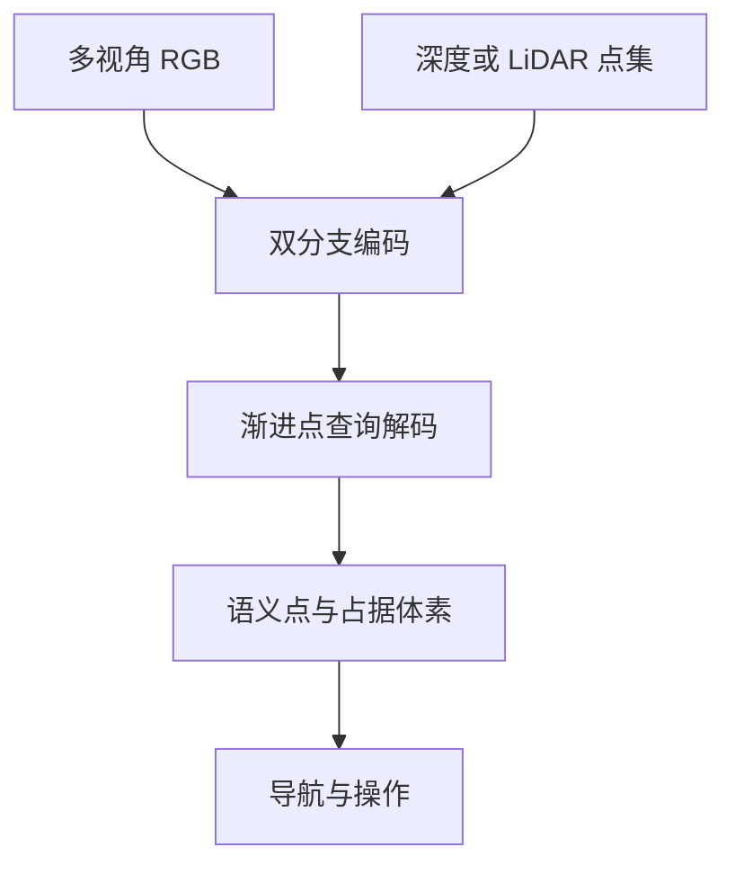
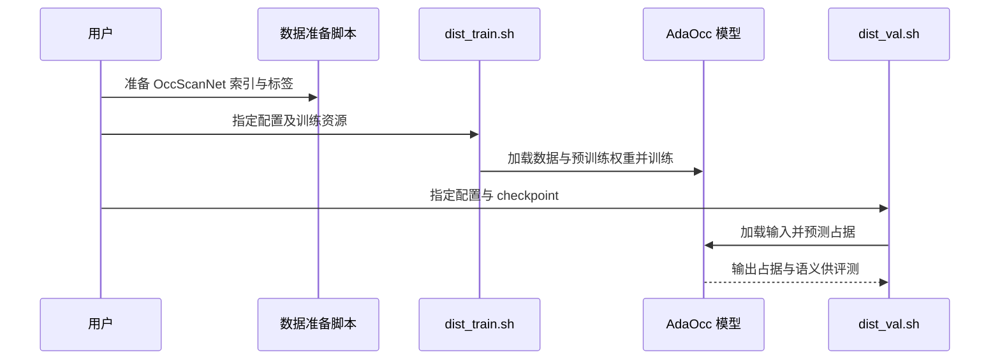

# AdaOcc：自适应具身三维占据预测

## 一句话定义

AdaOcc 把多视角 RGB 与深度或 LiDAR 几何融合为稀疏语义点，再按计算预算调整预测精度，为导航和操作提供局部三维占据表示。

## 英文缩写速查

| 缩写 | 英文全称 | 简要说明 |
|------|----------|----------|
| RGB | Red, Green, Blue | 彩色图像输入 |
| LiDAR | Light Detection and Ranging | 激光点云几何输入 |
| IoU | Intersection over Union | 占据预测的交并比 |
| mIoU | mean Intersection over Union | 各语义类别 IoU 的平均值 |

## 核心机制

1. **输入适配：** 几何引导双分支编码 RGB 和点集；估计深度、深度相机与 LiDAR 统一为几何点，支持不同视角。
2. **稀疏预测：** 从几何初始化点查询，预测带语义的占据点并体素化；避免对空区域一律进行密集计算。
3. **预算自适应：** 渐进 query 学习使同一模型可调整查询数量或采用中间解码层输出，权衡精度、延迟和显存。
4. **边界约束：** containment loss 鼓励预测点位于真实占据区域，降低浮点及边界不一致。

## 源码运行时序图

按[官方 README](https://github.com/wangjl-nb/AdaOcc) 准备数据、权重和对应深度模式；完整步骤见[源码归档](../../sources/repos/adaocc.md)。此图描述公开评测路径，非真实机器人部署时序。

## 实验与评测

| 设置 | 论文结果与口径 |
|------|----------------|
| Occ-ScanNet full | 占据 IoU **65.29**，11 类语义 mIoU **59.67**；官方评测网格 60×60×36，体素边长 0.08 m。 |
| 预算对照 | 论文所述 EfficientNet 变体 500 queries：mIoU 57.97、IoU 65.16、64.4 ms；与 full 主结果不是同一配置。 |
| 真实系统 | 展示 Go2 导航、ARX X5 操作和移动操作；演示不等于任意场景可靠性保证。 |

## 结论

**AdaOcc 的价值在于让同一占据预测框架适配传感器与推理预算，同时保持可供下游规划使用的语义几何。**

- 部署时应同时衡量 query 数、解码层数、精度与端到端延迟；预测深度的额外成本不能忽略。
- 小物体、薄结构、遮挡和反光或低纹理区域仍易出错；在目标传感器及场景下单独验证。
- 论文主要使用单帧或直接聚合设置，显式时序记忆仍待探索。
- 官方公开 OccScanNet 代码和权重；项目演示的完整真机部署流程未确认公开。

## 关联页面

- [Humanoid Occupancy](./paper-notebook-humanoid-occupancy-enabling-a-generalized-multim.md) — 侧重人形多模态与时序占据系统。
- [OccAnyScene](./paper-occanyscene.md) — 跨场景占据预测对照。

## 参考来源

- [论文归档](../../sources/papers/adaocc_arxiv_2609_38864.md)
- [项目页归档](../../sources/sites/adaocc.md)
- [官方源码归档](../../sources/repos/adaocc.md)

## 推荐继续阅读

- [AdaOcc 论文](https://arxiv.org/abs/2609.38864)及[官方项目页](https://wangjl-nb.github.io/AdaOcc_web/)。
