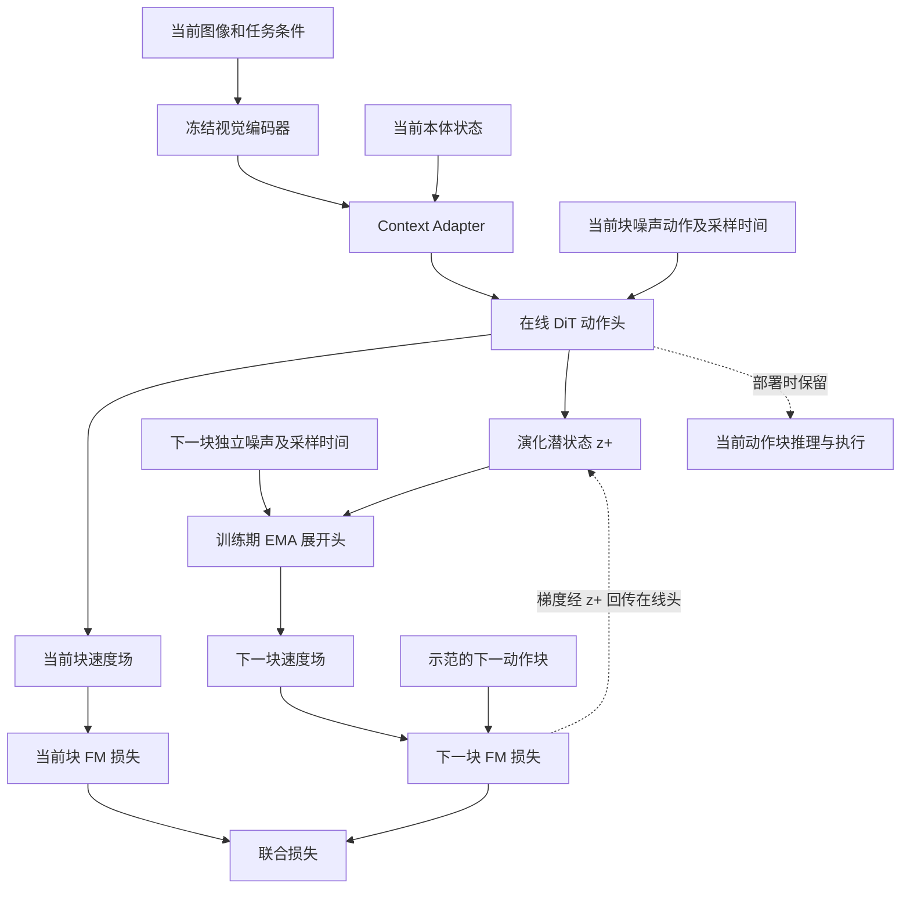
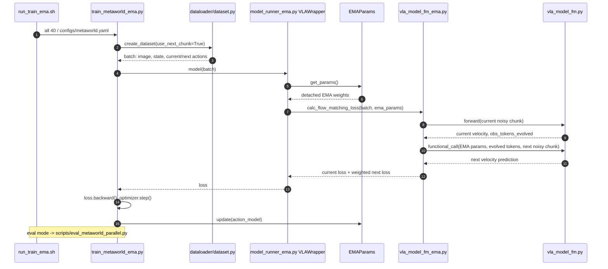

# AdaPolicy：动作驱动的前瞻机器人策略 / Action-Driven Anticipatory Robot Policies via Next-Chunk Prediction

**论文：** [arXiv:2610.34280v1](https://arxiv.org/abs/2610.34280)（2026-10-25） · **项目：** [官方主页](https://teee111.github.io/AdaPolicy/) · **代码：** [teee000/AdaPolicy](https://github.com/teee000/AdaPolicy) · **机构：** 天津大学等（按论文作者机构） · **本页复核：** 2026-11-09。

## 一句话定义

**AdaPolicy 用下一段真实示范动作来训练当前动作头的「演化潜状态」：EMA 展开头只在训练期读这个状态预测下一个 action chunk，下一段预测误差再反向推动在线策略学会预判；推理时移除该训练分支。**

## 英文缩写速查

| 缩写 | 英文全称 | 简要说明 |
|---|---|---|
| VLA | Vision-Language-Action | 视觉／语言条件的机器人动作策略 |
| DiT | Diffusion Transformer | 本文 flow-matching 动作头的 Transformer 实现 |
| FM | Flow Matching | 学习从噪声到动作的速度场 |
| EMA | Exponential Moving Average | 训练期展开头使用在线头的滑动平均参数 |
| ODE | Ordinary Differential Equation | 推理时沿预测速度场积分生成当前动作块 |
| BC | Behavior Cloning | 从示范动作直接学习策略的模仿学习 |

## 为什么重要

- 一般的未来画面预测／未来视觉特征监督需构建视觉目标与预测分支；AdaPolicy 直接使用数据里已有的**下一动作块**，让预判目标与控制行为对齐。
- 它不是「将动作块长度简单翻倍」，也不是在执行时显式模拟完整世界。关键监督落在**当前动作头输出的演化状态**，由后续动作损失回传。
- 对精细插入、接触操作有价值，但论文展示的是**任务成功率**，不是统一的「毫米级定位精度」定量认证。
- 旧索引中的「尚无公开可运行代码」已过时：2026-11-09 已核验作者仓库有 MetaWorld / RoboTwin 2.0 训练与仿真评测实现。

## 核心原理

### 模型输入、训练目标与梯度流

1. 当前视觉观测经冻结的视觉编码器（论文采用 DINOv3，也研究 Qwen3-VL-2B）处理；Context Adapter 用学习式查询压缩视觉条件，与投影后的本体状态构成在线头条件。
2. **在线 DiT 动作头**处理当前动作块的加噪采样：一支输出当前块的 FM 速度场，一支产生演化潜状态 \(z^+_t\)。
3. **训练期 EMA 展开头**将 \(z^+_t\) 与另外独立采样的下一块噪声、时间步组合，预测演示轨迹里下一动作块的 FM 速度场；展开头权重使用在线头 EMA，参数冻结，但不截断 \(z^+_t\) 梯度。
4. 损失可写为 \(L=L_{\mathrm{cur}}+\gamma L_{\mathrm{next}}\)。对于 \(x_\tau=(1-\tau)\epsilon+\tau A\)，FM 监督速度 \(v^*=A-\epsilon\)；下一块动作的真实示范是训练信号，**无需额外预测未来图片**。
5. 在线头优化后以 \(\bar\theta\leftarrow m\bar\theta+(1-m)\theta\) 更新 EMA。推理只运行在线头，沿其速度场生成当前 chunk，论文采用 10 步 ODE 积分。

### 流程总览

**注意：** 下一块监督不需要未来时刻的图像输入；这里的「展开头」指训练时的第二次动作模型前向，而非在真机循环中多运行一个模型。

## 源码运行时序图

下图按照官方公开的 **MetaWorld 训练入口**与实际函数调用绘制，不以泛化模板代替源码：

**代码定位：** [训练脚本](https://github.com/teee000/AdaPolicy/blob/main/metaworld/train_metaworld_ema.py) → [VLAWrapper.forward](https://github.com/teee000/AdaPolicy/blob/main/metaworld/models/model_runner_ema.py) → [calc_flow_matching_loss](https://github.com/teee000/AdaPolicy/blob/main/metaworld/models/vla_model_fm_ema.py)；通过 `torch.func.functional_call` 使用不计算参数梯度的 EMA 权重，**保留演化状态计算图**。RoboTwin 同源实现在 `robotwin/train_robotwin_ema.py`、`robotwin/models/model_runner_ema.py` 和 `model_fm_ema.py`。

## 工程实践

| 项目 | 论文 / 官方实现口径 |
|---|---|
| MetaWorld 入口 | 在 `metaworld/` 执行 `./run_train_ema.sh all 40`；需要 README 指定的 ModelScope HDF5 演示数据与 DINOv3 权重 |
| 仿真评测 | `./run_train_ema.sh eval <checkpoint.pt> all 50`；调用 `scripts/eval_metaworld_parallel.py` |
| 训练标志 | `training.use_next_chunk_pred: true`；MetaWorld README 给出 `lambda_next_chunk: 0.8`、`ema_decay: 0.99`、`action_chunk_size: 8` |
| RoboTwin 实现 | `robotwin/train_robotwin_ema.py`、`robotwin/robotwin_infer.py`；数据预处理依 README 的 LiLa-WAM 指引 |
| 真机协议 | 论文报告 PiPER 与双 RGB-D、30 Hz 控制、32 步动作块和异步滚动执行；此**非**已发布真机部署实现的声明 |
| 复现对照 | 相同数据与视觉骨干下，比较原始 FM、增加预测长度、未来视觉特征监督、停止下一块梯度及 AdaPolicy |

工程上要分别监控**当前块 loss、下一块 loss、rollout 成功率、显存峰值、步耗时与时延**；训练 FLOPs 不等于推理 FLOPs 或实测耗时。

## 实验与评测

以下数字为论文报告，**不是本站独立复现实测**。成功率单位为百分比，差值为百分点。

| 基准／真机任务 | 基线 | AdaPolicy | 改善 |
|---|---:|---:|---:|
| MetaWorld 50 任务平均 | 67.8 | 81.2 | +13.4 |
| RoboTwin 2.0 Clean（50 任务） | 64.4 | 84.92 | +20.52 |
| RoboTwin 2.0 Randomized（50 任务） | 64.5 | 84.04 | +19.54 |
| LIBERO 平均 | 92.1 | 95.2 | +3.1 |
| 真机耳机装配 | 74 | 86 | +12 |
| 真机鞋带穿孔（shoelacing） | 36 | 50 | +14 |
| 真机六任务平均 | 77.0 | 86.3 | +9.3 |

### 关键消融与训练代价

- **MetaWorld 机制消融：** 基线 67.8；仅未来特征预测 68.8；冻结展开头 72.0；下一段梯度截断 67.7；完整 AdaPolicy 81.2。证据支持下一块监督对在线表征的反传至关重要。
- **FLOPs 增加约 6%–11%**：512 hidden 的 611.5→648.2 GFLOPs，768 hidden 的 724.8→807.4 GFLOPs；**显存**分别从 13.7→17.1 GB、18.7→23.9 GB，不能据 FLOPs 宣称显存只增加 6%–11%。
- **推理额外分支开销为零：** 不运行 EMA 展开头；仍要运行在线 VLA、动作块生成和控制执行，所以不等于整体无耗时。
- 真机精细任务所用纠偏示范对基线与 AdaPolicy 一致；评价应保留任务、样本量和执行协议，不能将提升直接等同于“毫米级精度”。

## 结论

**AdaPolicy 的主要创新是用下一段动作损失训练可预判的在线控制表征，而非增加在线世界模型推理；在仿真与精细真机任务上取得论文报告的成功率提升。**

1. 需要未来意识但不愿引入未来图像生成器时，可先试训练期 next-chunk 监督。
2. **保留下一块损失到演化状态的反向传播**：截断梯度的消融几乎退回基础策略。
3. 不能简单认为“预测更长的动作块”就等价于 AdaPolicy；要控制相同视觉骨干、训练集与 chunk 长度。
4. 部署只留在线头，但训练仍需 EMA shadow、第二次前向及更大的显存预算。
5. 当前公开实现可从 MetaWorld / RoboTwin 切入复现；论文真机结果仍要按论文协议独立核验。

## 局限与风险

- **开源范围：部分开源。** 截至 2026-11-09，官方 `teee000/AdaPolicy` 已发布 MetaWorld 50 任务、RoboTwin 2.0 50 任务的可辨识训练和评测入口；未在此仓库核实完整 LIBERO 或真机部署脚本，不能把论文全实验视为已复现。
- 本方法通过动作而非未来图像约束预判；**不保证**演化潜状态是真实世界动力学模型，也不能自动外推至任意新环境。
- 训练成本不仅是 FLOPs：EMA 参数副本、展开前向与 batch 内下一段动作提高显存占用。
- 报告的任务成功率依赖操作任务、相机、示范分布与异步执行；不是毫米级位姿测量指标。
- 官方主页的最新资源区本次无法直接完整读取；源码开放结论以**实际核验的作者 GitHub 仓库**为依据。

## 关联页面

- [Action Chunking：动作块输出](../methods/action-chunking.md) — 动作块接口与执行地平线
- [Imitation Learning：模仿学习](../methods/imitation-learning.md) — 行为克隆与监督信号
- [VLA：视觉-语言-动作模型](../methods/vla.md) — 多模态策略总体位置
- [Diffusion Policy](../methods/diffusion-policy.md) — 生成式连续动作策略与 FM 对照
- [Receding Horizon](../concepts/receding-horizon-policy-execution.md) — 异步滚动动作执行
- [具身智能小站 10-28 资料索引](../overview/embodied-station-2026-10-28-59-papers-technology-map.md) — 原有项目入口，不重复建实体节点

## 参考来源

- [论文原文阅读归档](../../sources/papers/adapolicy_arxiv_2610_34280.md) — arXiv:2610.34280v1 全文 / 附录、方法及数值核对
- [官方项目页核对归档](../../sources/sites/adapolicy.md) — 网址与资源核查边界
- [官方源码与运行时序归档](../../sources/repos/adapolicy_teee000.md) — 入口与下一块损失源码
- [论文 PDF](https://arxiv.org/pdf/2610.34280)
- [作者 GitHub 源码](https://github.com/teee000/AdaPolicy)

## 推荐继续阅读

- [AdaPolicy：Action-Driven Anticipatory Robot Policies via Next-Chunk Prediction](https://arxiv.org/abs/2610.34280)
- [MetaWorld/RoboTwin 训练实现与 README](https://github.com/teee000/AdaPolicy)
- [RoboTwin 项目](https://github.com/RoboTwin-Platform/RoboTwin)
