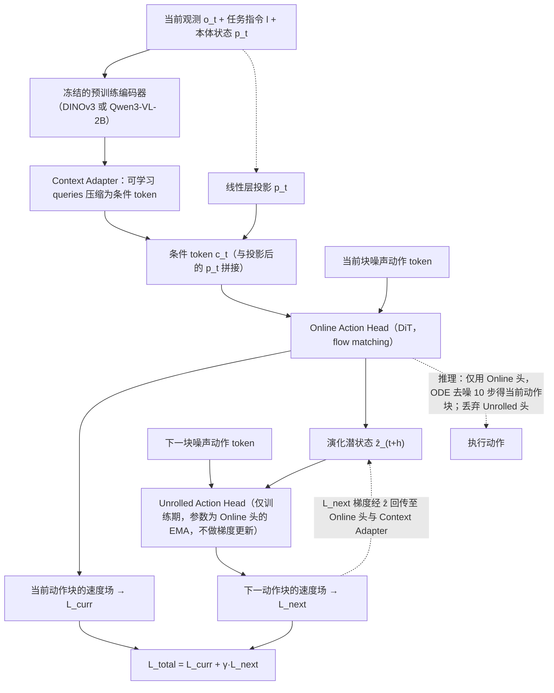

# AdaPolicy（arXiv:2610.34280）

**AdaPolicy**（*AdaPolicy: Action-Driven Anticipatory Robot Policies via Next-Chunk Prediction*，[arXiv:2610.34280](https://arxiv.org/abs/2610.34280)，[项目页](https://teee111.github.io/AdaPolicy/)）来自 [具身智能小站 2026-10-28 盘点](../../sources/blogs/wechat_embodied_station_59_papers_human_video_to_robot_experience_2026-10-28.md)，属「VLA 与策略后训练」组。

## 一句话定义

**当前动作头同时输出动作与演化状态，训练时再由展开动作头预测下一段，使动作损失塑造未来感知。**

## 英文缩写速查

| 缩写 | 英文全称 | 简要说明 |
|------|----------|----------|
| AdaPolicy | AdaPolicy: Action-Driven Anticipatory Robot Policies via Next-Chunk Prediction | 本文方法 / 基准的简称 |

## 为什么重要

- 预测下一段动作，获得隐式前瞻。无需编码未来观测，执行不增加展开分支，覆盖仿真与精细真机任务。
- 开源结论：**部分开源**（步骤 2.5，2026-10-28）。公众号未给代码链接；项目页链接 teee111/ADWM-Code，git ls-remote 失败（仓库不存在或私有），不能当作已开源。
- 同期同组工作见 [潜在动作、免渲染事件仿真与机器人评测：具身智能小站 10-28 期 59 篇阅读坐标](../overview/embodied-station-2026-10-28-59-papers-technology-map.md)。

## 流程总览

图依据：论文 §3.1–3.3 / Fig. 2。

## 核心机制

| 项 | 内容 |
|----|------|
| **arXiv** | [2610.34280](https://arxiv.org/abs/2610.34280) |
| **开源** | **部分开源** |
| **要点** | 当前动作头同时输出动作与演化状态，训练时再由展开动作头预测下一段，使动作损失塑造未来感知。 |
| **文内指标** | 公众号转述：无需编码未来观测，执行不增加展开分支，覆盖仿真与精细真机任务。 |

## 源码运行时序图

**部分开源** — 公众号未给代码链接；项目页链接 teee111/ADWM-Code，git ls-remote 失败（仓库不存在或私有），不能当作已开源。 待可运行代码公开后补图。

## 实验与评测

- 公众号转述：无需编码未来观测，执行不增加展开分支，覆盖仿真与精细真机任务。
- **读法：** 本页为索引级摘要，依据公众号转述的官方摘要与仓库信息整理；逐项数字与 baseline 以原文 PDF 为准。

## 与其他工作对比

- 横向索引见 [潜在动作、免渲染事件仿真与机器人评测：具身智能小站 10-28 期 59 篇阅读坐标](../overview/embodied-station-2026-10-28-59-papers-technology-map.md)；同 arXiv 不重复造页。

## 结论

**预测下一段动作，获得隐式前瞻：无需编码未来观测，执行不增加展开分支，覆盖仿真与精细真机任务。**

1. 开源边界：**部分开源** — 公众号未给代码链接；项目页链接 teee111/ADWM-Code，git ls-remote 失败（仓库不存在或私有），不能当作已开源。
2. 核心机制：当前动作头同时输出动作与演化状态，训练时再由展开动作头预测下一段，使动作损失塑造未来感知。
3. 复现与选型前核对任务协议、硬件与基准口径，勿直接横比公众号摘录数字。

## 关联页面

- [vla](../methods/vla.md)
- [imitation-learning](../methods/imitation-learning.md)
- [reinforcement-learning](../methods/reinforcement-learning.md)
- [diffusion-policy](../methods/diffusion-policy.md)
- [embodied-station-2026-10-28-59-papers-technology-map](../overview/embodied-station-2026-10-28-59-papers-technology-map.md)

## 参考来源

- [adapolicy_arxiv_2610_34280.md](../../sources/papers/adapolicy_arxiv_2610_34280.md)
- [wechat_embodied_station_59_papers_human_video_to_robot_experience_2026-10-28.md](../../sources/blogs/wechat_embodied_station_59_papers_human_video_to_robot_experience_2026-10-28.md)
- [arXiv:2610.34280](https://arxiv.org/abs/2610.34280)
- [arXiv PDF](https://arxiv.org/pdf/2610.34280)：已通读方法部分（实验与附录以略读为准）：§3.1–3.3、§4.1 实现细节

## 推荐继续阅读

- [arXiv PDF](https://arxiv.org/pdf/2610.34280)
- [项目页](https://teee111.github.io/AdaPolicy/)
