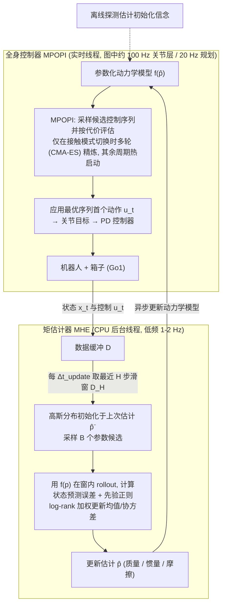

# Adaptive-MHE（arXiv:2609.17832）

**Adaptive-MHE**（*Adaptive-MHE: A Sampling-Based Adaptive MPC for Legged Loco-Manipulation via Moving Horizon Estimation*，[arXiv:2609.17832](https://arxiv.org/abs/2609.17832)）来自 [senlanke 具身运控lab 周更盘点](../../sources/blogs/wechat_senlanke_weekly_humanoid_quadruped_2026-09-14_18.md)（2026-09-14–18）。

## 一句话定义

**滑动窗并行采样物理参数，以预测–实测误差在线辨识，再反馈给采样式 MPC；无需可微仿真或力传感。**

## 英文缩写速查

| 缩写 | 英文全称 | 简要说明 |
|------|----------|----------|
| MHE | Moving Horizon Estimation | 移动时域估计 |
| MPC | Model Predictive Control | 模型预测控制 |
| SysID | System Identification | 系统辨识 |

## 为什么重要

- loco-manip 参数漂移常见；MHE 与 MPC 闭环可自适应而不重训策略。

## 流程总览

图依据：论文 §IV-A–C（式 2–6、Algorithm 1）/ Fig. 2；图中频率标注取自 Fig. 2

## 核心机制

| 项 | 内容 |
|----|------|
| **arXiv** | [2609.17832](https://arxiv.org/abs/2609.17832) |
| **开源** | **待发布**（步骤 2.5，2026-09-20） |
| **方法摘要** | Parallel parameter sampling + trajectory error identification → adaptive sampling MPC. |

## 源码运行时序图

**不适用**（截至 2026-09-20 未发布可运行官方代码或待核实）。

## 实验与评测

- Legged loco-manipulation adaptive control（以 PDF 为准）。
- 读法：先对齐任务设定、传感器与成功定义，再解读 headline 数字。

## 与其他工作对比

| 维度 | 读法 |
|------|------|
| **同周对照** | 见对应 [周更盘点](../../sources/blogs/wechat_senlanke_weekly_humanoid_quadruped_2026-09-14_18.md) 映射表，勿跨任务直接比 SR |
| **开源状态** | **待发布** — 部署前以项目页/arXiv 为准 |

## 结论

**Adaptive-MHE 把在线辨识嵌入 MPC，适合参数不确定的腿式操作。**

1. 开源：**待发布**；勿凭公众号摘要臆断可复现性。
2. 指标须连同实验条件解读（仿真/真机、平台、成功阈值）。
3. 关注 arXiv 版本更新与代码发布。

## 关联页面

- [model-predictive-control](../methods/model-predictive-control.md)
- [loco-manipulation](../tasks/loco-manipulation.md)
- [reinforcement-learning](../methods/reinforcement-learning.md)

## 参考来源

- [adaptive-mhe_arxiv_2609_17832.md](../../sources/papers/adaptive-mhe_arxiv_2609_17832.md)
- [wechat_senlanke_weekly_humanoid_quadruped_2026-09-14_18.md](../../sources/blogs/wechat_senlanke_weekly_humanoid_quadruped_2026-09-14_18.md)
- [arXiv:2609.17832](https://arxiv.org/abs/2609.17832)
- [arXiv PDF](https://arxiv.org/pdf/2609.17832)：已通读方法部分（实验与附录以略读为准）：§IV 提出的运动框架（A 移动时域估计器、B 全身控制器 MPOPI、C Adaptive-MHE 公式与 Algorithm 1）、§V 评估设定开头

## 推荐继续阅读

- [arXiv PDF](https://arxiv.org/pdf/2609.17832)
