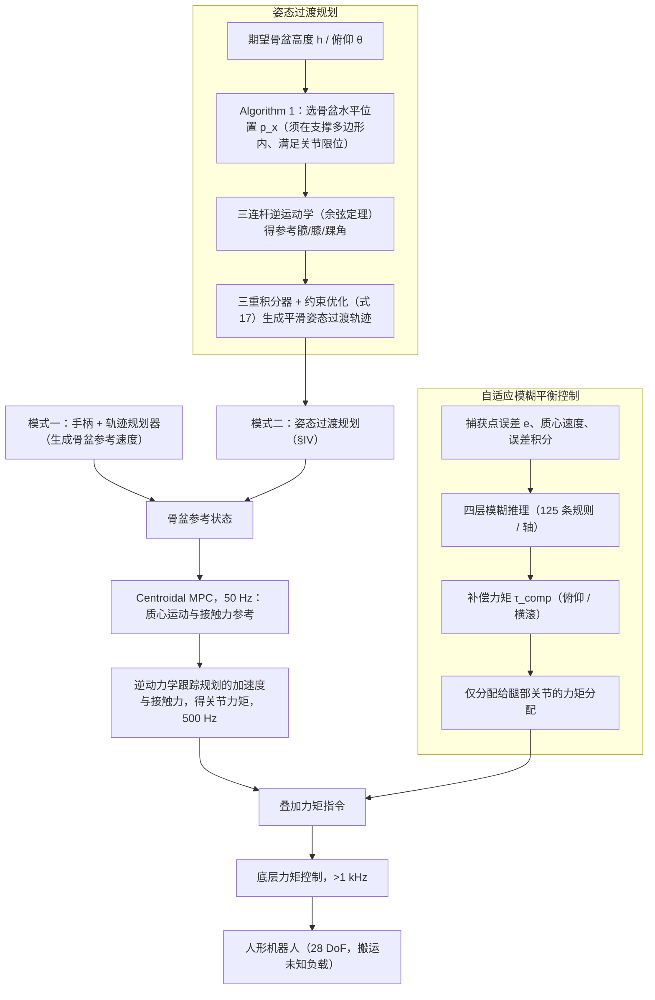

# 未知载荷下的自适应全身 MPC（arXiv:2610.12972）

## 一句话定义

结合质心模型预测控制、支撑腿自适应模糊力矩补偿和最优起坐姿态规划，处理未知载荷下的人形搬运平衡。

## 英文缩写速查

| 缩写 | 英文全称 | 简要说明 |
|------|----------|----------|
| MPC | Model Predictive Control | 滚动预测生成动力学可行的质心运动与接触力参考（50 Hz） |
| CoM | Center of Mass | 误差 $e$ 与姿态规划稳定约束所基于的质心投影 |
| WBC | Whole-Body Control | 逆动力学层，把规划加速度与接触力映射为关节力矩（500 Hz） |
| CP | Capture Point | 模糊补偿的误差来源：$\xi = r_{com} + \dot r_{com}/\omega$ |
| LIP | Linear Inverted Pendulum | 定义捕获点时采用的线性倒立摆近似 |
| IK | Inverse Kinematics | 三连杆解析逆运动学，由骨盆高度与俯仰求髋、膝、踝参考角 |
| DoF | Degrees of Freedom | 论文平台的自由度（原文写 28 DoF，计数未核实，见局限） |

## 为什么重要

抓取物体改变系统动力学；未知载荷带来的模型失配可能削弱姿态转换及搬运时的平衡和跟踪性能。论文 Table I 把"自适应平衡"与"姿态规划"两项能力并列对比，指出既有 MPC 框架大多只覆盖其中一项，而"带物理约束的 MPC + 自适应补偿 + 姿态规划"的组合正是本文的切入点。

## 流程总览

图依据：论文 Fig. 2、§III–V（控制频率见 §V 开头，姿态规划见 §IV）。

## 核心原理

**输入**：姿态模式下为期望骨盆高度 $h$ 与俯仰 $\theta$；行走模式下为手柄指令经轨迹规划器生成的骨盆参考速度。反馈侧为质心状态、接触状态与关节状态。

**关键机制**：

1. **质心动力学与接触**：论文以质心动量 $h$ 的牛顿-欧拉方程描述接触力作用，$\dot h=\left[\sum_i F_i + mg;\ \sum_i r_i\times F_i + M_i\right]$。
2. **捕获点误差**：水平面上以 LIP 近似定义 $\xi = r_{com} + \dot r_{com}/\omega$，支撑中心 $c_{supp}$ 取支撑脚接触点的加权质心，误差为
$$e=\xi-c_{supp}$$
3. **模糊补偿**：每个轴（俯仰对应前后向误差 $e_x$，横滚对应侧向 $e_y$）以误差 $e$、质心速度 $\dot r$ 与积分 $e_{int}$ 为输入，5 个高斯隶属函数（NB/NS/Z/PS/PB），每轴 $5\times5\times5=125$ 条规则，输出经加权平均并饱和：
$$\tau=S\cdot\frac{\sum_{i,j,k} w_{ijk}\,y_{ijk}}{\sum_{i,j,k} w_{ijk}},\qquad |\tau|\le\tau_{max}$$
4. **力矩分配**：补偿力矩只分配给支撑腿，手持载荷的上肢不做修正，以最小化 $\tau_{leg}^\top\tau_{leg}$ 为目标、满足 $\Omega(\tau_{leg})=\tau^{comp}_{task}$（$\Omega$ 为支撑腿关节力矩到骨盆任务空间力矩的映射）。
5. **姿态过渡**：以三重积分器离散模型 $\eta_{k+1}=\Phi\eta_k+\Gamma_1\omega_k+\Gamma_2\omega_{k+1}$ 描述三连杆（髋、膝、踝）的位置、速度、加速度，$\omega$ 为 jerk 输入；代价为对 IK 参考的跟踪误差加 jerk 正则，约束包括关节限位、速度/加速度/jerk 界以及质心投影在支撑多边形内（式 17）。

**输出**：骨盆参考状态经 centroidal MPC（50 Hz）得到质心运动与接触力参考；WBC 用逆动力学（式 5）把规划加速度与接触力变为关节力矩（500 Hz）；模糊补偿力矩叠加到腿部指令上，由底层力矩控制（>1 kHz）执行。论文选择逆动力学而非 TS-QP，理由是可行性与接触约束已在 centroidal MPC 层处理，下层只需跟踪规划量。

## 核心机制

| 组件 | 论文中的作用 |
|------|------------------|
| 质心 MPC | 在约束下生成动力学可行的参考运动与接触力（原文为非线性 MPC，摩擦锥、压力中心、摆动脚约束等沿用 [11]） |
| 自适应模糊平衡控制 | 由捕获点误差等可测信号生成修正力矩，分配至支撑腿关节，不估计载荷质量 |
| 最优姿态规划 | 基于航点与三重积分器，生成满足 CoM 稳定、关节限制与全身可行性约束的起坐轨迹 |

框架面向下降、抓取、提起、搬运和放置。模糊补偿与 MPC 的关系是"残差补偿"：MPC 保留对名义运动的约束最优性，模糊项只提供无模型的修正量。

## 工程实践

- **控制频率与平台**：centroidal MPC 50 Hz，WBC / 自适应补偿 500 Hz，底层力矩控制 >1 kHz；平台为论文所称 28 DoF 人形，仿真使用 MuJoCo，实机试验载荷为 7 kg 与 10 kg。
- **姿态可行性搜索**：Algorithm 1 在支撑多边形内沿 $p_x$ 逐步搜索，直到 IK 结果满足关节限位；若搜索不到则返回无可行解，应在上层处理。
- **补偿器调参**：隶属函数中心 $c_\ell$、宽度 $\sigma_\ell$、输出尺度 $S$、饱和值 $\tau_{max}$ 由专家经验设定，所有实验使用同一组参数；作者称行走实验未重新调参。
- **复现时应记录**：CoM 投影是否始终在支撑多边形内、补偿力矩是否频繁饱和、不同载荷下的关节力矩与骨盆高度/俯仰振荡，以及与非自适应基线的对比条件。

## 源码运行时序图

**不适用**：截至 2026-11-06 核查，论文 PDF 与 arXiv 摘要页均未列出官方代码、数据或项目页，无法依据官方运行入口绘制时序图。

## 实验与评测

- **仿真（MuJoCo）**：图 6 对比标准 centroidal MPC（无姿态规划、无自适应补偿）与本文方法，载荷为附加质量。前者随质量增加前倾并失稳，后者通过降低姿态维持平衡。图 5 展示四组初末骨盆/CoM 条件下的姿态过渡，文中定性地称 CoM 投影始终位于支撑多边形内。
- **实机静态提举**：分别搬运 7 kg 与 10 kg（图 7、图 8）。文中描述 7 kg 任务包括下蹲、抓取、提起、站起、放置；10 kg 任务中自适应控制器增加控制量，骨盆高度与俯仰出现小幅振荡后恢复。
- **实机提举加行走**：搬运 7 kg 物体，流程为从稳定 home 位姿出发、低头抓取（约 83 s）、提起后回到 home 姿态（约 110 s）、带载行走 15 s（约 140–155 s）、放置物体并回到 home 位（图 1、图 9）。文中称模糊参数未为行走重新调参即可正常行走。
- **量化结果**：摘要称相对非自适应基线平衡鲁棒性提高、姿态转换与提举中的跟踪退化减小。正文以定性描述和曲线为主，抽取的文本中未找到汇总数值表；图中具体数值未逐一核对，具体改善幅度、试验次数与误差指标未核实。

## 结论

**该方法让预测规划负责可行的名义运动，让模糊层负责载荷残差补偿，二者分工而非替代。**

1. 解读结果时先对齐载荷（7 kg / 10 kg）、任务阶段（提举、行走、放置）与非自适应基线的具体设定。
2. 姿态可行性（CoM 在支撑多边形内、关节限位）与模型失配补偿分别处理不同问题，不能把二者等同。
3. 补偿不需要估计载荷质量，但规则库与参数为手工经验设计，作者也承认尚未与 PID 做定量对比。
4. 验证仅覆盖论文平台、两档载荷与 MuJoCo 仿真，向其他机器人或其他载荷外推需要重新验证。
5. 正文缺少汇总数值表，复现前需从图中或代码（若后续发布）核对跟踪误差与平衡指标。

## 与其他工作对比

论文 Table I 对 7 个 MPC 框架做了能力勾选：在"自适应平衡"一列中，本文与 NMPC + Gait Adaptation [14]、Kino-dynamic MPC + Gait-Net [15] 同为打勾；在"姿态规划"一列中，只有 Three Particle-MPC + WBC [16] 与本文打勾。只有本文同时满足两项，这是论文的主要定位。该表为作者自评的定性勾选，未给出同条件的定量对比。

与一般的 [MPC 与 WBC 集成](../concepts/mpc-wbc-integration.md) 相比，本文的特点是把未知载荷下的模糊补偿与起坐姿态规划放进同一框架；与 [模糊逻辑控制](../methods/fuzzy-logic-control.md) 的一般用法相比，它把模糊项限定为 MPC 的残差补偿。论文也明确拒绝了 DOB、模型参考自适应与鲁棒控制等经典方案，理由是载荷引起的失配是状态相关的耦合非线性，而不是有界加性扰动。

## 局限与风险

- **证据范围**：本页依据 arXiv PDF 正文（8 页，无附录）的全文文本通读；图中数值与曲线未逐一目视核对，实验结果以定性描述为主。
- **作者自述的局限**：规则库为手工设计，参数靠专家经验调节；未与 PID 做定量比较；作者计划以学习方法优化补偿策略并引入主动扰动观测器，列为未来工作。
- **安全边界**：饱和输出提供了有界补偿，但 $\tau_{max}$ 等上限由经验设定，并非由稳定性证明给出。
- **自由度计数**：论文称平台为 28 DoF，但文中给出的分配（每臂 7、每腿 6）合计 26，差异未核实。
- **代码与数据**：截至 2026-11-06，PDF 与 arXiv 摘要页均未列出官方代码、数据或项目页。作者未声明开源，因此只能依据论文描述复现，无法确认"未开源"是作者的明确决定。
- **适用边界**：依赖 CoM 与支撑多边形的可靠估计，以及仿真与实机之间的一致性；手持载荷的位置与惯量未在摘要中给出，不应假设其他载荷分布下结论成立。

## 关联页面

- [MPC 与 WBC 集成](../concepts/mpc-wbc-integration.md)
- [质心动力学](../concepts/centroidal-dynamics.md)
- [捕获点与 DCM](../concepts/capture-point-dcm.md)
- [全身控制](../concepts/whole-body-control.md)
- [模糊逻辑控制](../methods/fuzzy-logic-control.md)
- [MuJoCo](../entities/mujoco.md)

## 参考来源

- [论文来源归档](../../sources/papers/adaptive_whole_body_mpc_2610_12972.md)
- [arXiv PDF](https://arxiv.org/pdf/2610.12972)：2026-11-06 通读全文文本（8 页，pdftotext 抽取；含方法、实验、结论与参考文献；无附录；图表未逐一目视核对）
- [arXiv 摘要页](https://arxiv.org/abs/2610.12972)：核对 Code, Data and Media 区，未列出代码或数据链接

## 推荐继续阅读

- [arXiv 论文](https://arxiv.org/abs/2610.12972)
