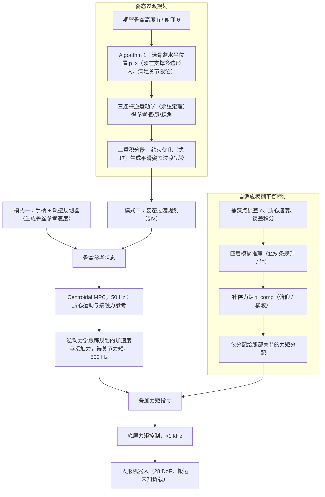

# 未知载荷下的自适应全身 MPC（arXiv:2610.12972）

## 一句话定义

结合质心模型预测控制、支撑腿自适应模糊力矩补偿和最优起坐姿态规划，处理未知载荷下的人形搬运平衡。

## 英文缩写速查

| 缩写 | 英文全称 | 简要说明 |
|------|----------|----------|
| MPC | Model Predictive Control | 滚动预测生成动力学可行参考 |
| CoM | Center of Mass | 姿态规划中受稳定约束的质心 |
| WBC | Whole-Body Control | 协调全身动作与平衡的控制 |

## 为什么重要

抓取物体改变系统动力学；未知载荷带来的模型失配可能削弱姿态转换及搬运时的平衡和跟踪性能。

## 流程总览

图依据：论文 Fig. 2、§III–IV、§V 开头（控制频率）。

## 核心机制

| 组件 | 摘要中说明的作用 |
|------|------------------|
| 质心 MPC | 生成动力学可行的参考运动 |
| 自适应模糊平衡控制 | 针对载荷造成的模型失配生成修正力矩，分配至支撑腿关节 |
| 最优姿态规划 | 基于航点与三重积分器，生成满足 CoM 稳定、关节限制与全身可行性约束的起坐轨迹 |

框架面向下降、抓取、提起、搬运和放置。摘要没有给出模块间具体接口或更新频率，不据此推断实现细节。

## 工程实践

研究时可分别核对姿态规划约束、质心参考与支撑腿补偿力矩的接口，以及载荷变化下的跟踪误差与平衡表现；实际控制频率、传感器与参数需查论文全文。

## 源码运行时序图

**不适用**：本次仅能获取摘要，未核实官方可运行代码，无法准确绘制。

## 实验与评测

摘要报告仿真和硬件实验中，相比非自适应基线平衡鲁棒性提高，姿态转换与提举时的跟踪退化减小。具体平台、载荷、指标、次数和改善幅度待查全文。

## 结论

**该方法将预测规划与载荷失配补偿结合，面向搬运中的平衡问题。**

1. 解读结果时先对齐载荷条件、任务阶段和非自适应基线。
2. 姿态可行性与模型失配补偿分别处理不同问题，不能把二者等同。
3. 摘要未提供定量数据，工程复现前需查全文及官方实现。

## 与其他工作对比

与一般的 [MPC 与 WBC 集成](../concepts/mpc-wbc-integration.md) 相比，本论文摘要特别强调未知载荷下的自适应补偿和起坐姿态规划；具体架构差异需查全文。

## 局限与风险

本页仅依据可访问摘要编写；实验细节、控制律与代码开放状态尚未核实，不应将摘要中的结果直接外推到其他机器人或载荷。

## 关联页面

- [MPC 与 WBC 集成](../concepts/mpc-wbc-integration.md)
- [质心动力学](../concepts/centroidal-dynamics.md)

## 参考来源

- [论文来源归档](../../sources/papers/adaptive_whole_body_mpc_2610_12972.md)
- [arXiv PDF](https://arxiv.org/pdf/2610.12972)：已通读方法部分（实验与附录以略读为准）：§III、§IV、§V 开头

## 推荐继续阅读

- [arXiv 论文](https://arxiv.org/abs/2610.12972)
