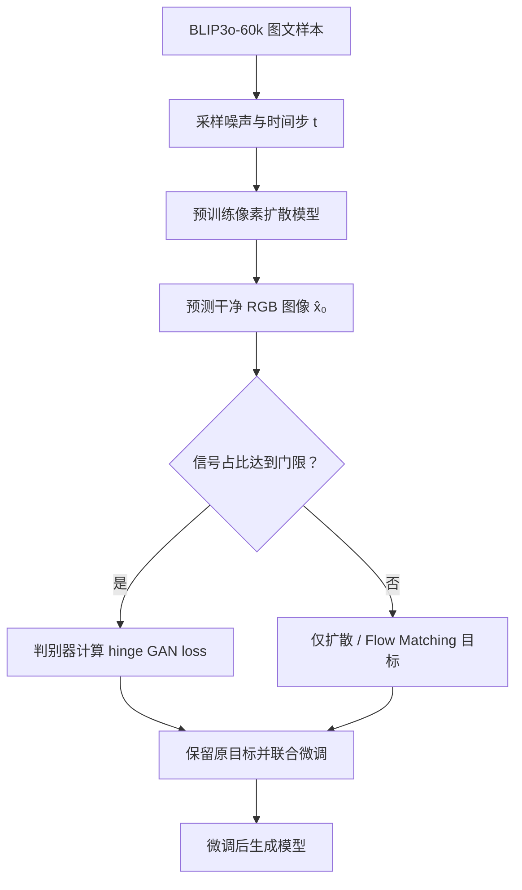

# 像素扩散的对抗训练（Adversarial Training for Pixel Diffusion）

**Adversarial Training for Pixel Diffusion**（Xin Lin、Zhifei Zhang、Yuqian Zhou、Haitian Zheng、Zhe Lin、Ming-Hsuan Yang、Truong Nguyen；[arXiv:2609.38170](https://arxiv.org/abs/2609.38170)）研究如何给已收敛的文生图像素扩散模型做**对抗式后训练**：保留原扩散或 Flow Matching 目标，只在结构较可靠的去噪阶段对模型预测的干净 RGB 图像施加判别器监督。

## 一句话定义

在像素扩散模型的预测 RGB 上加带噪声时间门控的 GAN loss，以较小改动修补高频细节，同时观察分布保真度、覆盖度和文本对齐是否能一起保持。

## 英文缩写速查

| 缩写 | 英文全称 | 简要说明 |
|------|----------|----------|
| GAN | Generative Adversarial Network | 生成器与判别器对抗训练；本文作为后训练的附加损失 |
| RGB | Red Green Blue | 像素模型的原生输出空间 |
| FID | Fréchet Inception Distance | 衡量生成图像与真实图像的特征分布距离，越低越好 |
| CMMD | CLIP Maximum Mean Discrepancy | 以 CLIP 特征衡量分布差异，越低越好 |
| DPG | Dense Prompt Graph | DPG-Bench 的提示词对齐评分，越高越好 |
| HF | High Frequency | 图像空间频率中的高频部分，对应细纹理与边缘细节 |
| SFT | Supervised Fine-Tuning | 本文用于控制额外训练步数的无 GAN 微调对照 |

## 为什么重要

像素扩散直接生成最终 RGB，绕开 VAE 编码/解码瓶颈；但模型仍可能系统性地低估自然图像中的细尺度统计。此工作把 GAN 从「替代扩散训练」或「少步蒸馏」改作**质量后校正项**，测试其能否加回纹理而不牺牲语义、覆盖度与分布质量。它也提供像素扩散与 latent diffusion 的匹配对照，帮助定位判别器监督在哪个输出路径上更容易发挥作用。

作者单位为加州大学圣地亚哥分校（UC San Diego）、奥多比研究院（Adobe Research）和加州大学默塞德分校（UC Merced）；第一作者主页说明该工作完成于其 Adobe Research 实习期间。

## 方法栈与流程总览

实验从收敛的公开 checkpoint 出发，在原有扩散 / Flow Matching 目标之上增加 hinge GAN loss。判别器对真实目标图与模型预测的干净图进行区分；生成器最小化 `-D(预测图)`。高噪声时模型的干净图估计尚不可信，因此只在信号占比达到阈值的时间步开启对抗损失。

### 关键实现选择

- **对抗对象：** 对 DeCo 与 PixelGen，判别器直接看预测 RGB；原有生成目标保持不变。DeCo 主结果使用带文本条件的 DINOv2 特征判别器。
- **时间门控：** 以信号比例阈值跳过高噪声阶段。补充分析指出结构约在采样进程约 `t=0.35–0.55` 稳定，而细节仍未完成；阈值控制语义结构受扰与细节收益之间的折中。
- **公平对照：** GAN 与 no-GAN SFT 使用同一初始 checkpoint、数据、训练时长、提示词和评测设置。
- **复现设置：** DeCo 为约 1.1B 参数、512² RGB Flow Matching 模型，主配置从收敛 checkpoint 微调 30k 步；数据为 BLIP3o-60k。主表使用 `t≥0.53` 的 DINOv2-text 判别器配置，常规 GAN 权重为 0.1。推理架构、采样步骤与采样过程均不变。

## 实验与评测

| Backbone / 指标 | no-GAN SFT | +GAN | 变化 |
|---|---:|---:|---:|
| DeCo · DPG Score ↑ | 81.6 | 83.3 | +1.7 |
| DeCo · FID ↓ | 33.27 | 28.59 | −4.68 |
| DeCo · CMMD ↓ | 0.836 | 0.736 | −0.100 |
| DeCo · Recall ↑ | 0.361 | 0.406 | +0.045 |
| DeCo · TOPIQ ↑ | 0.711 | 0.768 | +0.057 |
| PixelGen · DPG Score ↑ | 78.4 | 80.8 | +2.4 |
| PixelGen · Recall ↑ | 0.319 | 0.403 | +0.084 |
| PixelGen · FID ↓ | 33.94 | 33.20 | −0.74 |

主文报告两种像素骨干的多个图像质量与文本对齐指标均有提升。DeCo 的频谱幂律斜率从 `2.59` 变为 `2.24`，更接近真实 COCO 图像约 `2.19`；高频带功率占比从 `2.1%` 增至 `3.9%`。PixelGen 高频带占比从 `3.9%` 增至 `6.4%`。DINOv2 最近邻相似度平均值不变、最大值略降，recall 上升；作者据此及匹配步数对照认为增益不是记忆训练图或模式坍塌的简单结果。

## 与其他工作对比

| 路线 | 监督位置 / 目标 | 本文对照结论 |
|---|---|---|
| 像素扩散 + GAN 后训练 | 预测干净 RGB；保留原生成目标 | DeCo / PixelGen 的多指标联合收益及高频恢复 |
| 感知损失后训练 | 感知特征损失加细节 | 同样提升高频，但匹配对照中分布保真度与提示对齐变差 |
| latent diffusion + GAN | 预测 latent 或经冻结 VAE 解码后判别 | 测试的 PixArt-α / SANA 配置没有出现相近的联合收益；解码高频变化很小 |
| 普通无 GAN SFT | 相同训练数据与步数，不用判别器 | 控制额外优化步数，GAN 仍有额外改善 |

这组结果与「输出空间直接可达性」假设一致：像素模型的生成器预测、判别器输入和最终图像均处于 RGB；latent 模型的梯度要经冻结解码器才能影响像素细节。论文只测试特定 backbone、判别器与超参组合，不能据此推断所有 latent 生成模型都无法从 GAN 后训练受益。

## 工程实践

- 若用于现有像素扩散模型，先做同 checkpoint、同数据和同步数的 no-GAN SFT 控制组，再比较 GAN 组，避免把训练预算本身造成的收益归给对抗监督。
- 同时看分布指标（FID / CMMD）、覆盖度（recall）、文本对齐（DPG）与无参考画质指标；单看锐度或高频功率容易把伪影当进步。
- 扫描门控阈值和 GAN 权重。论文明确报告不同阈值偏向不同指标，没有一个设置统治整套指标；过早施加会扰乱尚未形成的布局，门限过严则可用的细节修正阶段太少。
- **开源状态：** 截至 2026-10-11，arXiv 论文及第一作者主页 publication entry 提供论文链接，但未列出这项工作的专属项目页或代码链接。论文所用 DeCo / PixelGen 预训练 checkpoint 可公开获取，不等于本论文的微调实现已发布；复现尚需自行实现判别器、时间门控与训练配方。
- **源码运行时序图：** 不适用；截至入库日未找到可核验的本论文官方可运行代码入口。

## 结论

这篇工作表明，对抗损失可作为像素扩散的后训练细节校正项；证据支持其改善两种像素骨干的多类指标，但收益依赖输出空间、噪声门控和判别器配置。

1. **后训练保留原采样栈：** 它不替代扩散目标，不减采样步数，也不修改模型架构。
2. **有效收益是联合指标：** DeCo 的 FID、Recall、DPG 与无参考画质均改善；不能只凭「更锐」判断成功。
3. **高频频谱是机制证据：** 频谱斜率和高频功率向自然图像统计移动，匹配锐化对照未复现完整指标收益。
4. **门控是必要的调参维度：** GAN 介入太早可能将细节压到未稳定结构上；门限与损失权重需按目标指标选取。
5. **像素与 latent 不宜直接外推：** 测试 latent 配置缺少类似联合收益，冻结 VAE 的解码路径可能削弱对高频输出的控制。
6. **复现边界清楚：** 目前可依据论文配方自行实现；未发现论文官方训练代码，不能把基座模型仓库当作本方法仓库。

## 局限与风险

- 论文是 2026 年 arXiv 预印本；表中改善来自特定公开 checkpoint、BLIP3o-60k 数据、判别器和训练配方，尚需更多模型与数据分布验证。
- 各门限/权重的质量权衡不同，论文不提供对所有评测指标都最优的单一配置。
- latent 对照只覆盖 PixArt-α 和 SANA 的若干配置；结果支持输出可达性解释，但不足以排除架构、判别器或优化设置造成的其他差异。
- 当前未发现本论文专属开源实现，无法直接验证其训练成本、移植工作量与代码级稳定性。

## 关联页面

- [Diffusion Model（扩散模型）](../concepts/diffusion-model.md) — 像素/latent 生成路径背景
- [Generative Adversarial Network（GAN）](../concepts/generative-adversarial-network.md) — 判别器与 hinge 对抗目标
- [Autoencoder / VAE](../concepts/autoencoder.md) — latent 路线的冻结解码器边界
- [PixelUmm](./paper-pixelumm.md) — 另一项直接在图像像素空间建模的工作

## 参考来源

- [Adversarial Training for Pixel Diffusion, arXiv:2609.38170](../../sources/papers/adversarial_training_pixel_diffusion_arxiv_2609_38170.md)

## 推荐继续阅读

- [arXiv HTML 全文与附录](https://arxiv.org/html/2609.38170v1) — 训练细节、消融及评测定义
- [DeCo: Frequency-Decoupled Pixel Diffusion for End-to-End Image Generation](https://arxiv.org/abs/2511.19365) — 论文采用的像素扩散基座之一
- [PixelGen: Improving Pixel Diffusion with Perceptual Supervision](https://arxiv.org/abs/2602.02493) — 另一项基座及感知损失对照
