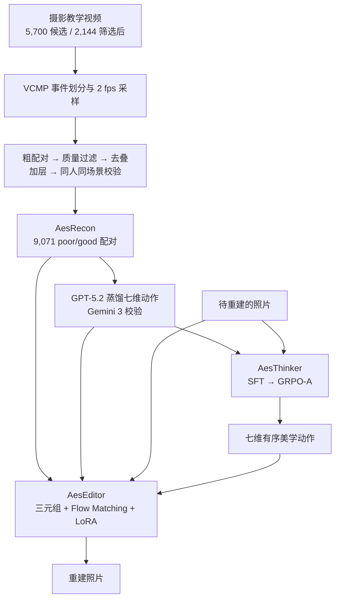
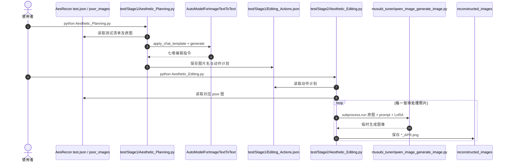

# AesFormer：将日常照片重建为美好回忆 / Transform Everyday Photos into Beautiful Memories

**AesFormer**（Du, He & Peng，北京大学王选计算机研究所；**ICML 2026**，[arXiv:2605.22126](https://arxiv.org/abs/2605.22126)）提出 *Aesthetic Photo Reconstruction*（APR，美学照片重建）：不只修光线或肤色，而是纠正拍摄时的构图、机位、主体位置与姿态等**结构性**缺陷，同时保留身份与场景语义。

## 一句话定义

**将“照片哪里不美、应当怎样改”的美学决策与“如何真正编辑像素”分离：AesThinker 生成七维有序动作计划，AesEditor 根据计划重建更好看的照片。**

## 英文缩写速查

| 缩写 | 英文全称 | 简要说明 |
|---|---|---|
| APR | Aesthetic Photo Reconstruction | 以结构重建改进照片美学的新任务 |
| VCMP | Video-based Corpus-Mining Pipeline | 从摄影教学视频挖掘同一场景的差/好配对 |
| SFT | Supervised Fine-Tuning | 用蒸馏出的动作序列冷启动 AesThinker |
| GRPO-A | Group Relative Policy Optimization for Aesthetics | 在组内优化格式、意图对齐和创造性回报 |
| VLM | Vision-Language Model | 用于数据筛选、动作规划与场景一致性检查 |
| LoRA | Low-Rank Adaptation | 两阶段中使用的参数高效微调技术 |
| VAE | Variational Autoencoder | 将目标图片编码到编辑器潜空间 |

## 为什么重要

- **从外观修饰到结构纠错：** 色彩/磨皮无法补救人物站位、视角或僵硬姿势；APR 直接研究这类拍摄结构问题。
- **规划与执行解耦但需针对任务协同训练：** 论文表明把现成 VLM 当规划器接到现成编辑器上，效果未必提升；规划指令须能被专门训练的编辑器落实。
- **与机器人的方法联系仅在抽象层：** 可以类比“高层规划 → 条件动作执行”和组内相对奖励训练，**不是** VLA 机器人控制、真实摄影机运动控制或机械臂动作生成论文。

## 核心信息

| 项目 | 内容 |
|---|---|
| 论文 | [AesFormer: Transform Everyday Photos into Beautiful Memories](https://arxiv.org/abs/2605.22126)（arXiv v1, 2026-05-21；ICML 2026） |
| 作者 / 机构 | Tianxiang Du、Hulingxiao He、Yuxin Peng；**北京大学王选计算机研究所** |
| 输入 / 输出 | 单张原始照片 → 七维美学编辑动作 → 改善结构美学的重建照片 |
| 数据 | **AesRecon：9,071** 对严格匹配的 poor/good 照片；其中 **903** 对用于测试 |
| 模型 | AesThinker：Qwen3-VL-8B；AesEditor：Qwen-Image-Edit-2511 |
| 开源 | [官方训练/推理/评测代码](https://github.com/PKU-ICST-MIPL/AesFormer_ICML2026) 已发布；数据集需签协议申请 |

## 核心原理

### 1. 数据构建：VCMP 与 AesRecon

先检索 **5,700** 个摄影教程候选视频，经筛选保留 **2,144** 个；分割连贯拍摄事件，以 **2 fps** 采样，对事件初期的较差图与后期的优秀照片作粗配对。随后依次处理画质/审美分数、转场伪影、教程字幕与拍摄 UI，并以 VLM 检查**同人、同场景、同事件且无新增场景元素**。最终形成 **9,071** 对样本（论文 §3）。

### 2. AesThinker：先决定怎么改

监督动作来自 poor/good 配对与可用的音频转写提示：GPT-5.2 生成编辑计划，Gemini 3 校验七维完整性与一致性，形成训练标签。Qwen3-VL-8B 经 SFT 冷启动，再以 GRPO-A 在线采样多条计划，用组内相对优势优化。

七维固定顺序（全局 → 局部）：

1. 画幅比例（aspect ratio）
2. 构图与取景（framing/composition）
3. 相机视角（viewpoint）
4. 主体位置（subject placement）
5. 主体姿态与动作细节（pose/action）
6. 对焦与景深（focus/depth-of-field）
7. 色彩与光线（color/light）

GRPO-A 组合格式回报、与参考动作意图对齐回报及创造性回报；论文实验权重为 **0.1 / 0.5 / 0.4**。创造性必须在已有主体和场景元素内发挥，凭空增加物体会受惩罚。相关优化思想见 [GRPO](../methods/grpo.md)。

### 3. AesEditor：把动作变成结构编辑

Qwen-Image-Edit-2511 作为基础编辑器，在严格配对的 `(poor, good, action)` 三元组上训练。冻结多模态编码器与 VAE，使用 LoRA 微调 MMDiT 的条件速度场，延续 rectified-flow / flow-matching 目标；推理时输入**原图 + AesThinker 生成的动作序列**，输出重建照片。

### 流程总览

> 图中训练分支表示监督与模型学习关系，最右端表示**推理语义**；实际推理入口与文件交接见下节。

## 源码运行时序图

已核对 [官方 README](https://github.com/PKU-ICST-MIPL/AesFormer_ICML2026) 和 [规划脚本](https://github.com/PKU-ICST-MIPL/AesFormer_ICML2026/blob/main/test/Stage1/Aesthetic_Planning.py)、[编辑脚本](https://github.com/PKU-ICST-MIPL/AesFormer_ICML2026/blob/main/test/Stage2/Aesthetic_Editing.py) 的真实调用：**先单独运行规划脚本产出 JSON，再运行编辑脚本逐张调 musubi-tuner**；二者不是一个自动互调的程序。

- **复现路径：** 官方 README 安装 Stage 1/2 的模型与依赖 → 运行 `test/Stage1/Aesthetic_Planning.py` → 运行 `test/Stage2/Aesthetic_Editing.py` → 可选执行 `test/Stage2/evaluate` 审美评测脚本。
- **已核对的关键代码参数：** 规划脚本 `max_new_tokens=500`；编辑脚本调用 `qwen_image_generate_image.py`，参数含 `--infer_steps 40`、`--guidance_scale 4.0`、`--lora_weight`；配置路径与所需权重需自行设置。具体源码定位见 [仓库归档](../../sources/repos/aesformer-icml2026.md)。

## 工程实践

| 要做什么 | 建议与核对点 |
|---|---|
| 获取数据 | AesRecon 必须按 README 签署 Release Agreement 并联系作者；`test/test.json` 与图像路径需对齐 |
| 准备 AesThinker | Stage 1(a) 由 LLaMAFactory SFT，Stage 1(b) 由 EasyR1 + 奖励服务器做 GRPO-A；测试脚本模型路径为占位符 |
| 准备 AesEditor | `train/Stage2/bash/1_cache_latents.sh`、`2_cache_textencoder.sh`、`3_train_lora.sh` 对应 musubi-tuner 的潜变量缓存、文本编码缓存与 LoRA 训练 |
| 推理与评估 | 先规划后编辑；最后配置 ArtiMuse、LAION-V2、Q-Align 分别评分 |
| 实验资源 | 论文使用 **10 × NVIDIA A40 48GB**；只是论文实验规模，不是已验证的最低复现门槛 |

## 实验与评测

**AesRecon 基准（论文 Table 1）：**

| 指标 | 原始 Qwen-Image-Edit-2511 | AesFormer |
|---|---:|---:|
| GPT-4o 判断：胜过 poor | 16.50% | **65.33%** |
| 人工判断：胜过 poor | 9.80% | **68.63%** |
| GPT-4o 判断：胜过 good | 7.64% | **26.25%** |
| Q-ALIGN（1–5） | 3.20 | **3.51** |

- 消融（Table 2）：仅 SFT 的 GPT-4o vs poor 胜率 **61.04%**；完成 GRPO-A 与编辑器训练后为 **65.33%**；将 SFT 动作七维打乱为 **58.69%**。
- Nano Banana Pro 在随机 **10%** 测试子集上运行（论文报告 GPT-4o vs poor **54.44%**、人工 **72.55%**），**不可直接当作同样本严格公平对比**。
- 人工偏好评测由 **15 位参与者**在测试子集进行；自动评分与偏好胜率是不同指标。

## 结论

**关键不在于单纯把一个通用 VLM 和一个通用修图模型串联，而在于七维摄影动作的可执行规划、相应的编辑器适配以及同场景配对数据。**

1. **先规划再编辑**：对于构图/姿态/机位问题，仅表层修图不够。
2. **行动维度顺序不可随便打乱**：由比例/构图走向姿态/光线的分解在消融中有可测收益。
3. **美学没有唯一正确答案**：GRPO-A 使用相对分组奖励鼓励多种合规方案，但需身份/场景一致性约束。
4. **编辑器也必须适配动作语义**：把通用规划器直接接通用编辑器，结果可能变差。
5. **读评测须区分子集与指标**：Nano Banana Pro 用 10% 子集，不宜跨表粗暴下结论。

## 与其他工作对比

| 方向 | 区别 |
|---|---|
| 传统 Retouch / Portrait Enhancement | 主要调外观色彩或人像细节；APR 专门处理拍摄结构 |
| Qwen-Image-Edit-2511 | AesFormer 将其当作 AesEditor 基础模型，再做 APR 动作条件训练 |
| 现成 Thinker + Editor | 通用 VLM 生成动作并直接喂通用编辑器，不保证审美质量改善 |
| [GRPO](../methods/grpo.md) | GRPO 是通用组内相对策略优化机制；本文的 GRPO-A 设计美学格式/语义/创造性奖励，不是机器人 RL rollout |

## 局限与风险

- **场景边界：** 论文仅单图 APR；多图与视频仍属于未来工作。
- **身份保持：** “不增加人物或背景、保留身份”的约束不能保证生成结果在所有场景中绝对忠实。
- **数据可得性：** 代码公开但 AesRecon 图像须签约申请；依赖预训练模型与额外编辑框架，源码内存在占位路径，需手工配置。
- **评价复现：** 人工审美存在主观性，GPT-4o 胜率也受评测模型版本影响；官方 README 提醒其曾使用的非官方服务后端映射不稳定，未来拟改用明确版本的 API。
- **领域定位：** 本文是计算机视觉/照片编辑研究，不可将“动作”误写成机器人关节命令。

## 关联页面

- [GRPO：组内相对策略优化](../methods/grpo.md) — 对照美学奖励与通用 GRPO
- [Diffusion Policy](../methods/diffusion-policy.md) — 对照生成模型学习动作的方式，注意二者输出对象不同
- [Diffusion Transformer](../concepts/diffusion-transformer.md) — 理解 AesEditor 使用的 Transformer 去噪/生成骨干

## 参考来源

- [AesFormer 论文全文核对记录](../../sources/papers/aesformer_arxiv_2605_22126.md)
- [AesFormer 官方代码核对记录](../../sources/repos/aesformer-icml2026.md)
- [arXiv:2605.22126v1](https://arxiv.org/html/2605.22126v1) — 方法、实验、结论
- [官方源码](https://github.com/PKU-ICST-MIPL/AesFormer_ICML2026) — README、Stage 1/Stage 2、评测入口

## 推荐继续阅读

- [论文 PDF](https://arxiv.org/pdf/2605.22126)
- [AesFormer 官方仓库与复现指南](https://github.com/PKU-ICST-MIPL/AesFormer_ICML2026)
- [GRPO 算法背景](../methods/grpo.md)
