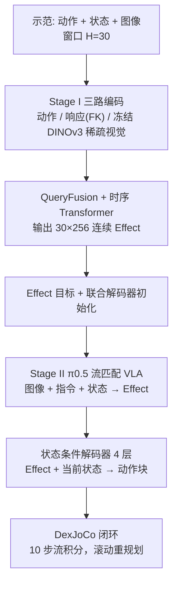
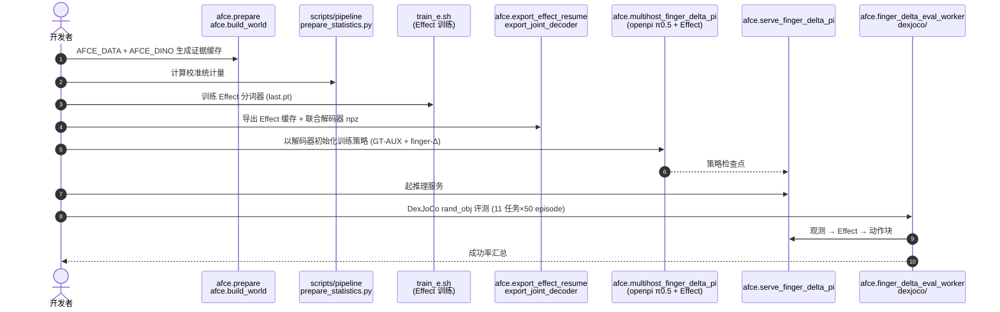

---

type: entity
tags: [paper, vla, dexterous-manipulation, bimanual, flow-matching, pi05, benchmark, sysu, yinwang]
status: complete
updated: 2026-10-12
arxiv: "2610.13212"
project_id: afce
project: https://afceproject.github.io/AFCE-Web/
code: https://github.com/AFCEProject/AFCE
related:
  - ../overview/embodied-station-34-papers-spatial-grounding-technology-map.md
  - ../tasks/bimanual-manipulation.md
  - ../methods/vla.md
  - ./paper-pi05-open-world-vla.md
  - ./paper-pi0.md
  - ../concepts/world-action-models.md
sources:
  - ../../sources/blogs/wechat_embodied_station_34_papers_spatial_grounding_2026-10-12.md
  - ../../sources/papers/afce_arxiv_2610_13212.md
  - ../../sources/sites/afce.md
  - ../../sources/repos/afce.md
summary: "AFCE（arXiv:2610.13212，中山大学/Yinwang）：把动作、机器人实际响应与稀疏 DINOv3 视觉变化压成连续 Effect 令牌，让 π0.5 基座的流匹配 VLA 预测 Effect 再由状态条件解码器还原动作块；DexJoCo 11 任务总体 50.97%（π0.5 为 39.15%），双臂均值 37.33%；仅仿真，MIT 代码已开放。"
---

# AFCE：让 VLA 预测「动作将产生的效果」而不只是动作

**AFCE**（*Action–Future Coupled Effect Learning*；论文 *Beyond Actions: Learning Future Operation Targets for Vision-Language-Action Models*，[arXiv:2610.13212](https://arxiv.org/abs/2610.13212)，[项目页](https://afceproject.github.io/AFCE-Web/)，[代码](https://github.com/AFCEProject/AFCE)）由 **中山大学（SYSU）与 Yinwang Intelligent Technology** 提出：不再让 VLA 直接回归动作块，而是回归一种由「示范动作 + 机器人实际响应 + 稀疏视觉变化」构成的连续 **Effect** 目标，再由状态条件解码器翻译成可执行动作。

## 一句话定义

**离线把动作、本体响应与场景视觉变化融合成时间有序的 Effect 令牌作为训练目标，让流匹配 VLA 只用当前观测去预测 Effect，部署时再解码成动作块。**

## 英文缩写速查

| 缩写 | 英文全称 | 简要说明 |
|------|----------|----------|
| AFCE | Action–Future Coupled Effect Learning | 本文方法 |
| VLA | Vision-Language-Action | 视觉-语言-动作策略 |
| DexJoCo | DexJoCo benchmark | 基于 MuJoCo 的灵巧手操作评测，Panda–Allegro 本体，11 任务 |
| LoRA | Low-Rank Adaptation | 对 PaliGemma 2B 与 300M 动作专家做低秩微调 |
| DINOv3 | Self-distillation vision foundation model v3 | 冻结视觉特征，提供稀疏视觉变化证据 |
| UVT | 论文中的对照基线 | 原文未展开全称（未核实），与 π0.5 同表对比 |

## 为什么重要

- 动作命令说明「做什么」，但不说明「做完会怎样」；灵巧手和双臂协调的失败往往出在后者。Effect 让监督信号带上了本体响应与场景变化。
- 它是对 [π0.5](./paper-pi05-open-world-vla.md) 路线的一个窄改动：只换输入输出投影和增加一个预训练解码器，主干保留，便于对比。
- 双臂任务上增益最大（均值 9.73% → 37.33%），对双臂灵巧操作研究是明确信号。

## 核心信息

| 项 | 内容 |
|----|------|
| 机构 | 中山大学（SYSU）；Yinwang Intelligent Technology Co., Ltd.（通讯 Shen Zhao、Xiaodan Liang） |
| 基座 | 官方 π0.5：PaliGemma 2B（LoRA 16/16）+ 300M 动作专家（LoRA 32/32） |
| 数据 | DexJoCo 11 任务各 100 条示范，共 1,100 episode / 523,763 帧（30 FPS） |
| 算力 | Stage II 两节点 × 4 GH200；Stage I 算力原文未写 |
| 开源 | **已开源**（MIT）：[AFCEProject/AFCE](https://github.com/AFCEProject/AFCE)；数据、DINOv3 与 π0.5 权重需自备 |

## 方法栈与流程总览

## 方法

- **Stage I：Effect 分词器（离线）。** 动作编码器分别投影位置、旋转、手指；响应编码器用观测状态加正运动学算出掌心平移、相对朝向、指尖位移与手指关节变化；视觉编码器取冻结 DINOv3 在稀疏时刻（步长 5 加终止帧）的特征，最多 6 个动态与 2 个参考区域、每区 8 槽，136 维描述子 PCA 到 64 维。步查询对三路做交叉注意力，再过时序 Transformer，得 30×256 的连续 Effect（**无离散码本**，Effect 是连续向量）。重建损失 L_I=L_A(分组 Huber，位置权重 2)+λ_S·L_S+λ_V·L_V+λ_R·L_rot(SO(3) 弦距离)，训练 30,000 步、batch 32。
- **Stage II：流匹配 VLA。** 把 π0.5 的动作投影替换为宽 256 的 Effect 投影，保留视觉语言状态主干；辅助动作损失 λ_GT=0.256 与手指差分 λ_Δf=0.05（仅 τ∈[0.2,0.7]）；训练 60,000 步；推理 10 步流积分生成 30 步 Effect 块。
- **解码器与本体接口：** 4 层解码器与策略联合训练；单臂 22 维动作 / 23 维状态，双臂 44 / 46 维，仅适配器随本体切换，其余共享。论文提醒共享参数不等于已学到本体无关表示。

## 源码运行时序图

对齐 [AFCEProject/AFCE](https://github.com/AFCEProject/AFCE) README 主流水线（归档见 [repos/afce.md](../../sources/repos/afce.md)；本次未实际运行，需外部数据与权重）：

- **复现边界：** 仓库不含数据集、DINOv3 权重、π0.5 基座参数（`action_dim=44`）和 Effect 缓存；README 参考结果为种子 0 的 284/550=51.64%，与论文三种子均值 50.97% 口径不同。

## 工程实践

| 项 | 建议 |
|----|------|
| 数据准备 | 动作、状态、未来图像必须时间对齐，否则 Effect 目标无法构造 |
| Effect 维度 | 256 维最好：回放位置误差 7.794 mm、回放成功 25/110；64 维时 11.585 mm、18/110 |
| 评测报告 | 每方法一个检查点，± 来自评测种子，不是训练种子方差 |
| 本体适配 | 单臂/双臂各自适配器，共享主干；不要据此宣称本体无关 |
| 复现路径 | 先 `python scripts/pipeline/verify_source.py` 验证源码，再按 README 逐步 prepare → train_e → export → 策略训练 |
| 算力 | 策略训练按两节点 8×GH200 规划，轻量复现未验证 |

## 实验与评测

DexJoCo（Panda–Allegro，仿真），rand-obj，每任务每种子 50 episode，种子 0/1/2，共 1,650 episode/方法：

| 任务 | UVT | π0.5 | AFCE |
|------|-----|------|------|
| Pinch Tongs | 1.33 | 43.33 | 5.33 |
| Click Mouse | 80.00 | 60.00 | 54.67 |
| Fold Glasses | 64.67 | 38.00 | 62.00 |
| Hammer Nail | 22.00 | 84.67 | 86.67 |
| Pick Bucket | 60.00 | 67.33 | 80.67 |
| Water Plant | 92.67 | 88.67 | 84.67 |
| Unlock iPad | 0.00 | 2.00 | 7.33 |
| Hanoi | 0.67 | 5.33 | 29.33 |
| Assembly | 0.00 | 1.33 | 9.33 |
| Microwave | 41.33 | 32.00 | 81.33 |
| Photograph | 30.67 | 8.00 | 59.33 |
| 单臂均值 | 53.44 | 63.67 | 62.33 |
| 双臂均值 | 14.53 | 9.73 | 37.33 |
| **总体** | 35.76±0.56 | 39.15±2.11 | **50.97±1.65** |

- **输入消融（单臂均值 / 双臂均值）：** 仅动作 57.22 / 30.93；去响应 48.67 / 25.47；去视觉 55.67 / 21.60；完整 62.33 / 37.33。完整模型在 Click Mouse 上反而从 65.33 降到 54.67。
- **读出诊断：** 训练集内真值 Effect 经解码器位置误差 8.30 mm，用预测 Effect 为 36.91 mm，说明预测误差会传到动作读出。
- 原文**未报告真机实验**。

## 结论

**把监督目标从「动作」换成「动作 + 响应 + 视觉变化」的连续 Effect，主要换来的是双臂灵巧协调，而不是所有任务的普遍提升。**

1. **双臂收益大。** 双臂均值 9.73%→37.33%，5 个双臂任务全部领先 π0.5 与 UVT。
2. **单臂基本持平。** 单臂均值 62.33 对 π0.5 的 63.67；Pinch Tongs（5.33 对 43.33）退步明显，精度类任务要谨慎。
3. **三路证据都用得上。** 去掉响应或视觉都使双臂均值下降（37.33→21.60/25.47）。
4. **瓶颈在预测，不在解码。** 真值 Effect 解码误差 8.30 mm，预测后 36.91 mm。
5. **只有仿真证据。** 没有真机数据，不能据此断定真机灵巧手收益。
6. **工程上先看开源仓库。** 代码 MIT 开放，但要自备数据与权重并具备多卡算力。

## 局限与风险

- 作者承认：需要时间对齐的动作/状态/未来图像；视觉特征可能漏掉细微接触并受遮挡与视角影响；固定尺寸 Effect 要在控制细节与可预测性间折中；闭环成功率无法区分 Effect 预测、融合、解码各自的误差；离线构造目标增加训练成本。
- 对比基线只有 UVT 与 π0.5，其他 VLA 未比；仅仿真。
- **开源状态：** 已开源训练与评测主路径；数据集、权重、真机遥操作栈、部分辅助模块未提供，仓库自述无法与私有实验快照逐位对齐。

## 与其他工作对比

| 对照 | 差异读法 |
|------|----------|
| [π0.5](./paper-pi05-open-world-vla.md) | AFCE 以其为基座，只换预测目标为 Effect，是直接对照 |
| [π0](./paper-pi0.md) | 同族流匹配 VLA，直接预测动作块 |
| [世界-动作模型](../concepts/world-action-models.md) | WAM 预测未来画面或潜变量；AFCE 的未来信息只用于构造训练目标，部署不生成未来画面 |
| [VLA 方法总览](../methods/vla.md) | 本文属于「改预测目标」一类，而非加规模或加数据 |

## 关联页面

- [34 篇空间落地技术图谱（汇总页）](../overview/embodied-station-34-papers-spatial-grounding-technology-map.md)
- [双臂操作](../tasks/bimanual-manipulation.md)
- [VLA](../methods/vla.md)
- [π0.5 开放世界 VLA](./paper-pi05-open-world-vla.md)
- [世界-动作模型](../concepts/world-action-models.md)
- [具身大模型评测基准选型闭环](../queries/embodied-eval-benchmark-selection-loop.md) — 本页属方法而非基准，其 DexJoCo 灵巧/双臂成功率对比落在③策略任务成功率层，且仅仿真、未经④层真机校准

## 参考来源

- [具身智能小站 34 篇盘点（2026-10-12）](../../sources/blogs/wechat_embodied_station_34_papers_spatial_grounding_2026-10-12.md)
- [afce_arxiv_2610_13212.md](../../sources/papers/afce_arxiv_2610_13212.md) — 论文摘录与开源核查
- [afce.md](../../sources/sites/afce.md) — 项目页归档
- [afce.md](../../sources/repos/afce.md) — GitHub 仓库归档
- [arXiv:2610.13212](https://arxiv.org/abs/2610.13212)

## 推荐继续阅读

- [AFCE 项目页](https://afceproject.github.io/AFCE-Web/)
- [AFCE GitHub](https://github.com/AFCEProject/AFCE)
- [DexJoCo 数据集（HF）](https://huggingface.co/datasets/DexJoCo/DexJoCo-Datasets-LeRobot)
