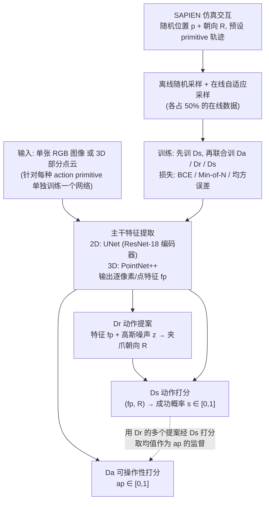

# Where2Act

**Where2Act: From Pixels to Actions for Articulated 3D Objects**（ICCV 2021）收录于 [Awesome-Affordance-Learning](https://github.com/hq-King/Awesome-Affordance-Learning)，属于具身 AI affordance 学习综述的配套论文清单。本页是 **清单索引**：给出它在综述分类里的位置与原文入口，方法细节和量化结果请看原文。

## 一句话定义

Where2Act: From Pixels to Actions for Articulated 3D Objects——在清单中归入 **Action（Architecture: Hierarchical model；Affordance Usage: explicit；Action Subcategory: Hierarchical affordance-to-action）**（清单未附方法摘要，此处不替原文概括贡献）。

## 英文缩写速查

| 缩写 | 英文全称 | 简要说明 |
|------|----------|----------|
| Affordance | Action possibility (Gibson) | 环境/物体对 agent 提供的可交互机会 |
| HOI | Human-Object Interaction | 人–物交互，常作 affordance 监督来源 |
| VLM | Vision-Language Model | 视觉–语言模型，用于 affordance 推理与接地 |
| VLA | Vision-Language-Action | 视觉–语言–动作策略 |

## 为什么重要

- 综述把 affordance 学习拆成感知、推理、引导动作三段（见 [综述实体页](../entities/paper-affordance-learning-embodied-ai-survey.md)），本条目是其中一段的代表文献之一。
- 可顺着 [技术地图](../overview/affordance-awesome-technology-map.md) 的同分组条目横向阅读同方向工作。

## 流程总览

图依据：论文 §3–4（Problem Statement、Network Modules、Collecting Training Data、Training and Losses，Fig.2 / Fig.3）

## 核心信息

| 字段 | 内容 |
|------|------|
| 出处 | ICCV 2021 |
| 方法名（清单标注） | Where2Act |
| 分组 1 | Action · Architecture: Hierarchical model；Affordance Usage: explicit；Action Subcategory: Hierarchical affordance-to-action |
| 论文 | <https://arxiv.org/abs/2101.02692> |

## 核心机制（归纳）

清单只给出标题、出处与分类标签，没有方法摘要；论文自述的方法流程见上方「流程总览」，实验数字仍以原文为准；需要机制与实验请读 [原文](https://arxiv.org/abs/2101.02692)。

## 评测与指标

- 本页没有搬运原文的 benchmark 与实机指标；评测口径以 [原文](https://arxiv.org/abs/2101.02692) 为准。
- 综述本身不提供跨论文性能排名（见 [综述实体页](../entities/paper-affordance-learning-embodied-ai-survey.md)），不同设置下的数字不可直接比较。

## 与其他工作对比

- 本页不做与具体基线的数值对比；同分组横向对照见 [技术地图](../overview/affordance-awesome-technology-map.md)。
- 若站内另有这篇的深读页，以那一页为准。

## 结论

**本页只提供「Where2Act」在 affordance 综述清单中的坐标与原文入口，不能替代原文。**

- 可确证的只有标题、出处与分类标签；方法与结果未经本页核实。
- 开源状态清单未标注，入库时未打开项目页核查，复现前请自行确认。
- 要深读：从原文入手，再回综述实体页对照 perception → reasoning → action 的位置。

## 常见误区

1. 不要把分类标签当作论文结论；标签来自清单维护者的归类。
2. 不要把本页当作方法证明；它只是清单入口。

## 关联页面

- [Affordance 学习综述](../entities/paper-affordance-learning-embodied-ai-survey.md)
- [Awesome-Affordance-Learning 技术地图](../overview/affordance-awesome-technology-map.md)
- [manipulation.md](../tasks/manipulation.md)、[imitation-learning.md](../methods/imitation-learning.md)

## 参考来源

- [`sources/papers/affordance_awesome_where2act-from-pixels-to-actions-for-articulated-3d-obje.md`](../../sources/papers/affordance_awesome_where2act-from-pixels-to-actions-for-articulated-3d-obje.md) — 本条目策展摘录
- [`sources/papers/affordance_awesome_catalog.md`](../../sources/papers/affordance_awesome_catalog.md) — 列表总表
- [`sources/repos/awesome-affordance-learning.md`](../../sources/repos/awesome-affordance-learning.md)
- 论文：<https://arxiv.org/abs/2101.02692>
- [arXiv PDF](https://arxiv.org/pdf/2101.02692)：已通读方法部分（实验与附录以略读为准）：§3 问题设定、§4 方法（4.1 网络模块、4.2 数据采集、4.3 训练与损失）、§5.1 实验设定

## 推荐继续阅读

- [Awesome-Affordance-Learning 仓库](https://github.com/hq-King/Awesome-Affordance-Learning)
- [原文](https://arxiv.org/abs/2101.02692)
