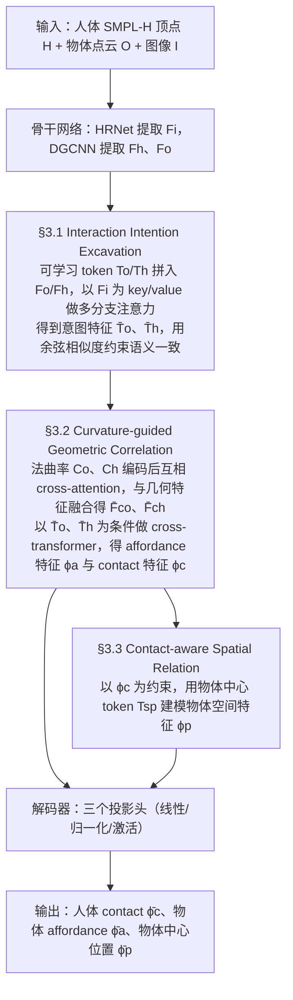

# LEMON

**LEMON: Learning 3D Human-Object Interaction Relation from 2D Images**（CVPR 2024）收录于 [Awesome-Affordance-Learning](https://github.com/hq-King/Awesome-Affordance-Learning)，属于具身 AI affordance 学习综述的配套论文清单。本页是 **清单索引**：给出它在综述分类里的位置与原文入口，方法细节和量化结果请看原文。

## 一句话定义

LEMON: Learning 3D Human-Object Interaction Relation from 2D Images——在清单中归入 **Perception（Scope: Object；Perception Subcategory: Spatial · Interaction-driven） ｜ Datasets / Benchmarks（Data Modality: image-3D）**（方法流程见下方「流程总览」）。

## 英文缩写速查

| 缩写 | 英文全称 | 简要说明 |
|------|----------|----------|
| Affordance | Action possibility (Gibson) | 环境/物体对 agent 提供的可交互机会 |
| HOI | Human-Object Interaction | 人–物交互，常作 affordance 监督来源 |
| VLM | Vision-Language Model | 视觉–语言模型，用于 affordance 推理与接地 |
| VLA | Vision-Language-Action | 视觉–语言–动作策略 |

## 为什么重要

- 综述把 affordance 学习拆成感知、推理、引导动作三段（见 [综述实体页](../entities/paper-affordance-learning-embodied-ai-survey.md)），本条目是其中一段的代表文献之一。
- 可顺着 [技术地图](../overview/affordance-awesome-technology-map.md) 的同分组条目横向阅读同方向工作。

## 流程总览

图依据：论文 §3 开头 / Fig.3（LEMON pipeline）、§3.1-3.4。

## 核心信息

| 字段 | 内容 |
|------|------|
| 出处 | CVPR 2024 |
| 方法名（清单标注） | LEMON |
| 分组 1 | Perception · Scope: Object；Perception Subcategory: Spatial · Interaction-driven |
| 分组 2 | Datasets / Benchmarks · Data Modality: image-3D |
| 论文 | <https://arxiv.org/abs/2312.08963> |

## 核心机制（归纳）

清单本身只给出标题、出处与分类标签；方法流程见上方「流程总览」，实验细节请读 [原文](https://arxiv.org/abs/2312.08963)。

## 评测与指标

- 本页没有搬运原文的 benchmark 与实机指标；评测口径以 [原文](https://arxiv.org/abs/2312.08963) 为准。
- 综述本身不提供跨论文性能排名（见 [综述实体页](../entities/paper-affordance-learning-embodied-ai-survey.md)），不同设置下的数字不可直接比较。

## 与其他工作对比

- 本页不做与具体基线的数值对比；同分组横向对照见 [技术地图](../overview/affordance-awesome-technology-map.md)。
- 若站内另有这篇的深读页，以那一页为准。

## 结论

**本页只提供「LEMON」在 affordance 综述清单中的坐标与原文入口，不能替代原文。**

- 可确证的只有标题、出处与分类标签；方法与结果未经本页核实。
- 开源状态清单未标注，入库时未打开项目页核查，复现前请自行确认。
- 要深读：从原文入手，再回综述实体页对照 perception → reasoning → action 的位置。

## 常见误区

1. 不要把分类标签当作论文结论；标签来自清单维护者的归类。
2. 不要把本页当作方法证明；它只是清单入口。

## 关联页面

- [Affordance 学习综述](../entities/paper-affordance-learning-embodied-ai-survey.md)
- [Awesome-Affordance-Learning 技术地图](../overview/affordance-awesome-technology-map.md)
- [manipulation.md](../tasks/manipulation.md)、[vla.md](../methods/vla.md)

## 参考来源

- [`sources/papers/affordance_awesome_lemon-learning-3d-human-object-interaction-relation-from.md`](../../sources/papers/affordance_awesome_lemon-learning-3d-human-object-interaction-relation-from.md) — 本条目策展摘录
- [`sources/papers/affordance_awesome_catalog.md`](../../sources/papers/affordance_awesome_catalog.md) — 列表总表
- [`sources/repos/awesome-affordance-learning.md`](../../sources/repos/awesome-affordance-learning.md)
- 论文：<https://arxiv.org/abs/2312.08963>
- [arXiv PDF](https://arxiv.org/pdf/2312.08963)：已通读方法部分（实验与附录以略读为准）：§3 方法（3.1-3.4，含 Fig.3）；§4 数据集与 §5 实验未细读

## 推荐继续阅读

- [Awesome-Affordance-Learning 仓库](https://github.com/hq-King/Awesome-Affordance-Learning)
- [原文](https://arxiv.org/abs/2312.08963)
