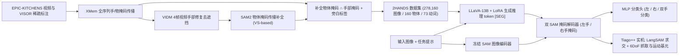

# 2HandedAfforder

**2HandedAfforder: Learning Precise Actionable Bimanual Affordances from Human Videos**（ICCV 2025，arXiv:2503.09320v3，TU Darmstadt & Hessian.AI）收录于 [Awesome-Affordance-Learning](https://github.com/hq-King/Awesome-Affordance-Learning)，属于具身 AI affordance 学习综述的配套文献。本页基于论文全文完成结构化精读与核实。

## 一句话定义

**2HandedAfforder** 是一套从第一视角人类操作视频中自动剥离手部遮挡、提取像素级精确双手机会掩码（构建 **2HANDS** 数据集），并由 VLM 推理生成 `[SEG]` token 联合 SAM 解码器预测任务导向左右手掩码与双手协作类别的端到端框架。

## 英文缩写速查

| 缩写 | 英文全称 | 简要说明 |
|------|----------|----------|
| 2HANDS | 2-Handed Affordance + Narration DataSet | 本文从 EPIC-KITCHENS 提取的 278K 图像精确双手机会数据集 |
| VLM | Vision-Language Model | 视觉–语言模型，本文采用 LLaVA-13B 经 LoRA 微调生成 `[SEG]` token |
| SAM / SAM2 | Segment Anything Model / SAM 2 | 视觉编码与掩码解码骨干，并用于无遮挡物体掩码跨帧传播补全 |
| LoRA | Low-Rank Adaptation | 低秩自适应，冻结 SAM 编码器与 VLM 主体，高效微调推理分割能力 |
| HD / Dir. HD | Hausdorff Distance / Directed Hausdorff Distance | 豪斯多夫距离与有向豪斯多夫距离，衡量预测掩码对真值的边界偏离 |

## 为什么重要

- 传统人工标注数据集（如 IIT-AFF、AGD20K、3DOI）往往退化为粗糙的“物体部件分割”而非真正可执行的操作区（例如“倒水入碗”需握持水瓶质心附近而非整个瓶身），且普遍忽略双手协同上下文；而早先视频自动标注方法（如 VRB、ACP）仅产出任务无关的粗略热图或边界框。
- 本文利用“视频掩码传播 + 视频手部修复 + SAM2 掩码补全”自动获得无手遮挡的精确接触掩码，并用视频旁白（narration）作为自然语言监督，打通了从人类第一视角视频到双臂机器人（Tiago++）可执行操作区的闭环。

## 核心信息

| 字段 | 内容 |
|------|------|
| 出处 | ICCV 2025（arXiv:2503.09320v3） |
| 作者与机构 | Marvin Heidinger*, Snehal Jauhri*, Vignesh Prasad, Georgia Chalvatzaki（TU Darmstadt, Hessian.AI） |
| 清单分组 1 | Action · Architecture: Hierarchical model；Affordance Usage: explicit；Action Subcategory: Hierarchical affordance-to-action |
| 清单分组 2 | Datasets / Benchmarks · Data Modality: video/text/3D |
| 论文与项目页 | <https://doi.org/10.1109/ICCV51701.2025.01368> · <https://arxiv.org/abs/2503.09320> · <https://sites.google.com/view/2handedafforder> |

## 核心机制

1. **无遮挡双手 Affordance 自动提取与 2HANDS 数据集构建**
   - 从 **EPIC-KITCHENS**（约 100 小时第一视角厨房视频）及其 **VISOR** 稀疏手–物掩码和接触标签出发，利用视频掩码传播网络（XMem）得到全序列稠密手/物掩码。
   - 使用 4 帧序列视频手部修复模型 **VIDM** 抹除人手遮挡并利用上下文帧纹理重建完整物体图像；随后用原图物体掩码提示 **SAM2** 将掩码传播至修复后无手帧（VS-based 补全，在对比实验中显著优于仅依赖二值掩码、易产生“ghost handles”的 MI-GAN IR-based 补全）。
   - 取“补全物体掩码 ∩ 手部掩码”并经腐蚀/膨胀去噪后作为精确 affordance 掩码，以活动旁白为开放词汇类别标签，按 Krebs & Asfour 双手分类法标注 `unimanual left`、`unimanual right`、`bimanual`；经水平翻转做左右手均衡后得到 **2HANDS**：**278,160** 张图像、25 个厨房环境、47 段视频、160 类物体、73 类动词（含左手 76,278、右手 76,278、对称双手 51,684、非对称双手 73,920）。
2. **VLM + 双解码器任务导向预测网络（2HandedAfforder）**
   - 借鉴 LISA 推理分割架构，将图像与自然语言问答提示输入 **LLaVA-13B**（经 LoRA 微调）输出语言与 `[SEG]` 隐式推理 token；同时通过冻结的 **SAM** 图像编码器提取高分辨率视觉特征。
   - 使用两个以 SAM 预训练权重初始化的 **掩码解码器**，分别结合图像特征与 `[SEG]` token 预测左手、右手像素级 affordance 掩码（Dice loss + Focal cross-entropy loss）；另在左解码器输出 token 上接 MLP 分类头预测双手类别（交叉熵损失；单手样本对未使用的手掩码置零损失权重）。此外还提供以 CLIP 文本特征替代 VLM 的轻量对照版 **2HandedAfforder-CLIP**。
3. **ActAffordance 基准与实机双臂部署**
   - 组织 10 名标注员借助 TORAS 在无手图像上结合原交互帧标注“所有合理交互区域”（应对多模态真值），构成 **400 个活动**的 **ActAffordance** 基准（含非重叠 EPIC-KITCHENS 与零样本跨集 Ego4D）及其目标框裁剪版 **ActAffordance-Cropped**。
   - 在双臂 **Tiago++** 机器人厨房场景中，先用 **LangSAM** 获取目标物体掩码与裁剪框，将模型预测掩码与 LangSAM 物体掩码求交提高稳定性，再反投影至 3D 点云驱动 6DoF 抓取预测与运动基元完成搅拌、倒水、开锅盖、开瓶等任务。

### 方法流程图

## 评测与指标

在 **ActAffordance**（全图与裁剪版）上的主要定量结果如下（因模型只预测单一合理交互模态而真值标注全部可能区域，Precision 与 Dir. HD 为核心精度指标）：

| 评测设定 | 模型 | IoU ↑ | Precision ↑ | HD ↓ | Dir. HD ↓ | mAP ↑ |
|------|------|-------|-------------|------|-----------|-------|
| ActAffordance（Combined） | LISA | 0.044 | 0.050 | 303 | 255 | 0.047 |
| ActAffordance（Combined） | AffLLM | 0.012 | 0.013 | 287 | 225 | 0.012 |
| ActAffordance（Combined） | 2HAffCLIP | 0.026 | 0.064 | 341 | 292 | 0.059 |
| ActAffordance（Combined） | **2HandedAfforder（2HAff）** | **0.058** | **0.130** | **262** | **202** | **0.104** |
| ActAffordance（Combined，提取上界） | AffExtract（数据管线） | 0.185 | 0.420 | 184 | 145 | - |
| ActAffordance（Ego4D 零样本切分） | **2HandedAfforder（2HAff）** | **0.051** | **0.137** | **292** | **227** | **0.105** |
| ActAffordance-Cropped（Combined） | LISA | 0.082 | 0.122 | 196 | 130 | 0.116 |
| ActAffordance-Cropped（Combined） | AffLLM | 0.076 | 0.112 | **155** | **76** | 0.103 |
| ActAffordance-Cropped（Combined） | VRB | 0.019 | 0.088 | 167 | 155 | 0.180 |
| ActAffordance-Cropped（Combined） | 3DOI | 0.082 | 0.224 | 168 | 109 | 0.154 |
| ActAffordance-Cropped（Combined） | **2HandedAfforder（2HAff）** | **0.086** | **0.269** | 180 | 100 | **0.240** |

> 注：在 Cropped 设定下 AffLLM 的 HD / Dir. HD 更低，论文指出是由于其输出较“乐观”且总能覆盖一定区域，而其他模型在漏检为空掩码时会受大距离惩罚。在未见过的 Ego4D 切分上，AffExtract Precision 达 0.541，2HandedAfforder Precision 达 0.137，验证了跨数据集泛化能力。

## 与其他工作对比

- **对比弱监督/热图类方法（LOCATE、VRB、ACP）**：脱离了人工小样本标注或任务无关接触热点框限制，能够根据自然语言任务提示区分双手协同区域。
- **对比推理分割与点提示方法（LISA、AffordanceLLM、3DOI）**：LISA 倾向于分割整件物体而非操作局部，3DOI 依赖测试时手动提供查询点；2HandedAfforder 仅凭语言任务即可在全图直接定位精确双手掩码，Cropped mAP 达 0.240（高于 VRB 0.180 与 3DOI 0.154）。同分组横向对照见 [技术地图](../overview/affordance-awesome-technology-map.md)。

## 常见误区或局限

1. **IoU 绝对值偏低不等于定位失效**：ActAffordance 真值涵盖人眼判断的所有可能接触区（如整条门把手），而模型单次只预测一条具体交互模态的紧凑掩码，因此应结合 Precision 与 Dir. HD 评估。
2. **多目标与模糊指令歧义（Failure Cases）**：当桌面存在多个同类物体或工具（如 `take onion`、`pick up bowl`）时，模型可能同时在无关工具或所有同类碗上输出掩码，或将单手拿取误判为双手任务。
3. **实机部署依赖外部实例分割与硬编码基元**：在 Tiago++ 上需先用 LangSAM 裁剪目标并与物体掩码求交来稳定输出，且仅提供空间掩码（不直接输出完整 6DoF 操作轨迹）。
4. **开源核实提示**：论文附录声明数据集与代码将发布于 `sites.google.com/view/2handedafforder`，入库前需按项目主页实际释放状态确认可复现资源。

## 结论

**2HandedAfforder 通过视频去手修复与掩码传播自动构建 278K 规模的精确双手机会数据集 2HANDS，并证明 VLM 推理 token 联合双 SAM 解码器可泛化至未见第一视角数据与真实双臂机器人操作。**

- 若需构建具身操作感知数据管线，“视频掩码传播 + 手部修复 + SAM2 掩码传播（VS-based）”比纯二值掩码补全更不易生成幽灵手柄伪影。
- 评估任务导向局部 affordance 时，优先使用 Precision、Dir. HD 与 mAP，避免被多模态真值拉低的 IoU 误导。
- 部署至真实机械臂前，建议借鉴本文与 LangSAM 掩码求交的后处理策略，过滤背景误检并结合 6DoF 抓取网络闭环执行。
- 涉及同场景多相似物体消歧时，需在提示词中加入空间方位或前置目标检测过滤，弥补单次 `[SEG]` token 的实例指代局限。

## 关联页面

- [Affordance 学习综述](../entities/paper-affordance-learning-embodied-ai-survey.md)
- [Awesome-Affordance-Learning 技术地图](../overview/affordance-awesome-technology-map.md)
- [manipulation.md](../tasks/manipulation.md)、[imitation-learning.md](../methods/imitation-learning.md)

## 参考来源

- [`sources/papers/affordance_awesome_2handedafforder-learning-precise-actionable-bimanual-aff.md`](../../sources/papers/affordance_awesome_2handedafforder-learning-precise-actionable-bimanual-aff.md) — 本条目策展摘录
- [`sources/papers/affordance_awesome_catalog.md`](../../sources/papers/affordance_awesome_catalog.md) — 列表总表
- [`sources/repos/awesome-affordance-learning.md`](../../sources/repos/awesome-affordance-learning.md)
- 论文：<https://doi.org/10.1109/ICCV51701.2025.01368>

## 推荐继续阅读

- [Awesome-Affordance-Learning 仓库](https://github.com/hq-King/Awesome-Affordance-Learning)
- [原文](https://doi.org/10.1109/ICCV51701.2025.01368)
