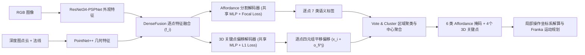

# FAKP-Net

**3D Affordance Keypoint Detection for Robotic Manipulation**（IROS 2024，arXiv:2511.22195v1，National University of Singapore）收录于 [Awesome-Affordance-Learning](https://github.com/hq-King/Awesome-Affordance-Learning)，属于具身 AI affordance 学习综述的配套文献。本页基于论文全文完成结构化精读与核实。

## 一句话定义

**FAKP-Net（Fusion-based Affordance Keypoint Network）** 通过在 RGB-D 点云上融合外观与几何特征，同时预测逐点 affordance 语义标签与指向**每类 affordance 四个表面 3D 关键点（3D keypoint quadruplet）**的平移偏移，从而将传统“是什么（what）”的分割扩展为直接指导机器人“在哪里、朝什么方向、多大尺度（where & how）”执行的 3D 表征。

## 英文缩写速查

| 缩写 | 英文全称 | 简要说明 |
|------|----------|----------|
| FAKP-Net | Fusion-based Affordance Keypoint Network | 本文提出的 RGB-D 多任务融合网络，联合预测分割与 3D 关键点偏移 |
| UMDKP | UMD Keypoint Dataset | 基于 UMDGT 去除悬空中心点并重定位至表面 4 关键点构建的 RGB-D 数据集 |
| NMSE | Normalized Mean Squared Error | 按类内四关键点到均值中心平均距离 $d_{aff}$ 归一化的均方定位误差 |
| PCK3D | Percentage of Correct 3D Keypoints | 预测 3D 关键点误差小于阈值 $0.3 d_{aff}$ 的四元组正确率（`PCK@0.3`） |
| MLP | Multi-Layer Perceptron | 多层感知机，本文用共享 MLP 分别构建语义分割头与偏移回归头 |

## 为什么重要

- 传统像素/点级 affordance 语义分割只回答部件“是什么功能”，无法直接给出夹爪接触点、操作方向和开口宽度；而前序 2D 关键点方法（AffKP）缺乏 3D 几何感知，面对外观相似但尺度不同的功能（如 `contain` 与 `scoop`）容易混淆，且仅数像素投影偏差就会导致 `wrap-grasp` 等动作失败。
- 本文首次为每类 affordance 定义表面 **4 个 3D 关键点**并构建 **UMDKP** 数据集，无需依赖繁重的后处理或类别级形状补全先验即可在真实未见家居物体（IKEA）上直接构造局部操作坐标系并完成多步操作。

## 核心信息

| 字段 | 内容 |
|------|------|
| 出处 | IROS 2024（arXiv:2511.22195v1） |
| 作者与机构 | Zhiyang Liu, Ruiteng Zhao, Lei Zhou, Chengran Yuan, Yuwei Wu, Sheng Guo, Zhengshen Zhang, Chenchen Liu, Marcelo H Ang Jr（NUS） |
| 方法名（清单标注） | FAKP-Net |
| 清单分组 1 | Perception · Scope: Object；Perception Subcategory: Spatial |
| 论文 | <https://doi.org/10.1109/IROS58592.2024.10801792> · <https://arxiv.org/abs/2511.22195> |

## 核心机制

1. **3D 关键点四元组表征与 UMDKP 数据集构建**
   - 在 UMDGT（包含 `grasp`、`cut`、`scoop`、`contain`、`pound`、`w-grasp` 6 类 affordance，剔除边界模糊的背景化 `support` 类）基础上，移除常位于物体表面之外的中心第 5 个点，并将剩余 **4 个关键点全部重定位到物体表面**，保持 UMD 原始训练/测试划分构成 **UMDKP**。
   - 四个关键点显式编码执行位姿：例如刀的 `cut` 区域中 kp1→kp2 向量定义切割方向、kp2 为刀刃接触点、kp3 衔接 `grasp` 区域；`wrap-grasp` 中 kp1–kp2 距离决定夹爪张开宽度，kp3–kp4 中点决定抓握原点。通过预设几何规则可由四元组及其中心点算出局部操作系的 $(x, y, z)$ 三轴。
2. **RGB-D 双流融合编码器**
   - **外观分支**：使用 ImageNet 预训练 **ResNet34 骨干的 PSPNet** 提取 RGB 像素特征。
   - **几何分支**：使用 **PointNet++** 从深度反投影点云与表面法线中提取 3D 几何特征。
   - **特征融合**：采用 **DenseFusion** 模块将每个可见种子点 $p_i$ 对应的外观特征与几何特征融合为逐点表征 $f_i$。
3. **多任务解码与投票聚类（Vote & Cluster）**
   - **Affordance 分割解码器**：共享 MLP 预测 7 类（背景 + 6 类 affordance）逐点置信度，使用 Focal Loss（$\gamma=2$，类别平衡因子 $\alpha=(0.03,0.12,0.17,0.21,0.17,0.2,0.1)$）训练。
   - **3D 关键点偏移解码器**：共享 MLP 预测每个种子点到同区域 4 个关键点的欧氏平移偏移 $\{o_{fi}^j\}_{j=1}^4$，仅对落在对应 affordance 区域内的点施加 $L_1$ 损失监督；多任务总损失 $L_{\text{multi-task}} = L_{\text{keypoints}} + \lambda L_{\text{semantic}}$（$\lambda=100$）。
   - **投票与聚类**：每个前景点投票生成候选关键点 $vkp_i^j = x_i + o_{fi}^j$，通过聚类区分相同语义标签下的不同实例区域，并以聚类中心作为最终 3D 关键点四元组。

### 方法流程图

## 评测与指标

### 1. UMDKP Affordance 语义分割对比（加权 F-measure $F_\beta^w$ ↑，Table I）

| 方法 | 类型 | grasp | cut | scoop | contain | pound | w-grasp | **Average** |
|------|------|-------|-----|-------|---------|-------|---------|-------------|
| SRF | 区域建议 | 0.31 | 0.41 | 0.48 | 0.64 | 0.67 | 0.26 | 0.46 |
| AffNet | 区域建议 | 0.73 | 0.76 | 0.79 | 0.83 | 0.84 | 0.81 | 0.80 |
| DeepLab | 编码–解码 | 0.62 | 0.74 | 0.78 | 0.86 | 0.88 | 0.73 | 0.76 |
| ED-RGB | 编码–解码 | 0.72 | 0.60 | 0.74 | 0.82 | 0.81 | 0.77 | 0.77 |
| AffKP* | 编码–解码 | 0.72 | 0.89 | 0.80 | 0.90 | 0.79 | 0.82 | 0.81 |
| AffCorrs | 编码–解码 | 0.65 | 0.81 | 0.81 | 0.87 | 0.87 | 0.89 | 0.82 |
| **FAKP-Net（Ours）** | RGB-D 融合 | **0.74** | **0.89** | **0.83** | **0.92** | **0.88** | **0.92** | **0.86** |

### 2. UMDKP 3D 关键点定位对比（Table II）与真机实验（Table III）

- **3D 关键点定位（对比投影至 3D 的 AffKP）**：FAKP-Net 平均 **NMSE = 0.27**（较 AffKP 0.42 降低 **0.15**），**PCK@0.3 = 67.61%**（较 AffKP 56.03% 提升 **+11.58%**）。分项 PCK@0.3：`w-grasp` **97.10%**（NMSE 0.16）、`contain` **82.96%**（NMSE 0.18）、`scoop` **66.06%**（NMSE 0.28）、`cut` **64.07%**（NMSE 0.27）、`pound` **52.57%**（NMSE 0.35）、`grasp` **42.91%**（NMSE 0.39）。
- **真机实验（Franka Emika 7-DoF + 2 指夹爪 + Azure Kinect，全未见 IKEA 物体，每任务 30 次试验）**：
  1. 番茄放入碗中（`contain`）：**29/30**（规划失败 1）；
  2. 用刀切香肠（`grasp+cut`）：**26/30**（规划失败 2，抓取失败 2）；
  3. 从碗中舀取（`grasp+scoop+contain`）：**20/30**（规划失败 2，抓取失败 3，执行碰撞/未达标 5）；
  4. 环抱抓取杯子（`w-grasp`）：**24/30**（规划失败 4，执行失败 2）。
  合计 **99/120（82.5%）** 成功率。

## 与其他工作对比

- **对比 2D 关键点工作（AffKP）**：AffKP 仅靠外观特征容易将碗内番茄误判为碗的图案，或受杯柄遮挡把 `grasp` 错分进 `contain` 区域；FAKP-Net 融合点云与法线几何特征后，在依赖尺寸与曲率的 `w-grasp`（97.10% vs 71.06%）和 `contain`（82.96% vs 58.49%）上获得显著提升。
- **对比类别级关键点方法（kPAM-SC 等）**：无需预设类别级 3D 形状先验或形状补全即可推广到全新 IKEA 物体实例。同分组横向对照见 [技术地图](../overview/affordance-awesome-technology-map.md)。

## 常见误区或局限

1. **数据集场景简单、无杂乱遮挡**：UMDKP 源自 UMD，仅有 6 类 affordance，背景单调且不含密集杂物堆叠（cluttered scenes），向复杂真实环境迁移时存在泛化风险。
2. **外观/几何均具歧义的类别指标偏低**：`grasp`（PCK@0.3 42.91%）和 `pound`（52.57%）显著弱于 `w-grasp`，如锤柄与锤头同呈黑色时极易产生定位歧义。
3. **红外深度相机与夹爪硬件约束**：Azure Kinect 红外传感器对高反光及吸光纯黑物体易产生深度缺失；Franka 最大负载 3 kg 及两指平行夹爪在抓取质心偏心的工具（如锤子）时容易发生滑移。
4. **动作解析仍由人工定义且开环**：四元组到 $(x,y,z)$ 操作坐标系的转换规则由人工按 affordance 类型编写；真机失败主要源自非凸运动规划陷入局部极小与无手中重感知。此外论文虽声明“All codes and data will be public”，正文未给出具体仓库链接。

## 结论

**FAKP-Net 用表面 3D 关键点四元组结合 RGB-D DenseFusion 多任务架构，使 affordance 感知从单纯区域分割跃升至直接可规划的局部 3D 位姿与尺度表征。**

- 在外观相似但物理尺寸/曲率不同的部件（如 `contain` vs `scoop`、`w-grasp`）上，引入 PointNet++ 法线与点云几何融合是提升 3D 关键点精度的关键。
- 将 2D 悬空中心关键点去掉并重定位至物体表面（UMDKP 做法）可明显降低深度投影带来的表面偏移误差。
- 实际机械臂集成时，建议将非凸局部规划替换为采样规划器并加入手中再感知（re-perceiving），以减少 120 次实机试验中占比最高（9/21）的规划失效与夹持滑移问题。

## 关联页面

- [Affordance 学习综述](../entities/paper-affordance-learning-embodied-ai-survey.md)
- [Awesome-Affordance-Learning 技术地图](../overview/affordance-awesome-technology-map.md)
- [manipulation.md](../tasks/manipulation.md)、[vla.md](../methods/vla.md)

## 参考来源

- [`sources/papers/affordance_awesome_3d-affordance-keypoint-detection-for-robotic-manipulatio.md`](../../sources/papers/affordance_awesome_3d-affordance-keypoint-detection-for-robotic-manipulatio.md) — 本条目策展摘录
- [`sources/papers/affordance_awesome_catalog.md`](../../sources/papers/affordance_awesome_catalog.md) — 列表总表
- [`sources/repos/awesome-affordance-learning.md`](../../sources/repos/awesome-affordance-learning.md)
- 论文：<https://doi.org/10.1109/IROS58592.2024.10801792>

## 推荐继续阅读

- [Awesome-Affordance-Learning 仓库](https://github.com/hq-King/Awesome-Affordance-Learning)
- [原文](https://doi.org/10.1109/IROS58592.2024.10801792)
