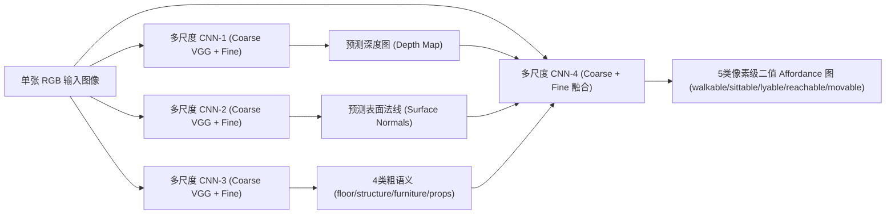

# A Multi-scale CNN for Affordance Segmentation in RGB Images

**A Multi-Scale CNN for Affordance Segmentation in RGB Images**（ECCV 2016，Oregon State University）收录于 [Awesome-Affordance-Learning](https://github.com/hq-King/Awesome-Affordance-Learning)，属于具身 AI affordance 学习综述的配套论文清单。本页基于论文全文完成结构化精读与核实。

## 一句话定义

**A Multi-Scale CNN for Affordance Segmentation in RGB Images** 是一套完全基于单目 RGB 输入的前馈多尺度卷积架构：先由三个独立多尺度 CNN 提取深度、表面法线与四类粗粒度表面语义等中层几何线索，再由第四个多尺度 CNN 融合像素与中层线索输出五类即时室内交互 affordance 像素分割图。

## 英文缩写速查

| 缩写 | 英文全称 | 简要说明 |
|------|----------|----------|
| CNN | Convolutional Neural Network | 卷积神经网络，本文以多尺度粗/细双分支结构预测中层线索与 affordance |
| RANSAC | Random Sample Consensus | 随机抽样一致算法，用于从 RGB-D 真值生成阶段拟合 3D 分片平面 |
| IoU | Intersection over Union | 交并比，本文在二值 affordance 掩码正像素区域上严格计算该指标 |
| AMT | Amazon Mechanical Turk | 众包标注平台，用于对半自动生成的 NYUv2 affordance 真值做人工纠偏与多数投票 |
| HOI | Human-Object Interaction | 人–物交互，本文不依赖人体骨架或交互姿态作为测试期输入 |

## 为什么重要

- 早期室内 affordance 推理要么依赖脆弱的手工几何规则，要么在场景中“幻想（hallucinate）”人体骨架或执行耗时能量最小化闭环（closing the loop）；而按物体类别直接映射（如把椅子一律标为 `sittable`）会忽略空间遮挡与环境上下文（塞在桌子下的椅子不具备**即时** `sittable` 性）。
- 本文率先验证了**纯前馈、无人体骨架假设**的像素级端到端思路：用中层 3D 几何与粗粒度语义（`floor / structure / furniture / props`）作为隐式场景表征，单图推理仅约 **0.15 秒**（Tesla K80），并首次为 **NYUv2** 补充了 1,449 张图像的五类稠密像素级 affordance 标注。

## 核心信息

| 字段 | 内容 |
|------|------|
| 出处 | ECCV 2016 |
| 作者与机构 | Anirban Roy, Sinisa Todorovic（School of Electrical Engineering and Computer Science, Oregon State University） |
| 分组 1 | Perception · Scope: Scene；Perception Subcategory: Visual |
| 分组 2 | Datasets / Benchmarks · Data Modality: image |
| 论文 | <https://web.engr.oregonstate.edu/~sinisa/research/publications/eccv16_affordance.pdf> |

## 核心机制

1. **五类“即时（Immediate）”室内 Affordance 定义与 NYUv2 半自动真值构建**
   - 仅考虑无需前置动作即可由人直接执行的五类全身/手部即时交互：`walkable`（近地水平面且上方净空）、`sittable`（特定高度水平面且上方/四周净空）、`lyable`（满足人体卧姿面积的 `sittable` 面）、`reachable`（站立手可触及高度且四周有站位净空）、`movable`（`reachable` 且面积足够小可用手轻松移动的物体）。
   - **真值生成（仅利用 NYUv2 训练/标注期 RGB-D + 40 类物体标注）**：将 RGB-D 对齐至地面为 $X$-$Y$ 平面、$Z$ 轴为高度；计算像素表面法线并用 **RANSAC** 拟合 3D 分片平面（水平/垂直法线容差 $\pm 10^\circ$），统计平面高度 $h$、最大凸面积 $s$ 与周围 $1\text{ ft}$ 净空（表 1 约束见下），结合物体类别白名单筛选候选 affordance；随后经 AMT 人工纠偏与多数投票。
   - 统计显示：**72%** 的自动标注经过人工修正（每类约 30–40 秒），自动标注与人工修正后真值的 IoU 仅 **67%**；18% 的像素同时具有多个 affordance 标签，地板像素中也只有 **79%** 属于 `walkable`。

   | Affordance 类型 | 表面朝向 | 高度 $h$（ft / m） | 面积 $s$（$\text{ft}^2$ / $\text{m}^2$） | 上方净空 | 四周净空 | NYUv2 图像出现率 / 像素占比 |
   |------|------|------|------|------|------|------|
   | Walkable | 水平 | $\le 1 / 0.3$ | $\ge 2.5 / 0.23$ | Yes | No | 83% / 12% |
   | Sittable | 水平 | $1.5\text{–}3.5 / 0.45\text{–}1.0$ | $\ge 1 / 0.1$ | Yes | Yes | 60% / 5% |
   | Lyable | 水平 | $1.5\text{–}3.5 / 0.45\text{–}1.0$ | $\ge 10 / 0.9$ | Yes | Yes | 22% / 11% |
   | Reachable | 水平 / 垂直 | $1.5\text{–}7 / 0.45\text{–}2.1$ | N/A | No | Yes | 100% / 65% |
   | Movable | 水平 / 垂直 | $1.5\text{–}7 / 0.45\text{–}2.1$ | $\le 2.5 / 0.23$ | 二选一 | 二选一 | 93% / 11% |

2. **四组多尺度 CNN 前馈中层线索提取与融合**
   - 借鉴 Eigen & Fergus [24] 架构，为兼顾效率仅保留**粗尺度（Coarse-scale）+ 细尺度（Fine-scale）**两级分支：
     - **Coarse-scale**：以 **VGG Net** 初始化，将全连接层替换为 $1 \times 1$ 卷积，输出下采样至原图 $1/16$ 后上采样至 $1/4$，捕获全局场景布局与上下文。
     - **Fine-scale**：随机初始化，将输入图经单步卷积+池化匹配至 $1/4$ 分辨率后与 Coarse 输出拼接，全程不再降采样以保留边缘与小物体细节，最终上采样回原图分辨率。
   - **三路中层线索 CNN（仅以单张 RGB 为输入）**：
     - **CNN-1（深度估计）**：对数尺度不变损失 + $x/y$ 梯度结构感知损失 $L_{\text{depth}}$（训练 2M 步）。
     - **CNN-2（表面法线）**：点积余弦损失 $L_{\text{norm}} = -\frac{1}{I}\sum_i n_i \cdot \hat{n}_i$（训练 1.5M 步）。
     - **CNN-3（粗粒度语义分割）**：仅预测 **4 类高阶表面**（`floor`、`structure`、`furniture`、`props`），以交叉熵损失训练 1.5M 步——作者指出相比 40 类细粒度物体，4 类高阶表面样本更充足且能泛化到未见新物体。
   - **CNN-4（Affordance 融合预测）**：将三路中层线索输出与原始 RGB 图像拼接，经同样结构的粗/细多尺度 CNN 输出 **5 张二值 affordance 图**（交叉熵损失训练 2M 步；795 张训练图经平移、镜像、小角度旋转与对比度增强扩展 3 倍）。

### 方法流程图

## 评测与指标

在 **NYUv2 Affordance 扩展数据集**（795 训练 / 654 测试，测试期仅输入 RGB，评价指标为正像素区域 **IoU %**）上的消融与架构对比结果如下：

| 对比组 / 变体（Table 2 & Table 3） | Walkable ↑ | Sittable ↑ | Lyable ↑ | Reachable ↑ | Movable ↑ | Avg. IoU ↑ |
|------|------|------|------|------|------|------|
| **w/o Mid-level**（RGB 直接预测） | 58.45 | 24.63 | 31.20 | 50.54 | 34.20 | 39.80 |
| **w/o Depth**（去掉深度线索） | 63.23 | 31.44 | 36.10 | 57.24 | 43.84 | 46.37 |
| **w/o Sem**（去掉 4 类语义线索） | 62.24 | 32.42 | 37.84 | 58.28 | 41.70 | 46.50 |
| **w/o Surf Norm**（去掉法线线索） | 64.36 | 32.32 | 37.77 | 57.70 | 44.64 | 47.36 |
| **Coarse scale only**（仅粗尺度分支） | 62.41 | 29.01 | 35.43 | 55.54 | 40.25 | 44.53 |
| **Fine scale only**（仅细尺度分支） | 64.67 | 31.58 | 37.74 | 57.86 | 43.67 | 47.10 |
| **Our approach (both + all cues)** | **66.74** | **34.44** | **40.18** | **60.01** | **46.42** | **49.56** |
| **w GT**（使用真值深度/法线/语义上界） | 70.43 | 37.61 | 43.33 | 63.41 | 51.37 | 53.23 |

> 注：原文正文（Sec. 6）有一处笔误称“Coarse-scale 优于 Fine-scale”，但 Table 3 实测数据明确为 Fine-scale only（47.10%）高于 Coarse-scale only（44.53%），双尺度联合达到 **49.56%**（距真值中层线索 Oracle 上界 53.23% 仅差 3.67%）。

## 与其他工作对比

- **对比能量最小化“闭环”场景解析（Hoiem et al.）与人体骨架幻想法（Gupta et al. / Fouhey et al.）**：骨架拟合会把桌面上方误标为 `walkable/standable`，且忽略椅子上杂物对 `sittable` 的阻挡；本文严格结合高度、凸面积与上下/四周净空约束定义真值，并以前馈 CNN 避免迭代优化的高耗时（单图 ~0.15 s）。
- **对比小物体工具部位 affordance（Myers et al. / Zhu et al.）**：前者聚焦 `graspable / cuttable / scoopable` 等手持工具局部功能，本文聚焦室内全身尺度及可及空间布局下的场景 affordance；因任务定义与真值格式不同，本文未与外部方法做同表跨集对比。同分组横向对照见 [技术地图](../overview/affordance-awesome-technology-map.md)。

## 常见误区或局限

1. **杂乱遮挡导致 3D 垂直支撑关系误判**：论文 Failure Case（Fig. 6）指出，当桌子下方地板存在部分遮挡与杂物时，中层深度估计无法分辨“桌子悬于地板正上方”，会误将桌底地板判为 `walkable`。
2. **中层线索未端到端联合微调**：CNN-1/2/3 与 CNN-4 是分任务独立训练后级联的，中层分支未针对下游 affordance 损失反向传播协同优化（原文明确未单独评测中层预测精度）。
3. **即时性与尺寸假设的边界**：`movable` 限制面积 $\le 2.5\text{ ft}^2$，排除了可推动的大型家具（如椅子）；`reachable` 仅考虑站立不弯腰/不攀爬的手臂可及范围；此外原文未提供公开代码仓库链接（开源状态需自行确认）。

## 结论

**Roy & Todorovic (ECCV 2016) 证明了单目 RGB 图像通过多尺度 CNN 显式预测“深度 + 法线 + 4 类粗语义”中层线索再前馈融合，比直接端到端像素回归显著提升 9.76 个百分点平均 IoU（39.80% → 49.56%）。**

- 做场景级室内可通行/可放置/可抓取区域感知时，引入深度、法线与粗粒度表面语义（`floor/structure/furniture/props`）作为中间表征，既能保留 3D 几何约束又避免细粒度物体类别过拟合。
- 构建像素级 affordance 数据集时，不能仅靠物体类别白名单或纯 RANSAC 规则自动生成（自动规则与人工校正真值 IoU 仅 67%），必须加入净空/面积几何校验与人工复核。
- 对于存在上下层遮挡的室内导航或移动操作场景（如桌下地面），单帧 RGB 中层线索仍易出错，实际工程部署宜结合多视角或真实深度传感器校验垂直净空。

## 关联页面

- [Affordance 学习综述](../entities/paper-affordance-learning-embodied-ai-survey.md)
- [Awesome-Affordance-Learning 技术地图](../overview/affordance-awesome-technology-map.md)
- [manipulation.md](../tasks/manipulation.md)、[vla.md](../methods/vla.md)

## 参考来源

- [`sources/papers/affordance_awesome_a-multi-scale-cnn-for-affordance-segmentation-in-rgb-ima.md`](../../sources/papers/affordance_awesome_a-multi-scale-cnn-for-affordance-segmentation-in-rgb-ima.md) — 本条目策展摘录
- [`sources/papers/affordance_awesome_catalog.md`](../../sources/papers/affordance_awesome_catalog.md) — 列表总表
- [`sources/repos/awesome-affordance-learning.md`](../../sources/repos/awesome-affordance-learning.md)
- 论文：<https://web.engr.oregonstate.edu/~sinisa/research/publications/eccv16_affordance.pdf>

## 推荐继续阅读

- [Awesome-Affordance-Learning 仓库](https://github.com/hq-King/Awesome-Affordance-Learning)
- [原文](https://web.engr.oregonstate.edu/~sinisa/research/publications/eccv16_affordance.pdf)
