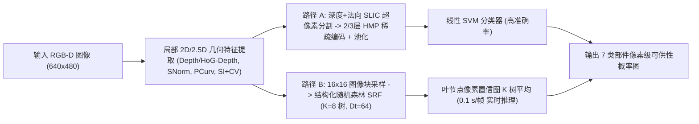

# UMD

**Affordance Detection of Tool Parts from Geometric Features**（Austin Myers, Ching L. Teo, Cornelia Fermüller, Yiannis Aloimonos，马里兰大学 UMD，ICRA 2015）收录于 [Awesome-Affordance-Learning](https://github.com/hq-King/Awesome-Affordance-Learning)，是物体部件级视觉–空间可供性检测与数据集建设的经典代表作。

## 一句话定义

通过从 RGB-D 局部图像块中提取视角不变的 2D/2.5D 几何特征，结合**超像素分层稀疏编码（S-HMP）**与**结构化随机森林（SRF）**实现未见工具部件的像素级「有效可供性（effective affordance）」定位，并发布经典的 **UMD RGB-D Part Affordance 数据集**。

## 英文缩写速查

| 缩写 | 英文全称 | 简要说明 |
|------|----------|----------|
| Affordance | Action possibility (Gibson) | 环境/物体对 agent 提供的可交互机会（本文聚焦工具作用于他物的有效可供性） |
| HOI | Human-Object Interaction | 人–物交互，常作 affordance 监督来源 |
| VLM | Vision-Language Model | 视觉–语言模型，用于 affordance 推理与接地 |
| VLA | Vision-Language-Action | 视觉–语言–动作策略 |
| S-HMP | Superpixel-based Hierarchical Matching Pursuit | 基于超像素池化的多层稀疏编码字典 + 线性 SVM 可供性检测方法 |
| SRF | Structured Random Forest | 在叶节点保留结构化像素置信图、支持 0.1 s/帧实时推理的随机森林 |
| SI+CV | Shape-Index and Curvedness | 由主曲率 $(\kappa_1,\kappa_2)$ 导出、范围 $[-1,+1]$ 的视角无关表面几何描述子 |

## 为什么重要

- 传统目标检测只能输出物体类别与外接框，无法告诉机器人「未知造型汤勺的哪一部分可握持（grasp）、哪一部分可盛汤（contain）」。本文抓住了**局部物理几何与功能高度绑定**的规律（例如马克杯底部可用于砸击 `pound`、锅铲边缘可用于切割 `cut`），让检测跨物体类别泛化到全新工具。
- 所构建的 **UMD RGB-D Part Affordance 数据集**（105 种厨具/车间/园艺工具、17 类别、7 类排序可供性标注、>10,000 像素级标注帧及 3 段杂乱多视角序列）成为后续大量像素级可供性分割研究（如 [综述实体页](../entities/paper-affordance-learning-embodied-ai-survey.md) 中 Perception 分支）的基准起点。
- 可顺着 [技术地图](../overview/affordance-awesome-technology-map.md) 对照早期几何基元方法与后期深度学习/VLM 方法的演进。

## 核心信息

| 字段 | 内容 |
|------|------|
| 作者与机构 | Austin Myers, Ching L. Teo, Cornelia Fermüller, Yiannis Aloimonos（University of Maryland, College Park） |
| 出处 | IEEE International Conference on Robotics and Automation (ICRA), 2015 |
| 方法名（清单标注） | UMD |
| 分组 1 / 分组 2 | Perception（Object；Visual · Spatial） ｜ Datasets / Benchmarks（image / RGB-D） |
| 论文 / 资源主页 | <http://users.umiacs.umd.edu/~fermulcm/affordance/ICRA15_affordance_parts_final.pdf> · <http://www.umiacs.umd.edu/~amyers/part_affordance/> |

## 核心机制（归纳）

1. **视角鲁棒的局部 2D/2.5D 几何特征集**：从 $N\times N$ RGB-D 局部图像块中提取 4 类几何特征以抑制外观纹理与相机视角变化：
   - **Depth / HoG-Depth**：平滑插值去噪并减去块均值以消除绝对深度偏移；S-HMP 直接编码块深度，SRF 采用 4 方向梯度直方图（HoG-Depth）。
   - **表面法向（SNorm）**：由深度相机内参恢复 3D 点云估计局部表面法向并去均值。
   - **主曲率（PCurv）**：$(\kappa_1, \kappa_2),\ \kappa_1 > \kappa_2$，刻画表面在不同正交方向的弯曲程度，具有外在视角不变性。
   - **形状指数与曲度（SI+CV）**：由主曲率计算 $\text{SI}=-\frac{2}{\pi}\arctan\frac{\kappa_1+\kappa_2}{\kappa_1-\kappa_2}$ 与 $\text{CV}=\sqrt{(\kappa_1^2+\kappa_2^2)/2}$，归一化至 $[-1, +1]$。
2. **方法一：S-HMP（高精无监督特征路线）**：使用融合深度与表面法向的改进 **SLIC** 算法将 RGB-D 图像过分割为表面碎片超像素；对各几何通道分别用 2 层与 3 层 **HMP（$L_0$ 稀疏编码字典 + 最大池化）**学习抽象特征；在每个超像素内对稀疏编码做最大池化，最终由线性 SVM 输出各可供性概率。
3. **方法二：SRF（实时结构化森林路线）**：针对 $N=16$ 局部特征块训练 $K=8$ 棵最大深度 $D_t=64$ 的决策树；通过 k-means 将结构化标注块聚为 $|L|=10$ 个离散聚类中心，以基尼不纯度信息增益分裂节点，并在叶节点直接存储**像素级可供性置信图**；推理时将单帧 640×480 RGB-D（每块过 $K$ 棵树并均值融合）在 **0.1 s** 内生成稠密像素概率图。
4. **UMD RGB-D Part Affordance 数据集**：Kinect 传感器于约 0.8 m 距离、转台 360° 采集 105 件工具（每件约 300 帧，共 >30,000 帧 RGB-D，其中 **>10,000 帧**带人工像素级多可供性排序标签），覆盖 7 类可供性：`grasp`、`cut`、`scoop`、`contain`、`pound`、`support`、`wrap-grasp`，并附 3 段移动机器人采集的杂乱多物体序列（每段约 1,000 帧）。

### 方法流程图

## 评测与指标

### 1. UMD RGB-D Part Affordance 数据集表现（Table IIa）

评价指标包括加权 F-measure $F_\beta^w$（$\beta=1$）、排序加权 $R_\beta^w$ 及像素级 Kendall 秩相关 $\bar{\tau}_k \in [-1, 1]$：

| 评测子集 | 方法 | $F_\beta^w$ (Mean) | $R_\beta^w$ (Mean) | $\bar{\tau}_k$ (Mean) | 单类最高 $F_\beta^w$ 表现 |
|---------|------|--------------------|--------------------|----------------------|--------------------------|
| 非杂乱单物体子集 | **S-HMP** | **0.557** | **0.082** | **0.751** | `contain` **0.810** / `wrap-grasp` **0.767** / `pound` **0.643** |
| 非杂乱单物体子集 | **SRF** | **0.460** | **0.081** | **0.643** | `wrap-grasp` **0.666** / `contain` **0.635** |
| 杂乱多物体+遮挡子集 | **S-HMP** | **0.250** | **0.105** | **0.563** | `contain` **0.437** / `support` **0.297** |
| 杂乱多物体+遮挡子集 | **SRF** | **0.165** | **0.083** | **0.435** | `contain` **0.322** / `grasp` **0.200** |

### 2. 几何特征消融与 Cornell Grasping Dataset 对比（Table IIb & IIc）

- **几何特征消融（Table IIb）**：对 `SRF` 而言，仅用 Depth 特征 $F_\beta^w$ 为 **0.323**，逐步叠加法向/主曲率/SI+CV 后大幅提升至 **0.460**（**+0.137**）；而直接用原始 RGB-D 像素值训练 SRF 仅得 **0.055**。`S-HMP` 仅凭 Depth 即可由多层稀疏编码拿到 **0.539**，完整几何特征为 **0.557**（`Depth+SNorm+PCurv` 达 **0.562**，完整特征在排序和杂乱场景更优）。
- **Cornell Grasping Dataset（5 折平均，Table IIc）**：
  - **S-HMP**：抓取识别准确率 **95.2%**，点级检测准确率 **92.0%**（超越深度学习基线 **SAE [25]** 的 **93.7% / 88.4%**）。
  - **SRF**：识别 **93.5%**、检测 **87.0%**（显著优于标准 20 树随机森林 **RF** 的 **85.3% / 62.5%**），接近深度学习 SAE 精度，而单帧推理耗时仅 **0.1 s**（SAE 需 **30 s**，**快 300 倍**）。

## 与其他工作对比

- **相比深度学习抓取检测器（Lenz et al. SAE [25]）**：SAE 仅输出抓取矩形框且单帧推理约 30 s；本文以轻量几何特征分别给出精度更高（S-HMP 92.0% vs. 88.4%）和实时级（SRF 0.1 s）的**像素级**多可供性预测。
- **相比物体级属性/3D CAD 匹配方法**：不依赖完整 3D 网格模型或先验物体分割框，可直接泛化到从未见过的工具类别（如用马克杯底部替代锤子）。
- 现代基于 CNN/Transformer/VLM 的可供性分割对比可参看 [Affordance 学习综述](../entities/paper-affordance-learning-embodied-ai-survey.md) 与 [技术地图](../overview/affordance-awesome-technology-map.md)。

## 常见误区或局限

1. **高精度（S-HMP）与实时性（SRF）不可兼得**：S-HMP 的精度与抗杂乱遮挡能力全面优于 SRF，但多层稀疏编码计算开销巨大无法实时；SRF 可达 0.1 s/帧（10 Hz）但杂乱场景掉点严重（$F_\beta^w$ 从 0.460 降至 0.165），且多类分离度较弱。
2. **仅依赖局部几何形状，缺乏材质与物理语义**：只看表面深度/曲率，无法分辨材质软硬、重量或易碎性（如纸杯与铁锤底部几何相似但物理承受力完全不同），论文在结论中指出需进一步结合视觉材质识别或触觉感知。
3. **数据集采集距离与传感器假设**：UMD 数据集基于 Kinect 在约 0.8 m 近距采集；当远距离或强反光/细薄边缘导致深度缺失严重时，局部法向与二阶曲率估计会退化。且本论文未进行机械臂闭环实际操作验证。

## 结论

**UMD（ICRA 2015）通过「视角无关局部几何描述子 + S-HMP / SRF 双路线」首次规模化解决了工具部件级多可供性像素定位问题，其核心遗产是验证了局部 2.5D 几何对跨类别功能泛化的决定性作用与 UMD 数据集基准。**

1. **原始 RGB-D 直输远不如显式几何导数特征**：SRF 上原始 RGB-D 仅得 $F_\beta^w = 0.055$，引入法向与主曲率/形状指数后跃升至 $0.460$，证明显式几何不变量在传统分类器中不可替代。
2. **工程部署按需二选一**：离线/静态场景追求高精排序与抗遮挡选 `S-HMP`（$\bar{\tau}_k = 0.751$，Cornell 92.0%）；需要机载 10 Hz 实时反馈选 `SRF`（0.1 s/帧，比同期深度模型快 300 倍）。
3. **杂乱与遮挡仍是早期几何方法的硬伤**：从单物体切换到杂乱多物体时，两类方法 $F_\beta^w$ 均腰斩以上（S-HMP 0.557→0.250，SRF 0.460→0.165），凸显了后续引入全局语义上下文与多尺度深度网络的必要性。
4. **注意物理可行性边界**：几何可供性只回答「形状上像不像某功能部位」，真机执行仍需叠加材质、力学与碰撞约束。

## 关联页面

- [Affordance 学习综述](../entities/paper-affordance-learning-embodied-ai-survey.md)
- [Awesome-Affordance-Learning 技术地图](../overview/affordance-awesome-technology-map.md)
- [manipulation.md](../tasks/manipulation.md)、[vla.md](../methods/vla.md)

## 参考来源

- [`sources/papers/affordance_awesome_affordance-detection-of-tool-parts-from-geometric-featur.md`](../../sources/papers/affordance_awesome_affordance-detection-of-tool-parts-from-geometric-featur.md) — 本条目策展摘录
- [`sources/papers/affordance_awesome_catalog.md`](../../sources/papers/affordance_awesome_catalog.md) — 列表总表
- [`sources/repos/awesome-affordance-learning.md`](../../sources/repos/awesome-affordance-learning.md)
- 论文：<http://users.umiacs.umd.edu/~fermulcm/affordance/ICRA15_affordance_parts_final.pdf>

## 推荐继续阅读

- [Awesome-Affordance-Learning 仓库](https://github.com/hq-King/Awesome-Affordance-Learning)
- [原文](http://users.umiacs.umd.edu/~fermulcm/affordance/ICRA15_affordance_parts_final.pdf)
- [UMD RGB-D Part Affordance 数据集与代码主页](http://www.umiacs.umd.edu/~amyers/part_affordance/)
