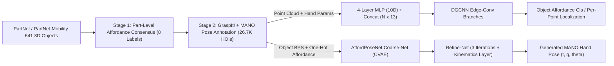

# AffordPose

**AffordPose: A Large-Scale Dataset of Hand-Object Interactions with Affordance-Driven Hand Pose**（ICCV 2023）收录于 [Awesome-Affordance-Learning](https://github.com/hq-King/Awesome-Affordance-Learning)，属于具身 AI affordance 学习综述的配套论文清单。本页是 **清单索引**：给出它在综述分类里的位置与原文入口，方法细节和量化结果请看原文。

## 一句话定义

AffordPose: A Large-Scale Dataset of Hand-Object Interactions with Affordance-Driven Hand Pose——在清单中归入 **Perception（Scope: Object；Perception Subcategory: Spatial · Interaction-driven） ｜ Datasets / Benchmarks（Data Modality: 3D）**（清单未附方法摘要，此处不替原文概括贡献）。

## 英文缩写速查

| 缩写 | 英文全称 | 简要说明 |
|------|----------|----------|
| Affordance | Action possibility (Gibson) | 环境/物体对 agent 提供的可交互机会 |
| HOI | Human-Object Interaction | 人–物交互，常作 affordance 监督来源 |
| VLM | Vision-Language Model | 视觉–语言模型，用于 affordance 推理与接地 |
| VLA | Vision-Language-Action | 视觉–语言–动作策略 |

## 为什么重要

- 综述把 affordance 学习拆成感知、推理、引导动作三段（见 [综述实体页](../entities/paper-affordance-learning-embodied-ai-survey.md)），本条目是其中一段的代表文献之一。
- 可顺着 [技术地图](../overview/affordance-awesome-technology-map.md) 的同分组条目横向阅读同方向工作。

## 核心信息

| 字段 | 内容 |
|------|------|
| 出处 | ICCV 2023 |
| 方法名（清单标注） | AffordPose |
| 分组 1 | Perception · Scope: Object；Perception Subcategory: Spatial · Interaction-driven |
| 分组 2 | Datasets / Benchmarks · Data Modality: 3D |
| 论文 | <https://openaccess.thecvf.com/content/ICCV2023/html/Jian_AffordPose_A_Large-Scale_Dataset_of_Hand-Object_Interactions_with_Affordance-Driven_Hand_ICCV_2023_paper.html> |

## 核心机制（归纳）

> 注：以下机制与评测指标基于通读 CVF 开放获取原文全文核对补充（[原文](https://openaccess.thecvf.com/content/ICCV2023/html/Jian_AffordPose_A_Large-Scale_Dataset_of_Hand-Object_Interactions_with_Affordance-Driven_Hand_ICCV_2023_paper.html)）。

**AffordPose** 将「部位级（part-level）手部中心 affordance」引入三维手–物交互（HOI）数据构建与下游理解/生成任务，核心包含数据构建管线与三项验证模型：

1. **两阶段 Affordance 驱动手姿数据构建**：
   - **对象与标签准备**：从 PartNet 与 PartNet-Mobility 的 13 个物体类别中筛选 641 个 3D 物体网格并按人手尺度归一化，定义 8 类以手为中心的部位级 affordance（`handle-grasp`、`press`、`lift`、`pull`、`twist`、`wrap-grasp`、`support`、`lever`；每物体含 1–5 类）。
   - **阶段 1（部位级 Affordance 标注）**：基于 PartNet 最细粒度层级语义分割，由 5 名志愿者讨论达成共识，为功能部件赋予 affordance 标签（无功能部件标为 `no affordance`）。
   - **阶段 2（GraspIt! + MANO 手姿标注）**：在 GraspIt! 仿真界面按 affordance 高亮部位后，14 名志愿者手动调整 **MANO** 关节手模型（固定形状参数 $\beta$，调节手掌外参 $p=\{t, q\}$ 与 16 个关节自由度内参 $\theta \in \mathbb{R}^{16}$），并运行 GraspIt! 力分析避免穿模与物理不可行姿态，共采集 **26,712** 组手–物交互（平均每物体 42 组）。
2. **手–物 Affordance 理解网络（DGCNN）**：
   - **输入/输出**：输入目标物体点云（$N \times 3$）与手姿参数（仅内参 $\theta$ 或全部参数 $\{t, q, \theta\}$）；输出物体级 affordance 分类标签（Classification 分支）或逐点功能部件分割标签（Segmentation 分支）。
   - **核心模块**：用 4 层 MLP 将手姿参数编码为 10 维向量并拼接至每个点坐标得到 $P' \in \mathbb{R}^{N \times 13}$，再送入带 Edge-Conv 的 **DGCNN** 分类/分割分支完成预测。
3. **Affordance 导向交互生成网络（AffordPoseNet）与图像基线**：
   - **AffordPoseNet（基于 GrabNet 扩展）**：将 affordance 标签编码为 one-hot 条件向量，与物体 BPS（Basis Point Set）特征拼接后，依次送入基于 CVAE 的 **Coarse-Net**（Encoder–Decoder 采样隐变量 $z$ 生成粗手姿）与迭代 3 次的 **Refine-Net**（含 Kinematics Layer）输出 MANO 手姿参数；另基于渲染的 3 视角 RGB 图像使用 **ResNet-18** 做交互分类、使用改进版 **I2LMeshNet** 做带 affordance 条件的手部网格恢复（原文未单独展开显式损失公式，沿用对应基线网络训练目标）。

### 方法流程图

## 评测与指标

- 综述本身不提供跨论文性能排名（见 [综述实体页](../entities/paper-affordance-learning-embodied-ai-survey.md)），以下指标均摘自 [原文](https://openaccess.thecvf.com/content/ICCV2023/html/Jian_AffordPose_A_Large-Scale_Dataset_of_Hand-Object_Interactions_with_Affordance-Driven_Hand_ICCV_2023_paper.html) 在 AffordPose 数据集（8:1:1 训练/验证/测试划分）上的实验：
- **手–物 Affordance 理解（DGCNN，Table 3）**：
  - 物体级分类准确率（8 类均值）：仅输入关节内参 $\theta$ 为 **94.40%**，输入全部姿态参数 $\{t, q, \theta\}$ 升至 **98.39%**（其中 `Support` 91.58%→99.65%、`Twist` 90.13%→98.35%）。
  - 逐点部件定位 IoU（8 类均值）：仅内参为 **95.36%**，全参数为 **96.29%**（小部件如背包拉链 `Pull` 为 **77.78%**）。
- **Affordance 导向交互生成（扩展测试集含额外 211 个仅带部件标注的物体，Table 4）**：
  - `GrabNet` 基线（无 affordance 条件）：穿透深度 `Penet.Depth` **0.87 cm**、交叠体积 `Solid.Intsec.Vol` **3.20 cm³**、接触率 **96.06%**，但对多 affordance 物体只能生成单一高频抓握，无法按 affordance 条件区分。
  - `AffordPoseNet`（8 类均值）：`Penet.Depth` **0.89 cm**、`Solid.Intsec.Vol` **4.57 cm³**、接触率 **96.06%**、Affordance 条件匹配准确率 **83.51%**（`Wrap-grasp` 达 **98.63%**、`Press` **95.24%**，但小部件 `Pull` **0%**、`Twist` **53.13%** 仍有接触定位偏移）。
- **RGB 渲染图像下游应用（每实例随机渲染 3 视角，Table 5 & 6）**：
  - 交互分类（`ResNet-18`）：平均精确率 **97.31%**、平均召回率 **97.29%**。
  - 手部网格恢复（改进 `I2LMeshNet` + affordance 条件）：平均顶点误差 `MPVPE` **16.4 mm**、平均关节角度误差 `MPJRE (AUC)` **0.1892**。
- **已知局限**：`pull`/`twist` 等对应极小可交互部件（如拉链、瓶盖）在生成任务上易出现接触区域偏移，作者指出需结合物理仿真器后处理优化；当前数据集聚焦单手静态交互，尚未覆盖动态序列与双手协同操作。

## 与其他工作对比

- 本页不做与具体基线的数值对比；同分组横向对照见 [技术地图](../overview/affordance-awesome-technology-map.md)。
- 若站内另有这篇的深读页，以那一页为准。

## 结论

**AffordPose 构建了首个以 8 类部位级（part-level）手部 affordance 显式驱动 MANO 手姿标注的大规模 3D 手–物交互数据集（641 物体、26.7K 交互）。**

- 部位级 affordance 同时决定手姿的接触位置与关节构型：同一 affordance 跨物体类别保持相似关节构型，同一物体的不同 affordance 则对应截然不同的手部外参和内参。
- 在下游理解（DGCNN 分类 98.39% / 定位 IoU 96.29%）与条件生成（AffordPoseNet 条件匹配率 83.51%）上，均验证了显式部件级 affordance 标签优于仅依赖通用人类意图或无条件抓握合成。
- 对极小部件（拉链 `pull`、瓶盖 `twist`）的生成接触定位仍是短板，工程落地时可叠加接触约束或物理仿真优化。
- 原文摘要提供项目主页 <https://github.com/GentlesJan/AffordPose>，但本页未拉取和运行仓库代码，复现前请核对数据许可与标注脚本。

## 常见误区

1. 不要把分类标签当作论文结论；标签来自清单维护者的归类。
2. 不要把本页当作方法证明；它只是清单入口。

## 关联页面

- [Affordance 学习综述](../entities/paper-affordance-learning-embodied-ai-survey.md)
- [Awesome-Affordance-Learning 技术地图](../overview/affordance-awesome-technology-map.md)
- [manipulation.md](../tasks/manipulation.md)、[vla.md](../methods/vla.md)

## 参考来源

- [`sources/papers/affordance_awesome_affordpose-a-large-scale-dataset-of-hand-object-interact.md`](../../sources/papers/affordance_awesome_affordpose-a-large-scale-dataset-of-hand-object-interact.md) — 本条目策展摘录
- [`sources/papers/affordance_awesome_catalog.md`](../../sources/papers/affordance_awesome_catalog.md) — 列表总表
- [`sources/repos/awesome-affordance-learning.md`](../../sources/repos/awesome-affordance-learning.md)
- 论文：<https://openaccess.thecvf.com/content/ICCV2023/html/Jian_AffordPose_A_Large-Scale_Dataset_of_Hand-Object_Interactions_with_Affordance-Driven_Hand_ICCV_2023_paper.html>

## 推荐继续阅读

- [Awesome-Affordance-Learning 仓库](https://github.com/hq-King/Awesome-Affordance-Learning)
- [原文](https://openaccess.thecvf.com/content/ICCV2023/html/Jian_AffordPose_A_Large-Scale_Dataset_of_Hand-Object_Interactions_with_Affordance-Driven_Hand_ICCV_2023_paper.html)
