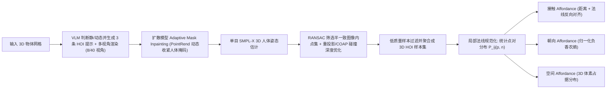

# ComA

**Beyond the Contact: Discovering Comprehensive Affordance for 3D Objects from Pre-trained 2D Diffusion Models**（ECCV 2024，arXiv:2401.12978v3，Seoul National University & Naver Webtoon AI）收录于 [Awesome-Affordance-Learning](https://github.com/hq-King/Awesome-Affordance-Learning)，属于具身 AI affordance 学习综述的配套文献。本页基于论文全文完成结构化精读与核实。

## 一句话定义

**ComA（Comprehensive Affordance）** 是一种面向任意 3D 物体网格的全方位人–物交互表征，通过对预训练 2D 修复扩散模型执行 **Adaptive Mask Inpainting** 并在弱多视角几何与碰撞约束下提升至 3D，联合建模人–物表面点对的**接触、相对法线朝向与宏观空间分布**。

## 英文缩写速查

| 缩写 | 英文全称 | 简要说明 |
|------|----------|----------|
| ComA | Comprehensive Affordance | 本文提出的全方位 3D 可交互性分布 $\mathcal{P}_{ij}(\mathbf{p},\mathbf{n})$ |
| HOI | Human-Object Interaction | 人–物交互，涵盖接触与非接触空间/朝向关系 |
| SMPL-X | Skinned Multi-Person Linear Model (Expressive) | 包含身体、手部与面部的三维参数化人体网格模型 |
| SIM / MAE | Similarity Score / Mean Absolute Error | 归一化接触分布直方图的相似度与平均绝对误差 |
| RMSE | Root Mean Square Error | 均方根误差，用于衡量图像修复前后非人体背景区域的像素保持度 |

## 为什么重要

- 既往 3D affordance 研究（如 IAGNet、DECO）普遍将其简化为物理接触热图且高度依赖人工标注，无法刻画人类使用笔记本电脑、显示器、望远镜等物体时的非接触距离与朝向规律（如面部朝向屏幕、眼睛贴近目镜）。
- 本文挖掘预训练 2D 扩散模型中隐含的丰富交互常识，无需人工 3D 标注即可自动合成规模化 3D HOI 样本，并在 BEHAVE 接触分布评测中反超全监督基线，同时支持 T-pose 人体优化重建与同类别物体迁移。

## 核心信息

| 字段 | 内容 |
|------|------|
| 出处 | ECCV 2024（arXiv:2401.12978v3） |
| 作者与机构 | Hyeonwoo Kim*, Sookwan Han*, Patrick Kwon, Hanbyul Joo（SNU, Naver Webtoon AI） |
| 方法名（清单标注） | ComA |
| 清单分组 1 | Perception · Scope: Object；Perception Subcategory: Spatial |
| 论文与源码 | <https://doi.org/10.1007/978-3-031-72983-6_23> · <https://arxiv.org/abs/2401.12978> · <https://github.com/snuvclab/coma> |

## 核心机制

1. **多视角渲染与 Adaptive Mask Inpainting（2D HOI 生成）**
   - 利用 VLM 判断目标物体属于“静态固定”（如椅子，设 8 个等方位角视角）还是“动态移动”（如杯子，施加随机旋转平移并设 40 个视角）进行弱透视渲染；通过滑窗与物体掩码 IoU 选取初始修复掩码，并用 VLM 为每个物体生成 3 条交互文本提示。
   - **Adaptive Mask Inpainting**：标准扩散修复易篡改原物体几何或用幻觉物体替换从而产生“false affordances”。本文在去噪早中期时间步对预测去噪潜变量解码 $D(\hat{x}_0)$，并用 **PointRend** 实时分割人体掩码来动态收缩后续时间步的修复区域，保证物体原有 3D 几何投影与外观不变。
2. **弱多视角辅助的 2D-to-3D 提升（Lifting 2D to 3D）**
   - 对生成的 2D HOI 图像先用单目 3D 人体估计器预测 SMPL-X 姿态与形状；因各视角生成的人体并不多视角一致，通过 **RANSAC** 按关节重投影误差筛选出与参考帧“半一致”的内点集 $\mathcal{I}$。
   - 以渲染掩码与分割掩码 IoU 确定初始深度 $z_d$，联合**关节重投影损失** $\mathcal{L}_{\text{re-projection}}$ 与基于 **COAP** 人体 SDF 的**穿模碰撞损失** $\mathcal{L}_{\text{collision}}$ 优化绝对深度，最后滤除掩码重叠低、内点少或严重穿模的样本。
3. **ComA 联合分布与三类 Affordance 衍生**
   - 对物体（Poisson disk 采样）和 SMPL-X 人体顶点采样点对 $(i,j)$，将物体表面法线旋转至 $\hat{\mathbf{n}}=[0,0,1]^T$ 后统计相对位置 $\mathbf{p} \in \mathbb{R}^3$（体素网格）与相对法线 $\mathbf{n} \in \mathbb{S}^2$（Fibonacci 球面网格）的高斯核密度分布 $\mathcal{P}_{ij}(\mathbf{p},\mathbf{n})$，通过求期望导出三种 affordance：
     - **Contact-based**：$f_{\text{contact}}(\mathbf{p},\mathbf{n}) = \frac{1-\mathbf{n}\cdot\hat{\mathbf{n}}}{2}e^{-\|\mathbf{p}\|}$，同时约束近距离与表面法线反向对齐；
     - **Orientational**：利用归一化负香农熵 $f_{\text{orientation}}(\mathbf{n}) = 1 + \frac{\log \mathcal{P}_{ij}(\mathbf{n})}{\log n_b}$ 度量远距或贴合交互中的稳定朝向倾向；
     - **Spatial**：以体素占据 $f_{\text{spatial}}(\mathbf{p})$ 描述人体各部位相对物体的宏观空间位置。
4. **优化重构与同类别零样本迁移**：利用学得的 ComA 可将初始 T-pose 人体优化至合理 3D 交互姿态（多模态交互如秋千采用 mean-shift mode seeking 分拆），并通过物体规范化与 **CPNet** 顶点对应将模型直接迁移到同类别新网格（如不同外观摩托车）。

### 方法流程图

## 评测与指标

在 100 个 3D 物体（20 BEHAVE、10 InterCap、2 ShapeNet、8 SAPIEN、60 SketchFab）上构建 ComA，并在 **BEHAVE**（20 类交互序列，采样 2048 点）上与有监督方法对比，同时消融 Adaptive Mask Inpainting（Table 1 & Table 2）：

| 评测任务 / 方法 | $\text{SIM}_{\text{Human}}$ (%) ↑ | $\text{SIM}_{\text{Object}}$ (%) ↑ | $\text{MAE}_{\text{Human}}$ (×100) ↓ | $\text{MAE}_{\text{Object}}$ (×100) ↓ |
|------|---|---|---|---|
| IAGNet（基于 BEHAVE 测试图） | - | 63.86 | - | 0.0353 |
| IAGNet（基于本文 2D HOI 图） | - | 66.34 | - | 0.0329 |
| DECO（基于 BEHAVE 测试图） | 17.39 | - | 0.259 | - |
| DECO（基于本文 2D HOI 图） | 21.66 | - | 0.246 | - |
| **ComA（Ours，全合成 3D 提升）** | **52.82** | **70.55** | **0.126** | **0.0288** |

| 图像修复消融（691 vs 692 张图） | $\text{RMSE}_{\text{Background}}$ ↓ | $\text{mIoU}$ ↑ | $\text{mIoU}_{\text{Occlusion Aware}}$ ↑ |
|------|---|---|---|
| Vanilla Inpainting | 42.23 | 0.535 | 0.631 |
| **Adaptive Mask Inpainting（Ours）** | **15.33** | **0.706** | **0.815** |

## 与其他工作对比

- **对比单图有监督接触预测（DECO、IAGNet）**：即使用本文合成的 2D HOI 图像输入 IAGNet/DECO（66.34% / 21.66%）已优于直接输入 BEHAVE 真图（63.86% / 17.39%），证明合成 2D 样本的高真实度；而 ComA 的 3D 提升表征在人体侧（52.82% vs 21.66%）与物体侧（70.55% vs 66.34%）均进一步大幅领先。
- **对比纯接触表征**：能够额外表达非接触“注视屏幕”“使用望远镜”等朝向约束，使 T-pose 人体优化得以收敛到语义一致的交互姿态。同分组横向对照见 [技术地图](../overview/affordance-awesome-technology-map.md)。

## 常见误区或局限

1. **依赖纹理质量与人工约束扰动范围**：无纹理网格（如 InterCap）需先用 ChatGPT + TEXTure 补全纹理才利于扩散修复；动态物体采样旋转/平移范围仍依赖轻量人工设定，以回避扩散模型固有的视角偏置。
2. **逐物体建模与跨类迁移瓶颈**：ComA 为单个 3D 网格构建点对联合分布，计算开销随采样样本量增长；跨实例复用依赖类别规范化及 CPNet 顶点对应，难以直接跨越拓扑结构迥异的物体类别。
3. **2D 生成一致性风险**：若某些冷门物体在预训练 2D 扩散模型中先验不足，多视角生成的人体姿态缺乏足够 RANSAC 内点，会导致大量样本被过滤阶段剔除。
4. **开源说明**：论文脚注提供了官方代码仓库 <https://github.com/snuvclab/coma>（本页整理时未执行本地仓库代码复现）。

## 结论

**ComA 将 affordance 从“接触热图”扩展至包含接触、法线朝向与宏观空间位置的三维联合分布，并验证了利用 2D 扩散模型零标注合成 3D HOI 数据的可行性与精度优势。**

- 在用扩散修复模型合成交互数据时，采用基于中间去噪潜变量分割的 Adaptive Mask Inpainting，可把背景误差 $\text{RMSE}_{\text{Background}}$ 从 42.23 压低至 15.33，有效避免物体几何被篡改导致的伪 affordance。
- 引入法线反向对齐项与归一化香农熵，使表征既能精确定位指尖级接触，又能刻画非接触交互（如注视/朝向约束）。
- 下游将 ComA 用于机器人或人体姿态合成时，可通过均值漂移（mode seeking）拆分多模态交互（如前后双向坐姿），并用 CPNet 对应关系在同类别资产间零训练复用。

## 关联页面

- [Affordance 学习综述](../entities/paper-affordance-learning-embodied-ai-survey.md)
- [Awesome-Affordance-Learning 技术地图](../overview/affordance-awesome-technology-map.md)
- [manipulation.md](../tasks/manipulation.md)、[vla.md](../methods/vla.md)

## 参考来源

- [`sources/papers/affordance_awesome_beyond-the-contact-discovering-comprehensive-affordance.md`](../../sources/papers/affordance_awesome_beyond-the-contact-discovering-comprehensive-affordance.md) — 本条目策展摘录
- [`sources/papers/affordance_awesome_catalog.md`](../../sources/papers/affordance_awesome_catalog.md) — 列表总表
- [`sources/repos/awesome-affordance-learning.md`](../../sources/repos/awesome-affordance-learning.md)
- 论文：<https://doi.org/10.1007/978-3-031-72983-6_23>

## 推荐继续阅读

- [Awesome-Affordance-Learning 仓库](https://github.com/hq-King/Awesome-Affordance-Learning)
- [原文](https://doi.org/10.1007/978-3-031-72983-6_23)
