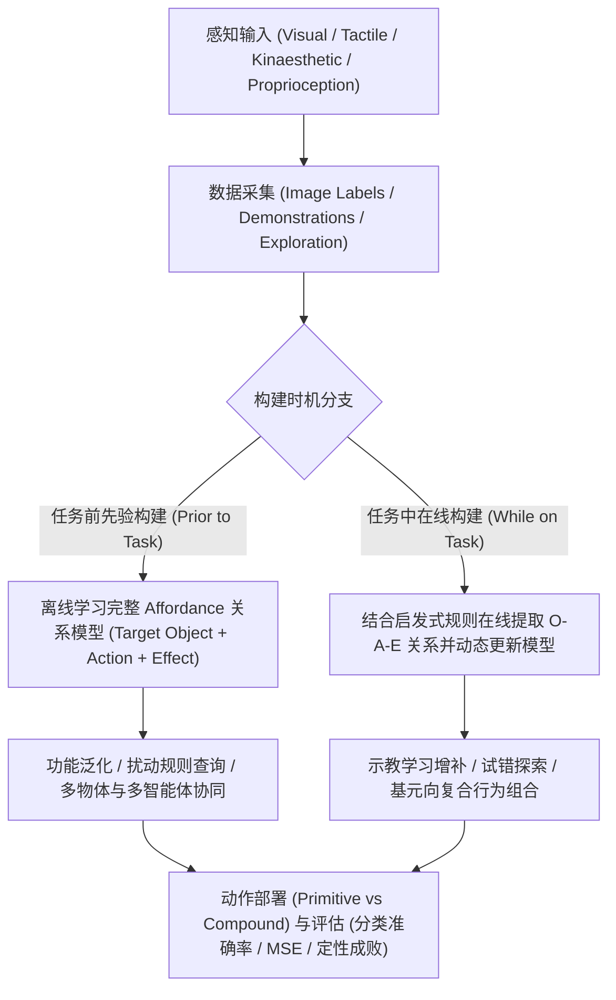

# Building Affordance Relations for Robotic Agents - A Review

**Building Affordance Relations for Robotic Agents - A Review**（IJCAI 2021 Survey Track，pp. 4302–4311，Edinburgh Centre for Robotics）收录于 [Awesome-Affordance-Learning](https://github.com/hq-King/Awesome-Affordance-Learning)，属于具身 AI affordance 学习综述的配套文献。本页基于论文全文完成结构化精读与核实。

## 一句话定义

一篇系统回顾 **2003–2020 年间 152 篇机器人 affordance 文献**的 IJCAI-21 综述，将不同流派的形式化统一抽象为**「目标物体 – 动作 – 效果」（Target Object – Action – Effect）三元 affordance 关系**，并系统剖析五大设计决策与关系构建时机（任务前先验 vs 任务中在线）如何决定智能体面对未知环境时的泛化边界。

## 英文缩写速查

| 缩写 | 英文全称 | 简要说明 |
|------|----------|----------|
| OAC | Object-Action Complex | 物体–动作复合体，Krüger 等提出的连接感知世界状态与预测动作效果的符号表征 |
| LbD | Learning by Demonstration | 示教学习，通过人类教师演示在线更新或构建机器人 affordance 关系 |
| MSE | Mean Square Error | 均方误差，文献中常用的连续效果预测或轨迹误差定量指标 |
| HD / KL | Hausdorff Distance / Kullback-Leibler Divergence | 豪斯多夫距离与 KL 散度，作者倡议用于标准化评测轨迹分布一致性 |

## 为什么重要

- 心理学中的 affordance 定义在机器人学中长期存在“主体视角 / 环境视角 / 观察者视角”等多义争论，难以直接指导工程系统设计。
- 本文跳出单纯按算法分类的旧综述框架，以**可落地到实体系统的归纳偏置与泛化能力**为核心线索，绘制了 152 篇文献的设计覆盖热度图，精准暴露出“动觉传感、复合动作、多步规划、在线效果闭环”长期被冷落的领域断层。

## 核心信息

| 字段 | 内容 |
|------|------|
| 出处 | IJCAI 2021 Survey Track（pp. 4302–4311） |
| 作者与机构 | Paola Ardón, Èric Pairet, Katrin S. Lohan, Subramanian Ramamoorthy, Ronald P. A. Petrick（Edinburgh Centre for Robotics） |
| 清单分组 1 | Related Surveys · Focus: Relational affordance representations for robotic agents |
| 论文与交互索引 | <https://doi.org/10.24963/ijcai.2021/590> · `https://paolaardon.github.io/affordance in robotic tasks survey/` |

## 核心机制（综述分类与分析框架）

1. **形式化演进与统一三元骨架（Section 2）**
   - 第一阶段（2007 年前）偏重心理学概念数学化，Şahin 等将其分为 Agent / Environmental / Observer 三视角；第二阶段（2007 年后）转向 **Agent-centric** 实操形式化（代表如 Krüger 等 OACs、Montesano 等贝叶斯网络、Cruz 等上下文状态模型、Barck-Holst 等抓取本体论）。
   - 综述指出，无论底层符号或概率表示如何差异，AI 与机器人中的 affordance 关系最终均收敛为同一三元组：**Target Object（目标物体） + Action（施加动作） + Effect（产生效果）**。
2. **Affordance 关系五大工程设计选择（Section 3）**
   - **传感输入**：Visual（最主流）、Tactile、Kinaesthetic（动觉）、Proprioception；
   - **数据采集与表征**：Image Labels（RGB/RGB-D 像素标注最多）、Demonstrations、Exploration；
   - **部署动作粒度**：Primitive actions（推、抓、举等单步基元占主导）vs Compound actions（倒水、递物等组合动作）；
   - **关系学习方法**：Probabilistic（概率推理最普遍）、Deterministic、Heuristics、Planning；
   - **评测方式**：Quantitative（混淆矩阵、MSE、分类准确率）vs Qualitative（任务成败定性判别）。
3. **关系构建时机与两类泛化部署范式（Section 4）**
   - **任务前先验构建（Prior to the Task）**：离线学完模型再执行，支持基于功能而非类别泛化至相似物体（如杯子与水瓶同具倾倒功能）、应对环境扰动的规则/多步查询，以及多物体共现与人–机协作多智能体协同；
   - **任务中在线构建（While on the Task）**：先验要求更低，通过示教学习或试错探索在线增补新关系，或依赖启发式规则把基元动作拼接为复合行为。

### 方法流程图（综述双范式部署与五维设计框架）

## 评测与语料覆盖（文献统计发现）

本文作为方法论综述不运行统一实验跑分，而是对交互数据库中的 **2003–2020 年 152 篇论文**（以及截至 2020 年的 **11 个公开数据集**与 **4 场专题研讨会**：RSS 2014、ECCV 2014、RSS 2018、ICRA 2019）进行多维统计（Section 5 & Figure 5）：

| 研究维度 | 高热度主流区（>80–100+ 篇） | 低热度空白区（<10–20 篇） | 综述核心研判 |
|------|------|------|------|
| 传感与采集 | Visual + Image Labels | Kinaesthetic 动觉轨迹、触觉融合 | 过度依赖静态图像像素标注，忽略材质、纹理与物理力觉交互 |
| 动作与学习 | Primitive Actions + Probabilistic | Compound Actions + Multi-step Planning | 多步组合任务与动作规划层次结合严重不足 |
| 执行与闭环 | 单步识别/标签输出 | 动作库 + 在线效果闭环验证 | 多数工作停留在“识别杯子可倒水”，未真正闭环执行并在线纠偏 |
| 基准生态 | 11 个数据集（远少于纯抓取的 30+ 个） | 含上下文多 affordance 标准化基准 | 亟需引入如 **Hausdorff 距离** 与 **KL 散度** 的统一轨迹评测标准 |

## 与其他工作对比

- **对比早先形式化与分类综述（Chemero & Turvey 2007、Şahin et al. 2007、Min et al. 2016、Zech et al. 2017）**：早期综述聚焦心理学映射或计算模型分类学；本文首次将“设计选择组合 × 关系构建时机（先验 vs 在线）”直接与机器人对未知场景的泛化能力挂钩。
- **对比同期站内新综述**：如面向 VLM/VLA 的最新综述（见 [Affordance 学习综述](../entities/paper-affordance-learning-embodied-ai-survey.md)）聚焦大模型驱动的感知–推理–动作三分法，本文则奠定了经典机器人认知与符号/概率关系建模脉络。同分组对照见 [技术地图](../overview/affordance-awesome-technology-map.md)。

## 常见误区或局限

1. **混淆“静态单标签”与“上下文依赖多义性”**：综述明确指出早期数据集普遍假设“一个物体只有单一、脱离上下文的 affordance”，忽视同一杯子在厨房（倒水）与浴室（装牙刷）的功能迁移。
2. **评测指标与跨任务不可比**：各论文混用分类精度、MSE 与定性成功率，在没有标准化交互基准和轨迹度量（如 HD / KL）前无法直接跨应用排名。
3. **时间覆盖截止 2020 年**：综述统计截至 2020 年（152 篇），尚未涵盖 2022 年之后兴起的 2D/3D 基础模型、扩散模型与 VLM 开放词汇 affordance 推理浪潮。

## 结论

**该综述用「目标物体–动作–效果」三元组与「任务前/任务中构建时机」双轴，清晰解释了不同 affordance 架构的泛化机理，并指明了从“静态视觉标签识别”走向“多模态物理关联 + 闭环复合行为学习”的演进方向。**

- 设计机器人 affordance 系统时，需权衡先验模型稳定性与在线探索适应性：高确定环境适合任务前构建，未知动态物体需保留任务中试错/示教更新通路。
- 避免将研究局限于纯 RGB 像素标签与单步基元（推/抓），应补充动觉/触觉物理属性与环境上下文特征关联。
- 构建新基准或评估轨迹级模仿/操作效果时，建议采纳作者提出的 **Hausdorff 距离** 与 **KL 散度** 替代单一离散分类准确率。

## 关联页面

- [Affordance 学习综述](../entities/paper-affordance-learning-embodied-ai-survey.md)
- [Awesome-Affordance-Learning 技术地图](../overview/affordance-awesome-technology-map.md)
- [manipulation.md](../tasks/manipulation.md)、[vla.md](../methods/vla.md)

## 参考来源

- [`sources/papers/affordance_awesome_building-affordance-relations-for-robotic-agents-a-revie.md`](../../sources/papers/affordance_awesome_building-affordance-relations-for-robotic-agents-a-revie.md) — 本条目策展摘录
- [`sources/papers/affordance_awesome_catalog.md`](../../sources/papers/affordance_awesome_catalog.md) — 列表总表
- [`sources/repos/awesome-affordance-learning.md`](../../sources/repos/awesome-affordance-learning.md)
- 论文：<https://doi.org/10.24963/ijcai.2021/590>

## 推荐继续阅读

- [Awesome-Affordance-Learning 仓库](https://github.com/hq-King/Awesome-Affordance-Learning)
- [原文](https://doi.org/10.24963/ijcai.2021/590)
