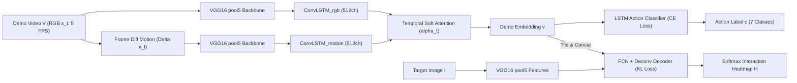

# Demo2Vec

**Demo2Vec: Reasoning Object Affordances from Online Videos**（CVPR 2018）收录于 [Awesome-Affordance-Learning](https://github.com/hq-King/Awesome-Affordance-Learning)，属于具身 AI affordance 学习综述的配套论文清单。本页是 **清单索引**：给出它在综述分类里的位置与原文入口，方法细节和量化结果请看原文。

## 一句话定义

Demo2Vec: Reasoning Object Affordances from Online Videos——在清单中归入 **Perception（Scope: Object；Perception Subcategory: Visual · Interaction-driven） ｜ Datasets / Benchmarks（Data Modality: video-image）**（清单未附方法摘要，此处不替原文概括贡献）。

## 英文缩写速查

| 缩写 | 英文全称 | 简要说明 |
|------|----------|----------|
| Affordance | Action possibility (Gibson) | 环境/物体对 agent 提供的可交互机会 |
| HOI | Human-Object Interaction | 人–物交互，常作 affordance 监督来源 |
| VLM | Vision-Language Model | 视觉–语言模型，用于 affordance 推理与接地 |
| VLA | Vision-Language-Action | 视觉–语言–动作策略 |

## 为什么重要

- 综述把 affordance 学习拆成感知、推理、引导动作三段（见 [综述实体页](../entities/paper-affordance-learning-embodied-ai-survey.md)），本条目是其中一段的代表文献之一。
- 可顺着 [技术地图](../overview/affordance-awesome-technology-map.md) 的同分组条目横向阅读同方向工作。

## 核心信息

| 字段 | 内容 |
|------|------|
| 出处 | CVPR 2018 |
| 方法名（清单标注） | Demo2Vec |
| 分组 1 | Perception · Scope: Object；Perception Subcategory: Visual · Interaction-driven |
| 分组 2 | Datasets / Benchmarks · Data Modality: video-image |
| 论文 | <https://openaccess.thecvf.com/content_cvpr_2018/papers/Fang_Demo2Vec_Reasoning_Object_CVPR_2018_paper.pdf> |

## 核心机制（归纳）

> 注：以下机制与评测指标基于通读 CVF 开放获取原文全文核对补充（[原文](https://openaccess.thecvf.com/content_cvpr_2018/papers/Fang_Demo2Vec_Reasoning_Object_CVPR_2018_paper.pdf)）。

**Demo2Vec** 旨在从互联网在线演示视频中学习物体 affordance 嵌入表征，并将其迁移到外观、视角或状态不同的同一物体静态目标图像上，核心由 **Demonstration Encoder** 与 **Affordance Predictor** 两部分组成，并配套提出 **OPRA**（Online Product Review dataset for Affordance）数据集：

1. **输入与特征提取**：
   - 输入为纯 RGB 演示视频片段 $V = (x_1, \dots, x_T)$（降采样至 5 FPS、缩放到 $256 \times 256$）与同一物体的静态目标图像 $I$（$256 \times 256$）。
   - 使用在 MS-COCO Faster R-CNN 上预训练的 **VGG16** 提取 `pool5` 空间特征（论文还消融了 Spatial Transformer Network 空间变换变体）。
2. **Demonstration Encoder（时空双模态 + 时序软注意力）**：
   - 针对演示视频中「交互瞬间稀疏、静止讲解帧多」的问题，同时输入每帧的 **RGB 外观模态** $x_t$ 与相邻帧差 **运动模态** $\Delta x_t = x_t - x_{t-1}$。
   - 分别通过两个 **ConvLSTM**（卷积核 $3 \times 3$、步长 1、512 通道）提取时空特征，并拼接两路特征计算**时序软注意力（Temporal Soft Attention, TSA）** 权重 $\alpha_t$，再对图像特征做逐元素加权求和 $v = \sum_{t=1}^T \alpha_t \odot x_t$ 得到低维演示嵌入向量 $v$。
3. **Affordance Predictor（动作分类器 + 热力图解码器）**：
   - **Action Classifier**：使用 **LSTM** 预测 7 类动作标签 $c$（`hold, touch, rotate, push, pull, pick up, put down`）。
   - **Heatmap Decoder**：采用改进的全卷积网络（FCN），将目标图像 $I$ 的 `pool5` 特征与平铺（tile）后的演示嵌入 $v$ 拼接，经两层 $1 \times 1$ 卷积与反卷积（`kernel=64, stride=32`）上采样，最后经 **Softmax** 归一化输出交互热力图分布 $H$（各像素概率和为 1）。
4. **训练目标**：
   - 动作分类采用 **交叉熵损失（Cross-Entropy）**；热力图预测采用预测分布 $H$ 与真值热力图（由 AMT 标注的 10 个交互像素点经高斯模糊混合生成）之间的 **KL 散度损失（KL-Divergence）**；使用 Adam 优化器（初始学习率 $2 \times 10^{-5}$）。

### 方法流程图

## 评测与指标

- 综述本身不提供跨论文性能排名（见 [综述实体页](../entities/paper-affordance-learning-embodied-ai-survey.md)），以下指标均摘自 [原文](https://openaccess.thecvf.com/content_cvpr_2018/papers/Fang_Demo2Vec_Reasoning_Object_CVPR_2018_paper.pdf) 在自建 **OPRA** 数据集上的实验：
- **OPRA 数据集构建与划分（Sec. 4）**：
  - 采集自 6 个 YouTube 产品评测频道的 1,091 条长视频，切分为 **11,505** 个单交互视频片段并配对 **2,512** 张网购/产品静帧图像，共形成 **20,774** 个视频–图像对（手工按产品隔离划分为 **16,976** 训练对与 **3,798** 测试对；摘要处统计为 20,612 组），涵盖 7 类动作（其中 `touch` 占 45.12%、`hold` 19.22%、`push` 12.73%）。
- **交互热力图预测（OPRA 测试集 3,798 组，Table 1）**：
  - `LSTM` 基线：KLD **3.45** / NLL **113.65**
  - `ConvLSTM`：KLD **3.31** / NLL **112.17**
  - `STN+ConvLSTM`：KLD **3.26** / NLL **116.52**
  - `TSA+ConvLSTM`（仅 RGB 时序注意力）：KLD **3.34** / NLL **117.22**
  - `Motion+TSA+ConvLSTM`（Demo2Vec 完整模型）：**KLD = 2.34**（$\downarrow$）、**NLL = 102.50**（$\downarrow$），显著优于全部对比变体。
- **动作标签分类 Top-1 准确率（OPRA 测试集，Table 2）**：
  - `LSTM` **20.41%** $\rightarrow$ `ConvLSTM` **30.20%** $\rightarrow$ `TSA+ConvLSTM` **38.47%** $\rightarrow$ `Motion+TSA+ConvLSTM`（完整模型）**40.79%**。
- **定性分析与局限（Sec. 5.2–5.3）**：模型能够根据不同演示视频对同一咖啡机预测出不同的交互热点（如把手 vs. 温度计 vs. 旋钮），并在不同视角目标图间保持稳定；主要失败模式为手势相近动作混淆（如 `rotate` 误判为 `hold`）、目标图自遮挡以及多相似部件（多个盖子/旋钮）引起的定位歧义。

## 与其他工作对比

- 本页不做与具体基线的数值对比；同分组横向对照见 [技术地图](../overview/affordance-awesome-technology-map.md)。
- 若站内另有这篇的深读页，以那一页为准。

## 结论

**Demo2Vec 证明仅凭纯 RGB 在线产品评测视频（无需深度或姿态真值），即可通过「时空卷积 + 帧差运动注意力」学习跨视角迁移的物体交互嵌入向量并构建了 OPRA 基准。**

- 帧差运动模态（$\Delta x_t$）配合时序软注意力（TSA）是提升核心：加入后热力图 KLD 从 3.34 降至 2.34、动作分类 Top-1 从 38.47% 升至 40.79%。
- 作为强监督热力图基准，Demo2Vec 在训练与推理时均需要人工热力图标注及对应演示视频输入，后续弱监督工作（如 ICCV 2019 Interaction Hotspots）进一步去掉了这一依赖。
- 对外型相似的多个部件或手势接近的动态动作（如旋转与握持）仍有误判，精细操作规划需配合更细粒度手部姿态或 3D 几何线索。
- 论文图 1 提供了项目页 <https://sites.google.com/view/demo2vec/>，但本页未核查外部代码与数据下载可用性。

## 常见误区

1. 不要把分类标签当作论文结论；标签来自清单维护者的归类。
2. 不要把本页当作方法证明；它只是清单入口。

## 关联页面

- [Affordance 学习综述](../entities/paper-affordance-learning-embodied-ai-survey.md)
- [Awesome-Affordance-Learning 技术地图](../overview/affordance-awesome-technology-map.md)
- [manipulation.md](../tasks/manipulation.md)、[vla.md](../methods/vla.md)

## 参考来源

- [`sources/papers/affordance_awesome_demo2vec-reasoning-object-affordances-from-online-videos.md`](../../sources/papers/affordance_awesome_demo2vec-reasoning-object-affordances-from-online-videos.md) — 本条目策展摘录
- [`sources/papers/affordance_awesome_catalog.md`](../../sources/papers/affordance_awesome_catalog.md) — 列表总表
- [`sources/repos/awesome-affordance-learning.md`](../../sources/repos/awesome-affordance-learning.md)
- 论文：<https://openaccess.thecvf.com/content_cvpr_2018/papers/Fang_Demo2Vec_Reasoning_Object_CVPR_2018_paper.pdf>

## 推荐继续阅读

- [Awesome-Affordance-Learning 仓库](https://github.com/hq-King/Awesome-Affordance-Learning)
- [原文](https://openaccess.thecvf.com/content_cvpr_2018/papers/Fang_Demo2Vec_Reasoning_Object_CVPR_2018_paper.pdf)
