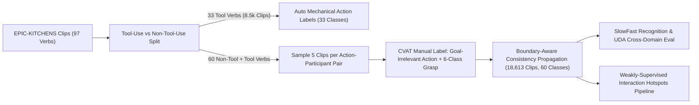

# Fine-Grained Affordance Annotation for Egocentric Hand-Object Interaction Videos

**Fine-Grained Affordance Annotation for Egocentric Hand-Object Interaction Videos**（WACV 2023）收录于 [Awesome-Affordance-Learning](https://github.com/hq-King/Awesome-Affordance-Learning)，属于具身 AI affordance 学习综述的配套论文清单。本页是 **清单索引**：给出它在综述分类里的位置与原文入口，方法细节和量化结果请看原文。

## 一句话定义

Fine-Grained Affordance Annotation for Egocentric Hand-Object Interaction Videos——在清单中归入 **Perception（Scope: Object；Perception Subcategory: Interaction-driven） ｜ Datasets / Benchmarks（Data Modality: video/image）**（清单未附方法摘要，此处不替原文概括贡献）。

## 英文缩写速查

| 缩写 | 英文全称 | 简要说明 |
|------|----------|----------|
| Affordance | Action possibility (Gibson) | 环境/物体对 agent 提供的可交互机会 |
| HOI | Human-Object Interaction | 人–物交互，常作 affordance 监督来源 |
| VLM | Vision-Language Model | 视觉–语言模型，用于 affordance 推理与接地 |
| VLA | Vision-Language-Action | 视觉–语言–动作策略 |

## 为什么重要

- 综述把 affordance 学习拆成感知、推理、引导动作三段（见 [综述实体页](../entities/paper-affordance-learning-embodied-ai-survey.md)），本条目是其中一段的代表文献之一。
- 可顺着 [技术地图](../overview/affordance-awesome-technology-map.md) 的同分组条目横向阅读同方向工作。

## 核心信息

| 字段 | 内容 |
|------|------|
| 出处 | WACV 2023 |
| 方法名（清单标注） | - |
| 分组 1 | Perception · Scope: Object；Perception Subcategory: Interaction-driven |
| 分组 2 | Datasets / Benchmarks · Data Modality: video/image |
| 论文 | <https://openaccess.thecvf.com/content/WACV2023/html/Yu_Fine-Grained_Affordance_Annotation_for_Egocentric_Hand-Object_Interaction_Videos_WACV_2023_paper.html> |

## 核心机制（归纳）

> 注：以下机制与评测指标基于通读 CVF 开放获取原文全文核对补充（[原文](https://openaccess.thecvf.com/content/WACV2023/html/Yu_Fine-Grained_Affordance_Annotation_for_Egocentric_Hand-Object_Interaction_Videos_WACV_2023_paper.html)）。

针对现有视觉数据集长期将「affordance」与「物体功能（如 `cut`）」「目标导向动作（如 `turn-off`）」混淆、且忽视人手运动能力（motor capacity）的缺陷，本文提出了一套面向第一视角（egocentric）手–物交互视频的细粒度标注体系与高效扩增流程，并在 EPIC-KITCHENS 上完成验证：

1. **三动作系统（3AS）概念解耦**：
   - 借鉴神经科学 **Three-Action System (3AS)** 模型，将手–物接触界面的 **Affordance**（与目标无关的物体物理属性 × 人手运动能力）与工具–物体界面的 **Mechanical Action**（两物体间的机械交互动作，如 `cut`、`stir`）严格分离。
   - **组合式 Affordance 标签**：定义为 **「目标无关运动动作（goal-irrelevant motor action） + 抓握类型（grasp type）」**；其中抓握类型来自对 Feix 等人 33 类抓握分类按发力方式与拇指姿态简化后的 **6 类抓握分类体系**（例如同一 `take` 动作可拆解为不同抓取方式与拉/握组合）。
2. **三步高效半自动标注流程（应用于 EPIC-KITCHENS）**：
   - **工具/非工具动作划分**：将 EPIC-KITCHENS 原 97 个动词划分为 60 个非工具使用动作（**51.5k** 片段，如 `take, put, open`）与 33 个工具使用动作（**8.5k** 片段，如 `cut, pour, mix, dry`），排除兼具两者的歧义词（如 `wash`）。
   - **机械动作自动标注**：对工具使用动作片段直接复用原动词标签作为 33 类机械动作标签。
   - **基于一致性假设的 Affordance 传播**：利用「同一被试在同一场景下以固定方式交互同一物体」的经验一致性，对高频 91 类 `(verb, noun, participant)` 组合每组抽样 5 个片段在 CVAT 中人工标注（共标注 **1,356** 个动作–被试对），再按单标注全量覆盖、无边界时序切分、或 EPIC-KITCHENS55/100 边界分组规则传播至全量片段，最终获得 **18,613** 个视频片段、**60** 类细粒度 affordance 标签（随机抽查 1,113 条人工复核准确率 **87.95%** 并纠偏）。
3. **下游验证任务与模型**：
   - 使用 **SlowFast** 分别训练工具/非工具分类器、33 类机械动作识别器与 60 类 affordance 识别器，并用 **Grad-CAM** 验证注意区域差异（affordance 聚焦手–物界面，机械动作聚焦工具–物体界面）。
   - 将 Nagarajan 等人（ICCV 2019）的弱监督交互热点预测框架中的动作监督替换为本标注的 affordance 标签（Cross-Entropy + 特征预期损失训练），对比热点定位粒度与泛化性。

### 方法流程图

## 评测与指标

- 综述本身不提供跨论文性能排名（见 [综述实体页](../entities/paper-affordance-learning-embodied-ai-survey.md)），以下指标均摘自 [原文](https://openaccess.thecvf.com/content/WACV2023/html/Yu_Fine-Grained_Affordance_Annotation_for_Egocentric_Hand-Object_Interaction_Videos_WACV_2023_paper.html) 在 EPIC-KITCHENS 标注集上的验证实验：
- **工具/非工具动作分类（SlowFast，Table 3）**：相比随机标注基线（Tool use **0.4720** / Non-tool use **0.5282**），本文标注达到 **0.8580**（Tool use）与 **0.7867**（Non-tool use）。
- **Affordance 与机械动作识别（SlowFast，Table 4）**：
  - 60 类 Affordance 识别：**Top-1 Acc = 57.08%**、**Top-5 Acc = 87.71%**。
  - 33 类 Mechanical Action 识别：**Top-1 Acc = 51.90%**、**Top-5 Acc = 86.43%**；Grad-CAM 可视化证实两者分别聚焦手–物接触区与工具–物体接触区。
- **弱监督交互热点预测（复现 ICCV 2019 热点管线，Table 5）**：
  - 原动作标签监督（9,236 片段，20 类）：`KLD` **2.661**、`SIM` **0.382**、`AUC-J` **0.758**。
  - 替换为本文 Affordance 标签（4,344 片段，43 类）：**`KLD = 1.305`**（$\downarrow$）、**`SIM = 0.399`**（$\uparrow$）、**`AUC-J = 0.776`**（$\uparrow$），用更少样本学到更细粒度且区分不同抓取方式的热点。
- **跨领域无监督域适应（EPIC-KITCHENS UDA 划分，SlowFast，Table 6）**：
  - `Action Recognition`：源域 Top-1 **16.16%** / Top-5 **32.91%** $\rightarrow$ 目标域 Top-1 **12.67%** / Top-5 **30.99%**。
  - `Affordance Recognition`：源域 Top-1 **24.68%** / Top-5 **53.58%** $\rightarrow$ 目标域 Top-1 **20.69%** / Top-5 **54.59%**（目标域相对退化更小，验证手–物交互特征比物体/动作名更具跨厨房泛化性）。
- **局限与权衡**：基于一致性的标签传播在抽样质检时初始准确率为 87.95%，需抽检修正；且排除了 `wash` 等歧义动词，主要在厨房第一视角数据集上验证。

## 与其他工作对比

- 本页不做与具体基线的数值对比；同分组横向对照见 [技术地图](../overview/affordance-awesome-technology-map.md)。
- 若站内另有这篇的深读页，以那一页为准。

## 结论

**本文从神经科学 3AS 理论出发重构了第一视角视频的细粒度 affordance 标注范式，将「人手抓取与无目标运动动作」从「工具机械动作」和「目标动词」中剥离出来。**

- 组合式标签（goal-irrelevant motor action + 6 类抓握）与基于同一被试一致性的传播策略，在 EPIC-KITCHENS 上以可控人工代价产出了 18,613 段、60 类 affordance 标注及 33 类机械动作标注。
- 实证表明该标注能显著提升弱监督交互热点定位精度（KLD 2.661 → 1.305）并在未见厨房域保持更好的识别迁移能力。
- 工程上，将抓握类型显式纳入标注能避免 `take`、`open` 等笼统动词在下游机器人抓握规划中混淆不同交互部位。
- 原文声明标注发布于 <https://github.com/zch-yu/epic-affordance-annotation>，本页未打开仓库核验文件结构与授权协议，使用前请自行确认。

## 常见误区

1. 不要把分类标签当作论文结论；标签来自清单维护者的归类。
2. 不要把本页当作方法证明；它只是清单入口。

## 关联页面

- [Affordance 学习综述](../entities/paper-affordance-learning-embodied-ai-survey.md)
- [Awesome-Affordance-Learning 技术地图](../overview/affordance-awesome-technology-map.md)
- [manipulation.md](../tasks/manipulation.md)、[vla.md](../methods/vla.md)

## 参考来源

- [`sources/papers/affordance_awesome_fine-grained-affordance-annotation-for-egocentric-hand-o.md`](../../sources/papers/affordance_awesome_fine-grained-affordance-annotation-for-egocentric-hand-o.md) — 本条目策展摘录
- [`sources/papers/affordance_awesome_catalog.md`](../../sources/papers/affordance_awesome_catalog.md) — 列表总表
- [`sources/repos/awesome-affordance-learning.md`](../../sources/repos/awesome-affordance-learning.md)
- 论文：<https://openaccess.thecvf.com/content/WACV2023/html/Yu_Fine-Grained_Affordance_Annotation_for_Egocentric_Hand-Object_Interaction_Videos_WACV_2023_paper.html>

## 推荐继续阅读

- [Awesome-Affordance-Learning 仓库](https://github.com/hq-King/Awesome-Affordance-Learning)
- [原文](https://openaccess.thecvf.com/content/WACV2023/html/Yu_Fine-Grained_Affordance_Annotation_for_Egocentric_Hand-Object_Interaction_Videos_WACV_2023_paper.html)
