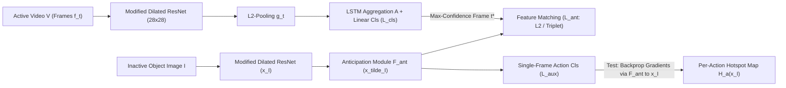

# Interaction Hotspots

**Grounded Human-Object Interaction Hotspots From Video**（ICCV 2019）收录于 [Awesome-Affordance-Learning](https://github.com/hq-King/Awesome-Affordance-Learning)，属于具身 AI affordance 学习综述的配套论文清单。本页是 **清单索引**：给出它在综述分类里的位置与原文入口，方法细节和量化结果请看原文。

## 一句话定义

Grounded Human-Object Interaction Hotspots From Video——在清单中归入 **Perception（Scope: Object；Perception Subcategory: Visual · Interaction-driven）**（清单未附方法摘要，此处不替原文概括贡献）。

## 英文缩写速查

| 缩写 | 英文全称 | 简要说明 |
|------|----------|----------|
| Affordance | Action possibility (Gibson) | 环境/物体对 agent 提供的可交互机会 |
| HOI | Human-Object Interaction | 人–物交互，常作 affordance 监督来源 |
| VLM | Vision-Language Model | 视觉–语言模型，用于 affordance 推理与接地 |
| VLA | Vision-Language-Action | 视觉–语言–动作策略 |

## 为什么重要

- 综述把 affordance 学习拆成感知、推理、引导动作三段（见 [综述实体页](../entities/paper-affordance-learning-embodied-ai-survey.md)），本条目是其中一段的代表文献之一。
- 可顺着 [技术地图](../overview/affordance-awesome-technology-map.md) 的同分组条目横向阅读同方向工作。

## 核心信息

| 字段 | 内容 |
|------|------|
| 出处 | ICCV 2019 |
| 方法名（清单标注） | Interaction Hotspots |
| 分组 1 | Perception · Scope: Object；Perception Subcategory: Visual · Interaction-driven |
| 论文 | <https://openaccess.thecvf.com/content_ICCV_2019/html/Nagarajan_Grounded_Human-Object_Interaction_Hotspots_From_Video_ICCV_2019_paper.html> |

## 核心机制（归纳）

> 注：以下机制与评测指标基于通读 CVF 开放获取原文全文核对补充（[原文](https://openaccess.thecvf.com/content_ICCV_2019/html/Nagarajan_Grounded_Human-Object_Interaction_Hotspots_From_Video_ICCV_2019_paper.html)）。

**Interaction Hotspots** 提出直接从自然人–物交互视频中以**仅动作/物体类别弱监督**（无需人工分割掩码、关键点、深度图或手部姿态估计）学习静止未交互物体上的空间交互热点 $H_a(x_I)$，核心由三大模块协同组成：

1. **高分辨率骨干与 L2 池化视频动作分类器（Sec. 3.1）**：
   - 使用改良的 **ResNet**（将最后两个残差阶段步长由 2 改为 1 并配合空洞卷积，使帧特征分辨率提升 $4\times$ 至 $x_t \in \mathbb{R}^{2048 \times 28 \times 28}$）。
   - 对每帧特征执行空间 **L2-pooling** $g_t = P(x_t)$（保留局部激活幅度的梯度响应，避免全局平均池化造成梯度空间均匀化），再由 **LSTM** 时序聚合模块 $\mathbb{A}(g_1, \dots, g_T) \rightarrow h^*(V)$ 经线性分类器预测跨物体类别共享的 $|A|$ 个动作（使用交叉熵损失 $\mathcal{L}_{cls}$）。
2. **蒸馏式交互预期模块 $F_{ant}$（Sec. 3.2）**：
   - 为弥合「视频中的交互态（active）」与「测试时静止物体图像（inactive）」之间的外观鸿沟，引入 $F_{ant}$ 将静止物体特征 $x_I$（来自 EPIC 动作前帧或 OPRA 产品静图）映射为假想交互态特征 $\tilde{x}_I = F_{ant}(x_I)$。
   - 训练时在视频中选取 LSTM 对真实动作置信度最高的时刻 $t^* = \arg\min_t \mathcal{L}_{cls}(\mathbb{A}(g_1, \dots, g_t), a)$ 作为主动帧监督 $x_{t^*}$，用特征匹配损失 $\mathcal{L}_{ant}$ 对齐（OPRA 上采用 $L_2$ 距离 $\|P(\tilde{x}_I) - P(x_{t^*})\|_2$；EPIC 因无精确同款产品图改用含负类别样本的 **Triplet Loss**），并叠加单帧辅助分类损失 $\mathcal{L}_{aux}(h_1(\tilde{x}_I), a)$。
   - **联合训练目标**：$\mathcal{L}(V, I, a) = \lambda_{cls}\mathcal{L}_{cls} + \lambda_{ant}\mathcal{L}_{ant} + \lambda_{aux}\mathcal{L}_{aux}$。
3. **穿透预期网络的梯度激活热点映射（Sec. 3.3）**：
   - 推理阶段输入静止图片提取 $x_I$，经 $\tilde{x}_I = F_{ant}(x_I)$ 预测动作分数 $y^a$ 后，**将梯度反向传播穿过 $F_{ant}$ 回到原始静止特征 $x_I$**，且不对梯度做空间平均，直接按通道加权累加正响应：$H_a(x_I) = \sum_k \text{ReLU}\left(\frac{\partial y^a}{\partial x_I^k} \odot x_I^k\right)$，从而对每个动作 $a \in \mathcal{A}$ 生成一张高分辨率局部热点图（支持未见物体类别的零样本迁移）。

### 方法流程图

## 评测与指标

- 综述本身不提供跨论文性能排名（见 [综述实体页](../entities/paper-affordance-learning-embodied-ai-survey.md)），以下指标均摘自 [原文](https://openaccess.thecvf.com/content_ICCV_2019/html/Nagarajan_Grounded_Human-Object_Interaction_Hotspots_From_Video_ICCV_2019_paper.html) 在 **OPRA**（约 16k 训练实例，7 类动作，第三人称）与 **EPIC-Kitchens**（约 40k 训练片段覆盖 352 物体 / 125 动作，众包 1.8k 标注热点用于测试 20 动作 / 31 物体，第一人称）上的实验（真值热点仅用于评测，不参与训练）：
- **已见物体类别的 Grounded Affordance 预测（Table 2 Left）**：
  - **OPRA**：本文弱监督模型达到 **`KLD = 1.427` ($\downarrow$)**、**`SIM = 0.362` ($\uparrow$)**、**`AUC-J = 0.806` ($\uparrow$)**；优于所有弱监督基线（`LSTM+Grad-CAM` 2.428 / 0.245 / 0.646；最强显著性基线 `SALGAN` 2.116 / 0.309 / 0.769；`DEEPGAZE II` 1.897 / 0.296 / 0.720），KLD 相对最优弱监督基线提升最高达 **25%**，并逼近强监督 `IMG2HEATMAP`（1.473 / 0.355 / 0.821）与 `DEMO2VEC`（1.197 / 0.482 / 0.847）。
  - **EPIC-Kitchens**：本文模型达到 **`KLD = 1.258`**、**`SIM = 0.404`**、**`AUC-J = 0.785`**，全面优于弱监督基线（`LSTM+Grad-CAM` 2.241 / `SALGAN` 1.508 / `DEEPGAZE II` 1.352，KLD 相对提升最高 **7%**），且在 KLD 与 SIM 上优于强监督 `IMG2HEATMAP`（1.400 / 0.359 / 0.794）。
- **未见新物体类别泛化（3 个划分均值，EPIC 留出 10/31 类、OPRA 留出 9/26 类，Table 2 Right）**：
  - **OPRA（Unseen）**：**`KLD = 1.381`**、**`SIM = 0.374`**、**`AUC-J = 0.826`**（超越全部弱监督及 `IMG2HEATMAP` 1.431 / 0.362 / 0.820）。
  - **EPIC-Kitchens（Unseen）**：**`KLD = 1.249`**、**`SIM = 0.405`**、**`AUC-J = 0.817`**（超越全部弱监督及 `IMG2HEATMAP` 1.466 / 0.353 / 0.770）。
- **表征与局限（Sec. 4.1–4.2）**：预期模块输出的 active 嵌入按「功能相似性」跨类别聚类（如冰箱、微波炉、橱柜均聚合在「拉开」功能邻域）；在 EPIC 等细粒度长尾动作词表下部分动作空间区分度较弱，偶发局部热点偏移（Fig. 4）。

## 与其他工作对比

- 本页不做与具体基线的数值对比；同分组横向对照见 [技术地图](../overview/affordance-awesome-technology-map.md)。
- 若站内另有这篇的深读页，以那一页为准。

## 结论

**Interaction Hotspots 仅依靠视频级动作与物体标签，通过「L2-pooling + 特征预期蒸馏 $F_{ant}$ + 穿透预期网络的局部梯度映射」，让模型无需热力图/掩码标注即可在静止物体上预测可泛化到新类别的交互热点。**

- 关键设计缺一不可：去掉特征降采样（4× 分辨率）、L2 池化保留局部梯度幅值、以及梯度必须穿过 $F_{ant}$ 反传至静止特征 $x_I$，共同解决了传统 `LSTM+Grad-CAM` 扩散严重且无法响应静止物体的问题。
- 由于动作分类器在设计上与具体物体类别解耦（预测 $|A|$ 类而非 $|A|\times |O|$ 类），模型能将「拉开微波炉」学到的结构先验迁移到训练集中从未见过的「橱柜」上。
- 相比强监督 `Demo2Vec`，本方法在推理时无需输入演示视频，仅需一张静态测试图即可为每个动作生成独立热点图。
- 原文摘要提供了项目主页 <http://vision.cs.utexas.edu/projects/interaction-hotspots/>，本页未访问外部仓库核验代码版本与预训练权重。

## 常见误区

1. 不要把分类标签当作论文结论；标签来自清单维护者的归类。
2. 不要把本页当作方法证明；它只是清单入口。

## 关联页面

- [Affordance 学习综述](../entities/paper-affordance-learning-embodied-ai-survey.md)
- [Awesome-Affordance-Learning 技术地图](../overview/affordance-awesome-technology-map.md)
- [manipulation.md](../tasks/manipulation.md)、[vla.md](../methods/vla.md)

## 参考来源

- [`sources/papers/affordance_awesome_grounded-human-object-interaction-hotspots-from-video.md`](../../sources/papers/affordance_awesome_grounded-human-object-interaction-hotspots-from-video.md) — 本条目策展摘录
- [`sources/papers/affordance_awesome_catalog.md`](../../sources/papers/affordance_awesome_catalog.md) — 列表总表
- [`sources/repos/awesome-affordance-learning.md`](../../sources/repos/awesome-affordance-learning.md)
- 论文：<https://openaccess.thecvf.com/content_ICCV_2019/html/Nagarajan_Grounded_Human-Object_Interaction_Hotspots_From_Video_ICCV_2019_paper.html>

## 推荐继续阅读

- [Awesome-Affordance-Learning 仓库](https://github.com/hq-King/Awesome-Affordance-Learning)
- [原文](https://openaccess.thecvf.com/content_ICCV_2019/html/Nagarajan_Grounded_Human-Object_Interaction_Hotspots_From_Video_ICCV_2019_paper.html)
