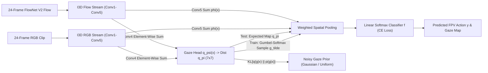

# Gaze + Action

**In the Eye of Beholder: Joint Learning of Gaze and Actions in First Person Video**（ECCV 2018）收录于 [Awesome-Affordance-Learning](https://github.com/hq-King/Awesome-Affordance-Learning)，属于具身 AI affordance 学习综述的配套论文清单。本页是 **清单索引**：给出它在综述分类里的位置与原文入口，方法细节和量化结果请看原文。

## 一句话定义

In the Eye of Beholder: Joint Learning of Gaze and Actions in First Person Video——在清单中归入 **Perception（Scope: Scene；Perception Subcategory: Interaction-driven）**（清单未附方法摘要，此处不替原文概括贡献）。

## 英文缩写速查

| 缩写 | 英文全称 | 简要说明 |
|------|----------|----------|
| Affordance | Action possibility (Gibson) | 环境/物体对 agent 提供的可交互机会 |
| HOI | Human-Object Interaction | 人–物交互，常作 affordance 监督来源 |
| VLM | Vision-Language Model | 视觉–语言模型，用于 affordance 推理与接地 |
| VLA | Vision-Language-Action | 视觉–语言–动作策略 |

## 为什么重要

- 综述把 affordance 学习拆成感知、推理、引导动作三段（见 [综述实体页](../entities/paper-affordance-learning-embodied-ai-survey.md)），本条目是其中一段的代表文献之一。
- 可顺着 [技术地图](../overview/affordance-awesome-technology-map.md) 的同分组条目横向阅读同方向工作。

## 核心信息

| 字段 | 内容 |
|------|------|
| 出处 | ECCV 2018 |
| 方法名（清单标注） | Gaze + Action |
| 分组 1 | Perception · Scope: Scene；Perception Subcategory: Interaction-driven |
| 论文 | <https://openaccess.thecvf.com/content_ECCV_2018/html/Yin_Li_In_the_Eye_ECCV_2018_paper.html> |

## 核心机制（归纳）

> 注：以下机制与评测指标基于通读 CVF 开放获取原文全文核对补充（[原文](https://openaccess.thecvf.com/content_ECCV_2018/html/Yin_Li_In_the_Eye_ECCV_2018_paper.html)）。

本文提出面向第一视角视频（First Person Vision, FPV）的联合**视线估计（Gaze Estimation）**与**动作识别（Action Recognition）**深度概率模型：针对人类日常视线中约 25% 为扫视（saccade）且眼动仪测量含噪声的问题，将视线建模为网络中的**随机隐变量（stochastic units）**，在仅输入纯视频（测试阶段无需眼动、手部掩码或物体标注）的条件下联合推理两项任务：

1. **双流 I3D 骨干网络（Sec. 3.5）**：
   - 基于在 Kinetics 上预训练的 **Two-Stream I3D**（3D Inception 卷积网络），输入 24 帧 **RGB 图像**与 **FlowNet V2 光流**（训练时随机裁剪 $224 \times 224$）。
   - 两路特征在 **第 4 卷积块（Conv4）** 末端以逐元素相加融合，送入子网络 $q_\psi(x)$ 输出 $7 \times 7$（空间下采样 $32\times$、时间步长 $8\approx 300\text{ ms}$）的视线分布参数 $\pi$；在 **第 5 卷积块（Conv5）** 末端再次融合得到视觉特征 $\phi(x)$。
2. **基于 Gumbel-Softmax 的随机视线注意力池化（Sec. 3.1–3.2）**：
   - 归一化参数 $\pi_{m,n}$ 得到近似后验分布 $q_\pi(g|x) = \frac{\pi_{m,n}}{\sum_{m,n}\pi_{m,n}}$。
   - 训练时利用 **Gumbel-Softmax（Concrete 分布，温度 $\tau=2$）** 从 $q_\pi$ 重参数化采样出可微的 2D 注意力掩码 $\tilde{g}_{m,n}$，对 Conv5 特征 $\phi(x)$ 做**空间加权平均池化** $\sum_{m,n}\tilde{g}_{m,n}\phi(x)_{m,n}$，再送入线性分类器 $f$ 与 Softmax 预测动作类别 $y$（实验中禁用全连接层 Dropout，因为随机采样本身提供结构化正则）。
3. **变分学习目标与视线噪声先验（Sec. 3.2）**：
   - 最大化对数似然变分下界（ELBO），最小化经验负下界损失：
     $$\mathcal{L} = -\sum_g \log p(y|g, x) + \text{KL}[q(g|x) \parallel p(g|x)]$$
     由两项组成：（a）基于采样视线 $\tilde{g}$ 的动作分类 **交叉熵损失**；（b）预测视线分布 $q(g|x)$ 与含噪视线先验 $p(g|x)$ 之间的 **KL 散度损失**。
   - **视线噪声模型 $p(g|x)$**：对跟踪到的注视点（fixation）建模为 2D 各向同性高斯分布；当视线处于扫视（saccade）或缺失时退化为 **2D 均匀分布**，允许注意力自由分配到动作判别区域。
4. **测试阶段确定性近似推理（Sec. 3.3）**：
   - 因线性 Softmax 分类器 $f$ 满足凸性（Jensen 不等式 $\mathbb{E}_g[f(g,x)] \ge f(\mathbb{E}[g], x)$），测试时直接用分布期望 $q_\pi$ 代替多次采样平均，实现单次前向传播无随机性联合输出视线热力图与动作类别。

### 方法流程图

## 评测与指标

- 综述本身不提供跨论文性能排名（见 [综述实体页](../entities/paper-affordance-learning-embodied-ai-survey.md)），以下指标均摘自 [原文](https://openaccess.thecvf.com/content_ECCV_2018/html/Yin_Li_In_the_Eye_ECCV_2018_paper.html) 在 **EGTEA Gaze+** 基准上的实验：
- **数据集设置（Sec. 4.1）**：Extended GTEA Gaze+ 包含 32 名被试在自然厨房环境下执行 7 类备餐任务的 29 小时第一视角视频（86 个 session，1280×960@24Hz，逐帧眼动跟踪），共 10,321 个动作片段、106 个长尾动作类；评测使用 Split 1（**8,299 训练 / 2,022 测试**）。
- **第一视角动作识别（Mean Class Accuracy，Table 1 & Table 2a）**：
  - 骨干消融（Video Acc）：`I3D RGB` **47.26%**、`I3D Flow` **38.31%**、`I3D Fusion` **48.84%**、`I3D Joint` **49.79%**。
  - 概率建模消融（Video Acc / Gaze F1）：确定性 `Gaze MLE`（51.12% / 24.68）、无视线监督 `Soft-Atten`（50.30% / 10.27）、`Ours w. Dropout`（52.12% / 32.66）、**`Our Model (Prob.)`** 达 **53.30% Video Acc**（**47.71% Clip Acc**）与 **32.97 Gaze F1**。
  - 外部基线对比（Video Acc）：`EgoIDT+Gaze`† **46.50%**、`EgoConv+I3D` **48.93%**、`I3D+Gaze`†（测试时直接输入真实人类视线）**51.21%**；**本文模型（53.30%）** 相比 `I3D Joint` 提升 **+3.5%**，甚至超过使用真值视线的 `I3D+Gaze`†（**+2.1%**）。
- **第一视角视线估计（F1 / Precision / Recall，Table 2b）**：
  - `EgoGaze`：F1 **16.63**（Prec 16.63 / Rec 16.63）
  - `Gaze MLE`†：F1 **24.68**（Prec 18.55 / Rec 36.86）
  - `Simple Gaze`：F1 **30.10**（Prec 25.14 / Rec 37.48）
  - `Deep Gaze`（纯视线模型）：F1 **33.51**（Prec 28.04 / Rec 41.62）
  - **`Our Model`†**：F1 **32.97**（Prec **27.01** / Rec **42.31**），在联合完成动作识别的同时保持与纯视线预测强基线相当的精度。
- **已知局限（Sec. 4.3–4.4）**：联合训练相比单任务 `Deep Gaze` 视线 F1 略低（32.97 vs. 33.51），作者指出任务自顶向下的注意力调制尚未完全发挥；部分错误源于动作尚未发生的提前误判或外观相近物体混淆（如黄瓜与青椒）。

## 与其他工作对比

- 本页不做与具体基线的数值对比；同分组横向对照见 [技术地图](../overview/affordance-awesome-technology-map.md)。
- 若站内另有这篇的深读页，以那一页为准。

## 结论

**本文首次将第一视角人类视线的测量噪声与扫视不确定性显式建模为深度网络中的随机离散变量（Gumbel-Softmax），实现了纯视频输入下的视线估计与细粒度动作识别端到端联合推理。**

- 用随机采样取代确定性最大似然（`Gaze MLE`）或盲用真值视线（`I3D+Gaze`），在 EGTEA Gaze+ 上同时大幅提升动作识别（53.30% vs. 51.12% / 51.21%）与视线 F1（32.97 vs. 24.68）。
- 对扫视或缺失帧采用 2D 均匀先验 + KL 散度约束，避免网络被动作无关的眼动跳变带偏，并等效于结构化 Dropout。
- 测试期利用线性分类器凸性直接传入期望视线图 $q_\pi$，消除采样随机性且保持单次前向推理开销。
- 本页核对自 CVF 开放获取原文，原文注明数据集发布于 <http://cbi.gatech.edu/fpv>；开源代码实现与权重需另行查阅作者主页确认。

## 常见误区

1. 不要把分类标签当作论文结论；标签来自清单维护者的归类。
2. 不要把本页当作方法证明；它只是清单入口。

## 关联页面

- [Affordance 学习综述](../entities/paper-affordance-learning-embodied-ai-survey.md)
- [Awesome-Affordance-Learning 技术地图](../overview/affordance-awesome-technology-map.md)
- [manipulation.md](../tasks/manipulation.md)、[vla.md](../methods/vla.md)

## 参考来源

- [`sources/papers/affordance_awesome_in-the-eye-of-beholder-joint-learning-of-gaze-and-action.md`](../../sources/papers/affordance_awesome_in-the-eye-of-beholder-joint-learning-of-gaze-and-action.md) — 本条目策展摘录
- [`sources/papers/affordance_awesome_catalog.md`](../../sources/papers/affordance_awesome_catalog.md) — 列表总表
- [`sources/repos/awesome-affordance-learning.md`](../../sources/repos/awesome-affordance-learning.md)
- 论文：<https://openaccess.thecvf.com/content_ECCV_2018/html/Yin_Li_In_the_Eye_ECCV_2018_paper.html>

## 推荐继续阅读

- [Awesome-Affordance-Learning 仓库](https://github.com/hq-King/Awesome-Affordance-Learning)
- [原文](https://openaccess.thecvf.com/content_ECCV_2018/html/Yin_Li_In_the_Eye_ECCV_2018_paper.html)
