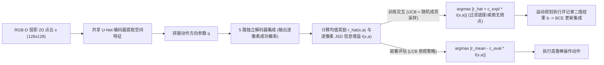

# IDA

**Information-driven Affordance Discovery for Efficient Robotic Manipulation**（ICRA 2024，arXiv:2405.03865v1，Qualcomm AI Research & Ghent University）收录于 [Awesome-Affordance-Learning](https://github.com/hq-King/Awesome-Affordance-Learning)，属于具身 AI affordance 学习综述的配套文献。本页基于论文全文完成结构化精读与核实。

## 一句话定义

**IDA（Information-driven Affordance Discovery）** 将视觉 affordance 学习建模为上下文老虎机（contextual bandit）主动探索问题，利用**共享编码器–多解码器 U-Net 集成**预测的像素级 **Jensen-Shannon 散度（JSD / 信息半径）**驱动 **UCB** 高效交互采样，并在部署测试时切换为 **LCB** 悲观准则以实现高样本效率与高鲁棒性操作。

## 英文缩写速查

| 缩写 | 英文全称 | 简要说明 |
|------|----------|----------|
| IDA | Information-driven Affordance Discovery | 本文提出的主动信息驱动视觉 affordance 发现方法 |
| JSD | Jensen-Shannon Divergence | 延森–香农散度（信息半径），等价于单步交互的期望参数 KL 信息增益 |
| UCB / LCB | Upper Confidence Bound / Lower Confidence Bound | 上置信界（训练探索加信息增益）/ 下置信界（评估减信息增益以保稳健） |
| BCE | Binary Cross-Entropy | 二元交叉熵损失，用于训练各集成解码器预测交互成败二值概率 |

## 为什么重要

- 传统 affordance 模型依赖昂贵的人类遥操作数据集或超大规模仿真预训练（如 Contact-GraspNet 的 1,770 万次仿真抓取、Where2Act 数十万条随机轨迹热身），且跨域泛化乏力。
- IDA 从零先验出发，仅靠信息论推导出的轻量多解码器 JSD 即可主动挑选既具不确定性信息量又有望成功的交互点，在 ManiSkill2 上全面超越预训练大模型，并在真机 xArm 6 仅 **90 分钟（250 轮交互）**内从随机初始化学到 **90%** 抓取成功率。

## 核心信息

| 字段 | 内容 |
|------|------|
| 出处 | ICRA 2024（arXiv:2405.03865v1） |
| 作者与机构 | Pietro Mazzaglia, Taco Cohen, Daniel Dijkman（Qualcomm AI Research, Ghent University） |
| 方法名（清单标注） | IDA |
| 清单分组 1 | Action · Architecture: Hierarchical model；Affordance Usage: reward；Action Subcategory: Hierarchical affordance-to-action · Planner-based |
| 论文与项目页 | <https://doi.org/10.1109/ICRA57147.2024.10611170> · <https://arxiv.org/abs/2405.03865> · <https://mazpie.github.io/ida> |

## 核心机制

1. **上下文老虎机建模与信息半径（JSD）等价推导**
   - 以投影到世界坐标系的 128×128 2D 点云观测为上下文 $x$，参数化动作基元 $a=[p,q]$（作用像素点 $p$ 与夹爪姿态角 $q$，6-DoF 抓取设 429 个离散角度，堆叠与开抽屉设 8 个角度），环境返回二值成败奖励 $b \in \{0,1\}$。
   - 论文在 Appendix A 严格证明：在状态–动作对 $(x,a)$ 上执行一次交互对模型参数 $\Theta$ 产生的期望 KL 信息增益 $I(x,a) = \mathbb{E}_{p(b|x,a)}[D_{KL}(p(\Theta|b,x,a)\|p(\Theta))]$ 等价于参数集成预测分布的 **JSD**：
     $$I(x,a) = H\!\left(\frac{1}{N}\sum_{i=1}^N p(b|x,a,\theta_i)\right) - \frac{1}{N}\sum_{i=1}^N H(p(b|x,a,\theta_i))$$
     因此只需前向推理一次集成模型即可逐像素算出信息增益图，无需额外交互或模型反传。
2. **共享编码器–5 解码器 U-Net 集成**
   - 采用轻量级 U-Net（编码器含 3 层卷积块：8/16/16 通道；将动作朝向 $q$ 拼接到隐向量后经双线性上采样与跳跃连接接入 **5 个独立解码器**），以 Sigmoid 输出每点成功概率。
   - 相比完全独立的 5 个网络，共享编码器既简化训练又提升准确率；所有成员使用完整回放缓冲数据（不采用 bootstrap 重采样以防降低单模型精度），每次交互后以 Adam（lr=$3\times10^{-4}$，batch=256）训练 5 步 BCE 损失。
3. **探索与评估的“乐观–悲观”非对称策略**
   - **训练探索（UCB + 集成 Thompson 采样）**：先采集 10 次随机动作填充缓冲区，此后随机抽样一个集成成员预测 $\hat{r}(x,a)$ 并加上归一化 JSD 奖励项：$\arg\max_a [\hat{r}(x,a) + c_{\text{expl}}\cdot I(x,a)]$（默认 $c_{\text{expl}}=0.3$），同时过滤机器人底座后方/上方及桌面以下点。
   - **测试评估（LCB 悲观策略）**：取全部 5 个解码器的均值预测 $\hat{r}(x,a)$ 并减去惩罚项：$\arg\max_a [\hat{r}(x,a) - c_{\text{eval}}\cdot I(x,a)]$（默认 $c_{\text{eval}}=0.1$），避开模型尚未把握的高风险边缘点。

### 方法流程图

## 评测与指标

### 1. ManiSkill2 仿真五大任务对比（10,000 次交互后，5+ 种子均值 ± 标准差，Affordance Success Rate ↑，Table I）

| 方法 | Grasp Cube | Grasp YCB | Grasp EGAD | Stack Cube | Open Drawer |
|------|---|---|---|---|---|
| C-GraspNet（17.7M 预训练） | **0.99** | 0.43 | 0.52 | - | - |
| Random | 0.81±0.04 | 0.50±0.05 | 0.57±0.08 | 0.96±0.04 | 0.75±0.09 |
| Where2Act（U-Net 适配） | 0.95±0.01 | 0.66±0.05 | 0.70±0.04 | 0.88±0.03 | 0.86±0.06 |
| Greedy | 0.97±0.04 | 0.82±0.03 | 0.76±0.11 | **0.99±0.01** | 0.73±0.14 |
| JSD（纯信息增益消融） | 0.96±0.02 | 0.85±0.03 | 0.83±0.03 | **0.99±0.01** | **1.00±0.00** |
| **IDA（Ours）** | **0.99±0.01** | **0.91±0.02** | **0.86±0.02** | **0.99±0.01** | 0.98±0.05 |

### 2. 极早期消融（Table II）与真机实验（xArm 6）

- **50 次交互后早期平均抓取成功率（Table II）**：**IDA = 0.45**，关闭随机集成采样（`IDA no ens. sampl.`）= **0.39**，纯信息增益（`JSD`）= **0.25**——表明极早期必须借助奖励项与 Thompson 集成采样才能避免纯 JSD 在噪声期的盲目探索。
- **真机在线学习（UFACTORY xArm 6 + 腕部 RGB-D，4 个不同尺寸玩具，垂直抓取 8 个离散旋转角）**：从完全随机初始化在线训练 250 轮（含评测总耗时约 90 分钟），最终抓取成功率达到 **90%**（远高于 Where2Act 与 Random）；不过在最初 25 轮交互时因初期 JSD 方向尚不明确，曾短时略低于纯随机采样。

## 与其他工作对比

- **对比大型离线预训练（Contact-GraspNet）**：尽管 Contact-GraspNet 在 8,872 个网格上训练了 1,770 万次抓取，在 YCB（0.43）和 EGAD（0.52）上仍因仿真域差大幅落后交互学习 10k 轮的 IDA（0.91 / 0.86）。
- **对比主动采样基线（Where2Act、Greedy）**：Where2Act 前 5000 步纯随机采样再用 Boltzmann 采样，在复杂 YCB（0.66）和 EGAD（0.70）收敛显著更慢；Greedy 易过早陷入局部最优，在难度较高的 `Open Drawer` 仅达 0.73。同分组横向对照见 [技术地图](../overview/affordance-awesome-technology-map.md)。

## 常见误区或局限

1. **极早期（≤25 次交互）冷启动劣势**：当回放缓冲极小、5 个解码器尚未对场景建立基本分辨能力时，纯信息增益引导反而可能比均匀随机探索更加集中于早期伪不确定点，需要靠初期随机步及 UCB 奖励补偿。
2. **依赖线性运动规划与离散化动作空间**：动作执行依赖给定直线运动规划器（作者在 Conclusion 中明确将其列为局限），且抓取/操作朝向被离散化（如真机仅限垂直方向 8 个旋转角），尚无法实现连续闭环柔顺控制或长视界多步任务链式规划。
3. **开源核实提示**：论文已给出项目主页 `https://mazpie.github.io/ida`，具体源码发布情况请在复现前按主页核实。

## 结论

**IDA 证明无需海量离线标注或仿真预训练，仅凭共享编码器–多解码器 U-Net 的 JSD 信息增益与 UCB/LCB 双阶段准则，即可在数小时真机交互内高效掌握泛化性更强的操作 affordance。**

- 搭建主动交互式 affordance 学习系统时，采用“共享编码器 + 5 路独立解码器（禁用 bootstrap 重采样）”是计算开销最小且不损伤单模型精度的有效不确定性估计结构。
- 训练期务必保留奖励项与集成成员随机采样（UCB + Thompson 采样），可把 50 步极早期平均抓取成功率从纯 JSD 的 0.25 提升至 0.45；部署期切换至 LCB（`r_mean - c_eval * JSD`）则能稳健回避低置信度边缘动作。
- 若需进一步拓展至长程多步操作或非刚性接触控制，后续应在此类信息驱动基元之上叠加层次化 RL 策略或 LLM/VLM 任务规划层。

## 关联页面

- [Affordance 学习综述](../entities/paper-affordance-learning-embodied-ai-survey.md)
- [Awesome-Affordance-Learning 技术地图](../overview/affordance-awesome-technology-map.md)
- [manipulation.md](../tasks/manipulation.md)、[imitation-learning.md](../methods/imitation-learning.md)

## 参考来源

- [`sources/papers/affordance_awesome_information-driven-affordance-discovery-for-efficient-ro.md`](../../sources/papers/affordance_awesome_information-driven-affordance-discovery-for-efficient-ro.md) — 本条目策展摘录
- [`sources/papers/affordance_awesome_catalog.md`](../../sources/papers/affordance_awesome_catalog.md) — 列表总表
- [`sources/repos/awesome-affordance-learning.md`](../../sources/repos/awesome-affordance-learning.md)
- 论文：<https://doi.org/10.1109/ICRA57147.2024.10611170>

## 推荐继续阅读

- [Awesome-Affordance-Learning 仓库](https://github.com/hq-King/Awesome-Affordance-Learning)
- [原文](https://doi.org/10.1109/ICRA57147.2024.10611170)
