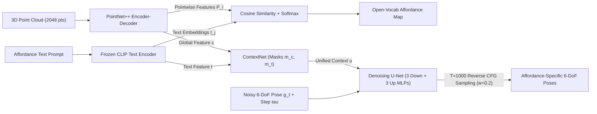

# 3DAPNet

**Language-Conditioned Affordance-Pose Detection in 3D Point Clouds**（ICRA 2024，arXiv:2309.10911v1）提出 **3DAPNet** 与 **3DAP** 数据集，面向单物体 3D 点云与任意自然语言 affordance 描述，联合输出逐点 affordance 区域分割图与支持该 affordance 的 6-DoF 夹爪位姿。

## 一句话定义

3DAPNet 是一个基于 PointNet++、冻结 CLIP 文本编码器与 ContextNet 条件扩散 U-Net 的端到端 3D 点云开放词汇 affordance–位姿联合学习框架。

## 英文缩写速查

| 缩写 | 英文全称 | 简要说明 |
|------|----------|----------|
| 3DAP | 3D Affordance-Pose Dataset | 本文构建的三元组数据集（点云、自然语言 affordance、6-DoF 位姿） |
| CLIP | Contrastive Language-Image Pre-Training | 本文用于提取开放词汇 affordance 文本嵌入的冻结文本编码器 |
| DoF | Degree of Freedom | 自由度，本文生成的抓握/操作末端位姿为 6-DoF（四元数 + 平移） |
| mESM | Mean Evaluated Similarity Metric | 位姿生成分布与真值位姿集合之间的平均评估相似度误差（越低越好） |
| mCR | Mean Coverage Rate | 生成位姿对真值 affordance 位姿集合的平均覆盖率（越高越好） |
| HOI | Human-Object Interaction | 人–物交互，常作 affordance 监督来源 |

## 为什么重要

- 既往 3D affordance 工作（如 OpenAD）虽然实现了开放词汇 affordance 区域检测，但不输出可执行位姿；而传统任务导向抓取方法（如 6D-TGD）又受限于预定义闭集标签。
- 3DAPNet 将开放词汇语义接地（PointNet++ + CLIP）与条件扩散 6-DoF 位姿生成（ContextNet + Denoising U-Net）联合训练，证明两个分支相互促进，并能在 180 ms 内生成 2,000 个候选位姿直接驱动真机（RealSense D435i + Robotiq 2F-85）执行操作。
- 同方向横向位置可参考 [Affordance 学习综述](../entities/paper-affordance-learning-embodied-ai-survey.md) 与 [技术地图](../overview/affordance-awesome-technology-map.md)。

## 核心信息

| 字段 | 内容 |
|------|------|
| 作者 | Toan Nguyen, Minh Nhat Vu, Baoru Huang, Tuan Van Vo, Vy Truong, Ngan Le, Thieu Vo, Bac Le, Anh Nguyen |
| 出处 | ICRA 2024（arXiv:2309.10911v1） |
| 方法名 / 数据集 | 3DAPNet / 3DAP（28K 平行夹爪位姿，7:1:2 划分） |
| 分组 | Perception · Scope: Object；Perception Subcategory: Spatial · Generalizable |
| 论文链接 | <https://doi.org/10.1109/ICRA57147.2024.10610008> / <https://arxiv.org/abs/2309.10911> |
| 项目与代码页 | <https://3DAPNet.github.io>（摘要声明代码与数据集公开） |

## 核心机制

3DAPNet 接收单物体 3D 点云 `C`（固定采样 `n = 2,048` 个点，坐标归一化至 `[0, 1]` 并按物体最长边 `5–30 cm` 尺度缩放）以及 `m` 条自然语言 affordance 文本，通过共享编码器与双分支架构联合训练（总损失 `L = L_aff + L_pose`）：

1. **开放词汇 Affordance 检测分支**：
   - **点–文特征提取**：`PointNet++` 编码器–解码器提取逐点特征 `P_1, ..., P_n`；冻结的 `CLIP` 文本编码器提取文本嵌入 `t_1, ..., t_m`。
   - **余弦相关性接地**：计算逐点–文本余弦相似度矩阵 `F_{i,j} = (P_i^T t_j) / (||P_i|| ||t_j||)`，经可学习温度参数 `η` 做逐点 Softmax 得到概率图 `S_{i,j}`，并以负对数似然 `L_aff` 监督。
2. **语言条件扩散位姿生成分支**：
   - **扩散与条件丢弃**：在 `T = 1,000` 步线性方差调度（`β_1 = 10^-4` 至 `β_T = 0.02`）下对 6-DoF 位姿 `g_0 = [g_qu, g_tr]` 加噪；训练时以 `p_uncond = 0.05` 随机丢弃条件实现无分类器引导（采样引导尺度 `w = 0.2`）。
   - **ContextNet 多模态融合**：先由两个 MLP + Softmax 分别预测点云影响掩码 `m_c` 与文本影响掩码 `m_t`，再计算逐元素加权融合上下文 `u = c ⊙ m_c + t ⊙ m_t`（相比简单相加大幅降低位姿误差）。
   - **U-Net 去噪网络**：噪声位姿 `g_t` 经 3 层下采样 MLP 与 3 层上采样 MLP，上采样阶段拼接跳跃连接、时间步嵌入 `τ` 与统一上下文 `u`，预测噪声 `ε_θ` 并用 MSE 损失 `L_pose` 监督。
3. **3DAP 数据集构建**：从 3D AffordanceNet 提取物体点云，用 6-DoF GraspNet 为每个物体生成得分最高的 1,000 个 Robotiq 2F-85（最大开口 85 mm）平行夹爪候选位姿，再人工按具体 affordance 筛选，共得 28K 条位姿标注。

### 方法流程图

## 评测与指标

所有定量方法均在 3DAP 数据集（7:1:2 划分，测试时每对物体–affordance 生成 200 个位姿）上评测；单点云推理生成 2,000 个位姿耗时 **180 ms**（RTX 3090 Ti，batch size 32，Adam `lr = 1e-3`，200 epochs）：

| 方法 / 变体 | mIoU (↑) | Acc (↑) | mAcc (↑) | mESM (↓) | mCR % (↑) |
|-------------|----------|---------|----------|----------|-----------|
| OpenAD | 55.20 | 58.89 | 58.22 | – | – |
| 6D-GraspNet（接入文本分支） | – | – | – | 0.373 | 22.81 |
| 6D-TGD | 55.38 | 60.14 | 57.99 | 0.219 | 30.10 |
| **3DAPNet（完整联合训练）** | **56.18** | **61.77** | **59.26** | **0.120** | **44.63** |
| 消融：仅 Affordance 分支 | 55.65 | 60.73 | 58.80 | – | – |
| 消融：仅 Pose 分支 | – | – | – | 0.147 | 41.29 |
| 消融：移除 ContextNet（直接相加） | 53.97 | 60.20 | 58.49 | 0.433 | 12.61 |
| 消融：BERT 文本编码器 | 52.89 | 59.77 | 59.25 | 0.182 | 30.46 |
| 消融：RoBERTa 文本编码器 | 53.92 | 58.13 | 57.01 | 0.277 | 30.11 |

- **真机部署链路**：RealSense D435i 深度相机 → VoxelNet 物体定位 → 采样 2,048 点 → 3DAPNet 推理 → ROS 解析逆运动学（IK）与奇异点规避轨迹优化 → TwinCAT 实时控制 Robotiq 2F-85 执行水龙头、刀具、碗、帽子等操作，并在 ShapeNetCore 未见物体与未见 affordance 同义词（如 `carve`、`accommodate`、`swathe`）上展示定性泛化。

## 与其他工作对比

- **对比 OpenAD**：OpenAD 仅完成开放词汇点云分割而无位姿生成能力；3DAPNet 在相同数据集上不仅多出 6-DoF 位姿生成，affordance 分割三项指标也全面反超（mIoU +0.98，Acc +2.88）。
- **对比 6D-TGD / 6D-GraspNet**：在适配开放词汇文本输入后，3DAPNet 将位姿误差 mESM 降至 0.120（几乎为 6D-TGD 0.219 的一半），并将位姿覆盖率 mCR 从 30.10% 提升至 44.63%。

## 结论

**3DAPNet 证明了开放词汇 affordance 分割与语言条件扩散位姿生成联合学习具有双向增益，其中 ContextNet 掩码融合与 CLIP 文本空间是跨词泛化的核心瓶颈组件。**

1. **双分支联合训练优于单分支**：共享 PointNet++ 编码器同时提升分割 mIoU（55.65 → 56.18）与位姿精度（mESM 0.147 → 0.120，mCR 41.29% → 44.63%）。
2. **ContextNet 对位姿生成不可或缺**：移除 ContextNet 改用特征直接相加后，mESM 恶化至 0.433（差于 6D-GraspNet），mCR 暴跌至 12.61%。
3. **文本编码器决定跨词泛化上限**：预训练视觉–语言对齐的 CLIP 显著优于纯文本模型 BERT 与 RoBERTa（mCR 44.63% vs 30.46% / 30.11%）。
4. **真机部署需前置检测裁剪**：网络以单物体 2,048 点云为输入，杂乱场景必须串联上游 3D 定位（如 VoxelNet）并配合运动学轨迹优化。

## 常见误区或局限

1. **单物体假设与杂乱场景限制**：3DAP 数据集源自单物体 3D AffordanceNet，模型本身不具备多物体杂乱点云场景的端到端检测能力，真机实验依赖 VoxelNet 预先分割出目标物体。
2. **未见 affordance 仍存在误检与失效位姿**：原文 Fig. 8 明确展示了未见 affordance 文本下的漏检/误检以及生成位姿无法支持目标功能（如错位抓取）的失败案例。
3. **夹爪构型绑定**：3DAP 数据集基于 6-DoF GraspNet 与 Robotiq 2F-85（最大 85 mm 开口）构建平行夹爪位姿，不直接适用于灵巧手或吸盘等异构末端执行器。

## 关联页面

- [Affordance 学习综述](../entities/paper-affordance-learning-embodied-ai-survey.md)
- [Awesome-Affordance-Learning 技术地图](../overview/affordance-awesome-technology-map.md)
- [manipulation.md](../tasks/manipulation.md)、[vla.md](../methods/vla.md)

## 参考来源

- [`sources/papers/affordance_awesome_language-conditioned-affordance-pose-detection-in-3d-poi.md`](../../sources/papers/affordance_awesome_language-conditioned-affordance-pose-detection-in-3d-poi.md) — 本条目策展摘录
- [`sources/papers/affordance_awesome_catalog.md`](../../sources/papers/affordance_awesome_catalog.md) — 列表总表
- [`sources/repos/awesome-affordance-learning.md`](../../sources/repos/awesome-affordance-learning.md)
- 论文：<https://doi.org/10.1109/ICRA57147.2024.10610008>（预印本 <https://arxiv.org/abs/2309.10911>）

## 推荐继续阅读

- [3DAPNet 项目主页](https://3DAPNet.github.io)
- [Awesome-Affordance-Learning 仓库](https://github.com/hq-King/Awesome-Affordance-Learning)
- [原文](https://doi.org/10.1109/ICRA57147.2024.10610008)
