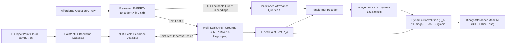

# LASO

**LASO: Language-guided Affordance Segmentation on 3D Object**（CVPR 2024）收录于 [Awesome-Affordance-Learning](https://github.com/hq-King/Awesome-Affordance-Learning)，属于具身 AI affordance 学习综述的配套论文清单。本页是 **清单索引**：给出它在综述分类里的位置与原文入口，方法细节和量化结果请看原文。

## 一句话定义

LASO: Language-guided Affordance Segmentation on 3D Object——在清单中归入 **Perception（Scope: Object；Perception Subcategory: Spatial · Generalizable） ｜ Datasets / Benchmarks（Data Modality: 3D）**（清单未附方法摘要，此处不替原文概括贡献）。

## 英文缩写速查

| 缩写 | 英文全称 | 简要说明 |
|------|----------|----------|
| Affordance | Action possibility (Gibson) | 环境/物体对 agent 提供的可交互机会 |
| HOI | Human-Object Interaction | 人–物交互，常作 affordance 监督来源 |
| VLM | Vision-Language Model | 视觉–语言模型，用于 affordance 推理与接地 |
| VLA | Vision-Language-Action | 视觉–语言–动作策略 |

## 为什么重要

- 综述把 affordance 学习拆成感知、推理、引导动作三段（见 [综述实体页](../entities/paper-affordance-learning-embodied-ai-survey.md)），本条目是其中一段的代表文献之一。
- 可顺着 [技术地图](../overview/affordance-awesome-technology-map.md) 的同分组条目横向阅读同方向工作。

## 核心信息

| 字段 | 内容 |
|------|------|
| 出处 | CVPR 2024 |
| 方法名（清单标注） | LASO |
| 分组 1 | Perception · Scope: Object；Perception Subcategory: Spatial · Generalizable |
| 分组 2 | Datasets / Benchmarks · Data Modality: 3D |
| 论文 | <https://openaccess.thecvf.com/content/CVPR2024/papers/Li_LASO_Language-guided_Affordance_Segmentation_on_3D_Object_CVPR_2024_paper.pdf> |

## 核心机制（归纳）

> 注：以下机制与评测指标基于通读 CVF 开放获取原文全文核对补充（[原文](https://openaccess.thecvf.com/content/CVPR2024/papers/Li_LASO_Language-guided_Affordance_Segmentation_on_3D_Object_CVPR_2024_paper.pdf)）。

**LASO（Language-guided Affordance Segmentation on 3D Object）** 首次提出以自然语言问题代替固定类别标签或 2D 示例图像来引导 3D 物体点云的功能部位分割：给定点云 $P_{raw} \in \mathbb{R}^{N \times 3}$ 与情景化问题 $Q_{raw}$，模型在不引入显式 affordance 类别辅助监督的条件下，直接输出二值点云分割掩码 $M \in \mathbb{R}^N$。论文同时构建了问答–点云数据集与基准模型 **PointRefer**：

1. **特征编码（Sec. 4 & 5）**：
   - **语言侧**：在问题前拼接 `[CLS]` 词元并由预训练 **RoBERTa**（默认 $d=512$）编码为序列特征 $X \in \mathbb{R}^{L \times d}$。
   - **3D 点云侧**：采用多阶段编码–解码结构的 **PointNet++** 作为默认 3D 分割骨干。
2. **自适应融合模块（Adaptive Fusion Module, AFM，Sec. 4.1）**：
   - 针对不同交互部位尺度差异巨大的挑战（如椅子靠背 vs. 门把手），将 AFM 注入 3D 骨干网络**多个解码阶段**以实现多尺度跨模态融合，单层包含三步瓶颈操作：
     1. *Grouping*：以文本特征 $X$ 为 Query、当前层点云特征 $P \in \mathbb{R}^{T \times d}$ 为 Key/Value 执行轻量交叉注意力（省略 Q/V 线性投影），聚合成词元对齐的分组特征 $G = \text{Attention}(X, W_1 P, P) + X \in \mathbb{R}^{L \times d}$；
     2. *Mixing*：经由 **MLP-Mixer**（依次通过组维度 $\text{MLP}_1$ 与通道维度 $\text{MLP}_2$）充分交互得到 $F$；
     3. *Ungrouping*：以 $P$ 为 Query、$F$ 为 Key/Value 执行反向交叉注意力 $P_m = \text{Attention}(P, W_2 F, F) + P$ 并加残差连接，输出增强后点云特征 $P_o$。
3. **指代点解码器（Referred Point Decoder, RPD，Sec. 4.2）**：
   - 将文本特征 $X$ 与可学习位置查询参数相加构造语言条件化的 **Affordance Queries** $A \in \mathbb{R}^{L \times d}$，送入 **Transformer Decoder** 与末层融合点特征 $P_o$ 交互得到 $A'$。
   - 经两层 MLP 将 $A'$ 映射为 $L$ 个 $1 \times 1$ **动态卷积核** $\Omega = \{\omega_i\}_{i=1}^L$，分别与 $P_o$ 卷积得到 $L$ 组点云响应掩码 $S_i = P_o * \omega_i$，再经池化与 Sigmoid 激活融合为最终分割掩码 $M \in \mathbb{R}^N$。
4. **训练目标（Eq. 10）**：
   - 完全去掉辅助 affordance 分类头，仅以 **Binary Cross-Entropy + Dice Loss**（$\mathcal{L} = \mathcal{L}_{BCE} + \mathcal{L}_{Dice}$）直接端到端训练分割掩码（Adam 优化器，学习率 `1e-4`）。

### 方法流程图

## 评测与指标

- 综述本身不提供跨论文性能排名（见 [综述实体页](../entities/paper-affordance-learning-embodied-ai-survey.md)），以下指标均摘自 [原文](https://openaccess.thecvf.com/content/CVPR2024/papers/Li_LASO_Language-guided_Affordance_Segmentation_on_3D_Object_CVPR_2024_paper.pdf) 在自建 **LASO 数据集** 上的实验：
- **LASO 数据集构建与划分（Sec. 3，Table 2）**：
  - 基于 3D-AffordanceNet 的 8,434 个 3D 物体形状（23 类物体、17 类 affordance、58 种物体–affordance 组合），由专家编写每组合 5 条问题并用 GPT-4 按「情景丰富、简洁表达、句式多样」原则各扩增 10 条（经人工审核），共 **870** 条问题、**19,751** 个问答–点云对。
  - **Seen 划分**（训练/测试共享物体–affordance 分布）：Train 6,883 形状 / 16,120 实例，Val 516 / 1,215，Test 1,035 / 2,416。
  - **Unseen 划分**（留出特定物体–affordance 组合测试跨物体迁移，共享相同 Val/Test）：Train 6,160 形状 / 458 问题 / 11,558 实例。
- **主基准对比（Table 3，4 项指标：mIoU↑ / AUC↑ / SIM↑ / MAE↓）**：
  - **Seen 分区**：`PointRefer` 达到 **`mIoU = 20.8%`**、**`AUC = 87.3%`**、**`SIM = 0.629`**、**`MAE = 0.093`**；全面超越改编后的对比模型 `IAGNet`（17.8% / 82.3% / 0.561 / 0.109）、`ReLA`（15.2% / 78.9% / 0.532 / 0.118）、`ReferTrans`（13.7% / 79.8% / 0.497 / 0.124）及 `3D-SPS`（11.4% / 76.2% / 0.433 / 0.138）。
  - **Unseen 分区**：`PointRefer` 达到 **`mIoU = 14.6%`**、**`AUC = 80.2%`**、**`SIM = 0.507`**、**`MAE = 0.119`**；同样领先次优 `IAGNet`（12.9% / 77.8% / 0.443 / 0.129）与 `ReLA`（10.7% / 69.7% / 0.429 / 0.144）。
- **消融与骨干分析（Table 4 & Table 5，Seen）**：
  - 盲测 `Blind`（去掉问题输入）mIoU 骤降至 **10.8%**；去掉 AFM 与 RPD（`w/o AFM & PRD`）降至 **17.7%**；单尺度融合（`w/o multi-scale`）**20.4%**；去掉语言条件查询（`w/o condition`）**19.2%**；去掉动态卷积核（`w/o dynamic filter`）**19.5%**。
  - 骨干对比中 `PointNet++` 显著优于 `PointMLP`，`RoBERTa` 在 Seen（20.8 vs. DeBERTa 20.4 / BERT 20.1）与 Unseen（14.6 vs. 14.5 / 14.1）均略占优；问题长度超过 14 词时因语义线索更充分，性能优于极短句。
- **已知局限（Sec. 5.1 & 5.3）**：所有模型在 Seen→Unseen 均有明显掉点（PointRefer 20.8%→14.6% mIoU）；面对过短、语义不足的问题（non-comprehended text）易定位失败，而面对多个分离功能部位时容易发生过度分割（将中间无关区域串联起来）。

## 与其他工作对比

- 本页不做与具体基线的数值对比；同分组横向对照见 [技术地图](../overview/affordance-awesome-technology-map.md)。
- 若站内另有这篇的深读页，以那一页为准。

## 结论

**LASO 将 3D 物体 affordance 分割从封闭类别标签和 2D 示例图拓展到开放自然语言问答驱动，为 LLM 任务规划器到 3D 操作部位接地提供了直接接口与 19,751 对问答–点云基准。**

- PointRefer 通过「多尺度 AFM（Grouping → MLP-Mixer → Ungrouping）」与「语言条件化动态卷积核 RPD」，在 Seen（20.8% mIoU / 87.3% AUC）与 Unseen（14.6% mIoU / 80.2% AUC）上均刷新适应基线，且无需额外 affordance 分类辅助损失。
- Unseen 泛化仍有较大掉点，且极简短问句与多分离部件过分割是当前典型失误模式，引入 LLM 常识先验或显式部件实例约束是后续改进方向。
- 原文摘要声明代码与数据集开源于 <https://github.com/yl3800/LASO>，本页未拉取和运行仓库代码，复现前请自行核对环境依赖与评测脚本。

## 常见误区

1. 不要把分类标签当作论文结论；标签来自清单维护者的归类。
2. 不要把本页当作方法证明；它只是清单入口。

## 关联页面

- [Affordance 学习综述](../entities/paper-affordance-learning-embodied-ai-survey.md)
- [Awesome-Affordance-Learning 技术地图](../overview/affordance-awesome-technology-map.md)
- [manipulation.md](../tasks/manipulation.md)、[vla.md](../methods/vla.md)

## 参考来源

- [`sources/papers/affordance_awesome_laso-language-guided-affordance-segmentation-on-3d-objec.md`](../../sources/papers/affordance_awesome_laso-language-guided-affordance-segmentation-on-3d-objec.md) — 本条目策展摘录
- [`sources/papers/affordance_awesome_catalog.md`](../../sources/papers/affordance_awesome_catalog.md) — 列表总表
- [`sources/repos/awesome-affordance-learning.md`](../../sources/repos/awesome-affordance-learning.md)
- 论文：<https://openaccess.thecvf.com/content/CVPR2024/papers/Li_LASO_Language-guided_Affordance_Segmentation_on_3D_Object_CVPR_2024_paper.pdf>

## 推荐继续阅读

- [Awesome-Affordance-Learning 仓库](https://github.com/hq-King/Awesome-Affordance-Learning)
- [原文](https://openaccess.thecvf.com/content/CVPR2024/papers/Li_LASO_Language-guided_Affordance_Segmentation_on_3D_Object_CVPR_2024_paper.pdf)
