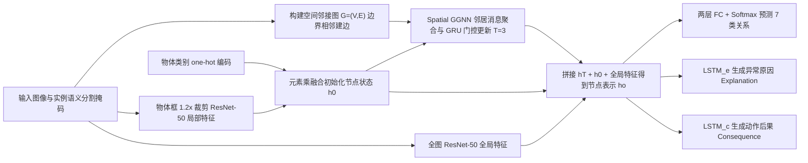

# Learning to Act Properly

**Learning to Act Properly: Predicting and Explaining Affordances From Images**（CVPR 2018）收录于 [Awesome-Affordance-Learning](https://github.com/hq-King/Awesome-Affordance-Learning)，属于具身 AI affordance 学习综述的配套论文清单。本页是 **清单索引**：给出它在综述分类里的位置与原文入口，方法细节和量化结果请看原文。

## 一句话定义

Learning to Act Properly: Predicting and Explaining Affordances From Images——在清单中归入 **Reasoning（Reasoning Subcategory: Relation-Based Affordance Reasoning） ｜ Datasets / Benchmarks（Data Modality: image）**（清单未附方法摘要，此处不替原文概括贡献）。

## 英文缩写速查

| 缩写 | 英文全称 | 简要说明 |
|------|----------|----------|
| Affordance | Action possibility (Gibson) | 环境/物体对 agent 提供的可交互机会 |
| HOI | Human-Object Interaction | 人–物交互，常作 affordance 监督来源 |
| VLM | Vision-Language Model | 视觉–语言模型，用于 affordance 推理与接地 |
| VLA | Vision-Language-Action | 视觉–语言–动作策略 |

## 为什么重要

- 综述把 affordance 学习拆成感知、推理、引导动作三段（见 [综述实体页](../entities/paper-affordance-learning-embodied-ai-survey.md)），本条目是其中一段的代表文献之一。
- 可顺着 [技术地图](../overview/affordance-awesome-technology-map.md) 的同分组条目横向阅读同方向工作。

## 核心信息

| 字段 | 内容 |
|------|------|
| 出处 | CVPR 2018 |
| 方法名（清单标注） | - |
| 分组 1 | Reasoning · Reasoning Subcategory: Relation-Based Affordance Reasoning |
| 分组 2 | Datasets / Benchmarks · Data Modality: image |
| 论文 | <https://openaccess.thecvf.com/content_cvpr_2018/html/Chuang_Learning_to_Act_CVPR_2018_paper.html> |

## 核心机制（归纳）

> 注：以下机制与评测指标基于通读 CVF 开放获取原文全文核对补充。

论文针对场景上下文敏感的 affordance 推理问题，构建 **ADE-Affordance** 数据集并提出基于**空间门控图神经网络（Spatial GGNN）**的预测与语言解释模型：

1. **问题定义（Sec. 4.1）**：给定图像 $I$、目标动作集合 $A = \{\text{sit}, \text{run}, \text{grasp}\}$ 及场景内 $M$ 个物体/背景（stuff）实例 $O = \{o_j\}_{j=1}^M$，为每个动作–实例对 $(a_i, o_j)$ 联合预测三项输出：
   - **7 类动作–物体关系（Relationship）**：1 类正例（`Positive`）、1 类绝对负例（`Firmly Negative`，来自常识知识库 KB），以及 5 类**场景例外（Exception）**（`Object Non-functional`、`Physical Obstacle`、`Socially Awkward`、`Socially Forbidden`、`Dangerous to ourselves/others`）。
   - **自然语言解释（Explanation）与后果预测（Consequence）**：当关系属于例外类别时，分别生成解释原因与违规后果的第三人称语句。
2. **空间邻接图与节点初始化（Sec. 4.2）**：
   - 从实例级语义分割掩码构建图 $G=(V,E)$，每个物体实例为一个节点，若两物体掩码边界相接则建立无向边以编码空间邻接关系。
   - 节点初始隐状态融合类别 one-hot 编码 $\hat{c}$ 与扩大 1.2 倍边界框内裁剪图像的 ResNet-50 局部特征 $\phi(o_v)$：$h_v^0 = g(W_c \hat{c}) \odot g(W_f \phi(o_v))$（$g$ 为 ReLU）。
3. **Spatial GGNN 消息传播与输出（Sec. 4.2）**：
   - 经过 $T=3$ 步循环传播：每步汇总邻居隐状态 $x_v^t = \sum_{v' \in N(v)} W_p h_{v'}^{t-1} + b_p$，再经门控循环单元（GRU 式更新门 $z_v^t$ 与重置门 $r_v^t$）迭代更新节点隐状态 $h_v^t$。
   - 传播结束后，拼接节点终态 $h_v^T$、初态 $h_v^0$ 与全图 ResNet-50 全局特征 $\phi(I)$，经线性层与 ReLU 得到节点表示 $h_v^o$：
     - 两层 FC + Softmax 输出 7 类关系概率 $p_s$；
     - 两个独立参数的 LSTM 语言解码器（$\text{LSTM}_e, \text{LSTM}_c$）分别生成 Explanation $y_e$ 与 Consequence $y_c$。
   - **训练目标**：关系分类与解释/后果生成均采用交叉熵损失，使用 BPTT 与 Adam 优化（可按任务独立训练，也可通过 SA-MT / MA-MT 多任务共享 GGNN 参数）。

### 方法流程图

## 评测与指标

- **ADE-Affordance 基准构建（Sec. 3）**：基于 ADE20K 筛选 **10,000 张室内外场景图像**（8,011 训练 / 1,000 验证 / 1,000 测试），涵盖 `sit`、`run`、`grasp` 3 个动作与 5 类物理/社会规范例外标注（测试集每图 3 人独立标注）。
- **关系预测指标（GT 分割设定，Table 4）**：采用 `mAcc`（3 类：正例/绝对负例/例外）与 `mAcc-E`（区分全部 7 类），Spatial GGNN（$T=3$）在多数动作上优于 KB 查表、Unaries（$T=0$）、Chain RNN 及全连接 FC GGNN：
  - **Sit**：mAcc **0.745** / mAcc-E **0.461**（对比 KB 0.656 / 0.281，Unaries 0.730 / 0.428，FC GGNN 0.733 / 0.438）
  - **Run**：mAcc **0.730** / mAcc-E **0.452**（对比 KB 0.662 / 0.284，Unaries 0.714 / 0.434，FC GGNN 0.711 / 0.407）
  - **Grasp**：mAcc **0.604** / mAcc-E **0.310**（Chain RNN mAcc 0.610；FC GGNN 0.596 / 0.309；KB 0.590 / 0.253）
- **真实预测分割端到端设定（Table 5）**：在 60 个 COCO/ADE 重叠物体类 + 25 个 stuff 类上叠加预测分割时，受分割误差影响指标明显下降（Sit 0.280 / 0.162，Run 0.238 / 0.192，Grasp 0.130 / 0.065）。
- **解释与后果生成（GT 分割，Table 6 & Table 7）**：以 Bleu-4 / METEOR / ROUGE / CIDEr 评估，Spatial GGNN 在 Grasp 解释（CIDEr **2.069** vs. Unaries 1.838，Bleu-4 **0.735**）与后果生成（CIDEr **1.504** vs. Unaries 0.772，Bleu-4 **0.70**）提升最显著；Run 解释 CIDEr **0.409**（vs. 0.350），Sit 解释 CIDEr **0.220**（FC GGNN 为 0.231）。作者指出受限于训练集规模，生成句子多样性仍偏低，相似场景易输出模板化表达。
- 评测口径与完整图表以 [CVF 原文](https://openaccess.thecvf.com/content_cvpr_2018/html/Chuang_Learning_to_Act_CVPR_2018_paper.html) 为准；综述本身不提供跨论文性能排名（见 [综述实体页](../entities/paper-affordance-learning-embodied-ai-survey.md)），不同设置下的数字不可直接比较。

## 与其他工作对比

- 本页不做与具体基线的数值对比；同分组横向对照见 [技术地图](../overview/affordance-awesome-technology-map.md)。
- 若站内另有这篇的深读页，以那一页为准。

## 结论

**本页已完成 CVF 原文核对：该工作最早系统建模了受物理障碍与社会规范约束的场景依赖型 affordance 推理与自然语言解释。**

- 构建包含 10,000 张 ADE20K 图像与 5 类例外标注的 ADE-Affordance 数据集（项目页：<http://www.cs.utoronto.ca/~cychuang/learning2act/>）。
- Spatial GGNN 通过相邻实例边界消息传播（$T=3$）在 GT 分割设定下优于无图基线与全连接图，但直接接入预测分割时性能大幅下滑。
- 受数据集规模限制，LSTM 生成的解释与后果句子偏模板化，实际部署需结合更强的场景解析与大语言/多模态模型。
- 可结合综述实体页对照其在「关系型 affordance 推理」脉络中的早期位置。

## 常见误区

1. 不要把分类标签当作论文结论；标签来自清单维护者的归类。
2. 不要把本页当作方法证明；它只是清单入口。

## 关联页面

- [Affordance 学习综述](../entities/paper-affordance-learning-embodied-ai-survey.md)
- [Awesome-Affordance-Learning 技术地图](../overview/affordance-awesome-technology-map.md)
- [vla.md](../methods/vla.md)、[manipulation.md](../tasks/manipulation.md)

## 参考来源

- [`sources/papers/affordance_awesome_learning-to-act-properly-predicting-and-explaining-affor.md`](../../sources/papers/affordance_awesome_learning-to-act-properly-predicting-and-explaining-affor.md) — 本条目策展摘录
- [`sources/papers/affordance_awesome_catalog.md`](../../sources/papers/affordance_awesome_catalog.md) — 列表总表
- [`sources/repos/awesome-affordance-learning.md`](../../sources/repos/awesome-affordance-learning.md)
- 论文：<https://openaccess.thecvf.com/content_cvpr_2018/html/Chuang_Learning_to_Act_CVPR_2018_paper.html>

## 推荐继续阅读

- [Awesome-Affordance-Learning 仓库](https://github.com/hq-King/Awesome-Affordance-Learning)
- [原文](https://openaccess.thecvf.com/content_cvpr_2018/html/Chuang_Learning_to_Act_CVPR_2018_paper.html)
