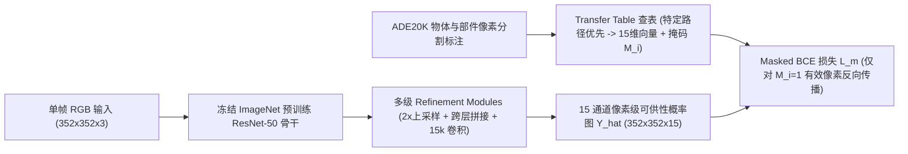

# Learning to Segment Affordances

**Learning to Segment Affordances**（ICCVW 2017）收录于 [Awesome-Affordance-Learning](https://github.com/hq-King/Awesome-Affordance-Learning)，属于具身 AI affordance 学习综述的配套论文清单。本页是 **清单索引**：给出它在综述分类里的位置与原文入口，方法细节和量化结果请看原文。

## 一句话定义

Learning to Segment Affordances——在清单中归入 **Perception（Scope: Object/Scene；Perception Subcategory: Visual）**（清单未附方法摘要，此处不替原文概括贡献）。

## 英文缩写速查

| 缩写 | 英文全称 | 简要说明 |
|------|----------|----------|
| Affordance | Action possibility (Gibson) | 环境/物体对 agent 提供的可交互机会 |
| HOI | Human-Object Interaction | 人–物交互，常作 affordance 监督来源 |
| VLM | Vision-Language Model | 视觉–语言模型，用于 affordance 推理与接地 |
| VLA | Vision-Language-Action | 视觉–语言–动作策略 |

## 为什么重要

- 综述把 affordance 学习拆成感知、推理、引导动作三段（见 [综述实体页](../entities/paper-affordance-learning-embodied-ai-survey.md)），本条目是其中一段的代表文献之一。
- 可顺着 [技术地图](../overview/affordance-awesome-technology-map.md) 的同分组条目横向阅读同方向工作。

## 核心信息

| 字段 | 内容 |
|------|------|
| 出处 | ICCVW 2017 |
| 方法名（清单标注） | - |
| 分组 1 | Perception · Scope: Object/Scene；Perception Subcategory: Visual |
| 论文 | <https://openaccess.thecvf.com/content_ICCV_2017_workshops/papers/w14/Luddecke_Learning_to_Segment_ICCV_2017_paper.pdf> |

## 核心机制（归纳）

> 注：以下机制与评测指标基于通读开放获取原文全文核对补充。

### 问题设定与从物体部件到 15 类可供性的映射

不同于先估计深度/法向再推导少量可供性的管线，本文提出直接从**单帧 RGB 图像**稠密预测 **15 类细粒度可供性**（`obstruct`, `break`, `sit`, `grasp`, `pinch-pull`, `hook-pull`, `tip-push`, `warmth`, `illumination`, `observe`/`read/watch`, `support`, `place-on`, `dry`, `roll`, `walk`），不依赖几何先验。

1. **物体–部件层级查表转换（Transfer Table）**：可供性通常附着于物体局部部件而非整物（如门把手对应 `hook-pull` 而非整扇柜门）。作者选取 **ADE20K** 中最常出现的 500 个物体与部件标签，构建“特定路径优先于通配部件”的查表映射（例如优先匹配 `cabinet/drawer/handle`，未命中再退回 `*/drawer`），输出 15 维可供性向量；对于难以整体归类的模糊区域保留为未标注，同时记录有效像素掩码 $M_i \in \{0, 1\}$（宁缺毋滥，以牺牲部分召回换取高标注精度），并按图像分辨率与物体数自适应多尺度裁剪及色彩/对比度增强。
2. **Dense-Refine-ResNet 架构**：以 ImageNet 预训练 **ResNet-50** 为骨干（训练时冻结其权重以防小数据集过拟合），自顶向下接入简化的 Pinheiro 式 **Refinement Modules**（省去一层卷积），将深层语义特征 2× 上采样后与浅层高分辨率特征按通道拼接并卷积生成 $15k$ 个特征图（$k \in \{1, 3, 5, 7\}$），最终输出 `352 × 352 × 15` 非互斥可供性概率图，单图推理仅 **107 ms**（近 10 FPS）。
3. **掩码二元交叉熵损失（Masked Binary Cross-Entropy, $L_m$）**：由于同一像素可具备多种可供性且部分区域标签缺失，损失在非互斥二元交叉熵 $H(Y_{ai}, \hat{Y}_{ai})$ 上乘以有效区域掩码 $M_i$ 后归一化：$L_m(Y, \hat{Y}) = (|A|\sum_{i\in I} M_i)^{-1} \sum_{a\in A}\sum_{i\in I} M_i H(Y_{ai}, \hat{Y}_{ai})$。使用 RMSprop（`lr = 0.001`）训练并在 LG432 的 20% 子集上标定二值化阈值。

### 方法流程图

## 评测与指标

- **数据集划分与基准**：从 ADE20K 训练集 90% / 10% 划分转换后的训练/验证集；测试集拆为两组（均来自 ADE20K 验证集）：
  - **LG432**（432 个场景，由部件查表规则自动转换，评测分布内泛化；其中 `pinch-pull` 与 `hook-pull` 未被覆盖记为 0%）。
  - **HQ50**（50 个高分辨率多物体场景，由专家按 15 类定义严格手工逐像素标注，评测对真实可供性分布的泛化）。
- **架构与超参数对比（Table 4，除注明外输入均为 `352 px`）**：
  - **`Dense-Refine-ResNet (k=3)`（最优折中）**：LG432 `mean IoU` **32.2%**、`pixel IoU` **63.0%**、`pixel Acc` **75.3%**；HQ50 `mean IoU` **30.0%**（所有配置最高），推理速度 **107 ms/图**。
  - `k=7`：LG432 `32.3% / 63.0% / 75.6%`，但 HQ50 降至 `28.9%`（更大参数量 $k>3$ 易过拟合查表转换规则的伪影）。
  - `k=5`：LG432 `31.1% / 62.2% / 74.8%`，HQ50 `28.5%`；输入分辨率降至 `224px / k=5` 后均明显下滑（LG432 `30.4%`，HQ50 `27.9%`）。
  - `k=1`：LG432 `29.3% / 60.2% / 71.3%`，HQ50 `28.5%`。
  - VGG 基线（同用 $L_m$ 损失）：`vgg_upconv`（LG432 `28.4% / 58.1% / 70.3%`，HQ50 `26.1%`）与 `vgg_refine`（LG432 `22.7% / 49.1% / 59.5%`，HQ50 `24.9%`）均落后于 ResNet 方案。
- **各类别 IoU 表现（Table 5，LG432 / HQ50）**：
  - 占据大面积平面或强上下文类精度较高：`obstruct`（**73.9% / 59.3%**）、`roll`（**70.5% / 71.7%**）、`walk`（**70.5% / 71.5%**）、`support`（**69.8% / 66.4%**）。
  - 局部物体类泛化良好（部分在真实标注 HQ50 上反超代理标签 LG432）：`illumination`（`39.1% / 50.2%`）、`break`（`36.2% / 42.2%`）、`grasp`（`21.8% / 25.0%`）。
  - 极细小或稀疏部件类别仍具挑战：`hook-pull`（`0.0% / 16.0%`）、`tip-push`（`0.9% / 3.6%`）、`pinch-pull`（`0.0% / 0.3%`）。

## 与其他工作对比

- 本页不做与具体基线的数值对比；同分组横向对照见 [技术地图](../overview/affordance-awesome-technology-map.md)。
- 若站内另有这篇的深读页，以那一页为准。

## 结论

**本文首次系统利用部件级语义分割（ADE20K）与掩码二元交叉熵 $L_m$，实现了单帧 RGB 图像下 15 类细粒度可供性的实时（~10 FPS）稠密预测。**

- **部件粒度优于整物粒度**：通过路径查表将可供性精确锚定到旋钮、把手、桌面等部件，并借助 $M_i$ 忽略未知区域，避免错误监督污染网络。
- **特征容量与分辨率权衡**：精炼通道倍率 `k = 3` 在真实分布 `HQ50` 上取得最高 `30.0%` mean IoU，过大容量会记忆代理标签伪影；提高输入分辨率（`352px` vs `224px`）对捕捉小部件至关重要。
- **局限与开源状态**：极端稀疏/微小交互部件（如按钮、拉手）受限于训练样本与阈值标定精度依然偏低；全文未给出公开代码仓库链接，复现需自行实现 Transfer Table 与 Keras/Theano 架构细节。

## 常见误区

1. 不要把分类标签当作论文结论；标签来自清单维护者的归类。
2. 不要把本页当作方法证明；它只是清单入口。

## 关联页面

- [Affordance 学习综述](../entities/paper-affordance-learning-embodied-ai-survey.md)
- [Awesome-Affordance-Learning 技术地图](../overview/affordance-awesome-technology-map.md)
- [manipulation.md](../tasks/manipulation.md)、[vla.md](../methods/vla.md)

## 参考来源

- [`sources/papers/affordance_awesome_learning-to-segment-affordances.md`](../../sources/papers/affordance_awesome_learning-to-segment-affordances.md) — 本条目策展摘录
- [`sources/papers/affordance_awesome_catalog.md`](../../sources/papers/affordance_awesome_catalog.md) — 列表总表
- [`sources/repos/awesome-affordance-learning.md`](../../sources/repos/awesome-affordance-learning.md)
- 论文：<https://openaccess.thecvf.com/content_ICCV_2017_workshops/papers/w14/Luddecke_Learning_to_Segment_ICCV_2017_paper.pdf>

## 推荐继续阅读

- [Awesome-Affordance-Learning 仓库](https://github.com/hq-King/Awesome-Affordance-Learning)
- [原文](https://openaccess.thecvf.com/content_ICCV_2017_workshops/papers/w14/Luddecke_Learning_to_Segment_ICCV_2017_paper.pdf)
