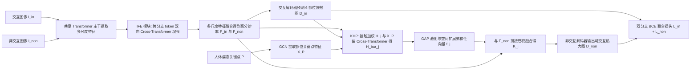

# Leverage Interactive Affinity for Affordance Learning

**Leverage Interactive Affinity for Affordance Learning**（CVPR 2023）收录于 [Awesome-Affordance-Learning](https://github.com/hq-King/Awesome-Affordance-Learning)，属于具身 AI affordance 学习综述的配套论文清单。本页是 **清单索引**：给出它在综述分类里的位置与原文入口，方法细节和量化结果请看原文。

## 一句话定义

Leverage Interactive Affinity for Affordance Learning——在清单中归入 **Perception（Scope: Object；Perception Subcategory: Visual · Interaction-driven）**（清单未附方法摘要，此处不替原文概括贡献）。

## 英文缩写速查

| 缩写 | 英文全称 | 简要说明 |
|------|----------|----------|
| Affordance | Action possibility (Gibson) | 环境/物体对 agent 提供的可交互机会 |
| HOI | Human-Object Interaction | 人–物交互，常作 affordance 监督来源 |
| VLM | Vision-Language Model | 视觉–语言模型，用于 affordance 推理与接地 |
| VLA | Vision-Language-Action | 视觉–语言–动作策略 |

## 为什么重要

- 综述把 affordance 学习拆成感知、推理、引导动作三段（见 [综述实体页](../entities/paper-affordance-learning-embodied-ai-survey.md)），本条目是其中一段的代表文献之一。
- 可顺着 [技术地图](../overview/affordance-awesome-technology-map.md) 的同分组条目横向阅读同方向工作。

## 核心信息

| 字段 | 内容 |
|------|------|
| 出处 | CVPR 2023 |
| 方法名（清单标注） | — |
| 分组 1 | Perception · Scope: Object；Perception Subcategory: Visual · Interaction-driven |
| 论文 | <https://openaccess.thecvf.com/content/CVPR2023/html/Luo_Leverage_Interactive_Affinity_for_Affordance_Learning_CVPR_2023_paper.html> |

## 核心机制（归纳）

> 注：以下机制与评测指标基于通读 CVF 开放获取原文全文核对补充。

针对同一物体在不同交互方式下呈现「多重交互可能性（multiple possibilities）」的问题，论文提出**姿态辅助交互亲和性学习框架（PIAL-Net）**，从带有姿态 $P$ 的人–物交互图像 $I_{\text{in}}$ 中提取人体部位与物体局部区域的**交互亲和性（interactive affinity）**，并迁移至非交互物体图像 $I_{\text{non}}$ 以定位可交互区域：

1. **双分支特征提取与交互特征增强（IFE，Sec. 3.1）**：
   - 两幅图像经共享 Transformer 主干网络提取 4 个阶段多尺度特征 $X_{\text{in}}, X_{\text{non}}$。
   - **IFE 模块**引入 $l=16$ 个可学习跨分支 token $X_c^0 \in \mathbb{R}^{l \times c}$ 并堆叠 $m=2$ 个块：每个块先用 Cross-Transformer（$\text{CT}$：多头交叉注意力 + LN + MLP）分别聚合 $X_{\text{in}}^i$ 与 $X_{\text{non}}^i$ 的上下文，再联合 $[X_{\text{in}}^i, X_{\text{non}}^i, X_c^i]$ 挖掘共性上下文得到 $X_c^{i+1}$，最后将 $X_c^{i+1}$ 分别反传更新两分支特征，缩小视角、尺度与外观差异。
2. **关键点启发式感知（KHP，Sec. 3.2）**：
   - **多尺度融合与接触区域解码**：将 IFE 输出特征与主干浅层特征（$i=1..3$）上采样融合得到高分辨率特征 $\hat{F}_{\text{in}}, \hat{F}_{\text{non}}$；交互分支解码器预测 $N_{\text{cls}}=6$ 个身体部位/接触通道图 $D_{\text{in}}$（对应 `Hands`、`Feet`、`Mouth`、`Hips`、`Back`、`Outside`）。
   - **GCN 姿态编码与部位特征提炼**：利用图卷积网络（GCN）从人体姿态关键点坐标 $P$ 提取关键点特征 $X_P$（带可学习边重要性矩阵 $M$）；将交互分支特征按部位接触概率加权 $H_j = \hat{F}_{\text{in}} \otimes P_{\text{in}}^j$，再用 Cross-Transformer 与对应部位关键点特征 $X_P^j$ 交互 $\bar{H}_j = \text{CT}(H_j, X_P^j)$，抑制背景干扰与接触遮挡带来的不确定性。
   - **亲和性迁移与训练损失**：对 $\bar{H}_j$ 做全局平均池化（GAP）得到部位亲和性向量 $f_j$，空间扩展后与 $\hat{F}_{\text{non}}$ 拼接并通过卷积融合得到 $K_j$，拼接所有部位通道后经解码器输出非交互分支预测图 $D_{\text{non}}$。总损失为双分支二元交叉熵之和 $L_{\text{total}} = \lambda_1 L_{\text{in}} + \lambda_2 L_{\text{non}}$（$\lambda_1=\lambda_2=1$）。

### 方法流程图

## 评测与指标

- **CAL 数据集构建（Sec. 4.1）**：从 PAD/PADv2 与 AGD20K 筛选并标注 **5,258 张图像**（2,689 张交互图 + 2,569 张非交互图），覆盖 **23 个 affordance 类别、47 个物体类别** 及 6 类接触部位（`Hands`、`Feet`、`Mouth`、`Hips`、`Back`、`Outside`），采用多点高斯模糊软热力图作为真值。
- **对比基准与定量结果（Sec. 4.2–4.3 / Table 1）**：在 **Seen**（4,484 组测试对）与 **Unseen**（3,297 组，训练与测试集类别不重叠）设定下，以 `KLD ↓`、`SIM ↑`、`NSS ↑` 对比语义分割（PSPNet、DeepLabV3+、SegFormer）、姿态估计（HRNet、ViTPose、HRFormer）及小样本分割（HSNet）共 7 个基线：
  - **Seen**：PIAL-Net（36.32M 参数）取得 **KLD 0.965 / SIM 0.756 / NSS 3.732**，显著优于最佳分割基线 SegFormer（1.198 / 0.741 / 3.543）、最佳姿态基线 HRFormer（1.259 / 0.729 / 3.479）及小样本分割 HSNet（2.014 / 0.431 / 1.922）。
  - **Unseen**：取得 **KLD 2.823 / SIM 0.430 / NSS 2.303**，优于 HSNet（3.016 / 0.234 / 1.007）、DeepLabV3+（5.632 / 0.374 / 1.993）与 SegFormer（5.957 / 0.401 / 2.167），跨类别迁移优势更明显。
- **消融与局限（Table 2–4, Sec. 4.4–4.5）**：同时启用 IFE 与 KHP 相对无两者基线将 Unseen KLD 从 5.593 降至 2.823；分部位关键点 + Cross-Transformer（Part+CT）显著优于全局池化或纯卷积融合。分部位评测显示 `"Back"` 部位误差仍明显偏高（Seen KLD 6.975、Unseen KLD 8.737），主要受背部接触样本稀缺与坐姿遮挡影响。
- 评测口径与完整图表以 [CVF 原文](https://openaccess.thecvf.com/content/CVPR2023/html/Luo_Leverage_Interactive_Affinity_for_Affordance_Learning_CVPR_2023_paper.html) 为准；综述本身不提供跨论文性能排名（见 [综述实体页](../entities/paper-affordance-learning-embodied-ai-survey.md)），不同设置下的数字不可直接比较。

## 与其他工作对比

- 本页不做与具体基线的数值对比；同分组横向对照见 [技术地图](../overview/affordance-awesome-technology-map.md)。
- 若站内另有这篇的深读页，以那一页为准。

## 结论

**本页已完成 CVF 原文核对：PIAL-Net 以「人体部位–物体局部接触（交互亲和性）」为桥梁，有效缓解了同一物体多交互方式的歧义并提升了跨类别迁移能力。**

- IFE 跨分支上下文增强 + KHP（GCN 姿态关键点引导交叉注意力）在 CAL 数据集 Seen（0.965 KLD）与 Unseen（2.823 KLD）设定下均显著优于纯分割、纯姿态及小样本分割基线。
- 对 `"Back"` 等少数类与坐姿遮挡部位仍存在明显性能短板，后续需处理部位样本不平衡与身体部位协同关系。
- 论文公开了代码与 CAL 数据集入口（<https://github.com/lhc1224/PIAL-Net>）。
- 可结合综述实体页对照其在「交互驱动视觉 affordance 感知」中的位置。

## 常见误区

1. 不要把分类标签当作论文结论；标签来自清单维护者的归类。
2. 不要把本页当作方法证明；它只是清单入口。

## 关联页面

- [Affordance 学习综述](../entities/paper-affordance-learning-embodied-ai-survey.md)
- [Awesome-Affordance-Learning 技术地图](../overview/affordance-awesome-technology-map.md)
- [manipulation.md](../tasks/manipulation.md)、[vla.md](../methods/vla.md)

## 参考来源

- [`sources/papers/affordance_awesome_leverage-interactive-affinity-for-affordance-learning.md`](../../sources/papers/affordance_awesome_leverage-interactive-affinity-for-affordance-learning.md) — 本条目策展摘录
- [`sources/papers/affordance_awesome_catalog.md`](../../sources/papers/affordance_awesome_catalog.md) — 列表总表
- [`sources/repos/awesome-affordance-learning.md`](../../sources/repos/awesome-affordance-learning.md)
- 论文：<https://openaccess.thecvf.com/content/CVPR2023/html/Luo_Leverage_Interactive_Affinity_for_Affordance_Learning_CVPR_2023_paper.html>

## 推荐继续阅读

- [Awesome-Affordance-Learning 仓库](https://github.com/hq-King/Awesome-Affordance-Learning)
- [原文](https://openaccess.thecvf.com/content/CVPR2023/html/Luo_Leverage_Interactive_Affinity_for_Affordance_Learning_CVPR_2023_paper.html)
