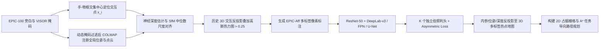

# EPIC-Aff

**Multi-label Affordance Mapping from Egocentric Vision**（ICCV 2023）收录于 [Awesome-Affordance-Learning](https://github.com/hq-King/Awesome-Affordance-Learning)，属于具身 AI affordance 学习综述的配套论文清单。本页是 **清单索引**：给出它在综述分类里的位置与原文入口，方法细节和量化结果请看原文。

## 一句话定义

Multi-label Affordance Mapping from Egocentric Vision——在清单中归入 **Perception（Scope: Scene；Perception Subcategory: Spatial · Interaction-driven） ｜ Datasets / Benchmarks（Data Modality: video-3D）**（清单未附方法摘要，此处不替原文概括贡献）。

## 英文缩写速查

| 缩写 | 英文全称 | 简要说明 |
|------|----------|----------|
| Affordance | Action possibility (Gibson) | 环境/物体对 agent 提供的可交互机会 |
| HOI | Human-Object Interaction | 人–物交互，常作 affordance 监督来源 |
| VLM | Vision-Language Model | 视觉–语言模型，用于 affordance 推理与接地 |
| VLA | Vision-Language-Action | 视觉–语言–动作策略 |

## 为什么重要

- 综述把 affordance 学习拆成感知、推理、引导动作三段（见 [综述实体页](../entities/paper-affordance-learning-embodied-ai-survey.md)），本条目是其中一段的代表文献之一。
- 可顺着 [技术地图](../overview/affordance-awesome-technology-map.md) 的同分组条目横向阅读同方向工作。

## 核心信息

| 字段 | 内容 |
|------|------|
| 出处 | ICCV 2023 |
| 方法名（清单标注） | EPIC-Aff |
| 分组 1 | Perception · Scope: Scene；Perception Subcategory: Spatial · Interaction-driven |
| 分组 2 | Datasets / Benchmarks · Data Modality: video-3D |
| 论文 | <https://openaccess.thecvf.com/content/ICCV2023/html/Mur-Labadia_Multi-label_Affordance_Mapping_from_Egocentric_Vision_ICCV_2023_paper.html> |

## 核心机制（归纳）

> 注：以下机制与评测指标基于通读 CVF 开放获取原文全文核对补充。

论文提出面向第一人称视频的**交互接地多标签度量级 affordance 建图与导航框架（EPIC-Aff）**，核心包含自动 3D 接地标注管线、多标签像素分割改造与 3D 活动热点建图/导航三部分：

1. **交互接地的多标签像素标注管线（Sec. 3.2）**：
   - **输入与交互中心定位**：结合 EPIC-Kitchens-100 动作旁白（动词 $V$ + 物体 $O$）与 VISOR 厨房掩码/边界框，将手边界框 $B_h$ 与交互物体框 $B_O$ 交集中心作为交互点 $x_i$。
   - **COLMAP 位姿与度量深度恢复**：利用 VISOR 动态物体掩码过滤前景动态区域后运行 **COLMAP**（SfM），在同一厨房多段视频的统一 3D 坐标系下注册高达 93% 的稀疏帧位姿 $T_{wc}$ 与环境点云 $\{X_p\}$；用神经网络单目深度估计器 $d_{NN}(x_i)$ 预测深度，并通过可见 SfM 点云深度中位数比值做尺度对齐，反投影得到全局 3D 交互点 $X_i^w = T_{wc} \cdot X_i^c$。
   - **跨序列历史重投影与多标签掩码生成**：汇集该厨房全部历史交互 $I_k$ 重投影至每一帧（$X_i^c = T_{cw} \cdot X_i^w$），在各重投影点叠加高斯核生成热力图，取阈值 $>0.25$ 的区域并按 VISOR 当前帧可见物体过滤，自动生成同一物体/像素共存多类可交互标签的度量级掩码。
2. **多标签像素分割与不平衡损失（Sec. 4.1）**：
   - 将经典单标签分割架构（U-Net、FPN、DeepLab-v3，均采用 ImageNet 预训练 ResNet-50 主干）改造为**多标签预测器**，对比两类方案：
     1. 保留多分类 Softmax 输出，设计三种后处理启发式选择多类（`top-K`、`max-θ`、动态差值阈值 `dyn-θ`）；
     2. 替换为 $K$ 个独立伯努利二分类头（推理阈值 $p_k > 0.5$），分别采用类加权二元交叉熵（BCE）或 **Asymmetric Loss（`Asym`）**（$\gamma_+=4, \gamma_-=1$，按正负样本比加权 $w_k$）缓解严重长尾不平衡（如 `open` 占 16.0%，而 `dry` 仅占 0.3%）。
3. **3D 活动热点建图与任务导向导航（Sec. 4.2）**：
   - 对训练未见帧，利用相机内参 $K_{\text{int}}$、COLMAP 位姿 $(R_w^c, t_w^c)$ 与尺度对齐深度 $d_{i,j}$ 将预测的多标签掩码反投影到全局 3D 点云地图（不做体素融合以保留同一空间区域的多标签共存）。
   - 基于 COLMAP 点云构建 2D 自由空间占据栅格，当给定目标动作指令时，在 3D affordance 地图上定位对应热点区域，并用欧氏距离 **$A^*$ 算法**规划从当前位姿到目标区域的最短路径。

### 方法流程图

## 评测与指标

- **EPIC-Aff 数据集规模（Sec. 3.2 / Table 1）**：基于 EPIC-Kitchens 构建 **38,876 张图像、304 类物体** 的大规模数据集，附带相机位姿与像素级多标签掩码，分为 **20 类 `easy-EPIC Aff`** 与 **43 类 `complex-EPIC Aff`** 两个难度版本。
- **多标签分割与显著性定量对比（Sec. 5.1–5.2 / Table 3 & Table 4）**：采用分布指标（`KLD ↓`、`SIM ↑`、`AUC-J ↑`）、分割指标（`mIoU ↑`、`F1-Score ↑`）与检测指标（`mAP ↑`、`AP50 ↑`）：
  - **`easy-EPIC Aff`（20 类，Table 3）**：**DeepLab-v3 + Asym** 在分割与显著性指标全部领先，取得 **42.3% mIoU / 60.1% F1 / 0.603 KLD / 0.668 SIM / 0.965 AUC-J**（mAP 43.6% / AP50 58.5%），显著高于 FPN + Asym（39.8% mIoU / 56.8% F1）、U-Net + Asym（17.7% mIoU）、多分类启发式 DeepLab-v3 dyn-$\theta$（19.5% mIoU / 4.947 KLD）及预训练 Grounded Interaction Hotspots（GIH：17.5% mIoU / 29.4% F1 / 2.381 KLD）；Mask R-CNN 在检测指标最高（**59.3% mAP / 62.6% AP50**），分割达 40.1% mIoU / 56.5% F1。
  - **`complex-EPIC Aff`（43 类，Table 4）**：**DeepLab-v3 + Asym** 仍保持最优分割性能，达 **31.1% mIoU / 46.5% F1 / 0.520 KLD / 0.670 SIM / 0.931 AUC-J**（FPN + Asym 为 28.1% mIoU / 42.9% F1；Mask R-CNN 为 17.1% mIoU / 27.3% F1 / 40.1% mAP）。
- **局限（Sec. 6）**：交互中心依赖手–物边界框交集近似；COLMAP 依赖离线建图且易受未屏蔽动态物体与噪声帧影响（实时系统需替换为 ORB-SLAM 等）；全部数据来自厨房场景，存在场景域偏置。
- 评测口径与完整图表以 [CVF 原文](https://openaccess.thecvf.com/content/ICCV2023/html/Mur-Labadia_Multi-label_Affordance_Mapping_from_Egocentric_Vision_ICCV_2023_paper.html) 为准；综述本身不提供跨论文性能排名（见 [综述实体页](../entities/paper-affordance-learning-embodied-ai-survey.md)），不同设置下的数字不可直接比较。

## 与其他工作对比

- 本页不做与具体基线的数值对比；同分组横向对照见 [技术地图](../overview/affordance-awesome-technology-map.md)。
- 若站内另有这篇的深读页，以那一页为准。

## 结论

**本页已完成 CVF 原文核对：EPIC-Aff 将第一人称交互历史通过 3D SfM 投影转换为像素级多标签监督，并打通了 3D 度量热点建图与 $A^*$ 任务导航。**

- 用 $K$ 个独立伯努利头配合 Asymmetric Loss 替代单标签 Softmax，有效缓解了同一物体多 affordance 共存与长尾类别不平衡（`easy-EPIC Aff` 上 DeepLab-v3 + Asym 达 42.3% mIoU / 60.1% F1）。
- 自动标注与建图依赖 COLMAP 离线重建及厨房视频分布，向实时机器人 SLAM 与非厨房场景迁移仍需补充泛化。
- 论文提供代码与数据集仓库入口（<https://github.com/lmur98/epic_kitchens_affordances>）。
- 可结合综述实体页对照其在「空间交互驱动多标签感知」中的位置。

## 常见误区

1. 不要把分类标签当作论文结论；标签来自清单维护者的归类。
2. 不要把本页当作方法证明；它只是清单入口。

## 关联页面

- [Affordance 学习综述](../entities/paper-affordance-learning-embodied-ai-survey.md)
- [Awesome-Affordance-Learning 技术地图](../overview/affordance-awesome-technology-map.md)
- [manipulation.md](../tasks/manipulation.md)、[vla.md](../methods/vla.md)

## 参考来源

- [`sources/papers/affordance_awesome_multi-label-affordance-mapping-from-egocentric-vision.md`](../../sources/papers/affordance_awesome_multi-label-affordance-mapping-from-egocentric-vision.md) — 本条目策展摘录
- [`sources/papers/affordance_awesome_catalog.md`](../../sources/papers/affordance_awesome_catalog.md) — 列表总表
- [`sources/repos/awesome-affordance-learning.md`](../../sources/repos/awesome-affordance-learning.md)
- 论文：<https://openaccess.thecvf.com/content/ICCV2023/html/Mur-Labadia_Multi-label_Affordance_Mapping_from_Egocentric_Vision_ICCV_2023_paper.html>

## 推荐继续阅读

- [Awesome-Affordance-Learning 仓库](https://github.com/hq-King/Awesome-Affordance-Learning)
- [原文](https://openaccess.thecvf.com/content/ICCV2023/html/Mur-Labadia_Multi-label_Affordance_Mapping_from_Egocentric_Vision_ICCV_2023_paper.html)
