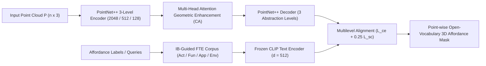

# Aff3DFunc

**Open-Vocabulary 3D Affordance Understanding via Functional Text Enhancement and Multilevel Representation Alignment**（ACM MM 2025）由英国格拉斯哥大学团队（Lin Wu、Wei Wei、Peizhuo Yu、Jianglin Lan）提出，收录于 [Awesome-Affordance-Learning](https://github.com/hq-King/Awesome-Affordance-Learning) 的 **Reasoning（Language-Centric Affordance Reasoning）** 分组。本文针对标签式提示语义贫乏与点云几何特征判别力不足的问题，提出了基于信息瓶颈原则的功能文本增强（FTE）与多层级表征对齐框架 **Aff3DFunc**。

## 一句话定义

**Aff3DFunc** 是一个轻量级（3.20M 参数）开放词汇 3D 可交互区域理解框架，通过信息瓶颈驱动的功能文本增强（FTE）与点云多层级监督对比对齐，实现面向标签与情景问句查询的零样本 3D Affordance 定位。

## 英文缩写速查

| 缩写 | 英文全称 | 简要说明 |
|------|----------|----------|
| Affordance | Action possibility (Gibson) | 环境或物体面向智能体提供的可交互功能区域与动作机会 |
| FTE | Functional Text Enhancement | 本文基于信息瓶颈原则构建的跨视角功能文本描述增强模块 |
| IB | Information Bottleneck | 信息瓶颈理论，在文本池构造中权衡类内语义多样性与类间可分性 |
| ML | Multilevel Representation Alignment | 多层级表征对齐，在解码器不同尺度实现几何与文本特征对齐 |
| SC | Supervised Contrastive Loss | 监督对比损失，在点云嵌入空间拉近同功能点簇并推远异类点簇 |
| CA | Cross-Attention | 基于 Transformer 自/交叉注意力的 PointNet++ 集合间几何关系增强模块 |
| VLA | Vision-Language-Action | 视觉–语言–动作策略，可利用 3D Affordance 预测约束安全操作区域 |

## 为什么重要

- **突破单一标签语义瓶颈**：物体与 affordance 存在“多对多”映射关系（同一物体有多种可交互部位，同一功能跨多类物体泛化），仅靠原始标签（如 `grasp`、`pour`）难以支撑复杂情景问句与零样本泛化。
- **轻量实时、面向安全操作**：相比依赖大语言模型或多模态大模型推理的高开销方案（如 3DAffordanceLLM、SeqAfford），Aff3DFunc 仅使用冻结 CLIP 文本编码器与改进版 PointNet++（3.20M 参数，单次推理 104.4 ms），可在移动机械臂上实时区分危险部位（如刀刃 vs 刀柄、耳机耳罩 vs 头梁）。
- 在知识库脉络中，本页对应 [Affordance 学习综述](../entities/paper-affordance-learning-embodied-ai-survey.md) 的 Reasoning 环节，并可结合 [技术地图](../overview/affordance-awesome-technology-map.md) 与 [操作任务页](../tasks/manipulation.md) 对照阅读。

## 核心信息

| 字段 | 内容 |
|------|------|
| 作者与单位 | Lin Wu, Wei Wei, Peizhuo Yu, Jianglin Lan（University of Glasgow） |
| 出处 | ACM MM 2025（MM '25, DOI: `10.1145/3746027.3755239`） |
| 方法名 | Aff3DFunc |
| 清单分组 | Reasoning · Reasoning Subcategory: Language-Centric Affordance Reasoning |
| 论文入口 | <https://eprints.gla.ac.uk/360521/> |
| 官方源码 | <https://github.com/wulin97/Aff3DFunc>（论文 4.1 节公布；当前页面未运行源码分析） |

## 核心机制（归纳）

给定无序输入点云 $P = \{p_1, \dots, p_n\} \in \mathbb{R}^{n \times 3}$ 与自然语言查询 $T$，Aff3DFunc 通过以下核心组件完成点级可交互区域接地（Grounding）：

1. **信息瓶颈驱动的功能文本增强（FTE）**：
   - 目标是从候选概念集合 $S$ 中选出最能表达目标 affordance $A$ 且冗余最小的描述子集 $S^*$：$\max I(A, S') - \beta I(S'; S)$。
   - 作者以归一化类内方差 $\tilde{V}(S)$（覆盖语义多样性，增大 $I(D; S^*)$）与归一化类间可分性 $\tilde{U}(S)$（抑制类间混叠，减小 $I(S^*; S)$）构建可计算代理评分：$\text{Score}(S) = \alpha \tilde{V}(S) + (1-\alpha)\tilde{U}(S)$。
   - 提示 LLM（主实验使用 GPT-3.5）从**动作（Actions）、功能（Functions）、外观（Appearance）、环境（Environment）**四个维度生成短语语料库；训练时按标签检索并**拼接**短语后送入冻结的 CLIP 文本编码器（投影至 $d=512$ 维）。
2. **多尺度注意力增强点云几何网络**：
   - 采用 3 层编码–解码结构的 PointNet++ 提取分层集合特征（$n_1 = 2048$、$n_2 = 512$、$n_3 = 128$），通过最远点采样（FPS）、kNN 分组与 mini-PointNet 提取局部几何嵌入 $F$。
   - 融合 FPS 坐标 MLP 位置编码 $X$（$Z = X \oplus F$），并引入 $L$ 块多头自注意力（MSA）+ MLP + 残差连接（论文称 `CA` 模块），在局部集合间建模全局几何关系。
3. **多层级对比表征对齐（ML + SC）**：
   - 在解码器三个抽象尺度（$n_1 = 2048$ 点级、$n_2 = 512$ 与 $n_3 = 128$ 区域集合级，按多数标注确定区域主功能标签）同步施加损失：
     - **加权交叉熵损失** $\mathcal{L}_{ce}^l$：引入类别平衡权重 $w_{y_i}$ 与可学习温度 $\tau_1$。
     - **监督对比损失** $\mathcal{L}_{sc}^l$：利用批内标注构造正负样本集，拉近同功能几何–文本对，推远异类样本（温度 $\tau_2$）。
   - 总损失 $\mathcal{L} = \sum_l (\mathcal{L}_{ce}^l + \lambda \mathcal{L}_{sc}^l)$，其中 $\lambda = 0.25$，$\tau$ 初始化为 $\ln(1/0.07)$。仅优化点云分支（Adam，学习率 $0.001$，batch size 16，RTX A4500 20GB）。

### 方法流程图

## 评测与指标

实验在 **3D AffordanceNet**（22,949 个实例，23 类物体，18 种 affordance 标签）上进行，覆盖 **Label-as-Query**（OpenAD 协议，全视角 Full-view 与遮挡部分视角 Partial-view）与 **Question-as-Query**（LASO 情景问句协议）两类零样本任务：

| 任务与设置 | 模型 | mIoU ↑ | Acc / AUC ↑ | mAcc / SIM ↑ | MAE ↓ | Params (M) |
|---|---|---|---|---|---|---|
| Label-as-Query（Full-view，零样本） | OpenAD | 0.1437 | 0.4631 (Acc) | 0.1951 (mAcc) | — | 1.80 |
| Label-as-Query（Full-view，零样本） | KD-TPC | 0.2233 | 0.4972 (Acc) | 0.3429 (mAcc) | — | 0.78 |
| Label-as-Query（Full-view，零样本） | **Aff3DFunc (w/o CA)** | 0.2653 | 0.5941 (Acc) | 0.4501 (mAcc) | — | 0.92 |
| Label-as-Query（Full-view，零样本） | **Aff3DFunc (Ours)** | **0.2942** | **0.6078 (Acc)** | **0.4829 (mAcc)** | — | 3.20 |
| Label-as-Query（Partial-view，零样本） | OpenAD / KD-TPC | 0.1250 / 0.2048 | 0.4525 / 0.4872 | 0.1737 / 0.3286 | — | 1.80 / 0.78 |
| Label-as-Query（Partial-view，零样本） | **Aff3DFunc (Ours)** | **0.2615** | **0.6020 (Acc)** | **0.4105 (mAcc)** | — | 3.20 |
| Question-as-Query（零样本） | OpenAD / KD-TPC | 0.1026 / 0.1083 | 0.5968 / 0.6066 (AUC) | 0.2251 / 0.3372 (SIM) | 0.1827 / 0.2563 | 1.80 / 0.78 |
| Question-as-Query（零样本） | **Aff3DFunc (Ours)** | **0.1315** | **0.6216 (AUC)** | **0.3558 (SIM)** | 0.2716 | 3.20 |
| Question-as-Query（闭集对照） | LASO* (全监督) / Ours* (线性探针) | 0.1995 / 0.1756 | 0.8527 / 0.8438 (AUC) | 0.6080 / 0.6129 (SIM) | 0.1023 / 0.1078 | 9.10 / 3.20 |

- **组件消融（表 3）**：Baseline（Label mIoU 0.1531 / Question mIoU 0.1033）→ `+SC`（0.1963 / 0.1088）→ `+FTE`（0.2504 / 0.1168）→ `+SC+FTE`（0.2523 / 0.1183）→ `+SC+FTE+ML`（0.2653 / 0.1218）→ `+SC+FTE+ML+CA`（**0.2942 / 0.1315**）。
- **FTE 策略消融（表 4–5）**：将短语直接拼接再送入 CLIP（mIoU 0.2942）优于先分别编码再池化（0.2747）；GPT-3.5 / GPT-4o / DeepSeek-R1 生成概念池的 mIoU 分别为 0.2942 / 0.2895 / 0.2795，显示 FTE 对 LLM 选型具有稳健性；概念池大小从 4 增至 64 提升多样性但超过阈值后增益递减。
- **推理效率（表 6，RTX A4500 20GB）**：完整模型 **5.37 GFLOPs**、**3.20M 参数**、单次推理延迟 **104.4 ms**；去掉 CA 的轻量版仅 **0.92M 参数**、4.83 GFLOPs、102.8 ms。
- **真机验证**：在 **Unitree GO2 移动平台 + 6-DoF D1 机械臂 + 平行夹爪** 上进行安全抓取测试，能避开刀刃、耳机耳罩等非功能/危险区域（OpenAD 在这两类测试中误指危险部位导致触发急停）。

## 与其他工作对比

- **对比既有开放词汇 3D 检测基线（OpenAD、KD-TPC）**：OpenAD 直接使用粗粒度标签文本与 CLIP 对齐，KD-TPC 引入知识蒸馏与点–文相关性，但均未对文本功能语义空间进行结构化刻画；Aff3DFunc 在 Full-view 与 Partial-view 上均取得大幅领先（mIoU 分别高出 KD-TPC 7.09 与 5.67 个百分点）。
- **对比基于 LLM/MLLM 的端到端 3D 推理方法（3DAffordanceLLM、SeqAfford、LASO）**：端到端大模型参数与算力开销大；Aff3DFunc 仅用 3.20M 可训练点云参数配合冻结 CLIP 即实现 104.4 ms 实时推理，且线性探针闭集性能（AUC 0.8438、SIM 0.6129）接近参数量近 3 倍的 LASO*（9.10M）。
- 同分组横向工作与演进脉络见 [技术地图](../overview/affordance-awesome-technology-map.md) 与 [Affordance 学习综述](../entities/paper-affordance-learning-embodied-ai-survey.md)。

## 结论

**Aff3DFunc 证明：在轻量点云骨干上，通过信息瓶颈引导的四维功能短语增强（FTE）与多尺度监督对比对齐，无需端到端运行大语言模型即可显著提升零样本 3D Affordance 定位与机械臂安全抓取的判别力。**

1. **短语拼接胜过池化融合** — 把行动、功能、外观、环境四视角短语直接拼接输入 CLIP（mIoU 0.2942），比分别编码再池化（0.2747）保留了更完整的组合语义。
2. **类内方差与类间可分性存在权衡** — 过大的概念池会降低类间可分性、削弱准确率增益，FTE 通过归一化加权与 M5 采样配置在二者间取得平衡。
3. **局部到全局的跨层对齐很关键** — 多层级（2048/512/128）监督对比损失与集合间注意力（CA）形成互补，仅移除 CA 会使 Full-view mIoU 从 0.2942 降至 0.2653。
4. **轻量化可部署是核心优势** — 3.20M 参数与 104.4 ms 延迟使其能直接部署在移动操作平台（如 Unitree GO2 + D1 机械臂）进行实时安全区域筛选。
5. **绝对精度仍有提升空间** — 零样本 mIoU 仍低于 0.30（0.2942），在极端微小区域（如刀尖 `jab`）与长文本语义理解上仍受限。

## 常见误区或局限

1. **极小局部几何区域召回不足**：论文第 5 节明确指出，尽管主功能区域（如花瓶瓶身、显示器屏幕）边界更清晰，但模型在极细小部件（如刀尖对应的 `jab`）上仍易漏检或偏移。
2. **CLIP 上下文长度限制**：因冻结使用标准 CLIP 文本编码器，过长或结构复杂的自然语言问句会受限于上下文长度，且 Question-as-Query 下的 MAE（0.2716）高于 OpenAD（0.1827）与 KD-TPC（0.2563）。
3. **真机实验仅为定性验证**：论文在 Unitree GO2 + D1 机械臂上的实验展示了避免急停的安全抓取效果，但尚未报告多物体、多场景的大规模定量成功率基准。
4. **勿将清单分类当全部贡献**：本条目在综述清单中仅标为 `Reasoning`，但原文实际包含点云骨干改进、多层级对比损失与真机安全操作验证。

## 关联页面

- [Affordance 学习综述](../entities/paper-affordance-learning-embodied-ai-survey.md)
- [Awesome-Affordance-Learning 技术地图](../overview/affordance-awesome-technology-map.md)
- [vla.md](../methods/vla.md)、[manipulation.md](../tasks/manipulation.md)

## 参考来源

- [`sources/papers/affordance_awesome_open-vocabulary-3d-affordance-understanding-via-function.md`](../../sources/papers/affordance_awesome_open-vocabulary-3d-affordance-understanding-via-function.md) — 本条目策展摘录
- [`sources/papers/affordance_awesome_catalog.md`](../../sources/papers/affordance_awesome_catalog.md) — 列表总表
- [`sources/repos/awesome-affordance-learning.md`](../../sources/repos/awesome-affordance-learning.md)
- 论文：<https://eprints.gla.ac.uk/360521/>

## 推荐继续阅读

- [Awesome-Affordance-Learning 仓库](https://github.com/hq-King/Awesome-Affordance-Learning)
- [原文](https://eprints.gla.ac.uk/360521/)
