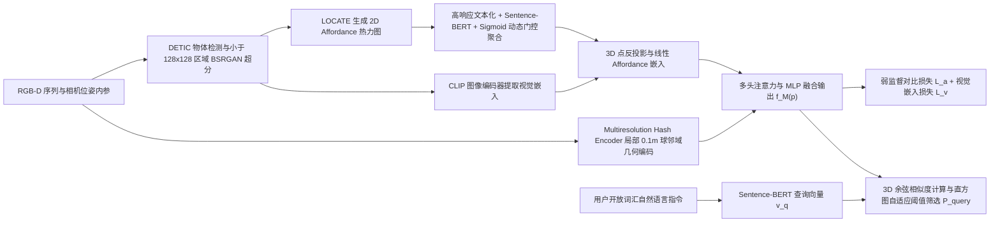

# OVA-Fields

**OVA-Fields: Weakly Supervised Open-Vocabulary Affordance Fields for Robot Operational Part Detection**（ICCV 2025）收录于 [Awesome-Affordance-Learning](https://github.com/hq-King/Awesome-Affordance-Learning)，属于具身 AI affordance 学习综述的配套论文清单。本页是 **清单索引**：给出它在综述分类里的位置与原文入口，方法细节和量化结果请看原文。

## 一句话定义

OVA-Fields: Weakly Supervised Open-Vocabulary Affordance Fields for Robot Operational Part Detection——在清单中归入 **Perception（Scope: Object；Perception Subcategory: Spatial · Generalizable）**（清单未附方法摘要，此处不替原文概括贡献）。

## 英文缩写速查

| 缩写 | 英文全称 | 简要说明 |
|------|----------|----------|
| Affordance | Action possibility (Gibson) | 环境/物体对 agent 提供的可交互机会 |
| HOI | Human-Object Interaction | 人–物交互，常作 affordance 监督来源 |
| VLM | Vision-Language Model | 视觉–语言模型，用于 affordance 推理与接地 |
| VLA | Vision-Language-Action | 视觉–语言–动作策略 |

## 为什么重要

- 综述把 affordance 学习拆成感知、推理、引导动作三段（见 [综述实体页](../entities/paper-affordance-learning-embodied-ai-survey.md)），本条目是其中一段的代表文献之一。
- 可顺着 [技术地图](../overview/affordance-awesome-technology-map.md) 的同分组条目横向阅读同方向工作。

## 核心信息

| 字段 | 内容 |
|------|------|
| 出处 | ICCV 2025 |
| 方法名（清单标注） | OVA-Fields |
| 分组 1 | Perception · Scope: Object；Perception Subcategory: Spatial · Generalizable |
| 论文 | <https://openaccess.thecvf.com/content/ICCV2025/papers/Su_OVA-Fields_Weakly_Supervised_Open-Vocabulary_Affordance_Fields_for_Robot_Operational_Part_ICCV_2025_paper.pdf> |

## 核心机制（归纳）

> 注：以下机制与评测指标基于通读 CVF 开放获取原文全文核对补充。

论文提出弱监督开放词汇 3D affordance 场框架 **OVA-Fields**，将 RGB-D 图像序列与自然语言指令直接映射至 3D 场景中的可操作部件，由四大模块组成：

1. **多模态 Affordance 感知（MAP，Sec. 3.1）**：
   - **目标检测与小物体超分**：用预训练 **DETIC** 检测每帧物体边界框 $b_i$；针对分辨率低于 $128\times 128$ 的小物体裁剪框（如杯子、水瓶），选择性应用 **BSRGAN** 做超分辨率增强。
   - **2D 热力图与动态门控权重**：对每个框输入 **LOCATE** 生成各 affordance $a_j$ 的 2D 热力图 $H_i^j$，对超过阈值 $\lambda$ 的高响应区域生成动作–物体文本描述并经 **Sentence-BERT** 编码为 $v_i^j$，再经 Sigmoid 动态门控权重 $w_i^j = \text{sigmoid}(s^{-1}(H_i^j - t))$ 聚合为 $v_i = \frac{1}{m}\sum_{j=1}^m v_i^j \odot w_i^j$，缓解开放词汇多义与特征冲突。同时用 **CLIP** 图像编码器提取视觉特征并反投影到 3D 表面点。
2. **空间特征提取（Sec. 3.2）**：
   - 对 3D 场景点 $p=(x,y,z)\in\mathbb{R}^3$，使用**多分辨率哈希编码器（MHE）**聚合半径 0.1m 球邻域几何特征 $f_g(p)$，与经线性层映射的 affordance 热力图嵌入 $f_a(h_a)$ 逐元素相加；再经**多头注意力（Multi-Head Attention）**与 **MLP** 生成统一高维表示 $f_M(p) = [f_i(p), f_a(p)]$（拆分为图像嵌入与 affordance 嵌入两部分）。
3. **对比学习跨模态特征融合（Sec. 3.2）**：
   - 采用弱监督对比训练，联合 **Affordance 对比损失 $L_a$**（拉近 3D 点特征 $f(P_i)$ 与置信度加权的 Sentence-BERT 正样本向量 $g_a(A_i)$，推开不匹配动作/部件负样本）与 **视觉嵌入损失 $L_v$**（对齐 CLIP 视觉特征），总损失 $L = \alpha L_a + \beta L_v$。
4. **自然语言查询映射（Sec. 3.3）**：
   - 用 Sentence-BERT 将用户复杂/隐式指令编码为 $v_q$，计算与所有 3D 点特征的余弦相似度 $s(p) = \text{sim}(v_q, f(p))$，通过相似度直方图最后一个显著峰值自适应确定阈值 $\theta$，提取 $s(p)>\theta$ 的点集作为目标操作区域。

### 方法流程图

## 评测与指标

- **多场景 3D 基准（Sec. 4.1–4.2 / Table 1 & Table 2）**：在 iPad Pro LiDAR 采集的真实室内场景（**Lab**、**Home**）及 3 个 **ScanNet** 场景、3 个 **SceneFun3D** 场景（每场景含 15–30 个物体）上以 `mIoU`、`mPrec`、`mRec` 对比 7 个闭集与开放词汇基线（统一后处理置信度阈值 $\tau=0.7$）：
  - **Lab / Home**：分别取得 **52.4% mIoU / 58.5% mPrec / 81.9% mRec**（3.4× 于最优基线 OpenAD 19.9% mIoU 与 3D AffordanceNet 15.4% mIoU）与 **46.2% mIoU / 73.3% mPrec / 48.5% mRec**（OpenAD 33.9% mIoU）。
  - **SceneFun3D / ScanNet**：在杂乱的场景级数据集 SceneFun3D 上达 **54.2% mIoU / 57.6% mPrec / 33.8% mRec**（OpenScene* 20.1% mIoU、CLIP-FO3D* 24.5% mIoU）；在 ScanNet 噪声点云下取得 **13.2% mIoU / 27.6% mPrec**（CLIP-FO3D* 15.3% mIoU / 21.2% mPrec）。
  - **细粒度物体部件（Table 2）**：冰箱门把手 **53.7% mIoU / 59.3% mPrec**、笔记本 **35.7% mIoU / 94.2% mPrec**、水杯 **23.8% mIoU / 60.0% mPrec**。
- **消融实验（Table 3 & Table 4）**：移除 BSRGAN 超分导致杯/瓶/刀等小物体精度明显下滑；自适应动态权重融合取得 **71.8% mIoU / 84.3% Instruction Acc.**，高于固定权重融合（63.4% / 72.5%）、纯几何（52.3% / 61.7%）和纯语义（48.1% / 58.2%）。
- **真机实验与局限（Sec. 5–6 / Table 5 & Fig. 6）**：5 项真机任务中，「从冰箱取食物」**90%**（延迟 4.7s）、「想吃鸡肉（推理微波炉把手）」**90%**（2.8s）、「抓取黄色水果（消歧香蕉）」**80%**（3.2s）、「拿笔写字」**80%**（5.1s）；「抓取水杯」空间检测准确率达 90%，但因对抓握接近角敏感，执行成功率仅 **20%**（3.1s）。分级语义复杂度测试显示 Level 1 直接指令最高达 100%，Level 3 隐式上下文指令降至 60–80%。作者指出当前无法预测铰接物体（门/抽屉）所需施力方向与运动学轨迹。
- 评测口径与完整图表以 [CVF 原文](https://openaccess.thecvf.com/content/ICCV2025/papers/Su_OVA-Fields_Weakly_Supervised_Open-Vocabulary_Affordance_Fields_for_Robot_Operational_Part_ICCV_2025_paper.pdf) 为准；综述本身不提供跨论文性能排名（见 [综述实体页](../entities/paper-affordance-learning-embodied-ai-survey.md)），不同设置下的数字不可直接比较。

## 与其他工作对比

- 本页不做与具体基线的数值对比；同分组横向对照见 [技术地图](../overview/affordance-awesome-technology-map.md)。
- 若站内另有这篇的深读页，以那一页为准。

## 结论

**本页已完成 CVF 原文核对：OVA-Fields 通过多分辨率哈希几何编码、动态门控 affordance 权重与弱监督对比学习，实现了支持复杂自然语言查询的 3D 开放词汇部件级定位。**

- 在 Lab（52.4% mIoU）、Home（46.2% mIoU）与 SceneFun3D（54.2% mIoU）等真实 3D 场景基准上显著优于 OpenAD、OpenScene* 与 CLIP-FO3D*，且 BSRGAN 选择性超分明显提升了杯/瓶等小物体精度。
- 真机实验验证了对直接与隐式语义指令的解析能力，但当前不预测铰接物体的施力方向与运动轨迹，且对抓握接近角敏感（如抓取水杯仅 20% 成功率）。
- 论文公开了代码仓库入口（<https://github.com/vlasu19/OVA-Fields>）。
- 可结合综述实体页对照其在「可泛化空间 3D affordance 感知」中的位置。

## 常见误区

1. 不要把分类标签当作论文结论；标签来自清单维护者的归类。
2. 不要把本页当作方法证明；它只是清单入口。

## 关联页面

- [Affordance 学习综述](../entities/paper-affordance-learning-embodied-ai-survey.md)
- [Awesome-Affordance-Learning 技术地图](../overview/affordance-awesome-technology-map.md)
- [manipulation.md](../tasks/manipulation.md)、[vla.md](../methods/vla.md)

## 参考来源

- [`sources/papers/affordance_awesome_ova-fields-weakly-supervised-open-vocabulary-affordance.md`](../../sources/papers/affordance_awesome_ova-fields-weakly-supervised-open-vocabulary-affordance.md) — 本条目策展摘录
- [`sources/papers/affordance_awesome_catalog.md`](../../sources/papers/affordance_awesome_catalog.md) — 列表总表
- [`sources/repos/awesome-affordance-learning.md`](../../sources/repos/awesome-affordance-learning.md)
- 论文：<https://openaccess.thecvf.com/content/ICCV2025/papers/Su_OVA-Fields_Weakly_Supervised_Open-Vocabulary_Affordance_Fields_for_Robot_Operational_Part_ICCV_2025_paper.pdf>

## 推荐继续阅读

- [Awesome-Affordance-Learning 仓库](https://github.com/hq-King/Awesome-Affordance-Learning)
- [原文](https://openaccess.thecvf.com/content/ICCV2025/papers/Su_OVA-Fields_Weakly_Supervised_Open-Vocabulary_Affordance_Fields_for_Robot_Operational_Part_ICCV_2025_paper.pdf)
