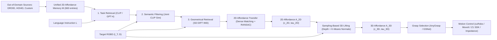

# RAM

**RAM: Retrieval-Based Affordance Transfer for Generalizable Zero-Shot Robotic Manipulation**（CoRL 2024）收录于 [Awesome-Affordance-Learning](https://github.com/hq-King/Awesome-Affordance-Learning)，属于具身 AI affordance 学习综述的配套论文清单。本页是 **清单索引**：给出它在综述分类里的位置与原文入口，方法细节和量化结果请看原文。

## 一句话定义

RAM: Retrieval-Based Affordance Transfer for Generalizable Zero-Shot Robotic Manipulation——在清单中归入 **Action（Architecture: Hierarchical model；Affordance Usage: explicit；Action Subcategory: Hierarchical affordance-to-action）**（清单未附方法摘要，此处不替原文概括贡献）。

## 英文缩写速查

| 缩写 | 英文全称 | 简要说明 |
|------|----------|----------|
| Affordance | Action possibility (Gibson) | 环境/物体对 agent 提供的可交互机会 |
| HOI | Human-Object Interaction | 人–物交互，常作 affordance 监督来源 |
| VLM | Vision-Language Model | 视觉–语言模型，用于 affordance 推理与接地 |
| VLA | Vision-Language-Action | 视觉–语言–动作策略 |

## 为什么重要

- 综述把 affordance 学习拆成感知、推理、引导动作三段（见 [综述实体页](../entities/paper-affordance-learning-embodied-ai-survey.md)），本条目是其中一段的代表文献之一。
- 可顺着 [技术地图](../overview/affordance-awesome-technology-map.md) 的同分组条目横向阅读同方向工作。

## 核心信息

| 字段 | 内容 |
|------|------|
| 出处 | CoRL 2024 |
| 方法名（清单标注） | RAM |
| 分组 1 | Action · Architecture: Hierarchical model；Affordance Usage: explicit；Action Subcategory: Hierarchical affordance-to-action |
| 论文 | <https://proceedings.mlr.press/v270/kuang25a.html> |

## 核心机制（归纳）

> 注：以下机制与评测指标基于通读开放获取原文全文核对补充（[CoRL 2024 原文](https://proceedings.mlr.press/v270/kuang25a.html)）。

**RAM** 提出一种无需训练（training-free）的「检索–迁移–升维」零样本跨本体操作框架，核心目标是把域外异构数据中的二维交互知识迁移为目标域可执行的三维可供性 $A_{3D} = (c^{3D}, \tau^{3D})$（3D 接触点与接触后运动方向）：

1. **统一二维可供性记忆库（Affordance Memory，$\mathcal{M} = \mathcal{M}_R \cup \mathcal{M}_H \cup \mathcal{M}_C$）**：
   - 每条记忆条目统一表示为 $(I^S, T, C)$，其中 $I^S$ 为无遮挡初始观测 RGB 图，$C = (c_0^{2D}, c_1^{2D}, \dots)$ 为接触点与接触后 2D 航点序列，$T$ 为自然语言任务类别。
   - 原文共构建 **660** 条条目覆盖 **13** 类任务（Appendix B Table 5）：**机器人数据**（DROID，131 条：投影夹爪闭合瞬间的 3D 末端位置及后续 10 步轨迹至首帧）、**人–物交互 HOI 数据**（HOI4D，479 条：取物体掩码内手部关键点均值并追踪手部航点）、**自定义数据**（互联网图像，50 条：人工点选起止点并插值）。
2. **三步由粗到细层次化检索（Hierarchical Retrieval）**：
   - 给定目标单目 RGB-D 观测 $(I^T, D)$ 与语言指令 $L$：① **Task Retrieval** 利用 CLIP 或 GPT-4 解析目标任务 $T$ 与物体名 $N$（若记忆库缺失该物体则基于几何相似性推理相近任务）；② **Semantic Filtering** 计算联合 CLIP 相似度 $\cos(\text{CLIP}_v(I^S), \text{CLIP}_v(I^T)) \cdot \cos(\text{CLIP}_v(I^S), \text{CLIP}_t(N))$ 并按阈值过滤低质量或语义不匹配样本；③ **Geometrical Retrieval** 在源实例掩码 $M^S$ 内基于 Stable Diffusion 稠密特征（DIFT）计算 **Instance Matching Distance（IMD）**，选出视角与朝向最接近的源演示图像。
3. **2D 可供性迁移（2D Affordance Transfer）**：
   - 利用视觉基础模型（默认 Stable Diffusion DIFT 特征）在源图 $I^S$ 与目标图 $I^T$ 之间做逐点稠密对应匹配，将源航点 $C$ 映射到目标图像空间。
   - 使用 **RANSAC** 剔除误匹配离群点并拟合 2D 直线，输出目标 2D 可供性 $A_{2D} = (c^{2D}, \tau^{2D})$。
4. **基于采样的 3D 升维与跨本体执行（Sampling-Based Affordance Lifting）**：
   - 利用深度图 $D$ 将 $c^{2D}$ 反投影为 3D 接触点 $c^{3D}$ 并裁剪局部点云，估计法向量后通过 **K-Means** 聚类得到 Top-K 候选法向中心。
   - 将候选 3D 法向量经相机内参重投影回 2D，选取与 $\tau^{2D}$ 夹角最小者作为接触后 3D 运动方向 $\tau^{3D}$。
   - 在裁剪点云上使用 **AnyGrasp** / **GSNet** 生成稠密抓取候选并选取最接近 $c^{3D}$ 的抓取位姿，随后通过位置控制（仿真 `cuRobo`、Franka `MoveIt!`、宇树 `Z1 SDK`）或带力反馈的阻抗控制沿 $\tau^{3D}$ 执行。

### 方法流程图

## 评测与指标

- **仿真评测（IsaacGym，GAPartNet + YCB 10 类超 70 个物体、13 个任务各 50 次试验，Table 1）**：
  - 任务涵盖 Open（O）、Close（C）与 Pickup（P），以目标关节自由度或抬升高度达标判定成功率（SR）。
  - 平均成功率：`Where2Act` **20.50%**、`VRB*` **30.77%**、`Robo-ABC*` **41.54%**（需配合本文 2D 迁移与 3D 升维模块适配）、`RAM (Ours)` **52.62%**。
- **杂乱桌面场景（3 类 Pickup 任务各 50 次，Table 6）**：`VRB*` **35.3%**、`Robo-ABC*` **44.0%**、`RAM` **57.3%**（对比干净场景 64.0% 仅下降 6.7 个百分点）。
- **真机实验（Franka Emika Panda + RealSense D415，6 项任务各 5 次试验，Table 2）**：
  - `Robo-ABC*` 平均 SR **50.0%**，**`RAM` 平均 SR 66.7%**（3 项 Open 分别为 3/5、2/5、3/5；3 项 Pickup 分别为 3/5、4/5、5/5）；同时在 **Unitree B1 四足机器狗 + Z1 机械臂（Robotiq 2F-85 夹爪）** 上验证了跨本体零样本部署。
- **消融实验（Open drawer/cabinet/microwave 各 20 集，指标 SR$\uparrow$ / 像素到把手距离 DTM$\downarrow$，Table 3）**：
  - **完整流水线（SD）**：SR **38.3%**、DTM **3.39**。
  - **检索模块消融**：去掉 Task Retrieval 降至 31.7% / 4.99；去掉 Semantic Filtering 降至 33.3% / 6.69；去掉 Geometrical Retrieval（IMD）骤降至 **26.7% / 9.36**，说明几何朝向对齐最关键。
  - **跨任务迁移（Cross-Task，屏蔽记忆库中目标任务）**：仍保持 **25.0%** SR（DTM 9.33）。
  - **VFM 对比**：`CLIP` 15.0% / 57.4、`DINOv2` 23.3% / 5.09、`SD-DINOv2` 36.7% / **3.04**（SD-DINOv2 接触点距离最优，但默认选 SD 因 SR 最高且推理更快）；记忆库容量消融（Fig. 6）显示仅用 50% 数据即可接近全量性能。
- **下游应用验证（§4.5，Table 4）**：
  - **自主数据收集与策略蒸馏**：用零样本 RAM 自动采集每任务 50 条成功轨迹训练 ACT 策略（CVAE Transformer，chunk=60，200K 步），3 项 Open 任务平均成功率由零样本 `RAM` 的 **30.0%**（`VRB` 仅 6.67%）跃升至 **65.0%**（+35.0%）。
  - 支持带人类偏好的 **One-Shot 视觉模仿**（含真实物体到《猫和老鼠》卡通图像的跨域迁移）及结合 **GPT-4V + Grounded-SAM** 的长程任务分解执行。

## 与其他工作对比

- 本页不做与具体基线的数值对比；同分组横向对照见 [技术地图](../overview/affordance-awesome-technology-map.md)。
- 若站内另有这篇的深读页，以那一页为准。

## 结论

**RAM 验证了「域外 2D 记忆库 + 层次化检索与 VFM 对应迁移 + 基于法向聚类的 3D 升维」可在无需任务内微调的条件下实现跨物体、跨环境、跨本体的零样本抓取与铰接物体操作。**

- 几何朝向对齐决定迁移成败：消融显示移除基于 Stable Diffusion DIFT 特征的 IMD 几何检索会使 Open 任务成功率从 38.3% 跌至 26.7%（DTM 由 3.39 恶化至 9.36）。
- 2D 迁移再升维 3D 比直接 3D 点云预测更抗深度噪声且可直接消费 DROID、HOI4D 与少量人工标注互联网图片等异构域外数据源（总计 660 条即可支撑 13 类任务）。
- 零样本框架既可直接作为跨本体执行器（Franka / Unitree B1+Z1），也可充当自主数据采集器：仅需 50 条自采成功轨迹即可将下游 ACT 策略成功率由 30.0% 提升至 65.0%。
- 主要局限在于长程任务依赖外部 VLM（如 GPT-4V）按步串联导致动作不够连贯，且难以处理拧旋（screwing）等复杂连续操作；极端视角（如门扇几乎平行视线）与低对比度暗色把手仍易引起检索或对应偏移。
- 原文附项目主页 <https://yuxuank.com/RAM/>，具体代码发布与依赖版本以项目页为准。

## 常见误区

1. 不要把分类标签当作论文结论；标签来自清单维护者的归类。
2. 不要把本页当作方法证明；它只是清单入口。

## 关联页面

- [Affordance 学习综述](../entities/paper-affordance-learning-embodied-ai-survey.md)
- [Awesome-Affordance-Learning 技术地图](../overview/affordance-awesome-technology-map.md)
- [manipulation.md](../tasks/manipulation.md)、[imitation-learning.md](../methods/imitation-learning.md)

## 参考来源

- [`sources/papers/affordance_awesome_ram-retrieval-based-affordance-transfer-for-generalizabl.md`](../../sources/papers/affordance_awesome_ram-retrieval-based-affordance-transfer-for-generalizabl.md) — 本条目策展摘录
- [`sources/papers/affordance_awesome_catalog.md`](../../sources/papers/affordance_awesome_catalog.md) — 列表总表
- [`sources/repos/awesome-affordance-learning.md`](../../sources/repos/awesome-affordance-learning.md)
- 论文：<https://proceedings.mlr.press/v270/kuang25a.html>

## 推荐继续阅读

- [Awesome-Affordance-Learning 仓库](https://github.com/hq-King/Awesome-Affordance-Learning)
- [原文](https://proceedings.mlr.press/v270/kuang25a.html)
