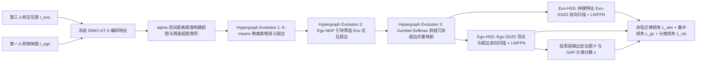

# Reasoning Mamba

**Reasoning Mamba: Hypergraph-Guided Region Relation Calculating for Weakly Supervised Affordance Grounding**（CVPR 2025）收录于 [Awesome-Affordance-Learning](https://github.com/hq-King/Awesome-Affordance-Learning)，属于具身 AI affordance 学习综述的配套论文清单。本页是 **清单索引**：给出它在综述分类里的位置与原文入口，方法细节和量化结果请看原文。

## 一句话定义

Reasoning Mamba: Hypergraph-Guided Region Relation Calculating for Weakly Supervised Affordance Grounding——在清单中归入 **Perception（Scope: Object；Perception Subcategory: Visual）**（清单未附方法摘要，此处不替原文概括贡献）。

## 英文缩写速查

| 缩写 | 英文全称 | 简要说明 |
|------|----------|----------|
| Affordance | Action possibility (Gibson) | 环境/物体对 agent 提供的可交互机会 |
| HOI | Human-Object Interaction | 人–物交互，常作 affordance 监督来源 |
| VLM | Vision-Language Model | 视觉–语言模型，用于 affordance 推理与接地 |
| VLA | Vision-Language-Action | 视觉–语言–动作策略 |

## 为什么重要

- 综述把 affordance 学习拆成感知、推理、引导动作三段（见 [综述实体页](../entities/paper-affordance-learning-embodied-ai-survey.md)），本条目是其中一段的代表文献之一。
- 可顺着 [技术地图](../overview/affordance-awesome-technology-map.md) 的同分组条目横向阅读同方向工作。

## 核心信息

| 字段 | 内容 |
|------|------|
| 出处 | CVPR 2025 |
| 方法名（清单标注） | Reasoning Mamba |
| 分组 1 | Perception · Scope: Object；Perception Subcategory: Visual |
| 论文 | <https://openaccess.thecvf.com/content/CVPR2025/papers/Wang_Reasoning_Mamba_Hypergraph-Guided_Region_Relation_Calculating_for_Weakly_Supervised_Affordance_CVPR_2025_paper.pdf> |

## 核心机制（归纳）

> 注：以下机制与评测指标基于通读 CVF 开放获取原文全文核对补充。

论文针对**弱监督 Affordance 接地（WSAG）**任务（仅利用图像级标签监督，从多张第三人称交互图 $I_{\text{exo}}$ 与第一人称物体图 $I_{\text{ego}}$ 学习，推理时仅输入 $I_{\text{ego}}$ 与动作标签 $Y_a$ 输出热点图），提出融合超图高阶关系与状态空间模型的 **Reasoning Mamba（R-Mamba）**：

1. **特征编码与超图构建（Sec. 4.1）**：
   - 使用冻结的 **DINO-ViT-S** 提取两分支语义特征 $F_{\text{exo}}, F_{\text{ego}} \in \mathbb{R}^{C\times H\times W}$，将每个空间位置视为超图顶点（共 $HW$ 个顶点）。
   - 在语义特征空间按距离阈值 $\epsilon=3$ 计算每个顶点的 $\alpha$-邻域构成超边 $e_i$，构建关联矩阵 $\mathcal{A}$ 并执行带残差连接的**超图卷积**（$\tilde{F} = F + D_v^{-1}\mathcal{A}D_e^{-1}\mathcal{A}^\top F\Theta$），建模多对多局部区域关系（如杯柄与杯身的协同）。
2. **超图引导状态空间模块（HSS Block，Sec. 4.2）**：
   - **超图演化（Hypergraph Evolution）**三阶段动态提纯超边：
     1. *新增超边*：对顶点特征执行 K-means 聚类（$k$ 个中心），为每个顶点关联最近的 $S=2$ 个聚类中心作为语义超边；
     2. *提取交互线索*：利用第一人称定位图 $P_{\text{ego}}$ 对 $\tilde{F}_{\text{ego}}$ 做掩码平均池化（MAP）得到引导向量 $\mathcal{F}_{\text{ego}}$，按余弦相似度筛选最相关的第三人称聚类顶点，经两层卷积聚合为更新后的超边特征；
     3. *剔除冗余超边*：用 **Gumbel-Softmax** 生成二值掩码 $M$ 过滤低信息超边（$\bar{\mathcal{E}} = M * \tilde{\mathcal{E}}$），再经 Softmax 注意力权重将演化超边重映射回顶点特征 $\overline{F}_{\text{exo}}, \overline{F}_{\text{ego}}$。
   - **Ego-HSS 与 Exo-HSS 双向状态空间建模**：Ego 分支将 $(\overline{F}_{\text{ego}}, \bar{\mathcal{E}}_{\text{ego}})$ 送入 **Ego-SS2D**（由独立 S6 选择性扫描块并行双向扫描顶点序列与超边序列并融合），经残差、LN 与 FFN 输出 $T_{\text{ego}}$；Exo 分支在通道维拼接 ego 与 exo 的顶点/超边特征后经 **Exo-SS2D** 得到 $T_{\text{exo}}$，从全局视角重组局部区域依赖。堆叠 $L$ 个块后经投影层生成定位图 $\mathcal{P}$，GAP 后得到分类分数 $z$。
3. **联合优化目标（Sec. 4.3）**：
   - 训练总损失 $\mathcal{L} = \mathcal{L}_{\text{cls}} + \lambda_{\text{sim}}\mathcal{L}_{\text{sim}} + \lambda_{\text{gc}}\mathcal{L}_{\text{gc}}$（$\lambda_{\text{sim}}=1, \lambda_{\text{gc}}=0.09$），结合图像级分类交叉熵 $\mathcal{L}_{\text{cls}}$、拉齐 $T_{\text{exo}}$ 与 $T_{\text{ego}}$ 的余弦相似度知识迁移损失 $\mathcal{L}_{\text{sim}}$，以及约束高响应聚焦部件区域的几何集中损失 $\mathcal{L}_{\text{gc}}$。推理阶段仅保留 egocentric 分支。

### 方法流程图

## 评测与指标

- **基准数据集与指标（Sec. 5.1）**：在 **AGD20K**（20,061 张第三人称图 + 3,755 张第一人称图，36 类 affordance，分 `Seen` 与 `Unseen` 跨物体类别划分）以及 **HICO-IIF**（取自 HICO-DET 与 IIT-AFF）上评估，采用分布相关性指标 `KLD ↓`、`SIM ↑`、`NSS ↑`。
- **主实验结果（Table 1）**：
  - **AGD20K-Seen**：R-Mamba 取得 **KLD 1.173 / SIM 0.414 / NSS 1.247**，优于 LOCATE（1.226 / 0.401 / 1.177）、Cross-view-AG+（1.489 / 0.342 / 0.981）及 Hotspots（1.773 / 0.278 / 0.615）；嵌入多模态框架 WSMA（`WSMA + Ours`）后进一步将指标从 1.176 / 0.416 / 1.247 提升至 **1.143 / 0.420 / 1.251**。
  - **AGD20K-Unseen**：R-Mamba 取得 **KLD 1.372 / SIM 0.380 / NSS 1.190**（LOCATE 为 1.405 / 0.372 / 1.157）；`WSMA + Ours` 达 **1.310 / 0.397 / 1.279**。
  - **HICO-IIF**：R-Mamba 取得 **KLD 1.510 / SIM 0.346 / NSS 0.998**，优于 LOCATE（1.593 / 0.327 / 0.966）与 Cross-view-AG（1.779 / 0.263 / 0.946）；`WSMA + Ours` 达 **1.422 / 0.361 / 1.030**。
- **消融分析（Table 2 & Table 3 / Sec. 5.3）**：去掉超图结构仅保留 SS2D（`w/o Hypergraph`）使 AGD20K-Seen / Unseen 的 KLD 分别恶化至 1.453 / 1.796；去掉 HSS 模块恶化至 1.294 / 1.470；去掉超图演化恶化至 1.244 / 1.402；距离阈值 $\epsilon=3$ 与联合损失 $\mathcal{L}_{\text{sim}}+\mathcal{L}_{\text{gc}}$ 均被验证为关键设计（相比仅全局知识迁移 Base 将 Unseen KLD 从 1.971 降至 1.372）。
- 评测口径与完整图表以 [CVF 原文](https://openaccess.thecvf.com/content/CVPR2025/papers/Wang_Reasoning_Mamba_Hypergraph-Guided_Region_Relation_Calculating_for_Weakly_Supervised_Affordance_CVPR_2025_paper.pdf) 为准；综述本身不提供跨论文性能排名（见 [综述实体页](../entities/paper-affordance-learning-embodied-ai-survey.md)），不同设置下的数字不可直接比较。

## 与其他工作对比

- 本页不做与具体基线的数值对比；同分组横向对照见 [技术地图](../overview/affordance-awesome-technology-map.md)。
- 若站内另有这篇的深读页，以那一页为准。

## 结论

**本页已完成 CVF 原文核对：R-Mamba 将超图高阶区域关系与 Mamba 选择性状态空间双向扫描结合，显著提升了弱监督 affordance 接地的局部–全局建模能力。**

- $\alpha$-空间超图卷积 + 三阶段超图演化（K-means 扩边、Ego MAP 引导、Gumbel-Softmax 剪枝）+ Ego/Exo-SS2D 在 AGD20K（Seen 1.173 / Unseen 1.372 KLD）与 HICO-IIF（1.510 KLD）均超越 LOCATE 等 WSAG 基线，并可作为即插即用模块进一步提升 WSMA。
- 消融实验证实超图结构、超图演化与 $\mathcal{L}_{\text{sim}}+\mathcal{L}_{\text{gc}}$ 缺一不可；论文正文未标注官方开源仓库地址。
- 可结合综述实体页对照其在「弱监督视觉 affordance 感知」中的位置。

## 常见误区

1. 不要把分类标签当作论文结论；标签来自清单维护者的归类。
2. 不要把本页当作方法证明；它只是清单入口。

## 关联页面

- [Affordance 学习综述](../entities/paper-affordance-learning-embodied-ai-survey.md)
- [Awesome-Affordance-Learning 技术地图](../overview/affordance-awesome-technology-map.md)
- [manipulation.md](../tasks/manipulation.md)、[vla.md](../methods/vla.md)

## 参考来源

- [`sources/papers/affordance_awesome_reasoning-mamba-hypergraph-guided-region-relation-calcul.md`](../../sources/papers/affordance_awesome_reasoning-mamba-hypergraph-guided-region-relation-calcul.md) — 本条目策展摘录
- [`sources/papers/affordance_awesome_catalog.md`](../../sources/papers/affordance_awesome_catalog.md) — 列表总表
- [`sources/repos/awesome-affordance-learning.md`](../../sources/repos/awesome-affordance-learning.md)
- 论文：<https://openaccess.thecvf.com/content/CVPR2025/papers/Wang_Reasoning_Mamba_Hypergraph-Guided_Region_Relation_Calculating_for_Weakly_Supervised_Affordance_CVPR_2025_paper.pdf>

## 推荐继续阅读

- [Awesome-Affordance-Learning 仓库](https://github.com/hq-King/Awesome-Affordance-Learning)
- [原文](https://openaccess.thecvf.com/content/CVPR2025/papers/Wang_Reasoning_Mamba_Hypergraph-Guided_Region_Relation_Calculating_for_Weakly_Supervised_Affordance_CVPR_2025_paper.pdf)
