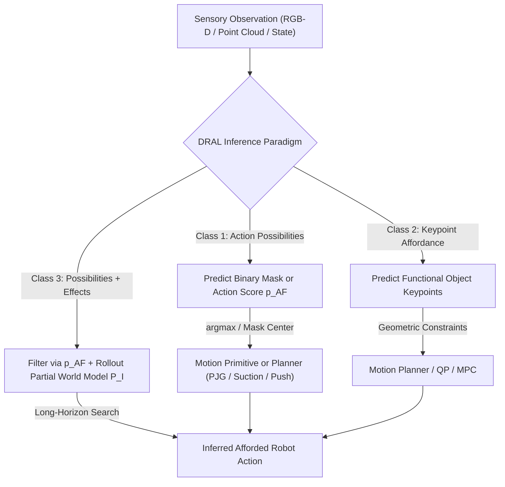

# Recent Advances of Deep Robotic Affordance Learning

**Recent Advances of Deep Robotic Affordance Learning: A Reinforcement Learning Perspective**（IEEE TCDS 2023，arXiv:2303.05344v2）是一篇以强化学习（RL）与马尔可夫决策过程（MDP）形式化为统一视角的深度机器人 affordance 学习（DRAL）专题综述。

## 一句话定义

本文借用 MDP 中的「意图（Intent）」与「部分转移模型」形式化定义，将 2015 年以来的深度机器人 affordance 学习工作系统归类为动作可能性建模、功能关键点表示与基于部分世界模型的规划三大路线。

## 英文缩写速查

| 缩写 | 英文全称 | 简要说明 |
|------|----------|----------|
| DRAL | Deep Robotic Affordance Learning | 深度机器人 affordance 学习，利用数据驱动深度方法辅助机器人决策 |
| MDP | Markov Decision Process | 马尔可夫决策过程，由状态、动作、奖励、转移与折扣因子构成 |
| HRL | Hierarchical Reinforcement Learning | 分层强化学习，通过运动原语/选项（options）处理长视野任务 |
| PDM | Partial Dynamic Model | 部分动力学模型，仅针对可实现（afforded）动作学习状态转移 |
| PJG | Parallel-Jaw Grasp | 平行夹爪抓取，DRAL 实机部署中最主流的动作原语形式 |

## 为什么重要

- 长期以来，机器人领域对 affordance 缺乏统一的数学定义，且大量视觉抓取与关键点工作未显式接入决策理论框架。
- 本文基于 Khetarpal 等（ICML 2020）的 MDP 意图理论给出统一数学坐标系：把离散视觉分割、连续动作成功分数、关键点几何约束乃至 Deep Affordance Foresight 等世界模型方法放进同一行为学习框架中比较优劣。
- 可与站内 [Affordance 学习综述](../entities/paper-affordance-learning-embodied-ai-survey.md) 及 [技术地图](../overview/affordance-awesome-technology-map.md) 互为补充。

## 核心信息

| 字段 | 内容 |
|------|------|
| 作者 | Xintong Yang, Ze Ji, Jing Wu, Yu-kun Lai（Cardiff University） |
| 出处 | IEEE TCDS 2023（arXiv:2303.05344v2） |
| 文献类型 | 专题综述（聚焦 2015–2023 年 DRAL 代表性研究，无自建新实验基准） |
| 分组 | Related Surveys · Focus: Robotic affordance learning from a reinforcement-learning perspective |
| 论文链接 | <https://doi.org/10.1109/TCDS.2023.3277288> / <https://arxiv.org/abs/2303.05344> |

## 核心机制

### 1. MDP 视角下的 Affordance 形式化

在标准 MDP `M = <S, A, r, P, γ>` 中，给定动作 `a ∈ A`，**意图（Intent）** `I_a(s)` 映射当前状态 `s` 到该动作期望达成的状态分布，对应部分转移模型 `P_I(s'|s, a)`。当且仅当部分模型与真实系统动力学分布差距满足精度阈值 `d(P_I(s'|s,a), P(s'|s,a)) <= ε` 时，动作 `a` 在状态 `s` 下是可实现的（affordable）。由此定义 affordance 集合 `AF_I ⊆ S × A` 与动作可能性模型 `p_AF(s, a) = p((s, a) ∈ AF_I)`，用于在 RL 中约束探索空间、加速价值/策略学习与世界模型规划。

### 2. 三大技术路线分类

1. **动作可能性建模（估计 `p̂_AF`，Sec. III / Table I，涵盖 14 篇工作 `[10]–[23]`）**：
   - *图像/点云分割（IS，`[10]–[17]`）*：将 affordance 简化为像素级或点云级二值掩码（如 UMD、IIT-AFF、AffordanceNet、基于 VAE 潜在表示的跨实体迁移等），下游常取掩码中心或将其作为策略额外输入通道。
   - *动作成功分数（AS，`[18]–[23]`）*：预测像素/点位处执行原语的连续成功概率或 Q 值，如 Zeng 等 4 类抓取/吸取原语、MetaGrasp `[19]`（在家居/对抗/杂乱场景分别报告 `93% / 91% / 87%` 抓取成功率）、Where2Act `[22]` 及接入语言技能价值的 SayCan `[23]`。
2. **关键点 Affordance（跳过 `p̂_AF` 直接生成受限动作，Sec. IV / Table II，涵盖 6 篇工作 `[24]–[29]`）**：
   - 预测物体功能关键点以压缩规划/MPC 搜索空间，涵盖基于类别先验的 kPAM / kPAM 2.0 / kPAM-SC、自监督工具操作 KETO、基于 GNN 与 REINFORCE 自动发现功能关键点的 GIFT `[28]`，以及 2D 动作方向关键点网络 AffKp `[29]`。
3. **动作可能性与动作后果联合建模（部分动力学模型，Sec. V，`[7, 30, 31]`）**：
   - 先由二值分类器 `p̂_AF` 过滤无效动作，再仅对有效动作学习部分世界模型 `P̂_I(s'|s,a)`，代表工作包括 Khetarpal 等（2D 导航 `[7]` 与时间抽象选项部分模型 `[31]`）及 Deep Affordance Foresight `[30]`（图像输入的多步 L 形棍工具使用规划）。

### 方法流程图

## 评测与指标

作为综述文章，本文未设立统一新实验，而是整理了原文献的输入模态、监督方式（SL/SSL/RL）、部署环境（Sim/Real）及代表性实证结论：

| 分类维度 | 覆盖文献范围 | 典型输入与训练方式 | 常见任务与代表数值（引自原文转述） |
|----------|--------------|--------------------|------------------------------------|
| IS 二值掩码 | `[10]–[17]`（8 篇） | RGB / RGB-D / 点云；多数为 SL，`[17]` 为 SSL | 3/4-DoF 抓取、倒水、舀取、叠放（Sim & Real） |
| AS 连续分数 | `[18]–[23]`（6 篇） | RGB / RGB-D / BOSM / 点云；SL 与 SSL 并重，`[23]` 为 SL/RL | 3/4-DoF 抓取、推拉、厨房技能调度；`[19]` 报告家居 93% / 对抗 91% / 杂乱 87% |
| Keypoint 关键点 | `[24]–[29]`（6 篇） | RGB-D / 点云；SL（kPAM 系列、AffKp）与 SSL（KETO、GIFT） | 6-DoF 放置/悬挂、插孔、敲击、勾取 |
| PDM 部分世界模型 | `[7, 30, 31]`（3 篇） | 状态与图像观测；在线交互 / MBRL | 2D 导航、2D Taxi 选项规划、多步工具使用（以 Sim 为主） |

## 与其他工作对比

- **对比既往机器人/心理综述（Jamone 2016、Yamanobe 2017、Ardón 2021、Hassanin 2021）**：早期综述侧重生态心理学起源、视觉检测分割或传统操纵设计指南；本文首次以通用 MDP 意图形式化贯穿 2015 年后的深度学习与 RL 工作，明确区分「仅估计可行性」与「兼顾动作后果预测」两类系统。
- **未来理论延伸（广义意图 General Intent）**：建议将意图从「下一状态分布」拓展为任意可量化动作后果（如抓取成功率、跌落率、盛水重量等），构建**广义 affordance（General Affordances）**。

## 结论

**从 MDP 视角审视，当前绝大多数 DRAL 方法仍停留在「单步、开环原语的动作可能性估计」，尚未充分打通「后果预测（部分世界模型）」与「技能自主发现（HRL Options）」。**

1. **动作空间过度依赖手工原语**：现有工作大量绑定自顶向下 3/4-DoF 平行夹爪抓取，缺乏闭环反馈纠偏与可中断选项（interrupted options）重规划。
2. **仅知可行性不足以规划长程任务**：动作可能性图忽略动作对环境状态的改变，多步工具操作依赖结合 `p̂_AF` 过滤与部分动力学模型 `P̂_I`。
3. **关键点表示存在几何与物理盲区**：稀疏关键点难以刻画柔性/形变物体受力与形变，需结合形状补全（如 kPAM-SC）或触觉/力觉模态。
4. **观测假设隐含不可见物理属性**：RGB-D 无法感知温度、软硬、透明材质或反光，单纯视觉容易给出危险或错误的可抓取判断。

## 常见误区或局限

1. **综述不直接提供跨论文公平榜单**：Table I 与 Table II 汇总了各论文的设置与模态，但各工作的数据集（UMD、IIT-AFF、自采仿真/真机）与硬件条件不同，文中未对不同方法的成功率做横向排名。
2. **PDM 与 HRL 发现路线真机验证仍薄弱**：第三类部分世界模型方法多停留在仿真或 2D 网格（如 Taxi、多步推块），高维真实机器人视觉长程验证依然稀缺。
3. **缺少统一 DRAL 基准 API**：社区尚无像 ImageNet 之于视觉或统一支持 SL/SSL/RL 多目标多步操作的数据采集与评测平台。

## 关联页面

- [Affordance 学习综述](../entities/paper-affordance-learning-embodied-ai-survey.md)
- [Awesome-Affordance-Learning 技术地图](../overview/affordance-awesome-technology-map.md)
- [manipulation.md](../tasks/manipulation.md)、[vla.md](../methods/vla.md)

## 参考来源

- [`sources/papers/affordance_awesome_recent-advances-of-deep-robotic-affordance-learning-a-re.md`](../../sources/papers/affordance_awesome_recent-advances-of-deep-robotic-affordance-learning-a-re.md) — 本条目策展摘录
- [`sources/papers/affordance_awesome_catalog.md`](../../sources/papers/affordance_awesome_catalog.md) — 列表总表
- [`sources/repos/awesome-affordance-learning.md`](../../sources/repos/awesome-affordance-learning.md)
- 论文：<https://doi.org/10.1109/TCDS.2023.3277288>（预印本 <https://arxiv.org/abs/2303.05344>）

## 推荐继续阅读

- [Awesome-Affordance-Learning 仓库](https://github.com/hq-King/Awesome-Affordance-Learning)
- [原文](https://doi.org/10.1109/TCDS.2023.3277288)
