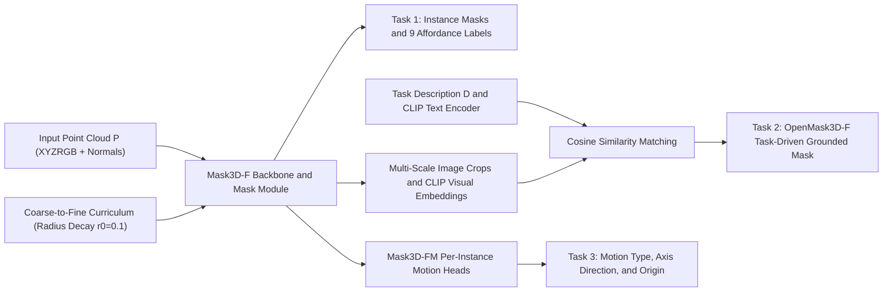

# SceneFun3D

**SceneFun3D: Fine-Grained Functionality and Affordance Understanding in 3D Scenes**（CVPR 2024）收录于 [Awesome-Affordance-Learning](https://github.com/hq-King/Awesome-Affordance-Learning)，属于具身 AI affordance 学习综述的配套论文清单。本页是 **清单索引**：给出它在综述分类里的位置与原文入口，方法细节和量化结果请看原文。

## 一句话定义

SceneFun3D: Fine-Grained Functionality and Affordance Understanding in 3D Scenes——在清单中归入 **Perception（Scope: Scene；Perception Subcategory: Spatial） ｜ Datasets / Benchmarks（Data Modality: 3D）**（清单未附方法摘要，此处不替原文概括贡献）。

## 英文缩写速查

| 缩写 | 英文全称 | 简要说明 |
|------|----------|----------|
| Affordance | Action possibility (Gibson) | 环境/物体对 agent 提供的可交互机会 |
| HOI | Human-Object Interaction | 人–物交互，常作 affordance 监督来源 |
| VLM | Vision-Language Model | 视觉–语言模型，用于 affordance 推理与接地 |
| VLA | Vision-Language-Action | 视觉–语言–动作策略 |

## 为什么重要

- 综述把 affordance 学习拆成感知、推理、引导动作三段（见 [综述实体页](../entities/paper-affordance-learning-embodied-ai-survey.md)），本条目是其中一段的代表文献之一。
- 可顺着 [技术地图](../overview/affordance-awesome-technology-map.md) 的同分组条目横向阅读同方向工作。

## 核心信息

| 字段 | 内容 |
|------|------|
| 出处 | CVPR 2024 |
| 方法名（清单标注） | SceneFun3D |
| 分组 1 | Perception · Scope: Scene；Perception Subcategory: Spatial |
| 分组 2 | Datasets / Benchmarks · Data Modality: 3D |
| 论文 | <https://openaccess.thecvf.com/content/CVPR2024/papers/Delitzas_SceneFun3D_Fine-Grained_Functionality_and_Affordance_Understanding_in_3D_Scenes_CVPR_2024_paper.pdf> |

## 核心机制（归纳）

> 注：以下机制与评测指标基于通读 CVF 开放获取原文全文核对补充。

SceneFun3D（[原文](https://openaccess.thecvf.com/content/CVPR2024/papers/Delitzas_SceneFun3D_Fine-Grained_Functionality_and_Affordance_Understanding_in_3D_Scenes_CVPR_2024_paper.pdf)）面向真实室内 3D 场景中的**细粒度功能性可交互元素**（如门把手、旋钮、开关、按键等），在数据集构建与三项下游基准任务上建立了完整管线：

- **高精度多模态数据构建管线**：
  - **激光扫描与对齐**：基于 ARKitScenes 资产，将每场景平均 4 次 Faro Focus S70 激光扫描按位姿拼接并做 5mm 体素下采样，共筛选 **710 个室内场景**（545 train / 80 val / 85 test，test 来自 ARKitScenes 验证集）；同时通过 $SO(3) \times \mathbb{R}^3$ 刚体插值同步 iPad Pro RGB-D 帧与相机位姿，经 DBSCAN 去除透明表面噪点后用 Predator 粗配准与 Multi-Scale ICP 精配准至点云坐标系。
  - **点云级标注与三类语义**：自研基于 BVH 加速光线投射的轻量级 Web 标注工具（结合场景视频），收集 **14,867 个**功能元素实例掩码及 9 类 Gibsonian 交互标签（`rotate`、`key press`、`tip push`、`hook pull`、`pinch pull`、`hook turn`、`foot push`、`plug in`、`unplug`，反射等几何缺失样本标为 `exclude`）、**14,279 个**以交互为中心的 3D 运动参数标注 $\phi_i = \{t_i, a_i, o_i\}$（运动类型 `translation`/`rotation`、轴向 $a_i \in \mathbb{R}^3$、原点 $o_i \in \mathbb{R}^3$），以及覆盖 10,913 个元素的自然语言任务描述（经 `gpt-3.5-turbo-instruct` 改写扩增 +6,220 条，共 **17,133 条**，连接 Gibsonian 与 telic affordance）。
- **三项核心任务与基线改造**：
  - **输入与输出**：输入为场景点云 $P = \{(p_i, f_i)\}$（坐标与 RGB/法向特征；Task 2 额外输入自由文本任务描述 $D$）；分别输出功能元素实例掩码与 affordance 标签（Task 1）、任务指代元素掩码与标签（Task 2）、以及实例级 3D 运动参数 $\phi_i$（Task 3）。
  - **Task 1 功能分割（`Mask3D-F` / `SoftGroup-F` / `LERF`）**：针对小尺寸前景极端不平衡问题，将 `Mask3D` 的 BCE 替换为区域 Dice 损失（$\mathcal{L}_{\text{seg}} = \lambda_{\text{dice}}\mathcal{L}_{\text{dice}} + \lambda_{\text{ce}}\mathcal{L}_{\text{ce}}$）；`SoftGroup-F` 先以加权多类 Dice + offset 损失训练 U-Net 主干，再冻结主干并用 $\mathcal{L}_{\text{top-down}} = \lambda_{\text{ce}}\mathcal{L}_{\text{ce}} + \lambda_{\text{dice}}\mathcal{L}_{\text{dice}} + \lambda_{\text{score}}\mathcal{L}_{\text{score}}$ 精修。二者均采用**由粗到细课程学习（Coarse-to-Fine Curriculum）**：初期在半径 $r_n$ 内扩张真值掩码 $Q_{\text{expand}}^{r_n}$，按步长从 $r_0=0.1$ 衰减至阈值 $r_{\text{thr}}$ 后切回真实细掩码。
  - **Task 2 任务驱动 Affordance 接地（`OpenMask3D-F`）**：将 `OpenMask3D` 的物体级掩码替换为 `Mask3D-F` 预测的功能元素掩码，按多尺度裁剪扩张率 $k_{\text{exp}}$ 提取掩码 CLIP 视觉特征，并与 CLIP 文本编码器编码的任务描述 $D$ 做相似度匹配。
  - **Task 3 3D 运动估计（`Mask3D-FM`）**：在 `Mask3D-F` 掩码模块上新增逐实例运动参数预测头，联合训练总损失 $\mathcal{L} = \mathcal{L}_{\text{seg}} + \mathcal{L}_{\text{motion}}$，其中 $\mathcal{L}_{\text{motion}} = \lambda_{\text{type}}\mathcal{L}_{\text{type}} + \lambda_{\text{axis}}\mathcal{L}_{\text{axis}} + \lambda_{\text{origin}}\mathcal{L}_{\text{origin}}$（类型采用交叉熵损失，轴向与原点采用 Smooth L1 损失）。

### 方法流程图

## 评测与指标

- **数据集与基准设置**：在 **SceneFun3D test split（85 个高精度室内场景）** 上按三项任务评测，数据与协议详情见 [原文](https://openaccess.thecvf.com/content/CVPR2024/papers/Delitzas_SceneFun3D_Fine-Grained_Functionality_and_Affordance_Understanding_in_3D_Scenes_CVPR_2024_paper.pdf)。
- **Task 1 功能分割（Table 2 & Table 4 左）**：报告 `AP`、`AP50`、`AP25`。`SoftGroup-F` 为 **3.6 / 8.4 / 17.2**，零样本 `LERF` 为 **4.8 / 12.3 / 18.1**，`Mask3D-F` 达到 **7.9 / 18.3 / 26.6**。课程学习消融显示，不启用掩码扩张（$r_0 = \text{None}$）时 `Mask3D-F` 退化为 **0.0 AP50 / 0.0 AP25**，$r_0=0.1$ 取得最优 **18.3 / 26.6**。
- **Task 2 任务驱动 Affordance 接地（Table 3 & Table 4 右）**：物体级 `OpenMask3D` 为 **0.0 AP50 / 0.0 AP25**，`LERF` 为 **4.9 / 11.3**，`OpenMask3D-F` 在 $k_{\text{exp}}=1.0$ 下达到 **8.0 AP50 / 17.5 AP25**（$k_{\text{exp}}=0.5$ 时为 **8.3 / 16.2**）。
- **Task 3 3D 运动估计（Table 5）**：在 `AP25` 基础上叠加运动类型正确（`+M`）、轴向夹角 $\le 15^\circ$（`+MA`）与轴间最小距离 $< 0.25$（`+MAO`）。`Mask3D-FM (rgb)` 取得 **26.6 / 23.8 / 9.8 / 7.9**；加入估计法向 `Mask3D-FM (rgb + n)` 取得 **26.5 / 24.0 / 10.2 / 8.1**，验证法向几何信息对运动参数预测有正向增益。
- **已知局限**：现有封闭集与开放集 3D 方法对极小结构（如电器微小旋钮）及反光材质表面仍难以稳定识别，整体 AP 仍处于较低水平。

## 与其他工作对比

- 本页不做与具体基线的数值对比；同分组横向对照见 [技术地图](../overview/affordance-awesome-technology-map.md)。
- 若站内另有这篇的深读页，以那一页为准。

## 结论

**本页只提供「SceneFun3D」在 affordance 综述清单中的坐标与原文入口，不能替代原文。**

- 可确证的只有标题、出处与分类标签；方法与结果未经本页核实。
- 开源状态清单未标注，入库时未打开项目页核查，复现前请自行确认。
- 要深读：从原文入手，再回综述实体页对照 perception → reasoning → action 的位置。

## 常见误区

1. 不要把分类标签当作论文结论；标签来自清单维护者的归类。
2. 不要把本页当作方法证明；它只是清单入口。

## 关联页面

- [Affordance 学习综述](../entities/paper-affordance-learning-embodied-ai-survey.md)
- [Awesome-Affordance-Learning 技术地图](../overview/affordance-awesome-technology-map.md)
- [manipulation.md](../tasks/manipulation.md)、[vla.md](../methods/vla.md)

## 参考来源

- [`sources/papers/affordance_awesome_scenefun3d-fine-grained-functionality-and-affordance-und.md`](../../sources/papers/affordance_awesome_scenefun3d-fine-grained-functionality-and-affordance-und.md) — 本条目策展摘录
- [`sources/papers/affordance_awesome_catalog.md`](../../sources/papers/affordance_awesome_catalog.md) — 列表总表
- [`sources/repos/awesome-affordance-learning.md`](../../sources/repos/awesome-affordance-learning.md)
- 论文：<https://openaccess.thecvf.com/content/CVPR2024/papers/Delitzas_SceneFun3D_Fine-Grained_Functionality_and_Affordance_Understanding_in_3D_Scenes_CVPR_2024_paper.pdf>

## 推荐继续阅读

- [Awesome-Affordance-Learning 仓库](https://github.com/hq-King/Awesome-Affordance-Learning)
- [原文](https://openaccess.thecvf.com/content/CVPR2024/papers/Delitzas_SceneFun3D_Fine-Grained_Functionality_and_Affordance_Understanding_in_3D_Scenes_CVPR_2024_paper.pdf)
