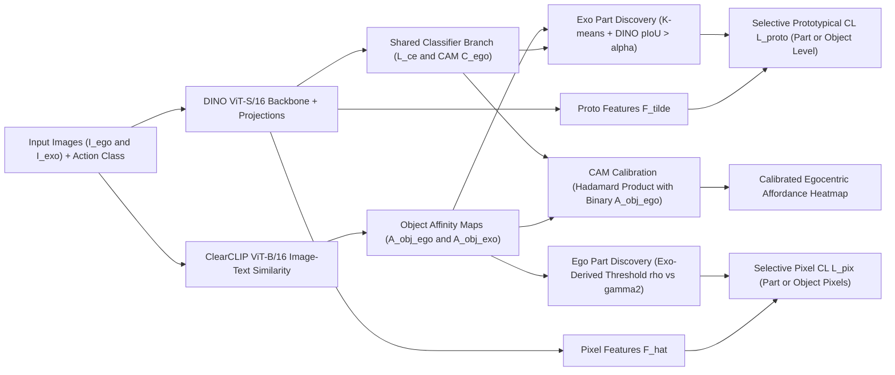

# Selective Contrastive Learning for Weakly Supervised Affordance Grounding

**Selective Contrastive Learning for Weakly Supervised Affordance Grounding**（ICCV 2025）收录于 [Awesome-Affordance-Learning](https://github.com/hq-King/Awesome-Affordance-Learning)，属于具身 AI affordance 学习综述的配套论文清单。本页是 **清单索引**：给出它在综述分类里的位置与原文入口，方法细节和量化结果请看原文。

## 一句话定义

Selective Contrastive Learning for Weakly Supervised Affordance Grounding——在清单中归入 **Perception（Scope: Object；Perception Subcategory: Visual）**（清单未附方法摘要，此处不替原文概括贡献）。

## 英文缩写速查

| 缩写 | 英文全称 | 简要说明 |
|------|----------|----------|
| Affordance | Action possibility (Gibson) | 环境/物体对 agent 提供的可交互机会 |
| HOI | Human-Object Interaction | 人–物交互，常作 affordance 监督来源 |
| VLM | Vision-Language Model | 视觉–语言模型，用于 affordance 推理与接地 |
| VLA | Vision-Language-Action | 视觉–语言–动作策略 |

## 为什么重要

- 综述把 affordance 学习拆成感知、推理、引导动作三段（见 [综述实体页](../entities/paper-affordance-learning-embodied-ai-survey.md)），本条目是其中一段的代表文献之一。
- 可顺着 [技术地图](../overview/affordance-awesome-technology-map.md) 的同分组条目横向阅读同方向工作。

## 核心信息

| 字段 | 内容 |
|------|------|
| 出处 | ICCV 2025 |
| 方法名（清单标注） | - |
| 分组 1 | Perception · Scope: Object；Perception Subcategory: Visual |
| 论文 | <https://openaccess.thecvf.com/content/ICCV2025/html/Moon_Selective_Contrastive_Learning_for_Weakly_Supervised_Affordance_Grounding_ICCV_2025_paper.html> |

## 核心机制（归纳）

> 注：以下机制与评测指标基于通读 CVF 开放获取原文全文核对补充。

针对弱监督 Affordance 接地（WSAG）中“可交互部件线索不总是清晰可辨、导致蒸馏间歇失效并退化为仅靠动作分类区分非功能性显著部位”的问题，本文（[原文](https://openaccess.thecvf.com/content/ICCV2025/html/Moon_Selective_Contrastive_Learning_for_Weakly_Supervised_Affordance_Grounding_ICCV_2025_paper.html)）提出在**部件级与物体级之间自适应切换**的选择性原型对比与像素对比学习框架：

- **输入与双分支骨干**：输入单张以物体为中心的自我视角图像 $I^{\text{ego}}$、动作类别文本提示及 $E$ 张第三人称交互视角图像 $I^{\text{exo}}$（默认 $E=3$）。图像经 `DINO (ViT-S/16)` 与投影层后分流至：
  1. **分类分支**：共享分类头（`CLS`）以交叉熵 $\mathcal{L}_{\text{ce}}$ 学习动作语义并生成类激活图 $C^{\text{ego}}, C^{\text{exo}}$（推理时仅输入 $I^{\text{ego}}$ 生成 $C^{\text{ego}}$）。
  2. **对比分支**：两个独立投影头分别输出原型对比特征 $\tilde{F}^{\text{(view)}}$ 与像素对比特征 $\hat{F}^{\text{(view)}}$。
- **基于 CLIP 的跨视角目标与部件发现**：
  - **物体亲和图（Object Discovery）**：采用 `ClearCLIP` 分解策略提取 `CLIP (ViT-B/16)` 局部视觉特征与动作文本嵌入的余弦相似度，得到物体亲和图 $A_{\text{obj}}^{\text{ego}}$ 与 $A_{\text{obj}}^{\text{exo}}$。
  - **第三人称视角部件发现**：将 $C^{\text{exo}}$ 与 $A_{\text{obj}}^{\text{exo}}$ 结合后按阈值 $\gamma_1$ 过滤，约束在目标物体区域内做 $K=3$ 的 K-means 聚类生成候选部件原型，与 $F^{\text{ego}}$ 计算部件–自我视角相似度图，并与自我视角 DINO 自注意力图计算 pIoU；仅当最高 pIoU $> \alpha$ 时视为可靠部件（索引集 $\mathbb{I}$）。
  - **自我视角部件发现**：利用 CLIP 对显著物体激活更强、而第三人称图易受小尺度与遮挡影响的特性，计算自适应阈值 $\rho = \min_{e \in E} \max_{h,w} A_{\text{obj}}^{\text{exo}}$，若 $A_{\text{obj}}^{\text{ego}}$ 存在大于 $\rho$ 的像素（索引集 $\mathbb{J}$）则二值化提取部件像素正集 $Q^+_b$。
- **选择性对比目标与推理校准**：
  - **选择性原型对比损失（$\mathcal{L}_{\text{proto}}$）**：若第三人称部件可靠（$b \in \mathbb{I}$），以部件亲和图 $A_{\text{part}}^{\text{(view)}}$ 构造正/负原型 $P^{\text{(view)}+}_b, P^{\text{(view)}-}_b$ 并将自我视角物体锚点 $z^{\text{ego}}_b = \Phi^+(\tilde{F}^{\text{ego}}_b, A^{\text{ego}}_{\text{obj}, b})$ 拉向同动作正原型、推离背景负原型与他类正原型；否则（$b \notin \mathbb{I}$）退回**物体级**原型对齐与全图池化锚点，持续抑制背景干扰。
  - **选择性像素对比损失（$\mathcal{L}_{\text{pix}}$）**：若 $b \in \mathbb{J}$ 则以 $\rho_b$ 划分自我视角部件像素正/负集合 $Q^+_b, Q^-_b$ 进行逐像素对比；否则以固定阈值 $\gamma_2$（$=\gamma_1=0.6$）做物体级像素对比。
  - **总训练目标与 CAM 校准**：总损失为 $\mathcal{L} = \mathcal{L}_{\text{ce}} + \lambda_1 \mathcal{L}_{\text{proto}} + \lambda_2 \mathcal{L}_{\text{pix}}$（$\lambda_1=\lambda_2=1, \alpha=\gamma=0.6, \beta=1, \tau=0.5$）。推理阶段将预测的 $C^{\text{ego}}$ 与二值化物体亲和图 $A$ 做 Hadamard 乘积校准，消除卷积感受野导致的激活扩散与背景误激活。

### 方法流程图

## 评测与指标

- **数据集与指标口径**：在 **AGD20K**（Seen 与 Unseen 划分）与 **HICO-IIF** 两个弱监督 Affordance 接地基准上评测，使用热图分布相似度与显著性指标 `KLD`（$\downarrow$）、`SIM`（$\uparrow$）与 `NSS`（$\uparrow$），详细设置见 [原文](https://openaccess.thecvf.com/content/ICCV2025/html/Moon_Selective_Contrastive_Learning_for_Weakly_Supervised_Affordance_Grounding_ICCV_2025_paper.html)。
- **主实验结果（Table 1，DINO ViT-S/16 + CLIP ViT-B/16，$E=3$）**：
  - **AGD20K-Seen**：KLD **1.124** / SIM **0.433** / NSS **1.280**，全面优于 `LOCATE`（1.226 / 0.401 / 1.177）、`WSMA`（1.176 / 0.416 / 1.247）及基于大模型的 `INTRA`（1.199 / 0.407 / 1.239）。
  - **AGD20K-Unseen**：KLD **1.243** / SIM **0.405** / NSS **1.368**，在未见物体类别上显著拉开与 `WSMA`（1.335 / 0.382 / 1.220）和 `LOCATE`（1.405 / 0.372 / 1.157）的差距。
  - **HICO-IIF**：KLD **1.358** / SIM **0.378** / NSS **1.231**，优于 `WSMA`（1.465 / 0.358 / 1.012）与 `LOCATE`（1.593 / 0.327 / 0.966）。
- **消融实验（Table 2，AGD20K-Seen）**：仅用分类损失基线为 KLD 1.349 / SIM 0.365 / NSS 1.138；逐步叠加物体级与部件级原型对比及像素对比后提升至 1.142 / 0.415 / 1.303；叠加推理端 CAM 校准后进一步达到 **1.124 / 0.433 / 1.280**。

## 与其他工作对比

- 本页不做与具体基线的数值对比；同分组横向对照见 [技术地图](../overview/affordance-awesome-technology-map.md)。
- 若站内另有这篇的深读页，以那一页为准。

## 结论

**本页只提供「Selective Contrastive Learning for Weakly Supervised Affordance Grounding」在 affordance 综述清单中的坐标与原文入口，不能替代原文。**

- 可确证的只有标题、出处与分类标签；方法与结果未经本页核实。
- 开源状态清单未标注，入库时未打开项目页核查，复现前请自行确认。
- 要深读：从原文入手，再回综述实体页对照 perception → reasoning → action 的位置。

## 常见误区

1. 不要把分类标签当作论文结论；标签来自清单维护者的归类。
2. 不要把本页当作方法证明；它只是清单入口。

## 关联页面

- [Affordance 学习综述](../entities/paper-affordance-learning-embodied-ai-survey.md)
- [Awesome-Affordance-Learning 技术地图](../overview/affordance-awesome-technology-map.md)
- [manipulation.md](../tasks/manipulation.md)、[vla.md](../methods/vla.md)

## 参考来源

- [`sources/papers/affordance_awesome_selective-contrastive-learning-for-weakly-supervised-aff.md`](../../sources/papers/affordance_awesome_selective-contrastive-learning-for-weakly-supervised-aff.md) — 本条目策展摘录
- [`sources/papers/affordance_awesome_catalog.md`](../../sources/papers/affordance_awesome_catalog.md) — 列表总表
- [`sources/repos/awesome-affordance-learning.md`](../../sources/repos/awesome-affordance-learning.md)
- 论文：<https://openaccess.thecvf.com/content/ICCV2025/html/Moon_Selective_Contrastive_Learning_for_Weakly_Supervised_Affordance_Grounding_ICCV_2025_paper.html>

## 推荐继续阅读

- [Awesome-Affordance-Learning 仓库](https://github.com/hq-King/Awesome-Affordance-Learning)
- [原文](https://openaccess.thecvf.com/content/ICCV2025/html/Moon_Selective_Contrastive_Learning_for_Weakly_Supervised_Affordance_Grounding_ICCV_2025_paper.html)
