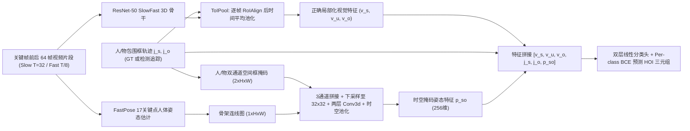

# ST-HOI

**ST-HOI: A Spatial-Temporal Baseline for Human-Object Interaction Detection in Videos**（ACM ICDAR 2021，arXiv:2105.11731v2，NUS & ASUS ICS）收录于 [Awesome-Affordance-Learning](https://github.com/hq-King/Awesome-Affordance-Learning)，属于具身 AI affordance 学习综述的配套论文清单。本页基于论文全文完成结构化精读与核实。

## 一句话定义

**ST-HOI** 是面向视频人–物交互检测（VideoHOI）的时空基线模型，通过在 SlowFast 3D 特征上沿人/物轨迹执行**先帧级 RoIAlign 再时间平均池化（ToIPool）**，并融合时序包围框轨迹与时空姿态掩码特征，解决了时序相反动作（推/拉、开/关）的歧义问题，并配套构建了 **VidHOI** 基准。

## 英文缩写速查

| 缩写 | 英文全称 | 简要说明 |
|------|----------|----------|
| HOI | Human-Object Interaction | 人–物交互检测，输出 `(human, predicate, object)` 三元组 |
| ToIPool | Tube-of-Interest Pooling | 兴趣管池化：沿轨迹逐帧 RoIAlign 后再沿时间维平均池化，消除特征错位 |
| STAD | Spatial-Temporal Action Detection | 时空动作检测（如 AVA），仅定位人体动作而不建模交互客体 |
| STSGG | Spatial-Temporal Scene Graph Generation | 时空场景图生成（如 Action Genome），生成成对关系图 |
| mAP / pAP | mean Average Precision / predicate-wise AP | 类别平均精度 / 按谓词统计的平均精度（要求人/物框 IoU > 0.5） |

## 为什么重要

- 传统静态图像 HOI 方法将视频帧视为独立同分布（i.i.d.）图像，无法区分静态视觉极相似但方向相反的时序交互（如 `push` vs `pull`、`open` vs `close`）。
- 作者通过实验揭示了一个反直觉现象：直接把 2D-CNN 换成 3D-CNN（如 SlowFast）做视频 HOI 或 STAD/STSGG，性能往往几乎不涨（~2%）甚至下降；根因在于传统“**先沿时间维池化、再对关键帧做 RoI 池化**”会在运动场景下把其他物体或背景错位池化进关键帧框内。ST-HOI 沿人/物轨迹修正池化顺序，在 Oracle 模式下将 Full mAP 相对 2D 基线提升 **24.8%**、纯时序谓词 mAP 提升 **73.5%**。

## 核心信息

| 字段 | 内容 |
|------|------|
| 出处 | ACM ICDAR 2021（arXiv:2105.11731v2） |
| 作者与机构 | Meng-Jiun Chiou*, Chun-Yu Liao, Li-Wei Wang, Roger Zimmermann, Jiashi Feng（NUS, ASUS Intelligent Cloud Services） |
| 分组 1 | Perception · Scope: Scene；Perception Subcategory: Interaction-driven |
| 论文与代码 | <https://dl.acm.org/doi/10.1145/3463944.3469097> · <https://arxiv.org/abs/2105.11731> · <https://github.com/coldmanck/VidHOI> |

## 核心机制

1. **VidHOI 视频 HOI 基准构建（基于 VidOR）**
   - 相比仅含 120 段室内摆拍 RGB-D 视频（10 个高层活动）的 CAD-120 和单主角志愿拍摄的 Action Genome，VidHOI 源自自然用户拍摄的 **VidOR** 多人多物视频。
   - 采用 AVA 风格的 **1 Hz 关键帧采样**规避全视频轨迹起止时间戳难对齐问题：训练集 **193,911** 关键帧（6,366 段视频），验证集 **22,808** 关键帧（756 段视频），总计 7,122 段视频（70 小时、7.3M 帧）、78 类物体（合并 adult/child/baby 为 person）、**50 类谓词**（25 类时序相关但仅占实例 ~5%，25 类空间/非时序）、**557 类 HOI 三元组**（315 个 Rare 类 $<25$ 实例，242 个 Non-rare 类 $\ge 25$ 实例）及 755K 实例。
2. **正确局部化视觉特征（ToIPool）**
   - 以 ResNet-50 **SlowFast** 为 3D 骨干（围绕关键帧截取 64 帧片段，Slow 分支均匀取 $T=32$ 帧，Fast 分支取 $T/\alpha$，$\alpha=8$），得到倒数第二层时空特征 $v \in \mathbb{R}^{d \times T \times H \times W}$。
   - 对人（$s$）、物（$o$）及二者并集框（$u$）轨迹 $\{j_{i,t}\}_{t=1}^T$，**反转传统池化顺序**：先在每帧特征 $v_t$ 上按当前帧包围框 $j_{i,t}$ 执行 `RoIAlign(v_t, j_{i,t})`，再对时间轴求平均 $\bar{v}_i = \frac{1}{T}\sum_{t=1}^T \text{RoIAlign}(v_t, j_{i,t})$，确保运动主客体特征始终精确对齐。
3. **时空掩码姿态特征与多特征融合**
   - **轨迹特征**：直接编码人类与物体的归一化连续坐标序列 $j_s, j_o \in \mathbb{R}^{T \times 4}$。
   - **时空掩码姿态模块**：用 **FastPose** 提取每帧人体 17 关键点骨架并绘制成取值 $\in [0, 1]$ 的单通道线段掩码 $\bar{h}_{i,t}$，与人/物二值空间框掩码 $s_{i,t} \in \{0,1\}^{2 \times H \times W}$ 拼接为 $p_{i,t} \in \mathbb{R}^{3 \times H \times W}$；下采样（$224\times 224 \to 32\times 32$）后经过两层 3D 卷积（`Conv3d 3->64, 5x7^2` 与 `64->256, 3x3^2`）、空间最大池化与时间平均池化并线性投影至 256 维向量 $\bar{p}_{so}$。
   - **融合与训练**：拼接 $v_{so} = [\bar{v}_s; \bar{v}_u; \bar{v}_o; j_s; j_o; \bar{p}_{so}]$ 经两层线性层输出 50/557 交互多标签概率，使用逐类二元交叉熵（BCE）损失训练（20 epochs，8×V100，SGD 初始 lr $10^{-2}$）；推理时按 HICO-DET 惯例取 top-100 预测对评测。

### 方法流程图

## 评测与指标

在 **VidHOI 验证集**（557 类 HOI 三元组 mAP）上的主表与时序/空间分项消融结果（Table 2 & Table 3）：

| 评测模式 | 模型配置 | Full mAP ↑ | Non-rare mAP ↑ | Rare mAP ↑ | 相对 2D 提升 | Temporal mAP / T% | Spatial mAP / S% |
|------|------|------|------|------|------|------|------|
| **Oracle**（真值轨迹） | 2D model [39] | 14.1 | 22.9 | 11.3 | - | 8.3 / - | 18.6 / - |
| **Oracle**（真值轨迹） | 3D model（朴素 SlowFast） | 14.4 | 23.0 | 12.6 | +2.1% | 7.7 / -7.2% | 20.9 / +12.3% |
| **Oracle**（真值轨迹） | Ours-T（+轨迹） | 17.3 | 26.9 | 16.8 | +22.7% | **14.4** / **+73.5%** | 24.7 / +32.8% |
| **Oracle**（真值轨迹） | Ours-T+V（+ToIPool） | 17.3 | 26.9 | 16.3 | +22.7% | 13.6 / +63.9% | 24.6 / +32.3% |
| **Oracle**（真值轨迹） | Ours-T+P（+时空姿态） | 17.4 | 27.1 | 16.4 | +23.4% | 12.9 / +55.4% | **25.0** / **+34.4%** |
| **Oracle**（真值轨迹） | **Ours-T+V+P（完整 ST-HOI）** | **17.6** | **27.2** | **17.3** | **+24.8%** | **14.4** / **+73.5%** | **25.0** / **+34.4%** |
| **Detection**（检测追踪轨迹） | 2D model [39] | 2.6 | 4.7 | 1.7 | - | 1.5 / - | 2.7 / - |
| **Detection**（检测追踪轨迹） | 3D model（朴素 SlowFast） | 2.6 | 4.9 | 1.9 | 0.0% | 1.6 / +6.7% | 2.9 / +7.4% |
| **Detection**（检测追踪轨迹） | Ours-T | 3.0 | 5.5 | 2.0 | +15.4% | 1.8 / +20.0% | **3.3** / **+23.6%** |
| **Detection**（检测追踪轨迹） | Ours-T+V | 3.1 | 5.8 | 2.0 | +19.2% | 1.8 / +20.0% | **3.3** / **+23.6%** |
| **Detection**（检测追踪轨迹） | Ours-T+P | **3.2** | **6.1** | 2.0 | **+23.1%** | 1.8 / +20.0% | **3.3** / **+23.6%** |
| **Detection**（检测追踪轨迹） | Ours-T+V+P | 3.1 | 5.9 | **2.1** | +19.2% | **1.9** / **+26.7%** | **3.3** / **+23.6%** |

## 与其他工作对比

- **对比静态图像 HOI 模型（PMFNet [39] 2D baseline 等）**：2D 模型逐帧独立推理且受限于共现偏置；ST-HOI 利用时序轨迹与 ToIPool 在时序谓词（`towards / away / push / pull / lift`）上取得 +73.5% 相对 mAP 跃升，并大幅减少相邻帧假阳性。
- **对比早期视频 HOI 与 STAD/STSGG（LIGHTEN [35]、SlowFast [7]、Action Genome [20]）**：LIGHTEN 依赖 CAD-120 的 RGB-D 深度/3D 姿态且需 $M\times N$ 次单独特征提取；常规 3D STAD 模型的“先时间池化再 RoI 池化”导致时序谓词倒退（3D Temporal mAP 从 8.3 降至 7.7，-7.2%），ST-HOI 用纯 RGB + ToIPool 纠正该结构缺陷。同分组横向对照见 [技术地图](../overview/affordance-awesome-technology-map.md)。

## 常见误区或局限

1. **Detection 与 Oracle 模式存在巨大鸿沟**：Full mAP 从 Oracle 的 **17.6** 骤降至 Detection 模式的 **3.1–3.2**（且 Ours-T+P 3.2 略高于完整模型 3.1），说明上游视频目标检测与跨帧轨迹追踪质量（及短轨迹直接用整图填充的退化处理）是现实部署的最大瓶颈。
2. **长尾效应极其显著**：VidHOI 中 50 类谓词有 25 类属时序交互但仅占总实例约 **5%**，315 个 Rare 类拉低了整体 mAP（Full 17.6 与 Rare 17.3 接近，远低于 Non-rare 27.2）。
3. **仅作简洁基线，未纳入高阶时空模块**：论文刻意省略了 Non-local block、Long-term Feature Bank（LFB）与交互性判别（interactiveness）等常见增益模块；在连续多帧复杂交互（如 `lift` 在 $T_2\text{–}T_4$ 帧间漏检）上仍有提升空间。

## 结论

**ST-HOI 揭示了视频 3D 骨干“先时间池化再 RoI 池化”的特征错位根因，并通过 ToIPool、轨迹坐标与时空姿态掩码在新建的大规模 VidHOI 基准上将视频时序 HOI 精度相对 2D 基线提升 73.5%。**

- 在构建视频交互/动作识别管线时，切勿在全局 3D 特征上先做时间池化再裁切实例框；应使用 **ToIPool**（先沿轨迹逐帧 `RoIAlign` 再时间聚合）保证动态目标特征对齐。
- 仅使用原始轨迹坐标 `j_s, j_o` 已能带来最大单步增益（Oracle +22.7% Full mAP），而时空姿态与空间掩码对区分静态/空间类谓词（Spatial mAP 24.7 → 25.0）不可或缺。
- 若要把 ST-HOI 迁移至机器人从人类视频学习交互策略，首要工程优化点在于提升真实检测–追踪轨迹的连续性（减少整图回退填充），其次才是叠加长时特征记忆或交互性分支。
- 官方数据集与代码已开源于 `github.com/coldmanck/VidHOI`，可直接作为 VideoHOI 评测与预训练起点。

## 关联页面

- [Affordance 学习综述](../entities/paper-affordance-learning-embodied-ai-survey.md)
- [Awesome-Affordance-Learning 技术地图](../overview/affordance-awesome-technology-map.md)
- [manipulation.md](../tasks/manipulation.md)、[vla.md](../methods/vla.md)

## 参考来源

- [`sources/papers/affordance_awesome_st-hoi-a-spatial-temporal-baseline-for-human-object-inte.md`](../../sources/papers/affordance_awesome_st-hoi-a-spatial-temporal-baseline-for-human-object-inte.md) — 本条目策展摘录
- [`sources/papers/affordance_awesome_catalog.md`](../../sources/papers/affordance_awesome_catalog.md) — 列表总表
- [`sources/repos/awesome-affordance-learning.md`](../../sources/repos/awesome-affordance-learning.md)
- 论文：<https://dl.acm.org/doi/10.1145/3463944.3469097>

## 推荐继续阅读

- [Awesome-Affordance-Learning 仓库](https://github.com/hq-King/Awesome-Affordance-Learning)
- [VidHOI 官方代码与数据集仓库](https://github.com/coldmanck/VidHOI)
- [原文](https://dl.acm.org/doi/10.1145/3463944.3469097)
