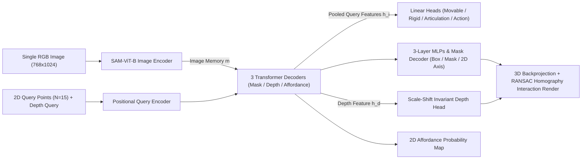

# Understanding 3D Object Interaction from a Single Image

**Understanding 3D Object Interaction from a Single Image**（ICCV 2023，arXiv:2305.09664v2）针对「无人在场、单张 RGB 图像、任意交互发生前」的静态场景理解问题，构建了 **3DOI** 数据集与基于 SAM 的多任务查询点 Transformer 模型。

## 一句话定义

本文以「在给定图像与 2D 查询点处我能做什么」为统一问题，利用扩展自 Segment Anything（SAM）的多解码器 Transformer 联合预测物体可移动性、3D 定位（掩码/框/深度）、刚性、关节运动学（类型与轴线）、交互动作及 affordance 概率图。

## 英文缩写速查

| 缩写 | 英文全称 | 简要说明 |
|------|----------|----------|
| 3DOI | 3D Object Interaction Dataset | 本文构建的 10K 图像数据集（50K+ 可交互物体 + 31K 不可移动固定物标注） |
| SAM | Segment Anything Model | 本文采用的 MAE 预训练 ViT 主干与点提示掩码解码底座 |
| EA-Score | Edge/Line Angle-Euclidean Score | 衡量预测 2D 旋转轴与真值之间角度及欧氏距离的 [0, 1] 指标 |
| SIM | Histogram Intersection (Similarity) | 用于评估预测 affordance 概率图与真值高斯分布重合度的指标 |
| WHIRL | In-the-Wild Human Imitating Robot Learning | 本文用于评测零样本跨领域迁移能力的机器人操作视频数据集 |

## 为什么重要

- 既往单图 3D 方法只还原「当前静止状态」，而传统关节/交互检测（如 3DADN）依赖「人正在交互」的视频线索，仿真训练（如 SAPIEN）又存在严重域差距。
- 3DOI 无需人体在场或视频序列，即可从单图预测刚体/柔性、单手/双手、平动/旋转关节轴及具体抓握热区，并直接以 **85.3% 可移动分类准确率 / 77.1 Mask mIoU** 零样本迁移到 WHIRL 机器人场景（Mask mIoU 达 **70.2**）。
- 可顺着 [Affordance 学习综述](../entities/paper-affordance-learning-embodied-ai-survey.md) 与 [技术地图](../overview/affordance-awesome-technology-map.md) 对照其「Perception · Spatial」定位。

## 核心信息

| 字段 | 内容 |
|------|------|
| 作者 | Shengyi Qian（University of Michigan）, David F. Fouhey（UMich / NYU） |
| 出处 | ICCV 2023（arXiv:2305.09664v2） |
| 数据集规模 | 10K 图像（Articulation 3K + EpicKitchen 2K + Taskonomy/Omnidata 5K，8k/1k/1k 划分）；50K+ 物体 + 31K 固定物 |
| 分组 1 / 分组 2 | Perception (Scope: Scene · Spatial) ｜ Datasets / Benchmarks (image/3D interaction) |
| 论文链接 | <https://doi.org/10.1109/ICCV51070.2023.01988> / <https://arxiv.org/abs/2305.09664> |
| 项目主页 | <https://jasonqsy.github.io/3DOI/> |

## 核心机制

1. **六维「What could I do here?」问题定义**：
   - 给定单张 `768×1024` RGB 图像与若干 2D 查询点 `[x, y]`（每图约 5 个交互点），对每个查询点联合预测：
     - **Movable**：三分类（不可移动固定物 fixture / 单手 1-hand / 双手 2-hand）。
     - **Localization**：可动部件 2D 包围盒、实例掩码与整图稠密深度。
     - **Rigidity**：二分类（刚性 rigid / 非刚性 non-rigid）。
     - **Articulation**：三分类（自由移动 freeform / 旋转 rotation / 平动 translation）+ 2D 旋转轴线 `(sin 2θ, cos 2θ, r)` 连续空间回归。
     - **Action**：三分类（pull / push / other）。
     - **Affordance**：以高斯核（半径 5）将单关键点真值转为概率图，用二值 Focal Loss（正样本权重 `α = 0.95`，`γ = 2`）监督。
2. **基于 SAM 的多解码器架构**：
   - 复用预训练 `SAM-ViT-B` 图像编码器与位置编码查询点编码器（最多并行 `N = 15` 个点查询 `k_p` 及 1 个可学习深度查询 `k_d`）。
   - 使用 **3 个独立 Transformer 解码器**分别服务于掩码、深度与 affordance 预测；线性头预测类别属性，3 层 MLP 回归包围盒与旋转轴；深度分支采用尺度–平移不变 L1 + 梯度匹配损失。全网使用 AdamW（`lr = 1e-4`，batch size 2，4× A40 GPU）联合训练 200 epochs。
3. **单图 3D 交互渲染**：对旋转关节物体，利用预测深度将 2D 轴反投影至 3D 并旋转点云后以 RANSAC 拟合单应矩阵（Homography）变形掩码；对平动物体则沿表面平均法向平移，从而在单张图像上渲染出潜在开合效果。

### 方法流程图

## 评测与指标

### 1. 3DOI 测试集定量对比（Table 1，全部指标越高越好）

| 方法 | Movable Acc | Box mIoU | Mask mIoU | Rigidity Acc | Articulation Acc | Axis EA-Score | Action Acc | Affordance SIM |
|------|-------------|----------|-----------|--------------|------------------|---------------|------------|----------------|
| 3DADN | – | 8.53 | 6.45 | – | 44.3 | 5.63 | – | – |
| SAPIEN | – | 5.94 | 4.57 | – | 41.6 | 1.79 | – | – |
| InteractionHotspots | – | – | – | – | – | – | – | 0.047 |
| ResNet MLP | 72.5 | 21.4 | – | 81.9 | 51.9 | 68.3 | 58.8 | – |
| COHESIV | 71.5 | 28.3 | 35.2 | 81.2 | 68.0 | 67.2 | 71.5 | 0.013 |
| **3DOI (Ours)** | **85.3** | **69.9** | **77.1** | **90.1** | **89.4** | **80.3** | **89.7** | **0.167** |

- **深度估计**：在 3DOI 测试集上 **96.7%** 像素处于 `1.25` 阈值内，**99.3%** 处于 `1.25^2` 阈值内。

### 2. WHIRL 机器人数据集零样本泛化（Table 2，无微调直接测试）

| 方法 | Movable Acc | Box mIoU | Mask mIoU | Rigidity Acc | Articulation Acc | Axis EA-Score | Action Acc | Affordance SIM |
|------|-------------|----------|-----------|--------------|------------------|---------------|------------|----------------|
| 3DADN | – | 13.8 | 10.1 | – | 53.3 | 4.03 | – | – |
| SAPIEN | – | 9.14 | 6.15 | – | 51.1 | 0.0 | – | – |
| InteractionHotspots | – | – | – | – | – | – | – | 0.045 |
| ResNet MLP | 88.8 | 14.1 | – | 80.0 | 51.1 | 57.1 | 51.1 | – |
| COHESIV | 86.7 | 37.1 | 38.7 | 82.2 | 73.3 | 66.1 | 73.3 | 0.015 |
| **3DOI (Ours)** | **91.1** | **68.7** | **70.2** | **95.6** | **80.0** | **68.5** | **84.4** | **0.148** |

## 与其他工作对比

- **对比视频/仿真路线（3DADN / SAPIEN）**：3DADN 只能在人体正在交互时检测关节物体，在无人首帧（WHIRL）几乎失效（Mask mIoU 10.1）；SAPIEN 纯合成渲染因严重域差距难以迁移到真实厨房场景（Mask mIoU 6.15）。
- **对比同架构监督基线（ResNet MLP / COHESIV）**：在同用 3DOI 数据训练时，引入 SAM 预训练与 Transformer 解码器使部件框/掩码定位跃升至 69.9 / 77.1 mIoU，Affordance SIM 较 InteractionHotspots 提升 **3.5 倍**（0.047 → 0.167）。

## 结论

**3DOI 证明「基于互联网视频 + 自我中心视频 + 3D 扫描渲染」混合标注配合 SAM 查询点 Transformer，能够摆脱对「人正在交互」的依赖，直接实现可零样本迁移至机器人操作场景的单图 3D 交互理解。**

1. **查询点范式避开整物歧义**：以「点处部件」而非整台冰箱/橱柜打框，精准分离门扇、抽屉等可动子部件。
2. **混合真实/渲染数据破除域差距**：即便不微调，3DOI 训练的模型在 WHIRL 机器人首帧上仍保持 70.2 Mask mIoU 与 80.0% 关节分类准确率。
3. **Transformer 掩码解码是稠密预测关键**：与同数据训练的 COHESIV 相比，密集定位（Mask mIoU +31.5/+41.9）和 affordance SIM（0.015 → 0.148）拉开代差。
4. **Affordance 绝对 SIM 仍有提升空间**：由于可形变物体交互点存在多解而真值仅标单关键点，SIM 仅达 0.167 / 0.148。

## 常见误区或局限

1. **对称物体旋转轴朝向歧义**：对外观左右对称的柜门或盒子，缺乏常识或内部铰链线索时模型容易把旋转轴预测到错误一侧（Fig. 9 Row 1）。
2. **纯视觉对物理材质/重量误判**：仅靠外观无法判断材质与重量，例如模型会将看似轻质塑料的垃圾桶误判为「单手可移动」（Fig. 9 Row 3）；遮挡也会导致部件掩码残缺。
3. **单关键点 affordance 标注限制**：3DOI 每个物体实例仅标注一个 affordance 关键点，面对有多个合理抓握区的物体（如沙发、枕头）会惩罚合理多解预测。

## 关联页面

- [Affordance 学习综述](../entities/paper-affordance-learning-embodied-ai-survey.md)
- [Awesome-Affordance-Learning 技术地图](../overview/affordance-awesome-technology-map.md)
- [manipulation.md](../tasks/manipulation.md)、[vla.md](../methods/vla.md)

## 参考来源

- [`sources/papers/affordance_awesome_understanding-3d-object-interaction-from-a-single-image.md`](../../sources/papers/affordance_awesome_understanding-3d-object-interaction-from-a-single-image.md) — 本条目策展摘录
- [`sources/papers/affordance_awesome_catalog.md`](../../sources/papers/affordance_awesome_catalog.md) — 列表总表
- [`sources/repos/awesome-affordance-learning.md`](../../sources/repos/awesome-affordance-learning.md)
- 论文：<https://doi.org/10.1109/ICCV51070.2023.01988>（预印本 <https://arxiv.org/abs/2305.09664>）

## 推荐继续阅读

- [3DOI 项目主页](https://jasonqsy.github.io/3DOI/)
- [Awesome-Affordance-Learning 仓库](https://github.com/hq-King/Awesome-Affordance-Learning)
- [原文](https://doi.org/10.1109/ICCV51070.2023.01988)
