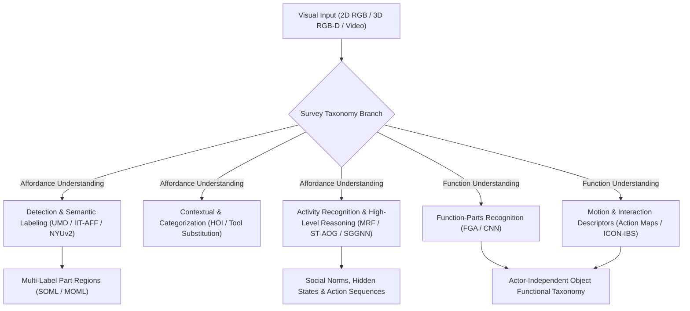

# Visual Affordance and Function Understanding

**Visual Affordance and Function Understanding: A Survey**（ACM Computing Surveys 2021，arXiv:1807.06775v1）是首篇从计算机视觉与机器人视觉双重视角系统梳理「视觉 affordance」与「功能场景理解（Functionality Understanding）」的权威长篇综述。

## 一句话定义

本文提出涵盖「基于 affordance 的理解（检测、分割、上下文、分类、活动识别、高层推理）」与「功能场景理解（功能部件、运动、交互、形状描述符）」的双翼层次分类体系，并对现有算法、数据集与开放挑战做出系统比较。

## 英文缩写速查

| 缩写 | 英文全称 | 简要说明 |
|------|----------|----------|
| SOML / MOML | Single/Multiple Object Multiple Labels | 单物体多标签与多物体多标签问题，affordance 学习的固有难点 |
| S-HMP / S-RF | Superpixel Hierarchical Matching Pursuit / Structured Random Forest | 早期 RGB-D 工具部位 affordance 检测代表特征工程与分类方法 |
| ST-AOG | Spatial-Temporal And-Or Graph | 时空与或图，用于联合解析人类活动、交互物体与社会 affordance |
| SGGNN | Spatial Gated Graph Neural Network | 空间门控图神经网络，用于结合物理与社会规范的 affordance 推理 |
| ICON / IBS | Interaction CONtext / Interaction Bisector Surface | 基于物体–物体几何交互二等分面的 3D 功能描述符 |

## 为什么重要

- 在概念层面明确区分了 **Affordance**（依赖执行主体的可交互动作机会，如锤柄 *graspable*）与 **Function**（独立于执行者的物体固有任务效用，如锤头 *strike*），指出二者之间呈多对多映射而非等价关系。
- 按输入模态（2D / 3D / 多模态）、特征范式（手工特征 vs 深度特征学习）、监督类型与实机/仿真验证全面对照 6 类子任务方法（Tables 3–9）及 15 个经典数据集（Table 10）。
- 可配合 [Affordance 学习综述](../entities/paper-affordance-learning-embodied-ai-survey.md) 与 [技术地图](../overview/affordance-awesome-technology-map.md) 梳理深度学习早期到当代的演进脉络。

## 核心信息

| 字段 | 内容 |
|------|------|
| 作者 | Mohammed Hassanin（UNSW Canberra）, Salman Khan（Data61-CSIRO / ANU）, Murat Tahtali（UNSW Canberra） |
| 出处 | ACM Computing Surveys (CSUR), Vol. 54, No. 3, 2021（arXiv:1807.06775v1，2018 年 7 月初版） |
| 文献类型 | 领域综述（涵盖 180+ 篇文献，覆盖检测、分割、推理、功能理解及数据集汇总） |
| 分组 | Related Surveys · Focus: Visual affordance recognition, segmentation, and function understanding |
| 论文链接 | <https://doi.org/10.1145/3446370> / <https://arxiv.org/abs/1807.06775> |

## 核心机制

作者将视觉 affordance 与功能理解拆解为两大支柱共十个分支：

1. **基于 Affordance 的理解（Sec. 5）**：
   - **Affordance 检测（Sec. 5.1，Table 3）**：从早期几何特征工程（GRUFF、Myers 等 UMD 数据集上的 S-HMP/S-RF、Hermans 等物理+视觉属性）演进至深度端到端检测（Nguyen 等编码器–解码器与 Faster R-CNN/R-FCN + CRF、Do 等 AffordanceNet），并涵盖室外驾驶 13 项指标的 DeepDriving（KITTI + TORCS 12 小时游戏录像）。
   - **Affordance 语义标注/分割（Sec. 5.2，Table 4）**：像素级多标签密集预测，代表工作包括多尺度 CNN（Extended NYUv2）、深度+表面几何特征（Kim 等）与 ADE20K 物体部件–affordance 查找表（Lüddecke & Wörgötter）。
   - **上下文 Affordance（Sec. 5.3，Table 5）**：围绕「物体–动作–效果」三元组，结合人体姿态、手部运动学（CONTACT VMGdb）、VAE 情景喜剧姿态生成（Binge Watching）与多源感官融合（CERTH-SOR3D）。
   - **Affordance 分类（Sec. 5.4，Table 6）**：图像/物体级分类与工具替代（Schoeler 等基于 CPC 部件分割 + SHOT 描述符构建 6 类工具本体，Abelha 等超二次曲面匹配，iCub 自探索平行 SOM）。
   - **基于 Affordance 的活动识别（Sec. 5.5，Table 7）**：涵盖 MRF/SSVM（Koppula 等）、ATCRF、Structural-RNN、ST-AOG 与社会规范 affordance 文法（HHOI）。
   - **高层 Affordance 推理（Sec. 5.6，Table 8）**：知识库 + 马尔可夫逻辑网络（MLN）、3D 流体力学液体容量模拟、CODE 透明容器液位推理，以及基于 ADE-Affordance（结合物理与社会规范及后果解释）的空间 GGNN。
2. **功能场景理解（Sec. 6，Table 9）**：
   - 包括 **功能部件识别**（如 FGA 随机与或树；早期深度功能检测 Ye 等在多阶段流程下准确率不足 `25%`）、**运动推功能**（Action Maps、交通功能区分割）、**交互推功能**（人手交互描述符与场景共现）以及 **3D 形状功能描述符**（基于交互二等分面 IBS 的 ICON 描述符）。

### 方法流程图

## 评测与指标

作为领域综述，本文未设置单一统一度量榜单，而在 Tables 3–9 对方法特性做定性对比，并在 **Table 10** 汇总了核心公开数据集规模与标注维度：

| 数据集 | 年份 | 模态与格式 | 类别/标签数 | 样本规模 | 核心标注特点 |
|--------|------|------------|-------------|----------|--------------|
| UMD | 2015 | RGB-D 图像 | 17 | 30,000 | 工具部位像素级几何 affordance 分割（7 类功能标签） |
| CAD-120 | 2016（原文标注） | RGB-D 视频 | – | 3,090 / 215 | 人类日常活动、骨架与动态物体 affordance |
| IIT-AFF | 2017 | RGB-D 图像 | 9 | 8,835 | 面向杂乱/工具场景的 9 类部件 affordance 检测 |
| ADE-Affordance | 2016 | RGB 图像 | 7 | 10,000 | 含物理/社会规范、例外与后果解释的室内场景标注 |
| Extended NYUv2 | 2016 | RGB 图像 | 5 | 1,449 | 室内场景表面法向、深度与 5 类 affordance 分割 |
| CONTACT VMGdb | 2011 | RGB-D 视频 | 20 | 5,200 | 结合手部抓取运动学（5 类抓握构型）的室内视频 |
| Binge Watching | 2017 | RGB-D | 30 类姿态 | 11,449 | 从情景剧提取的大规模人–场景交互姿态 |
| CERTH-SOR3D | 2017 | RGB-D | 14 | 20,800 | 15 类复杂感官运动与工具交互 affordance |
| COQE | 2017 | RGB | 10 | 5,000 | 容器液体体积、盛装内容物物理推理 |

## 与其他工作对比

- **对比机器人操控/发育机器人旧综述（Bohg 2014、Min 2016、Jamone 2016、Yamanobe 2017）**：以往综述集中于抓取合成、神经心理学或发育机器人自探索；本综述首次以「视觉计算 + 场景理解」为主轴，并将 **社会 affordance（Social Affordances）** 与 **功能场景理解（Function Understanding）** 纳入统一对比框架。

## 结论

**视觉 affordance 远不止「另一类目标检测」，其本质是融合几何、物理材质、主体约束与多对多局部语义的多标签场景推理问题。**

1. **严格区分 Affordance 与 Function**：Function 描述物体的通用任务效用（多对多映射到多个部位的多种 affordance），而 Affordance 始终依赖主体能力与当前物理状态（如倒置水杯不具备 pourable）。
2. **多标签（SOML/MOML）与部位级粒度是刚需**：同一把刀既有握柄抓握标签又有刀刃切割标签，传统单标签分类与互斥语义分割范式会破坏并发 affordance。
3. **纯外观特征存在物理盲区**：是否可坐、可搬运或可盛水取决于重量、材质（如纸杯 vs 玻璃杯）与容器内部状态，需引入多源属性与物理仿真。
4. **室外、高阶链式 affordance 与大规模数据集严重匮乏**：2018–2021 年间绝大多数学术基准局限在室内桌面工具，缺少面向开放世界与端到端深度特征学习的超大规模标注集。

## 常见误区或局限

1. **成文时间线偏早期（2018 初稿 / 2021 见刊）**：文献覆盖截止约 2017–2018 年（例如早期深网功能检测准确率仅 <25%），未涵盖 2020 年代后的 3D 点云开放词汇分割（如 3D AffordanceNet / OpenAD）及 VLM/LLM 驱动工作。
2. **表格偏定性而非数值榜单**：Tables 3–9 使用勾选矩阵对照输入模态与学习范式，未统一复现各方法在相同基准上的 mIoU/AP 排名。
3. **数据集表格个别字段与原论文年份有偏差**：例如 Table 10 将 CAD-120 标注年份列为 2016（实为 Koppula & Saxena 2016 PAMI 延续版或其引用口径，原始 IJRR 论文发表于 2013 年）。

## 关联页面

- [Affordance 学习综述](../entities/paper-affordance-learning-embodied-ai-survey.md)
- [Awesome-Affordance-Learning 技术地图](../overview/affordance-awesome-technology-map.md)
- [manipulation.md](../tasks/manipulation.md)、[vla.md](../methods/vla.md)

## 参考来源

- [`sources/papers/affordance_awesome_visual-affordance-and-function-understanding-a-survey.md`](../../sources/papers/affordance_awesome_visual-affordance-and-function-understanding-a-survey.md) — 本条目策展摘录
- [`sources/papers/affordance_awesome_catalog.md`](../../sources/papers/affordance_awesome_catalog.md) — 列表总表
- [`sources/repos/awesome-affordance-learning.md`](../../sources/repos/awesome-affordance-learning.md)
- 论文：<https://doi.org/10.1145/3446370>（预印本 <https://arxiv.org/abs/1807.06775>）

## 推荐继续阅读

- [Awesome-Affordance-Learning 仓库](https://github.com/hq-King/Awesome-Affordance-Learning)
- [原文](https://doi.org/10.1145/3446370)
