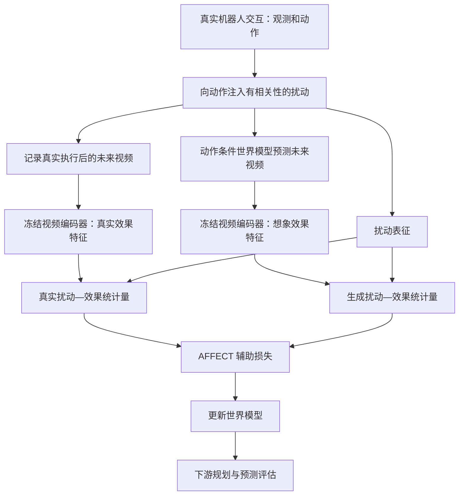

# AFFECT：让视频世界模型对动作扰动保持忠实 / AFFECT: Action-Faithful World Models through Effect Matching

## 一句话定义

AFFECT 是一种训练动作条件视频世界模型的辅助损失：要求模型对动作扰动的生成结果变化与真实世界录像中的变化一致，而不是仅生成视觉可信的视频。

## 英文缩写速查

| 缩写 | 英文全称 | 简要说明 |
|---|---|---|
| AFFECT | Action-Faithful world model training via Effect Matching | 动作扰动对应效果的表征统计匹配 |
| WM | World Model | 根据动作预测未来视觉观测的模型 |
| DROID | Distributed Robot Interaction Dataset | 作者用于真实机器人轨迹评测的数据 |
| UR5e | Universal Robots UR5e | 作者规划实验中的机器人 |

## 核心信息

| 项 | 资料 |
|---|---|
| 官方入口 | [项目或论文](https://periphanes.github.io/affect/) |
| 论文 | [arXiv:2611.25980](https://arxiv.org/abs/2611.25980) |
| 开放程度 | 论文和项目主页可访问；未发现官方算法实现仓库 |
| 本次检查 | 2026-11-23，一手材料静态核对，未独立复现 |

## 为什么重要

图像重建或视频逼真度高并不意味着能区分不同动作产生的细微物理后果；若把这种世界模型用于动作规划，可能选错控制输入。AFFECT 直接监督动作扰动带来的变化幅度与方向。

## 核心机制

1. 从机器人交互轨迹获得观测、执行动作、注入的有时间相关性的动作扰动，以及真实后续帧。
2. 用固定的视频表征编码器读取真实和模型想象的未来视觉特征，并使用扰动编码器表征动作变化。
3. 中心化特征后匹配真实与生成轨迹中「扰动—视觉效果」的统计相关性，把辅助损失叠加到原有视频预测训练目标；无需从同一初始状态重复试动作。
4. 对比动作扰动敏感度、与真实策略成功率的相关性，以及在下游规划中是否真正提升任务成功率。

## 流程总览

## 实验与评测

| 测试 | 作者报告 | 解释边界 |
|---|---|---|
| DROID 真机策略评估相关性 | 0.47 → 0.79（按两位小数） | 衡量世界模型对策略真实成效的预测相关性，非任务成功率 |
| UR5e 世界模型规划 | 成功率 60.0% → 68.3% | 下游规划提升，与前项不是同一种指标 |
| ALOHA-2 世界模型规划 | 作者报告有提升，精确数字见原文实验表 | 不用视频质量推断真实策略成功率 |

## 与其他工作对比

| 方向 | 关注点 | 差异 |
|---|---|---|
| 传统视频生成损失 | 单条未来轨迹是否逼真 | 不显式校准对动作扰动的响应 |
| [Mind2Act World](./paper-mind2act-world.md) | 任务完成时的认知与执行失败诊断 | AFFECT 侧重模型训练，Mind2Act 侧重能力评测 |

## 结论

**AFFECT 是一种训练动作条件视频世界模型的辅助损失：要求模型对动作扰动的生成结果变化与真实世界录像中的变化一致，而不是仅生成视觉可信的视频；使用时必须区分作者报告和可独立复现的验证结果。**

1. 优先报告动作扰动敏感度及规划成功率，不只报告生成视频质量。
2. 真实与想象结果比较必须对齐动作扰动分布与轨迹条件。
3. 一次初始状态的多次重放并非该方法的必要条件；其监督来自收集到的不同交互轨迹。
4. 跨机器人及真实任务的改进需要独立评估，不宜把相关系数解释成成功率。

## 工程实践

论文给出训练目标和实验设置，但截至 2026-11-23 未在官方项目页发现可复现的算法代码仓库。复现实验需要统一动作归一化、扰动时间相关性、视频特征抽取及规划预算。

### 源码运行时序图

**不适用**：作者项目页未提供可核实的可运行训练或规划代码入口，故不绘制虚构调用链。

## 局限与风险

原始比较涉及具体数据集、冻结特征编码器与测试规划器；结果不保证直接适用于不同摄像机、不同接触条件或陌生机器人。论文数字为作者报告，未独立复测。

## 关联页面

- [相关知识与路线](../methods/vla.md)
- [相关知识与路线](../tasks/manipulation.md)
- [相关知识与路线](../methods/model-based-rl.md)
- [相关知识与路线](./paper-mind2act-world.md)
- [相关知识与路线](../../roadmap/depth-wam.md)

## 参考来源

- [原始资料归档](../../sources/papers/affect-arxiv-2611-25980.md)
- [原始资料归档](../../sources/sites/affect-project.md)

## 推荐继续阅读

- [AFFECT 论文 v1](https://arxiv.org/abs/2611.25980)
- [官方项目页](https://periphanes.github.io/affect/)
