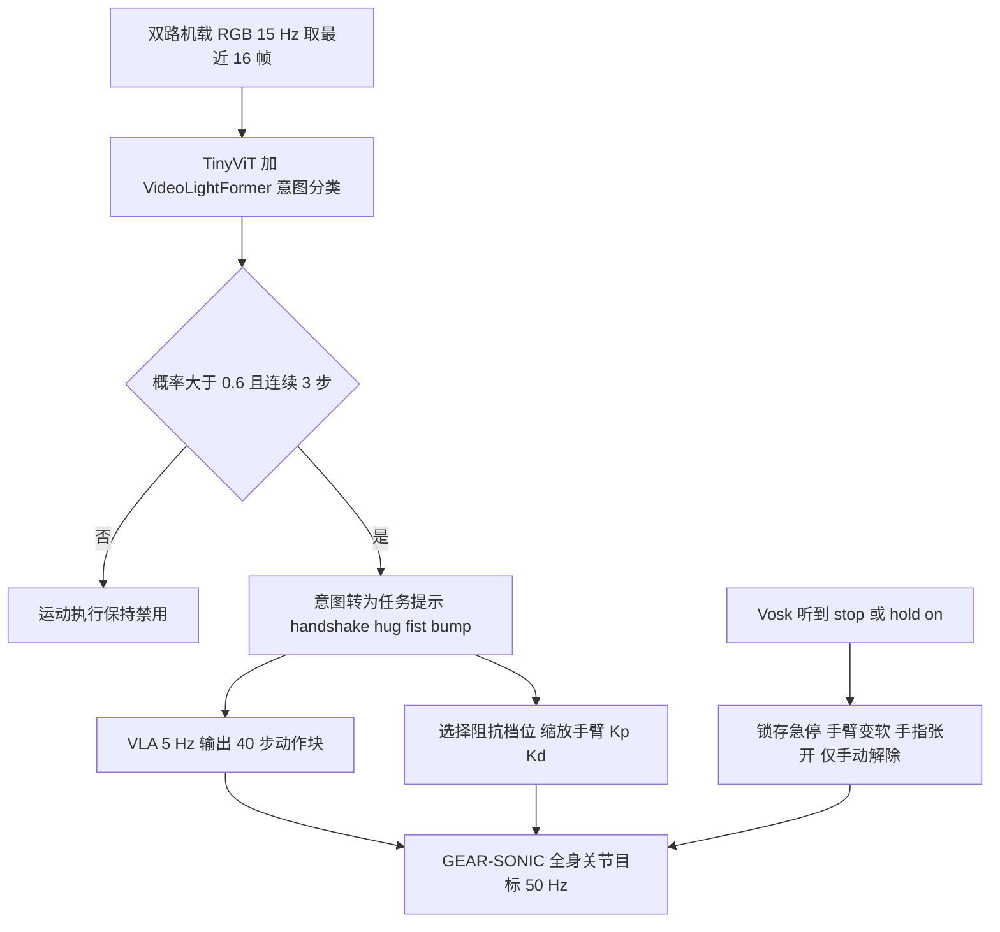

# AffectiveVLA（arXiv:2611.07712）

**AffectiveVLA**（*AffectiveVLA: Safe and Intent-Aware VLA Control for Human–Humanoid Social Interaction*，[arXiv:2611.07712](https://arxiv.org/abs/2611.07712)，v1 于 2026-11-05 发布）由斯科尔科沃科学技术学院（Skoltech）团队完成，作者栏全部署名该校。原文归档见 [sources/papers/affectivevla_arxiv_2611_07712.md](../../sources/papers/affectivevla_arxiv_2611_07712.md)。

## 一句话定义

**一条「意图门控」的 VLA 流水线：轻量视频模型先从双路 RGB 判断人想握手、碰拳、拥抱还是没有交互，置信不足就不让机器人动，确认后转成语言提示交给 VLA，接触阶段按交互类型调手臂阻抗，并有独立的语音急停。**

## 英文缩写速查

| 缩写 | 英文全称 | 简要说明 |
|------|----------|----------|
| VLA | Vision-Language-Action | 视觉-语言-动作策略；本文比较四个 |
| HRI | Human-Robot Interaction | 人机交互 |
| SONIC | Supersizing Motion Tracking for Natural Humanoid Whole-Body Control | 全身运动跟踪控制器；本文用其 GEAR-SONIC 把 64 维运动 token 变为关节目标（§3.1、§4.2） |
| RMSE | Root Mean Square Error | 离线开环动作误差（表 2） |
| F1 / macro-F1 | F1 score / 宏平均 F1 | 在线「是否做出对方发起的交互」的评分（表 3） |
| Kp / Kd | 位置增益 / 阻尼增益 | 关节阻抗参数，本文按交互类型缩放（式 1） |
| TinyViT | Tiny Vision Transformer | 意图模型的冻结视觉编码器 |
| VTN | Video Transformer Network | 意图实验中的一种时序结构（§5.3，另一种为 VideoLightFormer） |
| p95 | 95th percentile | 第 95 百分位延迟 |
| RQ | Research Question | 论文的三个研究问题 |

## 为什么重要

- **作者自述的问题（§1）：** 社交触碰与物体操作不同，对面有一个会动的人，意图要先推断；端到端 VLA 能生成接触丰富的动作，但意图不确定时有不安全误激活的风险。作者认为现有工作各有缺口：全身策略依赖操作员给出交互类型 [7]，顺应控制多用固定参数 [11]，VLM 流水线延迟高且不做接触 [2]。
- **作者自述的定位（§2）：** 「据我们所知」是首个把 RGB 意图识别、VLA 执行、交互专属阻抗与独立语音急停组合在人形机器人上的系统。该首创性说法未经我核实，属作者自述。
- **对本 wiki 的价值：** 它是一个把「安全门控」放在 VLA 之外的小而完整的工程样例，并给出一个有用的负面发现：离线动作误差不能预测在线表现（表 2 对比表 3）。
- **注意：** 本文全程是遥操作示教加监督微调，没有强化学习环节，引用到「机器人强化学习」语境时需如实标注。

## 核心机制与方法栈

| 模块 | 论文做法（节号） |
|------|------------------|
| 意图识别 | 双路 RGB（一路全身运动、一路手部接触区），16 帧对、15 Hz，缩放到 224×224；共享 TinyViT，各路独立因果 VideoLightFormer，注意力融合；输出 handshake / hug / fist_bump / no_interaction（§4.1） |
| 门控 | 概率超过 0.6 且连续 3 个推理步才提交；此前运动执行禁用（§4.1） |
| VLA 执行 | 任务提示加两路相机、机器人状态和 BrainCo 手状态；5 Hz 推理、50 Hz 执行；每手 6 维归一化指令；按执行器限速；指令与实测手指位置之差检测接触，接触后禁止继续闭合但允许张开；提示变化时丢弃排队动作（§4.2） |
| 任务条件顺应性 | K'p,i = α_i Kp,i，K'd,i = β_i Kd,i，β_i ≥ √α_i；只作用于 14 个手臂关节，躯干与腿不变；最小加加速度（minimum-jerk）过渡，变软 0.3 s、变硬 1.0 s；10 Hz 心跳，中断则保持最后增益（§4.2、§4.3、表 1） |
| 语音急停 | 离线 Vosk，限定词表（stop、hold on），确定性锁存：忽略操作员与 VLA 指令、行走置空闲、手臂变 SOFT 后放到休息位（检测到拥抱则先向外）、手指张开；只能手动解除（§4.4） |
| 数据 | PICO 4 Ultra + XRoboToolkit 遥操作，LeRobot 格式；1,270 条、19 人；扩展集 982 条（15 人），测试集 288 条（4 名未见者）（§3.1、§3.2） |
| 被比 VLA | Being-H0.5、GR00T N1.6、RLDX-1、UnifoLM-VLA-0，统一 76 维动作空间（64 维运动 token 加每手 6 维），动作块 40 步，单张 A100 80GB 微调 30k 步（§3.3） |

表 1 的档位（Kp 倍率, Kd 倍率）：Handshake 肩 (1.00, 1.00)、肘 (0.60, 0.83)、腕 (1.00, 1.00)；Hug 三关节均 (0.60, 0.83)；FistBump 肩肘 (0.60, 0.83)、腕 (1.00, 1.00)；Soft 三关节 (0.25, 0.50)。作者说明这些交互档位是「试点会话选定的临时值，最终值由用户研究决定」。

## 工程实践

- **平台：** Unitree G1 加 BrainCo 灵巧手，SONIC 控制 17 个上身电机；遥操作手部跟踪 90 Hz、手指指令 50 Hz；每条 episode 有三路同步 RGB（第一视角 1280×720、头部 1600×896 均 15 FPS，外部视角 1280×960）与 50 Hz 上身遥测（§3.1）。
- **数据清洗：** 剔除跟踪丢失、安全停止、意外接触和时长异常的 episode；保留的 episode 标注四个时间标记（接近开始、接触开始、释放开始、空闲开始）用于训练意图模型（§3.2）。
- **微调配方：** Being-H0.5、RLDX-1、UnifoLM-VLA-0 冻结语言骨干并训练 ViT、投影器与动作专家；GR00T N1.6 仅更新动作专家与投影器；UnifoLM 另需把数据转成 HDF5/RLDS（§3.3）。
- **意图模型选型（§5.3）：** 三种冻结视觉编码器（TinyViT、MobileViT、EfficientFormer）乘两种时序结构（VTN、VideoLightFormer），共六种；开发数据源自约 1,000 条 episode，清洗后 790 条（训练 632、验证 158）；测试集 288 条无 no_interaction，故宏 F1 只在三类上算。六种配置测试宏 F1 为 0.51 到 0.76，p95 延迟 5.31 到 6.73 ms，选定 TinyViT 加 VideoLightFormer（宏 F1 0.76、准确率 0.736、p95 6.27 ms）。
- **代码与复现：** 论文正文未给出代码或项目页，**不适用**（本页无可核对的源码运行入口，不画源码运行时序图）。

## 实验与评测

- **离线（§5.1、表 2）：** 288 条测试 episode 上预测 40 步动作块并与遥操作真值比。整体 RMSE：Being-H0.5 0.135、GR00T 0.135、RLDX-1 0.133、UnifoLM-VLA-0 0.148。手部误差明显大于身体（约 0.34–0.37 对 0.10–0.11）。GR00T 在块首步（0.085）与末步（0.156）最准；因 VLA 5 Hz、执行 50 Hz，主要执行块的开头，作者认为首步精度更重要。
- **在线（§5.2、表 3）：** 5 名参与者每种交互做 10 次，即每个策略 150 次；判对标准是机器人做出对方发起的交互。宏 F1：Being-H0.5 0.12、UnifoLM-VLA-0 0.63、RLDX-1 0.53、GR00T 0.75、GR00T 加意图识别 0.90。分项（握手 / 碰拳 / 拥抱）：GR00T 0.86 / 0.50 / 0.89，加意图识别后 0.92 / 0.78 / 1.00。作者称加意图识别后拥抱无错误；Being-H0.5 离线有竞争力但在线几乎做不出被要求的交互，UnifoLM 在线排第二。
- **意图门控行为（§5.3）：** 验证集 54 条 no_interaction episode 上时间提交规则无误激活；77% 的意图在物理接触前提交，中位提前量 2.1 s。
- **语音急停（§5.2）：** 两个停止短语在近距离经机载麦克风各检出 10/10 次，对话中无误触发。
- **顺应性用户研究（§5.4）：** 设计为肩、肘、腕各取刚或柔的 2×2×2 被试内实验（柔：Kp×0.6、Kd×0.83），平衡拉丁方，参与者对安全、舒适、自然度做 7 点评分；论文称数据收集仍在进行，**未报告结果**，因此 RQ2（偏好顺应性是否随交互而异）在本版没有答案。

## 与其他工作对比

| 对照 | 论文自述的差异（§2） | 我的读法 |
|------|----------------------|----------|
| D-STAR [7]、ECHO [14]、RHINO [6] 等技能策略 | 它们依赖固定技能集和操作员选择交互类型；本文从视觉推断意图并转成 VLA 提示 | 论文未与这些系统在同一任务上做实验对比，差异是定位上的，不是实测的 |
| HIAER [2] | VLM 方案多秒延迟且不做接触；本文意图约 6 ms 且执行接触 | 6.27 ms 是意图小模型的 p95，不含 VLA 推理，两者延迟口径不同 |
| GentleHumanoid [11] 等固定顺应 | 本文阻抗随交互变化 | 本文的档位为临时手选值，且用户研究未出结果 |
| 本 wiki 的 [分层意图感知表达动作生成](./paper-notebook-hierarchical-intention-aware-expressive-motion-g.md) 与 [人人演示学全身人形交互](./paper-notebook-learning-whole-body-human-humanoid-interaction-f.md) | 同属人形社交 / 交互方向 | 前者即论文所引 HIAER 一类的 VLM 路线，后者对应 [7]；方法差异见各页 |

## 结论

**把「该不该动」从 VLA 里拆出来交给一个很小的专用分类器，比让 VLA 自己从画面里猜意图更可靠；但这只是在 150 次 / 策略的小规模在线测试里得到的证据。**

1. 意图门控把 GR00T 的在线宏 F1 从 0.75 提到 0.90，碰拳提升最大（0.50 到 0.78，表 3）。
2. 意图模型本身并不强：测试宏 F1 0.76、准确率 0.736（§5.3），提升很大程度来自「提示明确了任务」与「低置信抑制动作」，论文没有把这两个因素拆开做消融（我的判断）。
3. 离线 RMSE 几乎相同的三个 VLA（0.133–0.135）在线宏 F1 从 0.12 到 0.75，说明开环误差不能代替上机评测（§5.2、§6）。
4. 安全机制各自有证据但都很初步：时间提交规则在 54 条无交互验证 episode 上无误激活，语音急停 10/10，顺应性档位仍是临时值且用户研究无结果。
5. 没有强化学习，全部是遥操作示教加监督微调。

## 局限与风险

**论文自己承认的（§6.1）：** 参与者数量有限；只有三种预设交互；环境与用户多样性有限；只在单一机器人与单一全身控制器上评测；对带标签 episode 的评测不能代表连续运行，长时间无交互时的误激活待研究；意图模型对未见参与者的泛化可能较差，尤其碰拳；嘈杂环境语音识别可能失败；降低 Kp 并不给接触力任何形式化界，且无重力补偿时手臂会轻微下垂，不适合精细低刚度任务。

**我看到的未验证之处（判断，非论文原话）：**

- 摘要说「约 1,300 条」，§3.2 的最终数字是 1,270 条，两处口径略有出入但不矛盾。
- 在线评测由 5 名参与者完成，论文未说明他们是否在训练数据的 19 人之中，也未给置信区间或显著性检验。
- 在线对比里「GR00T 单独」与「GR00T 加意图」的差别同时包含「提示信息」和「门控」，缺少只给提示不门控、或只门控不给提示的消融；摘要所称的「验证消融」在正文中只体现为有无意图模块这一组对比。
- 测试集 288 条没有 no_interaction，门控抑制误激活只在验证集 54 条上量化，且是带标签片段而非连续运行。
- 「意图约 6 ms」只是意图小模型的 p95，没有报告 VLA 端到端响应时间；VLA 为 5 Hz。
- 补充材料（六种意图模型的完整结果）本次未读，相关数字只引正文。
- 语音急停在「近距离」测试，未测噪声、距离与口音。

## 关联页面

- [VLA（Vision-Language-Action）](../methods/vla.md)
- [模仿学习](../methods/imitation-learning.md)
- [阻抗控制](../concepts/impedance-control.md)
- [全身控制](../concepts/whole-body-control.md)
- [安全滤波器](../concepts/safety-filter.md)
- [机器人安全状态机](../concepts/robot-safety-state-machine.md)
- [NVIDIA SONIC](./nvidia-sonic.md)
- [Isaac GR00T](./isaac-gr00t.md)
- [RLDX-1](./rldx-1.md)
- [UnifoLM-VLA](./unifolm-vla.md)
- [Unitree G1](./unitree-g1.md)
- [个性化情感感知与谈判机器人（arXiv:2611.14247）](./paper-affective-negotiation.md) — 对比接触意图/阻抗交互与面部情感持续学习、谈判效用调节的不同 HRI 技术路线

## 参考来源

- [sources/papers/affectivevla_arxiv_2611_07712.md](../../sources/papers/affectivevla_arxiv_2611_07712.md)
- [arXiv:2611.07712](https://arxiv.org/abs/2611.07712)
- 具身运控lab 周报（二手摘要，机构与创新点已回论文核对，机构以论文首页为准）

## 推荐继续阅读

- [arXiv PDF](https://arxiv.org/pdf/2611.07712)
- GentleHumanoid（arXiv:2511.04679，论文参考文献 [11]，上身顺应性）
- Beyond Mimicry（论文参考文献 [7]，人-人演示学人形交互，CVPR 2026）
