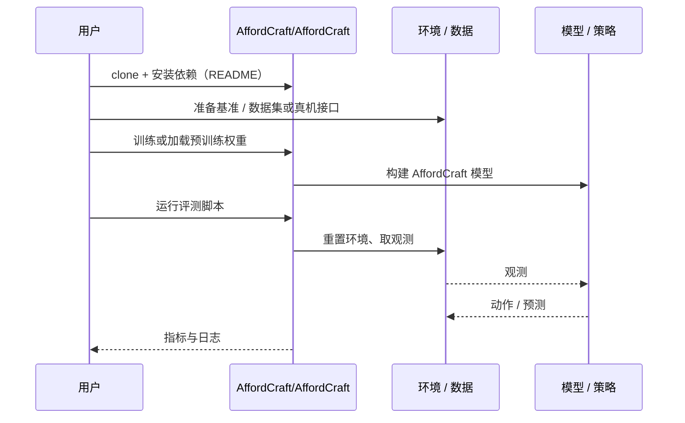

# AffordCraft（arXiv:2610.06643）

**AffordCraft**（*AffordCraft: Scalable Construction of Task-Ready Simulation Assets from Single Images*，[arXiv:2610.06643](https://arxiv.org/abs/2610.06643)，[项目页](https://affordcraft.github.io)，[代码](https://github.com/AffordCraft/AffordCraft)）来自 [具身智能小站 2026-10-13 盘点](../../sources/blogs/wechat_embodied_station_34_papers_mulligan_2026-10-13.md)，属「世界模型与仿真」组。

## 一句话定义

**根据图像与任务检索已有铰接资产并适配外观，保留部件与关节；能力依赖资产库覆盖。**

## 英文缩写速查

| 缩写 | 英文全称 | 简要说明 |
|------|----------|----------|
| Real2Sim | Real to Simulation | 真实到仿真 |
| URDF | Unified Robot Description Format | 资产/机器人描述格式 |
| Afford. | Affordance | 可操作性 |

## 为什么重要

- 从照片得到可操作仿真资产是扩展仿真训练的瓶颈。
- 开源结论：**已开源**（步骤 2.5，2026-10-14）。仓库可达。
- 同期同组工作见 [失败导向采集与可组合世界动作模型：具身智能小站 10-13 期 34 篇阅读坐标](../overview/embodied-station-2026-10-13-34-papers-technology-map.md)。

## 核心机制

| 项 | 内容 |
|----|------|
| **arXiv** | [2610.06643](https://arxiv.org/abs/2610.06643) |
| **开源** | **已开源** |
| **要点** | 大规模照片物理测试支持检索路线。 |
| **文内指标** | 以原文为准。 |

## 源码运行时序图

以下为按仓库入口（`AffordCraft/AffordCraft`）推断的通用运行链路；入库日仅核实仓库可达，未逐文件阅读，具体脚本名以 README 为准。

## 实验与评测

- 以原文为准。
- **读法：** 本页为索引级摘要，依据公众号转述的官方摘要与仓库信息整理；逐项数字与 baseline 以原文 PDF 为准。

## 与其他工作对比

- 横向索引见 [失败导向采集与可组合世界动作模型：具身智能小站 10-13 期 34 篇阅读坐标](../overview/embodied-station-2026-10-13-34-papers-technology-map.md)；同 arXiv 不重复造页。

## 结论

**资产构建的检索路线比逐物重建更可扩展，但受库覆盖限制。**

1. 开源边界：**已开源** — 仓库可达。
2. 核心机制：大规模照片物理测试支持检索路线。
3. 复现与选型前核对任务协议、硬件与基准口径，勿直接横比公众号摘录数字。

## 关联页面

- [crisp-real2sim](../methods/crisp-real2sim.md)
- [simulation-evaluation-infrastructure](../concepts/simulation-evaluation-infrastructure.md)
- [robot-simulation-three-layers](../concepts/robot-simulation-three-layers.md)
- [embodied-station-2026-10-13-34-papers-technology-map](../overview/embodied-station-2026-10-13-34-papers-technology-map.md)

## 参考来源

- [affordcraft_task_ready_simulation_assets_arxiv_2610_06643.md](../../sources/papers/affordcraft_task_ready_simulation_assets_arxiv_2610_06643.md)
- [wechat_embodied_station_34_papers_mulligan_2026-10-13.md](../../sources/blogs/wechat_embodied_station_34_papers_mulligan_2026-10-13.md)
- [arXiv:2610.06643](https://arxiv.org/abs/2610.06643)

## 推荐继续阅读

- [arXiv PDF](https://arxiv.org/pdf/2610.06643)
- [项目页](https://affordcraft.github.io)
- [https://github.com/AffordCraft/AffordCraft](https://github.com/AffordCraft/AffordCraft)
