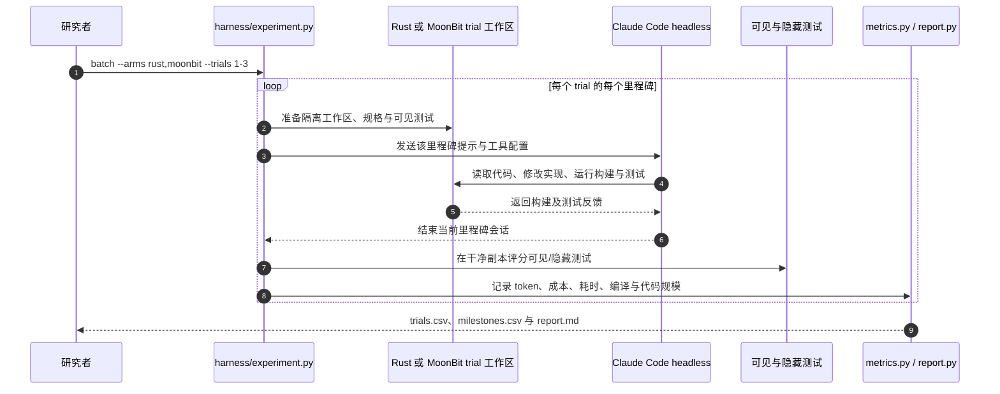

# Agent-Friendly by Design：用 SQL 引擎比较 MoonBit 与 Rust

**Agent-Friendly by Design: An Empirical Comparison of MoonBit and Rust in AI-Driven Software Construction** 是一项开源实验：让 Claude Opus 5.5 分别用 MoonBit 和 Rust 实现同一 SQLite 兼容 SQL 引擎，记录编码成本、测试质量、代码规模与编译调试表现。它比较的是特定模型、任务与 harness 下的 agent 表现，不是两种语言的普遍生产力排名。

## 一句话定义

以语言无关的规格和测试控制任务难度，再比较 AI coding agent 使用 MoonBit 与 Rust 的实际完成成本和质量。

## 英文缩写速查

| 缩写 | 英文全称 | 简要说明 |
|------|----------|----------|
| AI | Artificial Intelligence | 实验中生成并修改 SQL 引擎实现的智能体能力 |
| SQL | Structured Query Language | minisql 需要支持的查询与数据定义语言 |
| CLI | Command-Line Interface | 实验引擎通过标准输入输出交互的命令行形式 |
| API | Application Programming Interface | 报告中按模型 API 公开价目估算的成本口径 |

## 为什么重要

代码模型常因已有训练数据多少而表现不同。只比较代码行数或 token，可能把质量损失误认为效率提升；只看最终测试通过率，又可能漏掉编译错误、上下文重读与模型调用成本。该实验把这些指标放到同一任务里，并公开规格、测试、运行 harness、逐试验数据和最终实现，便于读者审查测量边界。

## 方法栈

### 对照设计

目标是一个与 SQLite 3.53 行为兼容的命令行 SQL 引擎，拆成九个里程碑：从核心解析、执行管线扩展到索引、事务、CTE、窗口函数及 SQLite 数据库文件读写。每种语言各运行 3 次，使用 Claude Opus 5.5（high effort）与 headless Claude Code；每个里程碑启动新会话，因此重新读取既有代码也是成本的一部分。

两组共享语言无关规格、提示、工具、harness、约 450 个测试、标准库限定和同一模型。测试按案例名哈希分为可见与隐藏两半；每阶段会重测此前里程碑，隐藏测试用于检查 agent 是否过拟合可见样例。期望结果由真实 SQLite 生成。两组只在语言专属 primer、构建命令和可执行文件路径上不同。MoonBit 的 primer 覆盖语法、工具链、核心 API 和常见错误，成本计入评测。

### 流程总览

## 实验与评测

下表为三次试验的均值；成本括号为跨试验标准差。

| 指标 | Rust | MoonBit | 如何解读 |
|------|-----:|--------:|----------|
| API 价目估算成本 | $43.86 ± $13.25 | $41.09 ± $3.97 | 比值均值 0.94，但比值中位数 1.12，成本差异受试验波动影响 |
| 输出 token | 867,780 | 762,261 | MoonBit 少约 12% |
| 全部可见测试首次通过前的输入 token | 21.7M | 23.6M | MoonBit 多约 9% |
| 隐藏测试通过率 | 96.3% | 95.6% | 接近，不能把更少 token 直接当作更高质量 |
| 最终源码 token | 193,931 | 171,530 | MoonBit 少约 12% |
| 编译失败率 | 5.8% | 13.0% | MoonBit 约高 2.25 倍 |
| 中位墙钟时间 | 2.19 h | 2.19 h | 相同 |

报告指出，模型在可见测试已全部通过后仍会继续加固实现，这部分占总输入 token 的 47–82%。因此最终调用成本不只由达到第一版可用实现决定。

## 源码运行时序图

官方仓库提供可运行的批次调度入口 `harness/experiment.py`。运行时以语言和 trial 建立隔离工作区，并按里程碑调用 headless Claude Code；评分和指标脚本随后统计实现与测试结果。

复现需要 Claude Code 及模型访问权限、Rust 与 MoonBit 工具链和 Python SQLite。模型调用会产生实际额度消耗；README 中的美元值按 API 价目估算，并非使用订阅时的实际扣款。

## 结论

**在这项小样本 SQL 引擎实验中，MoonBit 没有显示稳定的 agent 成本优势：源码与输出 token 更少，但编译失败更多，最终 API 估算成本与 Rust 接近。**

1. 不要把 0.94 的平均成本比解释成 MoonBit 一定更省；成本比的中位数是 1.12，且每组只有 3 次试验。
2. MoonBit 最终源码 token 少约 12%，隐藏测试通过率与 Rust 接近；这说明在该任务中代码更短没有明显牺牲整体通过率。
3. MoonBit 的编译失败率为 13.0%，高于 Rust 的 5.8%；语言新颖度和工具链反馈会转化为 agent 的调试开销。
4. MoonBit primer 被每个新会话反复读取，构成测量成本；primer 质量与长度会影响结果。
5. 做 agent 语言选型时，应同时记录首次通过时间、隐藏测试、失败构建和全程 token，而非单看生成速度或行数。
6. 结果不能外推为 Rust 与 MoonBit 的一般速度、内存安全、运行性能或人类开发者效率比较。

## 局限与风险

- **小样本：** 每种语言只有 3 次试验，且成本离散度较大；细小差异可能只是运行噪声。
- **单一模型与工具：** 结论限定于 Claude Opus 5.5、Claude Code、high effort 和本实验提示，不代表其他模型或 agent 框架。
- **单一任务：** minisql 的规格和九阶段构建不能代表 GUI、机器人控制、实时系统或其他编程任务。
- **Primer 非对称：** 两边说明同为四个部分，但 MoonBit primer 约 4–6k token，Rust 因模型已熟悉语言而更短；这反映实际熟悉度，却不能拆分语言和 primer 各自的因果贡献。
- **成本口径：** API list price 估算不能替代具体账户套餐、缓存定价和实际账单。
- **开源核查：** 仓库公开 harness、结果与实现；运行完整试验仍需模型访问。项目仓库根目录未见 LICENSE 文件，使用或再分发前应核对权利条款。

## 与其他工作对比

| 对比对象 | 主要测量 | 本实验的不同点 |
|----------|----------|----------------|
| [FrogNano](./paper-frognano-4b-coding-agent.md) | 对编码智能体做 RL 后训练，并在多个仓库级基准测试 | 本实验不训练模型，固定 agent 评估语言、primer 与任务约束 |
| [AI 智能体评测](../concepts/ai-agent-evaluation.md) | 评测设计、任务覆盖和结果解释原则 | 本项目提供可复核的特定 coding-agent 对照数据 |
| [Agentic Coding 软件工程基础](../concepts/agentic-coding-software-fundamentals.md) | 人如何给 agent 提供约束并审查工程取舍 | 本项目展示语言熟悉度、测试质量和构建反馈如何进入实际开发成本 |

## 工程实践

复用该实验思路比较其他语言或机器人软件栈时：

1. 先定义语言无关规格与可执行测试，把工具、模型、提示和任务预算固定。
2. 设置隐藏测试并防止 agent 访问，且让评分环境与开发环境隔离。
3. 每组重复运行多次，报告原始数据、均值和离散度。
4. 分开记录首次通过与持续加固成本，避免“通过以后继续改”的 token 掩盖首轮效果。
5. 同时报告编译失败率、隐藏测试、代码规模和真实部署约束；实验只在仿真/规格测试内完成时，不推断真机可靠性。

## 关联页面

- [Agentic Coding 时代的软件工程基础](../concepts/agentic-coding-software-fundamentals.md) — 约束、评测和人为判断如何转向 coding agent。
- [AI 智能体评测](../concepts/ai-agent-evaluation.md) — 设计任务、隐藏样例和解释指标的基础框架。
- [FrogNano：用在线任务合成训练 4B 编码智能体](./paper-frognano-4b-coding-agent.md) — 训练小模型编码智能体的另一种研究问题。
- [EmbodiedEvo](./paper-embodied-evo-coding-agent.md) — coding agent 在具身仿真里跨场景复用经验；任务领域与本实验不同。
- [具身大模型评测基准选型闭环知识链](../queries/embodied-eval-benchmark-selection-loop.md) — 对照：本页评的是纯软件 coding agent（编译失败率 / token / 成本），不进入具身四层评测；借鉴点仅在「固定 harness + 多次试验」的可复现性读法。

## 参考来源

- [论文摘录：Agent-Friendly by Design](../../sources/papers/agent_friendly_by_design_moonbit_rust_2026.md)
- [实验仓库归档：minisql-moonbit-vs-rust](../../sources/repos/minisql-moonbit-vs-rust.md)

## 推荐继续阅读

- [官方代码与数据仓库](https://github.com/bobzhang/minisql-moonbit-vs-rust)
- [官方结果报告](https://github.com/bobzhang/minisql-moonbit-vs-rust/blob/main/results/report.md)
- [预印本 PDF](https://github.com/bobzhang/minisql-moonbit-vs-rust/blob/main/paper/moonbit-agent-friendly.pdf)
