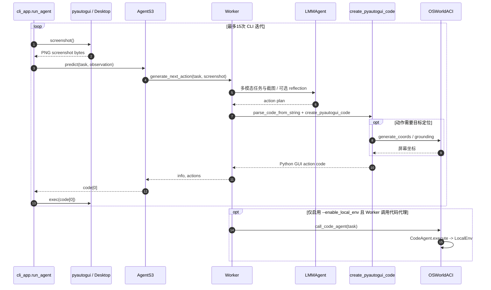

# Agent S3：Scaling Agents for Computer Use｜可扩展电脑操作智能体

**Agent S3**（Simular Research，[论文 arXiv:2510.02250](https://arxiv.org/abs/2510.02250)，[官方源码](https://github.com/simular-ai/Agent-S/tree/main/gui_agents/s3)）是一种用视觉截图决定键鼠操作的桌面 GUI 智能体；**Behavior Judge（BJudge）通过多次独立运行后的行为事实证据择优，而不是让单次 Agent S3 具有 72.6% 成功率。**

## 一句话定义

**扁平 GUI Worker 管单次“看屏幕→执行→再看屏幕”，BJudge 管多条完整执行轨迹的事后选择。**

## 英文缩写速查

| 缩写 | 英文全称 | 简要说明 |
|---|---|---|
| S3 | Agent S3 | 本项目第三代计算机使用智能体 |
| GUI | Graphical User Interface | 通过截图、鼠标和键盘访问桌面软件 |
| ACI | Agent-Computer Interface | 将模型动作描述转换成可执行桌面交互 |
| BJudge | Behavior Judge | 依据前后屏幕和行为描述从多条轨迹中选择结果 |
| BoN | Best-of-N | N 次独立执行后择优的评测模式 |
| OSWorld | OSWorld Benchmark | 面向真实桌面应用的计算机使用评测 |
| API | Application Programming Interface | 外部底座模型与 grounding 服务接口 |

## 为什么重要

- **解耦单轨执行与多轨选择：** 单轨可以保持低层次、少模型调用；当能隔离并行多次运行时，BJudge 再进行事后质量选择。
- **用可观察的动作效果评判：** 不只读模型自述或最后一帧，而看鼠标动作前后 GUI 是否真的发生期望变化。
- **工程迁移边界清晰：** 与 [AI Agent 评测](../concepts/ai-agent-evaluation.md) 一致，任务成败需要外部终态验证；这不是机器人运动控制器，也不应直接拥有不可撤销的生产权限。

## 核心原理与方法

### Agent S3：扁平 Worker 与图形界面 grounding

相较 Agent S2 的层级规划，Agent S3 把下一步动作生成集中到 `Worker`。它以自然语言任务、当前截图和有限轨迹上下文生成操作，再由 `OSWorldACI` / grounding 模型定位点击、输入、滚动等目标；可选 `Reflection` 提供回顾，可选 Code Agent 处理适合编程完成的子任务。

### Behavior Judge：多次执行后的行为证据比较

对同一个 OSWorld 任务从独立初态运行多个候选轨迹。**BehaviorNarrator** 从执行前后截图、鼠标目标和局部放大图生成可对照的事实描述；**ComparativeJudge** 在初始／最终截图及各轨迹事实描述的基础上选出更可能成功的一条。它不是逐动作投票，也不保证把所选运行自动“回放”进用户当前桌面。

## 流程总览

```mermaid
flowchart LR
  Task["自然语言桌面任务"] --> Init["独立初始化的桌面环境"]
  Init --> Roll["多条 Agent S3 候选轨迹"]
  Roll --> Worker["扁平 Worker + 可选 Reflection"]
  Worker --> Ground["OSWorldACI / UI grounding"]
  Ground --> Action["键鼠交互 / 可选 Code Agent"]
  Action --> Screen["下一帧截图与动作记录"]
  Screen --> Worker
  Screen --> Trace["完整候选轨迹"]
  Trace --> Narrator["BehaviorNarrator：动作前后事实"]
  Narrator --> Judge["ComparativeJudge：比较各轨迹"]
  Judge --> Winner["选出最可能成功的完整轨迹"]
```



**图的边界：** BJudge 属于多轨 benchmark 工作流。官方 `agent_s` 本地 CLI 启动的是**不带 BJudge 的单轨 Agent S3**；单轨流程不需要以上多次环境初始化和选择步骤。

## 源码运行时序图

核对的入口：`gui_agents/s3/cli_app.py:main/run_agent`、`agents/agent_s.py:AgentS3.predict`、`agents/worker.py:Worker.generate_next_action`、`agents/grounding.py:OSWorldACI`、`utils/common_utils.py:create_pyautogui_code`，以及可选的 `agents/code_agent.py` / `utils/local_env.py`。以下为 **README 的实际单轨 CLI 推理链**，不把未内建在该 CLI 中的多轨编排画进去。



`cli_app.py` 默认循环上限是 **15**；论文 OSWorld 指标是在 **100-step 设置**下报告，两者不能混为一谈。

## 实验与评测

| 测试 / 配置 | 成功率 | 解释 |
|---|---:|---|
| OSWorld，Agent S3 + GPT-5 单轨（论文 v2 Table 1） | 62.6% | 多次实验的单轨平均 |
| OSWorld，GPT-5 的 10 条轨迹 + BJudge | 69.9% | 多轨择优 |
| OSWorld，GPT-5 与 Claude Opus 4.5 各 5 条 + BJudge | **72.6%** | 论文最优设置，超过所引人类基线 |
| OSWorld 人类基线 | 72.36% | **基准平均**，不是每个人类任务都逊于 AI |
| WindowsAgentArena，1 条 → 3 条择优 | 50.2% → 56.6% | 独立测试基准 |
| AndroidWorld，1 条 → 3 条择优 | 68.1% → 71.6% | Android 使用边界不同 |

**结果口径冲突说明：** 官方 S3 README 将 OSWorld 单轨 100-step 报为 **66%**，但论文修订版 Table 1 的 GPT-5 单轨十次均值是 **62.6%**；保留各自来源与统计方式，不将二者视为同一个数或推测差异原因。

## 结论

**BJudge 的 72.6% 是有成本、有多轨隔离条件的 benchmark 结果；Agent S3 最值得复用的是简化 GUI 执行器及“用行为证据判断任务是否完成”的评测思想。**

1. 优先从单轨 CLI 试验开始，明确它**不提供**论文的 BJudge 10 轨完整复现。
2. 要复现 72.6% 必须保证候选环境可重置、互相隔离，并配置多个底座模型、grounding 与结果评判。
3. 评估时区分 **single-run**、**best-of-N**、不同 step budget，不用单一成功率宣传“全面超越人类”。
4. 把截图事实、任务终态及轨迹保存为可审计评测证据；对外部副作用任务加人工验收。
5. 在独立受控环境运行可选 Code Agent，避免将任意生成代码直接作用于个人工作机。

## 与其他工作对比

| 对照 | 差异 |
|---|---|
| Agent S2（同系列） | 具有层级管理／执行设计；S3 转向扁平 Worker 缩短单轨调用链 |
| Agent S3 单轨 | 直接决定下一 GUI 动作；成本与时延较低，无法把单轨成绩当 BJudge 成绩 |
| Agent S3 + BJudge | 额外启动 N 次独立任务与事实／比较判断，提升 best-of-N，但增加环境和模型费用 |
| [OpenClaw](./openclaw.md)、[Hermes Agent](./hermes-agent.md) | 更侧重通用助手、技能与工具运行时；Agent S3 研究截图驱动 computer use 与轨迹择优 |

## 工程实践

- **安装：** `pip install gui-agents` 或 clone 官方仓库后 `pip install -e .`；官方前提为单显示器及支持的 Windows、macOS、Linux 系统。
- **模型依赖：** 除主模型 API，还需提供兼容的 grounding 端点，README 推荐 `UI-TARS-1.5-7B`；不能把安装 Python 包等同于可直接离线运行完整系统。
- **启动示例：**

```bash
agent_s --provider openai --model gpt-5-2025-08-07 \
  --ground_provider huggingface --ground_url http://localhost:8080 \
  --ground_model ui-tars-1.5-7b \
  --grounding_width 1920 --grounding_height 1080
```

- **最小实验：** 在沙箱账户执行可撤销的桌面文件分类等任务，先录屏并核对终态，再尝试更长流程。
- **开放状态：** 核心 CLI、S3 Worker、grounding、Code Agent 和 BJudge 的叙述／比较模块均在 Apache-2.0 仓库中；官方 CLI 并未把 benchmark 的多实例协调和隔离自动封装为一条本地命令。

## 局限与风险

- **72.6% 并非单轨成绩**；官方推荐模型和 grounding 可能需要付费推理，源码免费不等于零运营成本。
- **平台声明不是普适保证**：多屏幕、不同分辨率、系统权限弹窗、复杂应用状态可能造成失败。
- **不可逆操作**：邮件发送、订单、删改文件、云端共享状态不一定能靠重置虚拟机撤销，不宜无监督运行多轨择优。
- **任意代码执行风险**：`cli_app.py` 会对生成的 GUI Python 动作执行 `exec(code[0])`；`--enable_local_env` 进一步允许 Python/Bash 在启动用户权限下执行，应最小授权、容器隔离、设置人工审批。
- **研究外推限制**：单一 benchmark 的平均超人类，不足以证明所有办公任务可靠替代人；BJudge 本身也会错误理解截图事实。
- **任务定位**：computer use agent 可服务 [AI Auto-Research](../concepts/ai-auto-research.md) 的软件操作环节，但不直接替代真实物理系统的安全执行层。

## 关联页面

- [AI Agent 评测](../concepts/ai-agent-evaluation.md) — 终态判分、跨 trial 隔离、best-of-N 指标口径
- [OpenClaw](./openclaw.md) — 个人助手与工具技能路线对照
- [Hermes Agent](./hermes-agent.md) — 常驻工具运行时与 Computer Use 执行链对照
- [AI Auto-Research](../concepts/ai-auto-research.md) — 自动化流程中执行、验证与回归评测的角色

## 参考来源

- [Agent S3 原始论文全文与评测摘录](../../sources/papers/agent_s3_arxiv_2510_02250.md)
- [Agent-S 官方源码及 S3 CLI／BJudge 核查](../../sources/repos/simular_agent_s3.md)
- [Simular Agent S3 官方项目文章](../../sources/sites/simular_agent_s3.md)

## 推荐继续阅读

- [Agent S3 论文 HTML v2（含附录）](https://arxiv.org/html/2510.02250v2)
- [官方 S3 README 与运行参数](https://github.com/simular-ai/Agent-S/blob/main/gui_agents/s3/README.md)
- [Agent S3 官方技术文章](https://www.simular.ai/articles/agent-s3)
