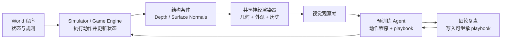
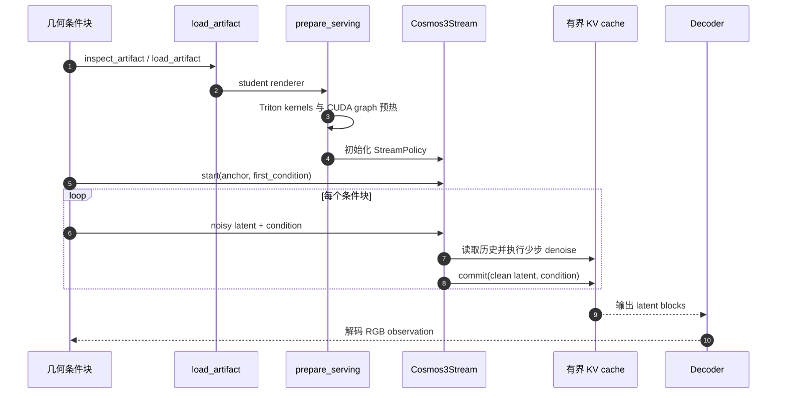

# AgentGarten（Code Worlds for Evolving Agents）

**AgentGarten**（[arXiv:2610.12374](https://arxiv.org/abs/2610.12374)，[项目页](https://mirros-lab.github.io/agent-garten/)，[代码](https://github.com/MirroS-Lab/AgentGarten)，[MirroS 博客](https://mirros.ai/blog/worlds-for-evolving-agents)）由 **MirroS、清华大学与北京大学团队**提出。它把交互世界拆为两部分：**仿真器/游戏引擎拥有可执行状态和规则；共享神经渲染器把世界导出的深度/法线与外观、历史条件转成 agent 看到的画面。**预训练智能体按轮次行动、复盘并写入文本 playbook，后续智能体继承这些经验。Hide-and-seek 展示 hider 第 4 轮用面板搭掩体、seeker 第 10 轮用坡道越墙。

## 英文缩写速查

| 缩写 | 英文全称 | 简要说明 |
|---|---|---|
| WM | World Model | 这里的渲染器只生成视觉观测；显式状态转移仍在引擎中 |
| AR | Autoregressive | 按块因果生成未来视频 latent，并通过 KV cache 延续历史 |
| RF | Rectified Flow | 视频扩散/流模型训练与采样参数化 |
| KV | Key–Value | Transformer 注意力缓存，支持流式生成 |
| RL | Reinforcement Learning | 对照工作使用 PPO 自博弈训练策略 |

## 为什么重要

- **把状态保真与视觉逼真分开处理。** 可执行引擎维护任务状态与规则，神经视频模型仅承担观察生成；视觉上更丰富的场景不必让生成模型同时隐式记忆所有动力学。
- **统一不同的世界外观。** 各 world 只需向共同接口导出结构化几何条件，多个仿真器/游戏引擎可复用同一个神经 renderer。
- **把语言经验接到交互循环。** playbook 是显式、可检查、可传承的策略经验载体；实验演示预训练 agent 能将关于遮挡、搬运和坡道的先验落到视觉闭环动作中。

## 核心架构

### 世界状态和视觉观察

世界程序在 simulator/game engine 里持续维护实体状态，接收 agent 的短 Python 动作程序并执行交互规则。引擎把场景的深度或表面法线等结构条件导出；共享 renderer 再结合首帧/外观参考、文本上下文与视频历史生成新观察。agent 根据渲染帧选择下一步动作。

这个分工意味着 **renderer 不负责游戏规则或物理状态更新**。状态仍由代码和仿真器决定，但生成的像素仍可能对接触、身份或外观呈现不一致；agent 因此会被画面误导。显式状态保证引擎内部一致，不自动保证画面 faithful。

### 渲染器训练：Cosmos3-Nano → streaming student

1. **双向 rectified flow：** 给定第一帧条件，对完整视频 clip 做几何条件生成训练。
2. **块因果自回归：** 采用 teacher forcing 或 diffusion forcing 训练块式生成模型；推理按块读取 KV cache。
3. **Adversarial Forcing：** 将自回归模型蒸馏为少步 student。Exact replay 重放 rollout 并重新编码历史，使后续预测损失可以更新历史编码；真实数据判别器加精确 R1/R2 正则，改善视觉质量。
4. **低延迟 serving：** 手写 Triton kernel、cuBLAS 与 CUDA graph；论文还使用 tiny decoder 和固定历史缓存窗口。

### 流程总览

该图描述论文的完整概念系统。公开 GitHub 当前仅覆盖渲染器训练和推理；环境交互服务器及 playbook practice loop 仍在官方 TODO 中。

## 实验与结果

### Hide-and-seek：轮次里程碑

每种角色从空 playbook 开始。每轮进行 5 局；agent 提交短 Python 程序控制移动/交互，只获得第一人称渲染观察，不读对象坐标、引擎隐藏状态或对手的私有观察。轮后查看获准的行动记录和视觉证据，撰写技能、失败分析或下一轮测试建议，传给新的 agent。

| 任务行为 | AgentGarten 展示 | OpenAI 2019 自博弈 PPO 报告 | 读数边界 |
|---|---:|---:|---|
| Hider 搭建 shelter | 第 4 轮 | 约 2500 万 episode | 前者从预训练语义先验开始，后者从策略随机初始化进行自博弈训练 |
| Seeker 使用 ramp 越墙 | 第 10 轮 | 约 1 亿 episode | 两者任务协议、观察模态、角色安排、训练算法和计数单位不同 |

这里的“4 轮”不是 4 个环境动作：hide-and-seek 的一轮包含 5 局，并附有轮后复盘与 playbook 传递。OpenAI 数字来自另一套实验的训练 episode 数。论文用它们作定性历史参照，不构成同设定的控制变量样本效率对比，也不表示 agent 从零学会了物理规律。

论文还展示 companion dog、one-lane bridge、sheep herding、quarry loader 四个环境，每个各有四轮示例。指标随任务变化，实验属于多世界演示；现有报告不提供足以估计普遍泛化性的多种子统计。

### H100 renderer throughput

论文 §4.3 报告 480×832 输出在 **单张 NVIDIA H100 上 36.5 FPS**。测量为稳态、缓存已满的 16 帧块：条件编码 10.6 ms，Transformer 四步去噪及 cache 发布 414.4 ms，tiny decoder 与 host transfer 8.8 ms，总 wall time 438.8 ms。使用手写 kernels、CUDA graph 和 tiny decoder。该数字是 renderer 吞吐，不含世界动作执行、服务调度和 agent 推理耗时；首次 kernel JIT / graph capture 也需预热。

## 源码运行时序图

官方仓库可运行部分是 renderer streaming inference。README 给出 `load_artifact`、`prepare_serving`、`Cosmos3Stream.start/denoise/commit` 的入口；图中不把尚未发布的 world server 或 agent loop 画成已开源代码。

README 依赖 Python 3.11+、PyTorch 2.9+、CUDA、Cosmos3-Nano transformer 权重和 Wan 2.2 VAE；使用 `scripts/run.sh` 训练 renderer。该运行时序图只覆盖可运行的渲染器子系统。

## 工程实践与开源状态

| 组件 | 2026-10-12 状态 | 说明 |
|---|---|---|
| Renderer 训练代码 | **已开源** | 双向、块因果及 Adversarial Forcing 训练配方 |
| Renderer 推理 / checkpoint | **已开源** | `Cosmos3Stream` + 有界 KV cache；HF 有 renderer 权重 |
| 实时渲染 server / interactive frontend | **待发布** | 官方 README TODO 未勾选 |
| Code worlds 与 playbook practice loop | **待发布** | 官方 README TODO 未勾选，完整 hide-and-seek 实验尚不能仅凭公开仓直接重跑 |
| 许可证 | Apache-2.0 | 仓库 README / `pyproject.toml` 声明 |

## 局限与风险

- **跨论文数字不等于样本效率比。** 预训练 agent 的轮次复盘与随机初始化 RL 的 episode 训练，先验和数据单位不同；不能用 25M/4 或 100M/10 推导公平倍数。
- **演示规模有限。** 轮次里程碑是论文报告的特定交互序列；跨四个其他世界的展示没有证明自动构造任意 code world 或普遍持续学习。
- **画面仍是 learned observation。** 结构化深度/法线条件与显式引擎状态帮助对齐，但 renderer 可能误画几何/接触，影响只看像素的 agent 行为。
- **公开实现不完整。** 论文叙述的完整 world-runtime 与 playbook loop 尚未在仓库开放，第三方当前可复现的主要是神经渲染器训练和推理。
- **吞吐指标边界窄。** 36.5 FPS 是单 H100、固定分辨率、预热、特定块长/缓存和 decoder 下的 renderer 指标；不表示端到端控制延迟或其他硬件吞吐。

## 结论

AgentGarten 的贡献是让显式代码世界、共享神经渲染和跨轮文本经验形成一套可扩展的交互训练构想；它证明的是预训练智能体能通过少数演示轮次把物体操作先验落地为工具使用策略。

- 复用共享视觉 renderer，同时让 simulator/game engine 保持可检查的状态与规则。
- 通过轮后 playbook 传递经验，使失败复盘和局部执行技巧可以显式累积。
- Hide-and-seek 的 shelter / ramp 里程碑分别出现在 round 4 / round 10；round 包含五局及复盘，不等价于 RL episode。
- 与 OpenAI 2019 自博弈对比具有启发性，但不支持训练效率倍数或“从零习得物理”的结论。
- H100 36.5 FPS 是 renderer 稳态吞吐，完整 agent 闭环延迟尚未由该数字覆盖。
- 官方代码目前只公开 renderer 子系统，完整 code-world practice 环境仍待发布。

## 关联页面

- [生成式世界模型](../methods/generative-world-models.md) — 在同类体系中定位神经 renderer 与显式 simulator 的分工
- [Code-as-World](./paper-code-as-world.md) — MirroS 的另一项可执行世界表示研究
- [HarnessEval-W](./paper-harnesseval-w.md) — 交互式视觉世界的 agent 化评测
- [Video-as-Simulation](../concepts/video-as-simulation.md) — 生成视频作为交互观察/仿真的边界

## 参考来源

- [AgentGarten 技术报告](../../sources/papers/agentgarten_arxiv_2610_12374.md)
- [AgentGarten 项目页](../../sources/sites/agentgarten-project.md)
- [MirroS 官方博客](../../sources/blogs/mirros-agentgarten.md)
- [AgentGarten 官方仓库](../../sources/repos/agentgarten.md)

## 推荐继续阅读

- [AgentGarten 技术报告 §4–5](https://arxiv.org/html/2610.12374v1)
- [MirroS 官方项目页](https://mirros-lab.github.io/agent-garten/)
- [OpenAI: Emergent Tool Use from Multi-Agent Interaction](https://openai.com/index/emergent-tool-use/)
