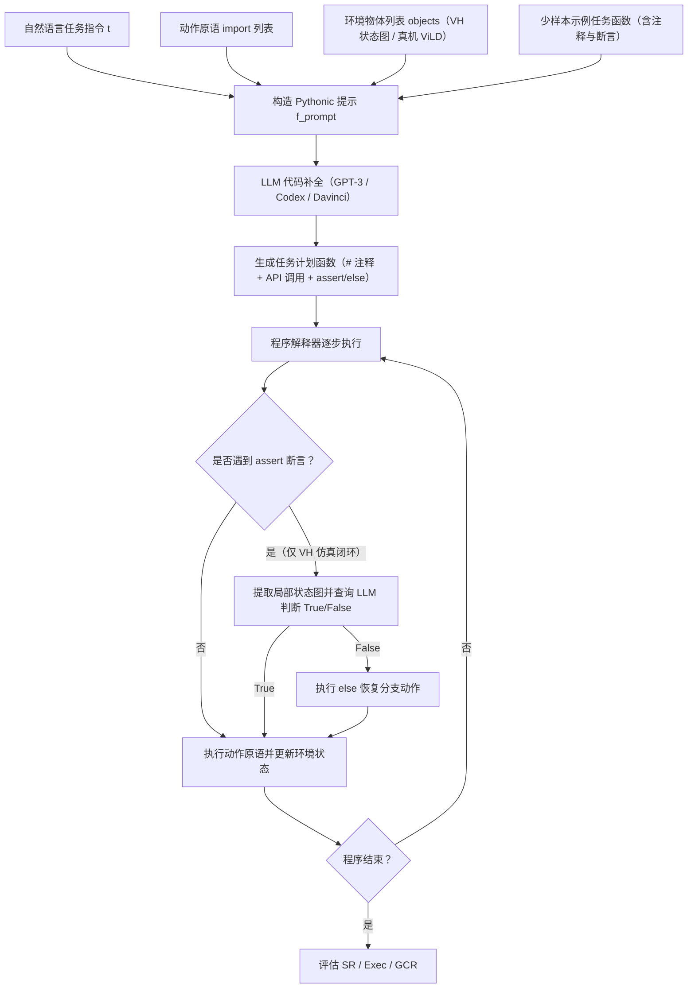

# ProgPrompt: Generating Situated Robot Task Plans using Large Language Models

## 一句话定义

ProgPrompt 是一种面向大语言模型（LLM）的程序化提示框架，通过 Python `import` 声明机器人可用动作原语、以 `objects` 列表注入环境物体，并利用代码注释与 `assert/else` 断言恢复机制生成可直接在仿真与真机上执行的具身任务计划。

## 英文缩写速查

| 缩写 | 英文全称 | 简要说明 |
|---|---|---|
| LLM | Large Language Model | 大语言模型，本文中用于生成程序化任务计划及判断状态断言真假 |
| VH | VirtualHome | 确定性家庭活动仿真平台，提供状态图观测与 11 类家庭动作原语 |
| SR | Success Rate | 任务成功率，仅当生成计划执行后满足全部任务相关目标条件时为 1 |
| Exec | Executability | 可执行率，生成的动作序列中在当前环境中语法与前置条件可执行的动作比例 |
| GCR | Goal Conditions Recall | 目标条件召回率，实际终态与真值目标状态条件集合的交集比例 |
| ViLD | Vision and Language Knowledge Distillation | 开放词汇目标检测与分割模型，用于在真机桌面场景构建可用物体列表 |

## 核心信息

| 字段 | 内容 |
|---|---|
| 论文标题 | *ProgPrompt: Generating Situated Robot Task Plans using Large Language Models* |
| 作者 | Ishika Singh, Valts Blukis, Arsalan Mousavian, Ankit Goyal, Danfei Xu, Jonathan Tremblay, Dieter Fox, Jesse Thomason, Animesh Garg |
| 机构 | University of Southern California (USC)、NVIDIA（第一作者于 NVIDIA 实习期间完成） |
| 发表时间 / 预印本 | arXiv:2209.11302v1（2022-09-22） |
| 论文链接 | [arXiv:2209.11302](https://arxiv.org/abs/2209.11302) / [PDF](https://arxiv.org/pdf/2209.11302) |
| 项目主页 | [progprompt.github.io](http://progprompt.github.io) |
| 清单分类 | `harness.skills` |
| 来源条目 | `survey_ax_2209_11302` |
| 开源 / 验证范围 | 论文给出了 VirtualHome（70 任务集）与 Franka-Emika Panda 真机实验；正文提供提示结构与实验评测，真机闭环断言恢复未在物理臂上启用 |

## 为什么重要

1. **避免自由文本规划的“幻觉动作”与“不存在物体”**：此前直接让 LLM 生成自然语言步骤（如 Huang et al., 2022）容易产生无法映射到机器人原语的描述（如 `"take out(salmon, grocery bag)"`）或引用场景中不存在的物体；ProgPrompt 用编程语言的 `import` 与变量列表天然约束输出空间。
2. **绕开组合动作空间枚举瓶颈**：相比 SayCan 需要在每一步枚举并评分所有可行动作-参数组合，ProgPrompt 直接由 LLM 自回归生成完整结构化程序，在物体数量与动作组合爆炸的家庭环境中更易扩展。
3. **显式融入情景状态反馈（Situated Awareness）**：通过 `assert(...)` 前置条件检查与 `else:` 恢复分支，使线性计划具备简单的条件分支与错误恢复能力，同时利用 Python `#` 注释触发类似思维链（Chain-of-Thought）的子任务分解。

## 核心方法

ProgPrompt 将任务规划形式化为元组 $\langle O, P, A, T, I, G, t \rangle$（物体集 $O$、物体属性 $P$、可执行动作集 $A$、转移模型 $T$、初态 $I$、目标集 $G$ 与高层自然语言指令 $t$）。核心设计分为三部分：

1. **Pythonic 提示结构构造（$f_{\text{prompt}}$）**：
   - **能力约束（Import 语句）**：以 `from actions import walk <obj>, grab <obj>, ...` 声明当前机器人具备的动作原语与参数签名；更换机器人时只需替换导入列表。
   - **环境感知（Objects 列表）**：将环境中可用物体以字符串列表 `objects = [...]` 提供给模型（VirtualHome 中为全局变量；真机桌面实验中由 ViLD 检测分割后作为每个函数内部的局部变量动态注入）。
   - **少样本示例（Example Tasks）**：提供 3 个（受长度限制的模型如 DAVINCI 为 2 个）可执行任务函数示例，展示函数名（任务名）、子任务注释、断言恢复与动作调用的对应关系。
   - **待补全函数头**：在提示末尾写入 `def <target_task>():`，由 LLM 补全函数体。
2. **计划程序的三大语法要素**：
   - **自然语言注释（`#` Comments）**：概括接下来几步的子目标（如 `# 1: grab salmon`），引导常识分解并防止模型输出发散或重复。
   - **原语 API 调用**：以合法物体名作为参数的函数调用（如 `putin('salmon', 'microwave')`）。
   - **前置断言与恢复（`assert` / `else`）**：在关键动作前断言前置条件（如 `assert('close' to 'microwave')`），若不成立则执行 `else:` 后的恢复动作（如 `else: find('microwave')`）。
3. **闭环解释执行与状态反馈**：
   - 解释器逐行执行生成程序中的动作；当遇到 `assert` 语句时，从 VirtualHome 状态图中提取相关物体的属性和关系文本，再构造 `PROMPT for State Feedback` 询问 LLM 该断言为 `True` 或 `False`，仅当返回 `False` 时触发 `else:` 恢复动作。

### 方法流程图

## 实验与评测

### 1. VirtualHome 主实验与消融（Table I）

在 VirtualHome 平台构造 70 个家庭任务数据集（3 个环境，每个环境含 115 个物体实例，动作空间 $|\mathcal{A}|=11$），在 `ENV-0` 的 10 个测试任务上各运行 5 次取均值与标准差（固定 3 个示例：`put the wine glass in the kitchen cabinet`、`throw away the lime`、`wash mug`；DAVINCI 因上下文限制仅用 2 个示例）：

| # | 方法 / 格式 | Comments | Feedback | LLM Backbone | SR | Exec | GCR |
|---|---|---|---|---|---:|---:|---:|
| 1 | **ProgPrompt** | ✓ | ✓ | **Codex** | **0.40±0.11** | **0.90±0.05** | **0.72±0.09** |
| 2 | ProgPrompt | ✓ | ✓ | DAVINCI | 0.22±0.04 | 0.60±0.04 | 0.46±0.04 |
| 3 | ProgPrompt | ✓ | ✓ | GPT3 | 0.34±0.08 | 0.84±0.01 | 0.65±0.05 |
| 4 | ProgPrompt | ✓ | ✗ | GPT3 | 0.28±0.04 | 0.82±0.01 | 0.56±0.02 |
| 5 | ProgPrompt | ✗ | ✓ | GPT3 | 0.30±0.00 | 0.65±0.01 | 0.58±0.02 |
| 6 | ProgPrompt | ✗ | ✗ | GPT3 | 0.18±0.04 | 0.68±0.01 | 0.42±0.02 |
| 7 | LangPrompt（自然语言示例 + GPT2 动作映射） | — | — | GPT3 | 0.00±0.00 | 0.36±0.00 | 0.42±0.02 |
| 8 | Baseline (Huang et al., 2022) | — | — | GPT3 | 0.00±0.00 | 0.45±0.03 | 0.21±0.03 |

关键消融发现：
- **编程语言结构与代码预训练**：`ProgPrompt (GPT3)` 在所有指标上显著优于纯自然语言基线 `LangPrompt`（SR 0.34 vs. 0.00）及 Huang et al. [2]（SR 0.34 vs. 0.00，Exec 0.84 vs. 0.45）；代码微调过的 `Codex` 进一步将 GPT3 的 SR 从 0.34 提升至 0.40、Exec 从 0.84 提升至 0.90。
- **注释（Comments）的作用**：去掉 `#` 注释后（行 3→5，行 4→6），SR 从 0.34 降至 0.30（无 Feedback 时从 0.28 降至 0.18），Exec 从 0.84 大幅降至 0.65，说明自然语言子目标注释对维持常识规划连贯性至关重要。
- **断言反馈（Feedback）的作用**：去掉 `assert/else` 恢复后（行 3→4），SR 从 0.34 降至 0.28、GCR 从 0.65 降至 0.56。

### 2. 跨任务长度与新场景泛化（Table II & Table III）

- **任务序列长度分段表现（Table II，`ENV-0`）**：
  - 短序列（$0 \le |A| \le 5$）：SR `0.20±0.40`，Exec `0.61±0.29`，GCR `0.60±0.25`
  - 中序列（$6 \le |A| \le 10$）：SR `0.60±0.50`，Exec `0.95±0.11`，GCR `0.79±0.29`（与提示示例长度相近的任务表现最佳，如 `throw away apple`、`put salmon in the fridge` 均达 SR 1.00）
  - 长序列（$11 \le |A| \le 18$）：SR `0.00±0.00`，Exec `0.87±0.14`，GCR `0.36±0.16`
- **跨新环境泛化（Table III，每个新场景 10 任务 × 5 次运行）**：
  - `ENV-0`：SR `0.34±0.08`，Exec `0.84±0.01`，GCR `0.65±0.05`
  - `ENV-1`：SR `0.56±0.08`，Exec `0.85±0.02`，GCR `0.81±0.07`
  - `ENV-2`：SR `0.56±0.05`，Exec `0.85±0.03`，GCR `0.72±0.09`
  - **三场景均值**：SR **`0.48±0.13`**，Exec **`0.85±0.02`**，GCR **`0.73±0.10`**。

### 3. 真机桌面实验（Table IV）

- **硬件与底层栈**：Franka-Emika Panda 机械臂 + 平行夹爪；感知使用 ViLD 开放词汇检测与分割映射点云；底层抓取放置采用 Contact-GraspNet + SceneCollisionNet + MPPI（使用注释，**未启用** `assert` 闭环状态反馈）。
- **测试结果**：在 4 个递进任务（含 0–4 个干扰物共 9 组试验）中，生成计划的 **`Exec = 1.0`**；前 3 个单步/双步任务（放香蕉入碗、放梨上盘、同时放香蕉和梨）在有/无干扰物下全部达成 **`SR = 1, Plan SR = 1, GCR = 100%`**；在 `"sort the fruits on the plate and the bottles in the box"` 任务中：
  - 0 干扰物：`SR = 0, Plan SR = 1, GCR = 2/3`（计划正确，因夹爪随机滑动失败）；
  - 1 干扰物：`SR = 1, Plan SR = 1, GCR = 3/3`；
  - 2 干扰物：`SR = 0, Plan SR = 0, GCR = 2/3`（模型误将汤罐 `soup can` 当作瓶子 `bottle` 放入盒子）。

## 与现有工作的对比

| 维度 | Huang et al. (2022) / LangPrompt | SayCan (2022) | Inner Monologue (2022) | ProgPrompt (本文) |
|---|---|---|---|---|
| 计划表示形式 | 自然语言句子列表 + 嵌入匹配 | 自然语言可选动作逐一打分 | 自然语言步骤 + 环境反馈 | **Python 函数代码（`import` + `objects` + `#` 注释 + `assert/else`）** |
| 动作与物体约束 | 事后 1:1 语义匹配，易生成不可行动作 | 需显式枚举当前全部可行动作-物体组合 | 仍可能引用场景中不存在的物体 | **`import` 限定原语签名，`objects` 限定当前物体集** |
| 状态反馈机制 | 开环生成完整计划后再执行 | 基于价值函数（affordance）重排 | 回合级文本描述与成功检测反馈 | **`assert/else` 前置条件检查与局部状态图查询** |
| 可扩展性 | 不依赖枚举，但可执行性低（Exec 0.36–0.45） | 组合动作空间下枚举成本高 | 依赖场景文本摘要器 | **无须枚举组合空间，且 VH 上 Exec 达 0.84–0.90** |

## 常见误区或局限

1. **真机并未实现闭环断言恢复**：由于现实场景存在感知与抓取不确定性，作者在物理机械臂实验中明确关闭了 `assert` 状态检查与闭环恢复，仅验证了开环程序化提示的可执行性（`Exec=1`）与语义分类能力。
2. **前置断言覆盖不全且缺少动作执行成功反馈**：生成计划中的 `assert` 仅覆盖部分常识条件（例如找到位于橱柜内的物体时可能漏掉先打开柜门），且系统不向代理提供动作是否执行成功的直接反馈，后续步骤可能沿错误状态继续执行。
3. **长时程任务与多等价解评测受限**：在长度为 11–18 步的任务（如 `wash the plate`、`microwave salmon`）上 SR 降至 0.00；同时单一真值终态检查会误杀合法替代方案（如把煮好的咖啡壶放到另一张桌子上）。
4. **环境静态假设与 API 截断**：VirtualHome 中的一些环境限制（如坐姿时无法操作附近物体）未显式写入提示；此外模型偶尔因 API 长度上限而截断生成程序，且对物理量（实数坐标/尺寸）与复杂控制流支持有限。

## 结论

**一句话总判：ProgPrompt 证明了“代码语法约束 + 自然语言注释 + 断言恢复分支”是比纯自然语言提示更可靠、且无需组合枚举的 LLM 机器人高层规划接口。**

1. **用 `import` 和 `objects` 约束词表而非事后匹配**：相比生成自由文本再用句子嵌入做 1:1 动作映射，直接在 prompt 中声明原语签名与场景物体能把 VirtualHome 可执行率从 0.45 提升到 0.84–0.90。
2. **保留代码中的自然语言 `#` 注释**：消融实验表明，去掉注释会使 GPT-3 的 SR 从 0.34 降至 0.30（无断言时从 0.28 降至 0.18），注释实质上起到了代码内思维链的作用。
3. **断言机制（`assert/else`）适合局部前置纠错，但不等于完整闭环监控**：它能修正未靠近或未开门等局部状态偏差，但遇到长时程状态漂移或真机执行失败时仍需外部视觉/状态监测（后续如 REFLECT、DoReMi 进一步补足了这一环）。
4. **代码预训练模型显著收益**：在同一提示结构下，Codex 的 SR（0.40）和 Exec（0.90）均高于基础 GPT-3（0.34 / 0.84），工程落地优先选用强代码能力模型。

## 关联页面

- [SayCan 论文节点](paper-saycan.md)
- [Code as Policies 论文节点](paper-pai-2209-07753-codeaspolicies.md)
- [LLM 机器人控制接口](../concepts/llm-robotics-control-interfaces.md)
- [Agentic Robots 综述](paper-towards-agentic-robots-survey.md)
- [全量项目节点清单](../overview/awesome-agentic-robots-node-index.md)
- [VLA 方法背景](../methods/vla.md)

- [智能体机器人操作策略](../methods/agentic-manipulation-policies.md)：对照操作场景中的规划、执行与反馈接口。

## 参考来源

- [官方 Awesome 快照归档](../../sources/repos/awesome-agentic-robots-survey-index.md)
- [arXiv:2209.11302v1 论文页面](https://arxiv.org/abs/2209.11302)（[PDF 原文](https://arxiv.org/pdf/2209.11302)）
- [ProgPrompt 官方项目页](http://progprompt.github.io)
