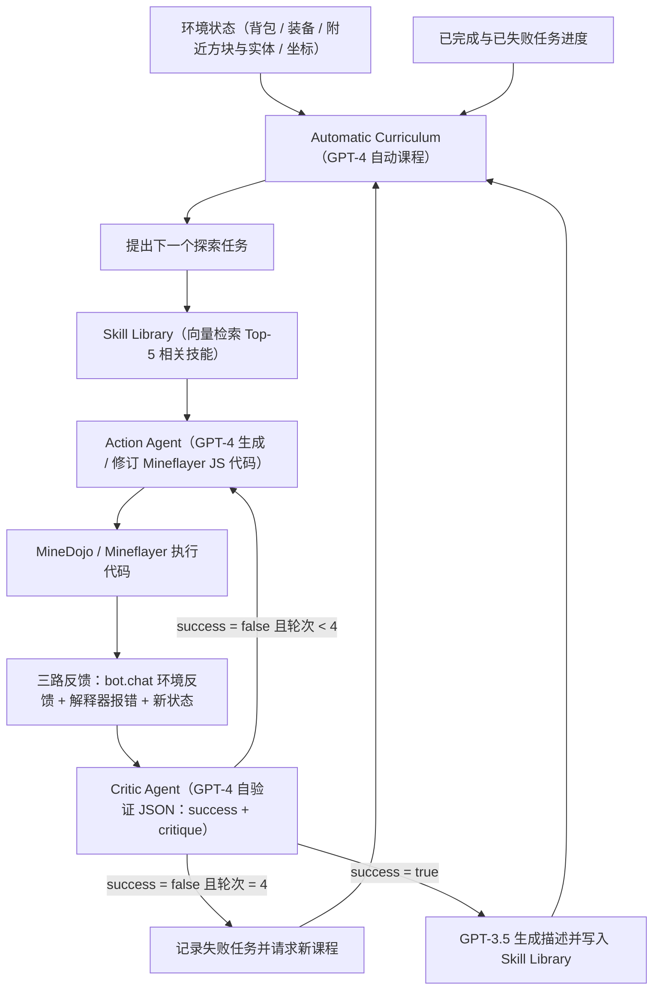

# VOYAGER: An Open-Ended Embodied Agent with Large Language Models

## 一句话定义

Voyager 是一个不依赖参数微调的具身终身学习智能体架构，在 Minecraft 中结合 GPT-4 自动课程、以描述向量索引的 JavaScript 可执行技能库，以及融合环境反馈、报错与自验证的迭代提示闭环，持续解锁科技树并实现新世界零样本泛化。

## 英文缩写速查

| 缩写 | 英文全称 | 简要说明 |
|---|---|---|
| LLM | Large Language Model | 大语言模型，本文中由 GPT-4 承担课程生成、代码合成与成功自验证，GPT-3.5 负责辅助问答与技能描述 |
| API | Application Programming Interface | 应用程序接口，本文中指 Mineflayer 控制原语及 OpenAI 文本/向量嵌入接口 |
| CoT | Chain-of-Thought | 思维链提示技术，引导模型在生成代码或课程任务前先输出推理过程 |
| RL | Reinforcement Learning | 强化学习，文中作为依赖低层动作与密集/稀疏奖励的传统对比路线 |
| VPT | Video PreTraining | 基于海量视频无监督预训练的 Minecraft 低层行为克隆基线方法 |
| NLP | Natural Language Processing | 自然语言处理，文中指出 ReAct、Reflexion、AutoGPT 等基线最初面向纯文本任务设计 |

## 核心信息

| 字段 | 内容 |
|---|---|
| 论文标题 | *VOYAGER: An Open-Ended Embodied Agent with Large Language Models* |
| 作者 | Guanzhi Wang, Yuqi Xie, Yunfan Jiang, Ajay Mandlekar, Chaowei Xiao, Yuke Zhu, Linxi "Jim" Fan, Anima Anandkumar |
| 机构 | NVIDIA、Caltech、UT Austin、Stanford、UW Madison |
| 发表时间 / 预印本 | arXiv:2305.16291v2（2023-10-19） |
| 论文链接 | [arXiv:2305.16291](https://arxiv.org/abs/2305.16291) / [PDF](https://arxiv.org/pdf/2305.16291) |
| 项目主页 | [voyager.minedojo.org](https://voyager.minedojo.org/) |
| 清单分类 | `harness.skills` |
| 来源条目 | `survey_ax_2305_16291` |
| 开源 / 验证范围 | 论文基于 MineDojo 与 Mineflayer JavaScript API 完成全自动探索、科技树解锁、消融及新世界泛化实验（另含人类反馈辅助 3D 建造展示）；未直接部署在物理机器人上 |

## 为什么重要

1. **打破具身智能体“无人类脚本即停滞”的探索瓶颈**：传统 RL/IL 与早期的 ReAct/AutoGPT 缺乏自下而上的难度递进机制，在开放世界面对庞大科技树时极易在早期或局部徘徊；Voyager 的自动课程按智能体当前状态动态提出“既新颖又可达成”的下一目标。
2. **以可执行代码作为终身记忆与可组合技能（Skill Library）**：将成功验证的 JavaScript 函数存入向量数据库（键为程序描述的嵌入向量，值为代码本身），新技能可直接调用旧技能实现能力复利，并以完全外置记忆的形式规避神经网络的灾难性遗忘。
3. **无梯度更新的纯黑盒闭环自我改进**：通过“执行反馈 + 解释器报错 + 独立 Critic 自验证”三路信号迭代改写代码（每任务最多 4 轮），证明强基础模型仅凭上下文学习（In-Context Learning）即可完成长时间尺度技能积累。

## 核心方法

Voyager 由三大核心模块协同驱动，完全通过黑盒调用 `gpt-4-0314`、`gpt-3.5-turbo-0301` 与 `text-embedding-ada-002`（温度除自动课程设 0.1 外其余均为 0）：

1. **自动课程（Automatic Curriculum）**：
   - 输入：鼓励探索多样性的系统指令、智能体当前状态（背包、装备、32 格内方块/实体、群系、时间、生命/饥饿值、坐标、已知箱子）、已完成与已失败任务列表，以及 GPT-3.5 结合 Wiki 知识库自问自答生成的补充上下文（按已完成任务数采用 Warm-up Schedule 分阶段解锁状态字段，第 0/5/7/10/15 任务逐步加入）。
   - 输出：先用 CoT 推理当前进度，再给出单个可执行、可从状态验证的具体任务（刻意避开需屏幕视觉判定的建造/种植/交易类任务）。
2. **代码动作空间与技能库（Skill Library）**：
   - 接到任务后，先用 GPT-3.5 生成求解建议并结合环境反馈作为检索查询，从向量数据库检索 **Top-5 相关技能**。
   - 动作智能体（GPT-4）基于控制原语 API（如 `exploreUntil`、`mineBlock`、`craftItem`、`smeltItem`、`placeItem`、`killMob` 等 Mineflayer 封装函数）和检索到的旧技能编写通用、可复用的异步 JavaScript 函数（以 `bot` 为唯一参数）。
   - 任务一旦被自验证模块判定成功，使用 GPT-3.5 生成程序自然语言描述，并用 `text-embedding-ada-002` 嵌入后存入技能库。
3. **迭代提示与三路反馈机制（Iterative Prompting）**：
   - **环境反馈（Environment Feedback）**：通过代码中的 `bot.chat()` 打印中间进度与缺失材料（如缺少 2 个木板）。
   - **执行报错（Execution Errors）**：捕获 JavaScript 解释器异常（如调用了不存在的物品名 `acacia_axe`）。
   - **自验证批评（Self-Verification）**：另起一个 GPT-4 Critic 智能体，根据执行后状态与任务要求输出 JSON 格式的 `reasoning`、`success`（布尔值）与 `critique`（未成功时的具体修改建议）。若 4 轮代码生成后仍未通过，则将该任务记为失败并向自动课程请求新任务。

### 方法流程图

## 实验与评测

所有主实验在 MineDojo（基于 Mineflayer 控制）中进行，每项方法运行 **3 次试验**，探索上限设为 **160 轮提示迭代**（新世界零样本测试上限设为 **50 轮**）。

### 1. 开放世界探索、科技树解锁与地图覆盖（Table 1 & 图 1/7）

| 方法 | 独有物品发现数（160 轮内） | 木质工具（迭代轮数） | 石质工具（迭代轮数） | 铁质工具（迭代轮数） | 钻石工具（迭代轮数） | 相对地图遍历距离 |
|---|---:|---|---|---|---|---|
| ReAct | 约 Voyager 的 1/3.3 以下 | N/A (0/3) | N/A (0/3) | N/A (0/3) | N/A (0/3) | 基准范围 |
| Reflexion | 低 | N/A (0/3) | N/A (0/3) | N/A (0/3) | N/A (0/3) | 基准范围 |
| AutoGPT | 较少 | 92±72 (3/3) | 94±72 (3/3) | 135±103 (3/3) | N/A (0/3) | 基准范围 |
| Voyager w/o Skill Library | 有平台期 | 7±2 (3/3) | 9±4 (3/3) | 29±11 (3/3) | N/A (0/3) | — |
| **Voyager（完整版）** | **63 种（3.3× 于对比基线）** | **6±2 (3/3)（提速 15.3×）** | **11±2 (3/3)（提速 8.5×）** | **21±7 (3/3)（提速 6.4×）** | **102 (1/3)** | **2.3× 更长距离** |

*注：文中说明提速倍数（15.3×、8.5×、6.4×）对应与 AutoGPT 基线的迭代次数对比（如 92/6 ≈ 15.3、94/11 ≈ 8.5、135/21 ≈ 6.4）。*

### 2. 新世界零样本泛化（Table 2，50 轮迭代上限，清空背包并重置新世界）

| 方法 | Diamond Pickaxe | Golden Sword | Lava Bucket | Compass |
|---|---:|---:|---:|---:|
| ReAct | N/A (0/3) | N/A (0/3) | N/A (0/3) | N/A (0/3) |
| Reflexion | N/A (0/3) | N/A (0/3) | N/A (0/3) | N/A (0/3) |
| AutoGPT | N/A (0/3) | N/A (0/3) | N/A (0/3) | N/A (0/3) |
| AutoGPT w/ Voyager Skill Library | 39 (1/3) | 30 (1/3) | N/A (0/3) | 30 (2/3) |
| Voyager w/o Skill Library | 36 (2/3) | 30±9 (3/3) | 27±9 (3/3) | 26±3 (3/3) |
| **Voyager（完整版）** | **19±3 (3/3)** | **18±7 (3/3)** | **21±5 (3/3)** | **18±2 (3/3)** |

*注：不仅 Voyager 自身凭借技能库提速显著，将 Voyager 学到的技能库作为即插即用资产提供给 AutoGPT 后，AutoGPT 也从 0/3 突破至解决 3/4 类未见任务。*

### 3. 消融实验与技能检索准确率（Fig. 9 & Table A.4）

- **自动课程消融**：替换为随机课程后，发现的独有物品数下降 **93%**；人工课程缺乏对实时状态的适应且需领域知识，同样显著落后。
- **反馈机制消融**：移除自验证模块（Self-Verification）对性能打击最大，发现的独有物品数下降 **73%**；移除环境反馈或执行报错也均明显退化。
- **基座模型对比**：代码生成将 GPT-4 替换为 GPT-3.5 后，GPT-4 获得的独有物品数是 GPT-3.5 的 **5.7×**。另在 `gpt-4-0613` 上复测与 `gpt-4-0314` 表现相近（Fig. A.4）。
- **技能检索准确率（309 样本，Table A.4）**：Top-1 `80.2±3.0%`、Top-2 `89.3±1.8%`、Top-3 `93.2±0.7%`、Top-4 `95.2±1.8%`、Top-5 **`96.5±0.3%`**。

## 与现有工作的对比

| 维度 | VPT / DreamerV3 | DEPS / DECKARD / Plan4MC | ReAct / Reflexion / AutoGPT | Voyager (本文) |
|---|---|---|---|---|
| 训练/学习机制 | 大规模视频预训练或世界模型 RL 梯度更新 | LLM 规划 + 预定义/RL 策略 | 纯提示推理/反思（无参数更新） | **纯黑盒上下文学习 + 外置可成长技能库** |
| 动作空间 | 键盘/鼠标或离散低层动作 | 键盘/鼠标或离散动作 | 文本动作或代码（无技能库沉淀） | **Mineflayer 封装的高层 JavaScript 函数代码** |
| 任务提出机制 | 无自动课程或预定义目标 | 按配方分解固定目标 | 无系统课程或固定子目标分解 | **状态感知的 Bottom-up 自动课程** |
| 长期知识积累 | 存在灾难性遗忘或能力固定 | 无可检索组合的跨任务代码库 | 仅会话内短期上下文记忆 | **向量检索的组合式代码技能库（Top-5 检索 96.5%）** |

## 常见误区或局限

1. **依赖高成本闭源模型与强编码能力**：GPT-4 API 成本约为 GPT-3.5 的 15 倍，但消融显示用 GPT-3.5 生成代码会导致发现物品数骤降至约 1/5.7，当前方案难以直接用同期开源或小参数 LLM 替代。
2. **依赖高层文本化状态与 Mineflayer 运动原语**：论文实验时期的 GPT-4 为纯文本接口，不支持原始视觉像素感知；所有移动、寻路与采掘均封装在 Mineflayer JavaScript API 中，且环境配置了“死亡后保留背包并就近复活”以维持探索连续性，并非端到端像素控制。
3. **自动课程与代码生成的幻觉**：课程可能提出游戏中不存在的任务（如制作 `"copper sword"` 或 `"copper chestplate"`）；代码生成可能错误使用圆石作为熔炉燃料或调用不存在的原语函数。
4. **自验证并非百分百可靠，且视觉空间任务仍需人类介入**：Critic 可能漏判间接掉落物信号（如未能将蜘蛛丝 `string` 识别为击杀蜘蛛成功的标志）；对于 3D 建筑搭建（如下界传送门、房屋）等需要屏幕空间视觉评估的任务，目前仍需人类充当 Critic 或课程拆解者。

## 结论

**一句话总判：Voyager 验证了“自动课程 + 向量检索式代码技能库 + 多路执行自验证闭环”可以在不更新模型权重的前提下构建持续进化的具身智能体，但高度依赖强编码大模型与可靠的高层控制原语。**

1. **将终身学习从权重迁移转为代码库外置累积**：可执行函数天生具备时间延展性与可组合性，既避免灾难性遗忘，还能作为跨智能体资产直接提升 AutoGPT 等基线。
2. **自验证是闭环迭代中最关键的反馈信号**：去掉自验证导致探索物品数暴跌 73%，在实际代理系统设计中必须配备独立的“完成度判定 + 纠错建议”Critic 环节。
3. **自动课程必须紧贴当前状态而非随机或静态脚本**：随机课程使物品发现下降 93%，有效探索要求任务难度刚好处于智能体当前能力前沿。
4. **向真实机器人迁移的边界在于接口与安全约束**：Voyager 证明了高层技能编排范式，但在真机上需补齐视觉感知闭环（如 VLM）、硬件安全门控与物理执行器校验。

## 关联页面

- [智能体记忆与睡眠巩固](../concepts/agent-memory-and-dreaming.md)
- [编码智能体自验证闭环](../methods/coding-agent-verification-loops.md)
- [Code as Policies 论文节点](paper-pai-2209-07753-codeaspolicies.md)
- [Agentic Robots 综述](paper-towards-agentic-robots-survey.md)
- [全量项目节点清单](../overview/awesome-agentic-robots-node-index.md)
- [VLA 方法背景](../methods/vla.md)

## 参考来源

- [官方 Awesome 快照归档](../../sources/repos/awesome-agentic-robots-survey-index.md)
- [arXiv:2305.16291v2 论文页面](https://arxiv.org/abs/2305.16291)（[PDF 原文](https://arxiv.org/pdf/2305.16291)）
- [Voyager 官方项目页](https://voyager.minedojo.org/)
