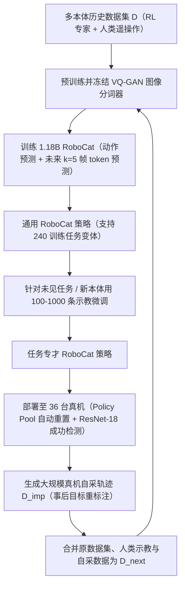

# RoboCat: A Self-Improving Generalist Agent for Robotic Manipulation

## 一句话定义

RoboCat 是一种基于视觉目标条件（Visual Goal-Conditioned）的跨本体、多任务自回归 Transformer 通用操作智能体，通过冻结 VQ-GAN 图像分词与未来帧辅助预测，实现跨 5–14 DoF 机械臂的少样本微调迁移及真机自主采数自提升闭环。

## 英文缩写速查

| 缩写 | 英文全称 | 简要说明 |
|---|---|---|
| VQ-GAN | Vector Quantized Generative Adversarial Network | 预训练并冻结的图像离散分词器，将每帧视觉观测编码为 $8\times 8$ 离散 token |
| VFM | Vision Foundation Model | 视觉基础模型（如 NFNet-f6、Swin-L 等），文中用作单任务微调对比基线 |
| DoF | Degrees of Freedom | 自由度，本文覆盖仿真/真机 5-DoF、7-DoF 平行夹爪及 14-DoF 三指灵巧手机械臂 |
| RGB-Stacking | Red-Green-Blue Objects Stacking Benchmark | Lee et al. (2021) 提出的 116 个参数化非立方体形状的堆叠基准 |
| NIST-i | NIST-inspired Gears and 3-Peg Base | 受 NIST 装配基准启发的齿轮与三轴底座任务集（真机为 1 mm 公差且底座可自由移动） |
| BC | Behavior Cloning | 行为克隆，RoboCat 底层策略学习与 VFM 基线均采用模仿学习目标 |

## 核心信息

| 字段 | 内容 |
|---|---|
| 论文标题 | *RoboCat: A Self-Improving Generalist Agent for Robotic Manipulation* |
| 作者 | Konstantinos Bousmalis*, Giulia Vezzani*, Dushyant Rao*, Coline Devin*, Alex X. Lee*, Maria Bauza*, Todor Davchev*, Yuxiang Zhou*, Agrim Gupta* 等（共 39 位作者） |
| 机构 | Google DeepMind |
| 发表期刊 / 预印本 | *Transactions on Machine Learning Research (TMLR)*（12/2023）；arXiv:2306.11706v2（2023-12-22） |
| 论文链接 | [arXiv:2306.11706](https://arxiv.org/abs/2306.11706) / [OpenReview](https://openreview.net/forum?id=vsCpILiWHu) |
| 清单分类 | `model.adaptation` |
| 来源条目 | `survey_ax_2306_11706` |
| 开源 / 验证范围 | 论文基于自研物理环境（36 台真机：15 Panda + 17 Sawyer + 4 KUKA）与 MuJoCo/MoMa 仿真完成大规模评测；当前公开入口为论文与 OpenReview，未核见完整通用权重/代码开源 |

## 为什么重要

1. **打破“单任务单模型”与“同构动作空间”假设**：此前通用机器人模型（如 RT-1）多限定在单一或同动作空间本体上；RoboCat 原生兼容不同观测维度、不同控制频率（10 Hz / 20 Hz）及不同自由度（5-DoF 约束 Sawyer、7-DoF Panda、未见过的 14-DoF KUKA + 三指手）。
2. **用视觉目标与事后重标注（Hindsight Goal Relabeling）释放失败与次优数据价值**：以任务终态图像而非固定语言模板定义任务，使得任何轨迹的末帧都可自动作为合法目标图像，且自采失败/次优数据也能无人工监督地回流训练。
3. **验证了机器人基础模型的“自提升飞轮（Self-Improvement Loop）”**：微调后的专才策略在真机上借助 Reward Model 成功率检测器与 Policy Pool 自动重置机制，自主采集数万条新轨迹并回灌重训下一代通用模型，实现跨任务正迁移与更高效的下游适应。

## 核心方法

RoboCat 将策略建模为基于视觉目标条件的自回归序列模型 $\pi(a_t \mid o_t, g_t) = P_\theta(a_t \mid x_{<t}, I_{<t}, g_{<t})$，主体采用 **1.18B 参数（24 层、隐层维度 2048、FFN 8196）的 Decoder-only Transformer**（基于 Gato 架构，另含 364M 与 62M 消融版本），上下文固定为 1024 token（约对应 3 个时间步历史）：

1. **跨本体统一词元化与训练目标**：
   - **本体感知与动作**：沿用 Gato 方案对不同维度的本体关节状态 $x_t$ 和归一化动作 $a_t \in [-1, 1]$ 进行顺序编码，不强制对齐各机械臂的动作/观测维度。
   - **视觉词元化**：采用在 ImageNet、DMControl、Meta-World 与操作图像上预训练并**冻结**的 VQ-GAN 编码器（词表 4096，64 维离散量化），将两路前置角相机图像与目标图像（$128\times 128\times 3$）分别编码为 $8\times 8$ 网格 token（目标图像采用一半事后目标 $I^i_{T+1}$ + 一半同任务语义等价成功目标 $I^j_{T+1}$）。
   - **双预测训练损失**：除预测动作 token 外，额外引入**未来 $k=5$ 步图像 VQ-GAN token 预测辅助损失**（克服 20 Hz 控制下相邻帧高度冗余问题，大幅提升泛化性）。
2. **少样本微调与真机自提升闭环**：
   - **少样本微调**：针对未见任务或新本体收集 **100–1000 条**人类遥操作成功示教，仅在成功轨迹上以 $10^{-5}$ 学习率微调最多 50,000 步。
   - **真机自主采数基础设施**：
     - *视觉成功率检测器*：基于三路视角 ResNet-18 训练每步二分类奖励模型（约 90% 准确率），用于筛选语义等价目标及判定重置时机（最终论文汇报成绩由人工逐条视频核验）。
     - *策略池自动重置（Policy Pools）*：利用互逆任务的起止状态重叠（如插入与拔出、抓取与放置）交替调度执行（无状态池 / 基于奖励模型的状态条件池），大幅减少人工重置。
   - **数据回灌重训**：将微调策略自主采集的数据 $D_{\text{imp}}^y$ 与原数据集及示教合并为 $D_{\text{next}} = D \cup \bigcup_y (D_{\text{demo}}^y \cup D_{\text{imp}}^y)$，重新训练 VQ-GAN 与下一代 RoboCat 通用模型。

### 方法流程图

## 实验与评测

全量实验覆盖 **253 个任务变体**（240 个训练任务 + 13 个最终微调任务；另有 22 个受限模型 `RoboCat-lim` 泛化评测任务与 9 个自提升任务），横跨 2 个仿真本体与 3 个真机本体（共 123 个仿真物体、134 个真实物体），每项评估均在 **100 个随机初态与目标图像回合**上统计人工核验成功率。

### 1. 主模型在训练任务与少样本微调任务上的表现（Table 1 & Table 15）

| 阶段 | 环境 / 本体 | 任务族 & 物体集 | 评测变体数 | 平均成功率（微调为 500 / 1000 条示教） |
|---|---|---|---:|---:|
| 训练（含自提升） | Sim Sawyer 7-DoF | Stacking (RGB / NIST-i) | 28 & 5 | 82% |
| 训练 | Sim Panda 7-DoF | Stacking / Tower / Pyramid (RGB & NIST-i) | 30&6 / 8&3 / 30 | 80% / 60% / 65% |
| 训练 | Sim Panda 7-DoF | Lifting / Insertion-peg (NIST-i) | 3 / 3 | 88% / 75% |
| 训练 | Real Sawyer 5-DoF | RGB Stacking (R-on-B / B-on-G) | 5 / 1 | 80% / 45% |
| 训练（自提升） | Real Sawyer 5-DoF | RGB Tower / Inverted Pyramid / Vegetable Lifting | 1 / 1 / 4 | 23% / 17% / 54% |
| 训练（含自提升） | Real Panda 7-DoF | Fruit Lifting / NIST-i Lifting / Insertion-peg / Removal-peg | 4 / 3 / 3 / 3 | 54% / 94% / 77% / 97% |
| **微调（未见任务）** | **Real Panda 7-DoF** | **Fruit Insertion-bowl / Removal-bowl (YCB)** | **3 / 3** | **84% / 84%** 与 **64% / 72%** |
| **微调（未见物体）** | **Real Panda 7-DoF** | **Shape-matching Insertion-base / Removal-base** | **3 / 3** | **6% / 13%** 与 **70% / 82%** |
| **微调（未见本体）** | **Real KUKA 14-DoF** | **NIST-i Gear Lifting（三指灵巧手）** | **1** | **56% (500) / 86% (1000)** |

*注：Shape-matching 插入任务因需高难度三维朝向调整且底座可移动，成功率较低（13%）；而在未曾见过的 14-DoF KUKA + 三指手本体上，1000 条示教即可达到 86%（逼近人类遥操作水平 88.4%）。*

### 2. 对比基准与基线（Table 2, Fig. 5–6, Fig. 7–10）

- **Real Sawyer RGB-Stacking 基准（Table 2，5 个测试三元组 T1–T5 均值）**：
  - `RoboCat`: **80%**（T1–T5 分别为 87%, 70%, 82%, 93%, 68%）
  - `BC-IMP`（单任务专家）: 79%（75%, 61%, 74%, 95%, 88%）
  - `Gato`（通用智能体）: 78%（58%, 59%, 81%, 96%, 96%）
- **对比 59 个单任务视觉基础模型（VFM）基线（最佳为 CLIP 预训练 NFNet-f6 438M 与 Swin-L 197M）**：
  - 在 1000 条示教的新任务微调（水果放碗、水果取碗、KUKA 齿轮抓取）上，NFNet 与 Swin 表现极差，而 RoboCat（即使仅用 500 条示教）显著胜出（Fig. 6）。
- **受限模型 `RoboCat-lim` 泛化与适应（Fig. 7 & Table 3）**：
  - 在真机未见过的蓝叠绿任务（`blue-on-green`）上，0-shot 为 0%，微调 **500 条**人类示教达 **88%**（同数据下 Gato 仅 **60%**），微调 100 条示教亦达 **82%**（人类数据）/ **63%**（专家数据）。
- **自提升闭环有效性（Fig. 10 & Fig. 11 & Table 20）**：
  - 在 364M 模型对照实验（4 个新任务各 500 条示教）中，额外加入微调策略自采数据的“自提升模型”在全部 4 个任务上均优于仅把 500 条示教直接混入通用训练的基线（Fig. 10）。
  - 规模化自提升后，1.18B 全量 RoboCat 在训练任务与新任务微调上均优于 `RoboCat-lim`（正迁移，Fig. 9）；在真实 NIST-i 插入任务上，从 364M 升级到 1.18B RoboCat 使固定底座与移动底座的错误率分别下降 **2.77×**（0.36→0.13）和 **2.70×**（0.62→0.23）（Table 20）。
- **关键消融（Appendix D.3 & G.2 & G.4.4）**：
  - VQ-GAN 分词器在未见测试任务上显著优于 Gato 使用的 Patch ResNet；预测未来 $k=5$ 步 VQ-GAN token 相比 $k=0$ 带来 **50% 相对泛化提升**，而直接预测像素（MSE）在测试集上完全忽略目标（0% 成功率）。
  - 扩大 VQ-GAN 词表尺寸反而单调降低未见任务泛化性（4096 优于更大词表）。
  - 模型容量从 364M 增至 1.18B 在仿真结构搭建任务上带来 **6%–21%** 成功率提升。

## 与现有工作的对比

| 维度 | Gato (2022) | RT-1 (2022) / PaLM-E (2023) | 单任务 VFM 微调（NFNet / Swin） | RoboCat (本文) |
|---|---|---|---|---|
| 核心范式 | 跨领域通用序列模型（Atari/文本/单臂） | 语言条件多任务策略或 VQA 高层规划 | ImageNet/CLIP 视觉编码器 + MLP 策略头 | **视觉目标条件跨本体操作通用智能体 + 自提升闭环** |
| 本体兼容性 | 仅少量单臂操作数据 | 同构动作空间或依赖预训练底层技能 | 单任务独立训练 | **原生兼容 5/7/14-DoF 异构机械臂与不同手爪** |
| 视觉表征与辅助目标 | Patch ResNet，仅预测动作 | 语言条件端到端动作预测 | 冻结或微调视觉骨干 + BC MSE 损失 | **冻结 VQ-GAN + 动作与未来 $k=5$ 帧 token 联合预测** |
| 新技能/新本体扩展 | 跨任务正迁移有限（蓝叠绿 500 示教 60%） | 需大规模同分布新数据 | 500–1000 条示教下难以学成复杂操作 | **100–1000 条示教快速微调，且自采数据可回灌进化** |

## 常见误区或局限

1. **并非完全“无人值守”的在线强化学习**：论文特别澄清，RoboCat 的自提升过程**不是**在物理交互时实时更新参数——真机采数由人工启停并使用冻结策略，模型重训是完全离线的有监督行为克隆（BC）过程，缺乏利用奖励信号进行的在线试错优化。
2. **仅使用视觉目标与实验室标准笼箱环境**：所有实验均在高度受控的 `25 cm × 25 cm` 标准黑色/固定纹理工作篮中完成，背景变化极小；同时完全依赖终态目标图像指定任务，不支持自然语言指令，因此无法直接表达“过程约束”（如绕过障碍或特定轨迹顺序）。
3. **精细三维重定向与接触密集装配仍是短板**：未启用腕部相机（仅用两路前置篮筐相机，而 Table 21 显示 4 相机可让专才 BC 在 NIST-i 插入上从 13% 升至 36%），在需要反复重定向和精密几何配合的 Shape-matching 插入任务上，即使微调 1000 条示教成功率也只有 **13%**（圆形 19%、五边形 10%、正方形 11%）。
4. **评估与成功检测仍依赖人工环节**：训练好的 ResNet-18 视觉成功检测器准确率约为 **90%**，可用于触发自动化重置与数据重标注，但论文最终基准评测成功率仍需人工逐段核验视频来计数。

## 结论

**一句话总判：RoboCat 首次在真机规模上验证了“冻结离散视觉分词 + 异构跨本体序列建模 + 自主采数回灌”的机器人通用操作飞轮，证明更多样化的跨本体数据能同时提升旧任务性能与新任务少样本适应效率。**

1. **视觉词元选择与未来帧预测直接决定跨任务泛化**：相比连续像素重建或 Patch ResNet，基于多样性图像预训练的冻结 VQ-GAN 配合 $k=5$ 步未来 token 预测能有效去除高频控制帧冗余、逼近语义表示。
2. **自提升闭环的核心基础设施是“可逆策略池”与“视觉奖励模型”**：真机数据瓶颈不在推理而在环境重置与标注；利用任务间起止状态互逆构建 Policy Pool 才能让真机低人工干预地持续产数。
3. **100–1000 条示教即可完成跨自由度本体迁移**：即使面对未见过的 14-DoF 机械臂 + 三指灵巧手，通用预训练表征仍能使其在 1000 条示教内逼近人类遥操作水平（86% vs. 88.4%）。
4. **纯双视角视觉行为克隆在精密插孔场景存在上限**：对于 Shape-matching 等强接触与重定向任务，未来需引入腕部/触觉视角、力反馈或强化学习微调以突破 13% 成功率瓶颈。

## 关联页面

- [模仿学习](../methods/imitation-learning.md)
- [数据飞轮](../concepts/data-flywheel.md)
- [RT-1 论文节点](paper-rt-1.md)
- [Agentic Robots 综述](paper-towards-agentic-robots-survey.md)
- [全量项目节点清单](../overview/awesome-agentic-robots-node-index.md)
- [VLA 方法背景](../methods/vla.md)

## 参考来源

- [官方 Awesome 快照归档](../../sources/repos/awesome-agentic-robots-survey-index.md)
- [arXiv:2306.11706v2 论文页面](https://arxiv.org/abs/2306.11706)（[OpenReview 正式发表版](https://openreview.net/forum?id=vsCpILiWHu)）
