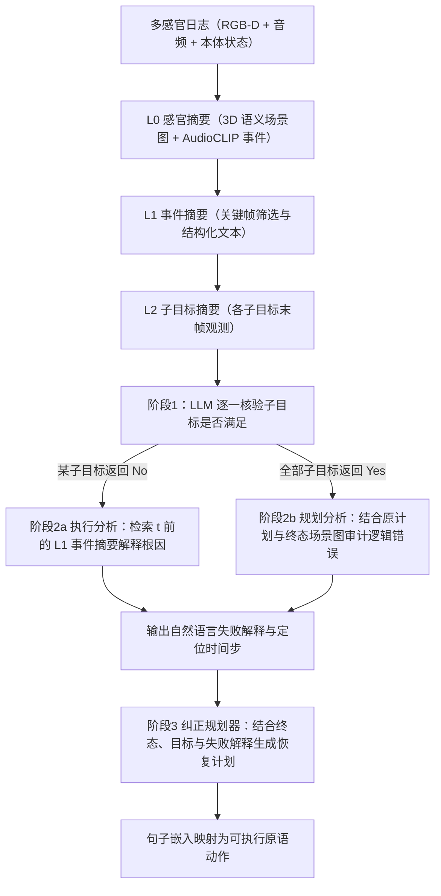

# REFLECT: Summarizing Robot Experiences for FaiLure Explanation and CorrecTion

## 一句话定义

REFLECT 是一个面向长时程机器人任务的执行后失败归因与纠正框架，通过将 RGB-D、音频与本体状态转化为“感官层—事件层—子目标层”三层文本摘要，渐进式引导 LLM 区分执行失败与规划失败并生成恢复动作序列。

## 英文缩写速查

| 缩写 | 英文全称 | 简要说明 |
|---|---|---|
| LLM | Large Language Model | 大语言模型（主实验采用 GPT-4，附录对比 GPT-3.5），负责子目标校验、根因解释与纠正规划 |
| RGB-D | Red-Green-Blue + Depth | 彩色与深度视觉观测流，用于投影构建任务相关的 3D 语义点云与空间场景图 |
| CLIP | Contrastive Language-Image Pre-training | 视觉-语言对比模型，用于零样本匹配裁剪物体的当前离散状态标签及音频事件文本标签 |
| Exp | Explanation Accuracy | 失败解释准确率，由人工评估员盲评生成的自然语言解释是否正确且具信息量 |
| Loc | Localization Accuracy | 失败定位准确率，预测失败时间戳落入人工标注失败时间区间内的比例 |
| Co-plan | Correction Planning Success Rate | 纠正规划成功率，从终态执行生成的恢复计划后最终满足任务目标条件的比例 |

## 核心信息

| 字段 | 内容 |
|---|---|
| 论文标题 | *REFLECT: Summarizing Robot Experiences for FaiLure Explanation and CorrecTion* |
| 作者 | Zeyi Liu*, Arpit Bahety*, Shuran Song |
| 机构 | Columbia University |
| 发表会议 / 预印本 | *7th Conference on Robot Learning (CoRL 2023)*；arXiv:2306.15724v4（2023-10-16） |
| 论文链接 | [arXiv:2306.15724](https://arxiv.org/abs/2306.15724) / [PDF](https://arxiv.org/pdf/2306.15724) |
| 项目主页 | [robot-reflect.github.io](https://robot-reflect.github.io/) |
| 清单分类 | `harness.monitoring_and_recovery` |
| 来源条目 | `survey_ax_2306_15724` |
| 开源 / 验证范围 | 论文构建 RoboFail 数据集（AI2THOR 10 任务 100 条仿真失败 + UR5e 11 任务 30 条真机遥操作失败）；正文中仿真可验证纠正规划执行，真机部分评估解释与定位质量 |

## 为什么重要

1. **把非结构化多模态传感器流统一成 LLM 可推理的紧凑记忆**：长时程机器人日志包含高帧率视频与音频，直接喂给通用字幕模型（如 BLIP-2）会丢失物体状态与空间接触关系（真机解释率仅 6.25%），而全部转文字又会触发上下文噪音与遗漏。
2. **用“渐进式分层检索”替代一次性全局问答**：先用子目标末帧摘要逐一做 Yes/No 成功校验，一旦失败再调取历史事件摘要深挖前置诱因（例如区分“在某步没抓到”与“更早一步掉落/冰箱没开”），若全部子目标均通过再转入全局规划逻辑审计。
3. **显式建立“失败分类学”与可复用评测基准（RoboFail）**：覆盖规划失败（45%：错误动作 21%、缺漏动作 18%、错误顺序 11%、指代歧义 5% 等）与执行失败（55%：低层执行失败 15%、环境阻挡 13%、意外动力学如掉落 11%、感知错误 6% 等，图 4 为仿真+真机分类统计），并证明先做因果解释可将纠正规划成功率从 41.9% 提升至 79.1%。

## 核心方法

REFLECT 包含三大顺序模块：

1. **三层机器人经验摘要（Hierarchical Robot Summary，§3.1）**：
   - **L0 感官输入摘要（Sensory-Input Summary）**：
     - *视觉场景图*：对 RGB-D 观测（真机用 MDETR 检测、CLIP 匹配物体状态，仿真使用真值检测与状态）投影生成 3D 语义点云，经 `ADD / UPDATE / REPLACE / DELETE` 四种启发式融合跨帧点云，再按几何阈值计算 8 种空间关系（`inside`、`on top of`、`above`、`below`、`on the left`、`on the right`、`occluding`、`near`）以及夹爪持有关系 `inside robot gripper`，仅保留任务相关及空间关联节点 $G_t = \{N \cup \{n_{\text{robot}}\}, E\}$。
     - *音频摘要*：按音量阈值 $\epsilon$ 切分音频片段，用 AudioCLIP（真机）/ 预置标签匹配 20 类音频事件（如水龙头出水、物体掉落声），弥补视觉遮挡或瞬时事件漏检。
   - **L1 事件摘要（Event-Based Summary）**：仅在满足以下任一条件时抽取关键帧转为固定格式文本：`Gt ≠ Gt-1`（场景图变化）、音频事件起止帧、或子目标结束帧。
   - **L2 子目标摘要（Subgoal-Based Summary）**：仅保存每个高层子目标执行完毕时的观测文本。
2. **渐进式失败解释（Progressive Failure Explanation，§3.2）**：
   - **阶段 1（子目标逐一核验）**：用 L2 子目标摘要询问 LLM `Is the subgoal satisfied?`。
   - **阶段 2a（执行分析 Execution Analysis）**：若某子目标返回 `No`，则检索该时间点 $t$ 之前的完整 L1 事件摘要，由 LLM 定位真正导致失败的前序时间步与根因（如“在 00:36 移动时将水壶掉落”）。
   - **阶段 2b（规划分析 Plan Analysis）**：若所有子目标均返回 `Yes` 但任务整体未达标，则输入原计划、目标状态与聚合终态场景图（去除视角相关方位边），由 LLM 识别规划逻辑错误（如“锅放在 4 号灶头却打开了 2 号灶头”）并提取最相关时间步。
3. **失败纠正规划器（Failure Correction Planner，§3.3）**：
   - 将任务名、原计划、**失败解释**、当前终态与目标状态一并提示给 LLM 生成恢复动作序列，并采用句子嵌入相似度将生成动作映射到环境可执行原语集。

### 方法流程图

## 实验与评测

基于自建 **RoboFail** 数据集（100 条 AI2THOR 仿真失败轨迹 + 30 条 UR5e 真机遥操作厨房失败轨迹），主实验使用 **GPT-4**：

### 1. AI2THOR 仿真评测结果（Table 1，%）

| 方法 / 消融 | 执行失败 Exp | 执行失败 Loc | 执行失败 Co-plan | 规划失败 Exp | 规划失败 Loc | 规划失败 Co-plan |
|---|---:|---:|---:|---:|---:|---:|
| `w/o progressive`（直接开放式问答） | 46.5 | 62.8 | 60.5 | 61.4 | 70.2 | 64.9 |
| `Subgoal only`（仅用 L2 摘要） | 76.7 | 74.4 | 51.2 | 71.9 | 73.7 | 75.4 |
| `LLM summary`（由 LLM 压缩 L0 文本） | 55.8 | 67.4 | 65.1 | 57.9 | 54.4 | 66.7 |
| `w/o explanation`（无失败解释直接重规划） | — | — | 41.9 | — | — | 56.1 |
| **REFLECT（完整版）** | **88.4** | **96.0** | **79.1** | **84.2** | **80.7** | **80.7** |

### 2. UR5e 真机评测结果（Table 2，%）

| 方法 / 消融 | 执行失败 Exp | 执行失败 Loc | 规划失败 Exp | 规划失败 Loc |
|---|---:|---:|---:|---:|
| `BLIP2 caption`（关键帧通用图像字幕） | 6.25 | 25.0 | 35.7 | 57.1 |
| `w/o sound`（去掉音频模态） | 50.0 | 68.8 | 78.6 | 78.6 |
| `w/o progressive` | 43.8 | 81.3 | 71.4 | 78.6 |
| `Subgoal only` | 56.3 | 62.5 | 71.4 | 78.6 |
| `LLM summary` | 37.5 | 75.0 | 64.3 | 71.4 |
| **REFLECT（完整版）** | **68.8** | **93.8** | **78.6** | **78.6** |

### 3. 核心消融与 LLM 能力对比（§5 & Table 5）

- **音频模态贡献**：在真机执行失败中，去掉声音（`w/o sound`）导致解释准确率与定位准确率均下降约 **20 个百分点**（Exp 68.8%→50.0%，Loc 93.8%→68.8%），因掉落撞击或遮挡下的水流/灶台声在视觉上极难捕捉。
- **结构化层级摘要 vs. 通用字幕 / LLM 摘要**：`BLIP2 caption` 丢失物体开关状态与空间关系，真机执行失败解释率仅 **6.25%**；`LLM summary` 会丢失诸如“冰箱当时处于关闭状态”等关键因果证据，真机解释率降至 **37.5%**。
- **失败解释对重规划的直接增益**：去掉失败解释（`w/o explanation`）时，模型往往盲目重复原失败计划，仿真执行失败纠正率从 **79.1%** 暴跌至 **41.9%**，规划失败纠正率从 **80.7%** 降至 **56.1%**。
- **GPT-4 vs. GPT-3.5（Appendix Table 5）**：在仿真/真机对比中（文中 Table 5 对照），GPT-3.5 执行失败 Loc 为 47.8%、Co-plan 仅 30.4%（规划失败 Loc 51.9%、Co-plan 40.7%），远低于 GPT-4（68.8% / 93.8% 与 78.6% / 78.6%），说明弱推理模型易受摘要中冗余信息干扰。

## 与现有工作的对比

| 维度 | Socratic Models (2022) / BLIP2 字幕 | Inner Monologue / Reflexion (2023) | DoReMi (2023) | REFLECT (本文) |
|---|---|---|---|---|
| 诊断时机 | 执行后开放式问答 | 单步结束或假设有真值环境反馈 | 执行过程中高频 $\Delta t$ 实时约束监测与中断 | **执行完成后（Post-execution）系统性分层回溯** |
| 感官抽象方式 | 通用图像字幕（缺空间与状态细节） | 固定场景描述器 / 文本环境返回 | LLM 生成针对性二元视觉约束问题（BLIP-2） | **RGB-D 3D 语义场景图 + CLIP 状态 + AudioCLIP 音频** |
| 失败归因机制 | 无渐进式执行/规划分流 | 无系统分层检索 | 触发即重规划，不输出结构化因果诊断 | **子目标校验 → L1 事件追溯 / 全局规划审计** |
| 纠正依据 | 无显式根因解释 | 依赖文本反思记忆 | 违规约束信息写入重规划提示 | **显式自然语言根因解释驱动纠正规划（+37.2% 提升）** |

## 常见误区或局限

1. **执行后（Post-hoc）离线分析，无法在动作途中实时止损**：与同期工作 DoReMi 不同，REFLECT 是在整段任务执行失败后才汇总感官数据做回溯归因，若机械臂在中途掉落物品仍会继续走完后续无效动作（若需实时中断，需将其与执行期监测器结合）。
2. **依赖强先验与静态环境假设**：物体状态识别（CLIP）需预先给定候选状态词表（Table 6）；空间关系依赖人工阈值（如 `<5 cm` 接触、凸包比例 `>50%`/`>70%`）；且聚合 3D 点云隐式假设“未与机器人交互的环境其余部分保持静态”。
3. **真机对感知误差敏感且难以诊断低层控制失败**：真机执行失败解释率从仿真的 88.4% 降至 68.8%，主要受 MDETR/CLIP 误识别影响（如把平底锅认成煮锅）；此外，由于摘要仅保留物体类别、状态与空间关系，无法捕捉关节力矩、滑移速度或位姿偏差等连续几何信息，对纯低层控制失效解释力较弱。
4. **重依赖 GPT-4 级强推理模型**：降级至 GPT-3.5 时，执行失败纠正规划率从 93.8% 骤降至 30.4%（Table 5），工程部署需权衡云端推理延迟与成本。

## 结论

**一句话总判：REFLECT 证明了“任务相关的多模态 3D 场景图与音频事件压缩 + 先子目标后事件的渐进式查询 + 先解释再重规划”能够显著提升长时程机器人失败的定位、归因与自我修复能力。**

1. **用结构化空间-状态摘要替代通用 VLM 图像描述**：在失败分析中，精确的物体状态与方位边远比自然语言泛泛描述有效（真机执行失败解释率 68.8% vs. BLIP-2 的 6.25%）。
2. **多感官（尤其音频）对遮挡与瞬时事件不可或缺**：加入音频检测可将真机执行失败解释与定位准确率分别拉高近 19 和 25 个百分点。
3. **先生成根因解释再做重规划是必要步骤**：不经失败解释直接重规划会让 LLM 陷入重复犯错（仿真纠正成功率仅 41.9% vs. 79.1%）。
4. **适用定位为“长时程事后复盘与高层次重规划”**：若场景存在快速动态扰动或精细力控故障，应将 REFLECT 与在线约束监测（如 DoReMi）及底层力/触觉监控互补联用。

## 关联页面

- [具身大模型评测基准选型闭环](../queries/embodied-eval-benchmark-selection-loop.md)
- [机器人视觉感知栈选型闭环](../queries/robot-perception-stack-selection-loop.md)
- [DoReMi 论文节点](paper-agentic-2307-00329.md)
- [ProgPrompt 论文节点](paper-agentic-2209-11302.md)
- [具身三层控制架构](../concepts/embodied-three-layer-control-architecture.md)
- [Agentic Robots 综述](paper-towards-agentic-robots-survey.md)
- [全量项目节点清单](../overview/awesome-agentic-robots-node-index.md)
- [VLA 方法背景](../methods/vla.md)

- [智能体机器人操作策略](../methods/agentic-manipulation-policies.md)：对照操作场景中的规划、执行与反馈接口。

## 参考来源

- [官方 Awesome 快照归档](../../sources/repos/awesome-agentic-robots-survey-index.md)
- [arXiv:2306.15724v4 论文页面](https://arxiv.org/abs/2306.15724)（[PDF 原文](https://arxiv.org/pdf/2306.15724)）
- [REFLECT 官方项目页](https://robot-reflect.github.io/)
