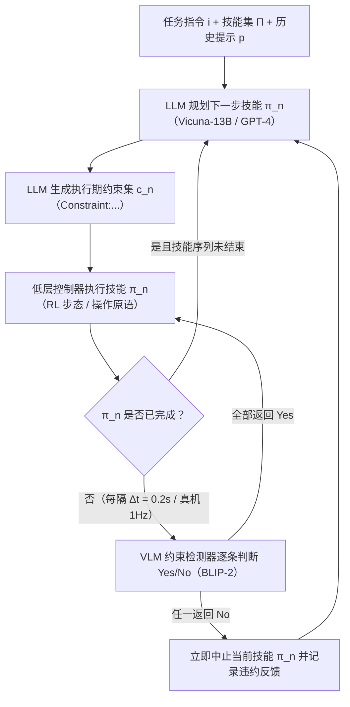

# DoReMi: Grounding Language Model by Detecting and Recovering from Plan-Execution Misalignment

## 一句话定义

DoReMi 是一种面向分层具身系统的实时计划-执行对齐框架，让 LLM 在规划下一步技能的同时生成对应的执行期约束，并由 VLM 作为高频约束检测器持续做 Yes/No 核查，实现执行偏离时的即时中止与重规划恢复。

## 英文缩写速查

| 缩写 | 英文全称 | 简要说明 |
|---|---|---|
| LLM | Large Language Model | 大语言模型（本地部署 Vicuna-13B 或 API 调用 GPT-4），承担技能规划、约束生成与重规划 |
| VLM | Vision-Language Model | 视觉-语言模型（默认 BLIP-2 Flan-T5-XL，另消融 BLIP-1 与 InstructBLIP），作为约束检测器 |
| IM | Inner Monologue | 仅在每步技能结束后接收反馈并重规划的对比基线（含实用 VLM 版与理想 Oracle 版） |
| DoReMi-FT | DoReMi Fine-Tuned | 使用 128 对图文样本通过 LoRA 微调 BLIP-2 约束检测器后的增强版本 |
| LoRA | Low-Rank Adaptation | 低秩自适应参数高效微调方法，单张 NVIDIA A100 即可完成 BLIP-2 检测器微调 |
| VQA | Visual Question Answering | 视觉问答，本文中 VLM 检测器采用极短二元 VQA 形式输出 `Yes` 或 `No` |

## 核心信息

| 字段 | 内容 |
|---|---|
| 论文标题 | *DoReMi: Grounding Language Model by Detecting and Recovering from Plan-Execution Misalignment* |
| 作者 | Yanjiang Guo*, Yen-Jen Wang*, Lihan Zha*, Jianyu Chen |
| 机构 | 清华大学交叉信息研究院（IIIS）、清华大学未央书院、上海期智研究院 |
| 发表时间 / 预印本 | arXiv:2307.00329v4（2024-09-14） |
| 论文链接 | [arXiv:2307.00329](https://arxiv.org/abs/2307.00329) / [PDF](https://arxiv.org/pdf/2307.00329) |
| 项目主页 | [sites.google.com/view/doremi-paper](https://sites.google.com/view/doremi-paper) |
| 清单分类 | `harness.monitoring_and_recovery` |
| 来源条目 | `survey_ax_2307_00329` |
| 开源 / 验证范围 | 论文在 Ravens UR5e 仿真（Table I）、20-DoF 人形机器人仿真及真机人形机器人（Table II）完成评测；项目页为 Google Sites 展示页，正文未提供公开代码仓库链接 |

## 为什么重要

1. **解决分层具身架构中的“技能执行期盲区”**：现有分层方法要么开环假设每步原语必成功（如 SayCan），要么仅在技能**结束后**再检查状态与重规划（如 Inner Monologue）。若搬运箱子途中箱子掉落或前方突发障碍，等到技能结束再发现会浪费大量时间甚至引发碰撞。
2. **用 LLM 主动提问替代 VLM 开放式场景描述**：开放式 VLM 图像描述（`"Describe the image"`）往往冗长模糊且漏掉关键失败条件；DoReMi 让 LLM 基于历史上下文生成针对当前步骤的精确约束（如 `"Is the robot holding a fish?"`），VLM 仅需回答单 token `Yes`/`No`（耗时 `< 0.1 s`），精度与延迟均大幅优化。
3. **兼顾低层高频动力学控制与高层语义纠偏**：高层规划与约束检测运行在独立频率（仿真每 $\Delta t = 0.2\text{ s}$ 检一次，真机人形机器人云端通信频率 `1 Hz`），不影响底层 RL 步态控制与操作原语的高频稳定性。

## 核心方法

DoReMi 围绕“高层规划与约束生成 + 执行期高频监测与即时恢复”两阶段闭环运行（Algorithm 1）：

1. **LLM 双角色规划与约束生成（§3.A–B）**：
   - 在每轮决策步 $n$，输入高层任务指令 $i$、技能描述集 $l_\Pi$、历史上下文与提示 $p_{n-1}$，由 LLM（本地 **Vicuna-13B** 选最大输出概率技能，或零温度 **GPT-4**）预测下一步技能 $\pi_n$。
   - 紧接着以 `"Constraint:"` 续写，利用 LLM 的物理常识为该步及延续的前置状态生成必须满足的约束集合 $c_n$（例如执行 `Move to the plate` 前约束 `"The robot is holding a fish"`；执行 `Place blue block on green block` 时保留前序约束 `"red block is on brown block"`）。
2. **VLM 执行期高频约束检测（§3.C）**：
   - 在低层技能 $\pi_n$ 执行期间，每隔 $\Delta t = 0.2\text{ s}$（真机为 `1 Hz`）采集第一/第三人称相机图像，将每条约束 $c_j \in c_n$ 转为二元问答 `"Question: Is the constraint c_j satisfied? Answer:"`，由 **BLIP-2** 判别输出 `Yes`（`True`）或 `No`（`False`）。
   - **即时中止与恢复**：一旦任一约束返回 `False`，立即**中止**当前正在执行的低层技能 $\pi_n$，将违背信息（如 `[Detector feedback: the red block is not on the brown block]`）追加写入提示 $p_n$，并立刻唤醒 LLM 重新规划恢复步骤（而非盲目重试上一步）。
3. **复杂场景下的数据高效微调（`DoReMi-FT`）**：
   - 零样本 BLIP-2 在多物体复杂桌面（如 `Prepare-food`）表现下降；作者仅采集 **5 条水果演示共 128 对图文样本**，在单张 A100 上用 **LoRA** 微调 BLIP-2 Flan-T5-XL，即可泛化至未见食物类别（垃圾食品、蔬菜、海鲜）、未见背景与未见任务。

### 方法流程图

## 实验与评测

所有定量评测以 **Vicuna-13B** 作为 LLM 规划器、**BLIP-2** 作为默认 VLM 检测器，对比 SayCan、CLIPort、Inner Monologue（IM，使用同一 VLM 作场景描述与成功检测）及 IM-Oracle（理想无误差回合末反馈）。

### 1. UR5e 机械臂操作任务（Ravens 仿真，4 种子 × 12 回合，最长时限 20 s，Table I）

| 任务与扰动设置 | SayCan SR (%) | CLIPort SR (%) | IM SR (%) | **DoReMi SR (%)** | IM-Oracle SR (%) | IM 时间 (s) | **DoReMi 时间 (s)** | IM-Oracle 时间 (s) |
|---|---:|---:|---:|---:|---:|---:|---:|---:|
| Pick & Place ($p=0.0$ / $0.2$ / $0.3$ 每秒掉落率) | 100 / 81 / 63 | 100 / 100 / 100 | 100 / 100 / 100 | **100 / 100 / 100** | 100 / 100 / 100 | 2.7 / 3.4 / 4.0 | **2.7 / 3.0 / 3.3** | 2.7 / 3.4 / 4.0 |
| Stack in order ($n=0$ / $1$ / $2$ / $3$ cm 放置噪声) | 100 / 96 / 63 / 31 | 100 / 96 / 85 / 74 | 100 / 96 / 86 / 75 | **100 / 100 / 96 / 86** | 100 / 100 / 98 / 91 | 7.2 / 8.0 / 12.2 / — | **7.2 / 7.5 / 10.2 / 15.6** | 7.2 / 7.4 / 9.8 / 14.7 |
| Stack in order ($p=0.1$, $n=0$ / $1$ / $2$ / $3$ cm) | 71 / 71 / 54 / 21 | 94 / 94 / 79 / 33 | 94 / 94 / 79 / 34 | **98 / 94 / 92 / 55** | 99 / 97 / 95 / 64 | 10.0 / 10.7 / — / — | **9.4 / 10.6 / 14.5 / —** | 9.9 / 10.9 / 15.3 / — |

*注：在存在随机掉落时，DoReMi 甚至比 IM-Oracle 用时更短（如 $p=0.3$ 时 3.3 s vs. 4.0 s），因为 IM-Oracle 必须等当前移动技能结束才能重规划。*

### 2. 20-DoF 人形机器人仿真与真机任务（DeepMimic 步态 + 抓取原语，Table II）

| 任务与扰动设置 | SayCan SR (%) | IM SR (%) | DoReMi SR (%) | **DoReMi-FT SR (%)** | IM-Oracle SR (%) | **DoReMi-FT 时间 (s)** | IM-Oracle 时间 (s) |
|---|---:|---:|---:|---:|---:|---:|---:|
| Obstacle-avoidance（障碍密度 $d=0.0$ / $0.3$ / $0.6$） | 100 / 68 / 40 | 100 / 68 / 40 | 100 / 92 / 90 | **100 / 92 / 90** | 100 / 68 / 40 | **24.2 / 31.2 / 34.3** | 24.2 / — / — |
| Move-box（掉落率 $p=0.0$ / $0.02$ / $0.04$） | 98 / 61 / 42 | 98 / 63 / 46 | 97 / 95 / 94 | **97 / 96 / 96** | 98 / 98 / 96 | **32.2 / 35.0 / 37.3** | 32.1 / 46.5 / 61.2 |
| Prepare-food（抓失败 $p_1=0.1$, 掉落 $p=0.0$ / $0.02$ / $0.04$） | 78 / 49 / 18 | 83 / 56 / 21 | 85 / 66 / 37 | **96 / 93 / 91** | 99 / 97 / 96 | **27.6 / 31.0 / 35.2** | 27.8 / 36.8 / 46.3 |
| **Prepare-food-real（真机人形）** | — | 20 | 20 | **90** | — | **195.0** | — |
| **Stack-real（真机人形，外力推倒积木）** | — | 10 | 20 | **80** | — | **240.0** | — |

### 3. VLM 微调与骨干模型消融（Appendix Table III & Table IV）

- **LoRA 微调收益（Table III）**：在 `Prepare food` 约束检测上，微调前 BLIP-2 为 `TP=78, FN=27, FP=8, TN=25`；微调后跃升至 `TP=99, FN=6, FP=1, TN=32`。
- **不同零样本 VLM 骨干对比（Table IV，最大扰动下）**：
  - `Obstacle-avoidance`：BLIP-1 `88%`、BLIP-2 `90%`、InstructBLIP `92%`
  - `Move-box`：BLIP-1 `64%`、BLIP-2 `94%`、InstructBLIP `92%`
  - `Prepare-food`：BLIP-1 `16%`、BLIP-2 `37%`、InstructBLIP `40%`（所有零样本 VLM 在复杂多物体厨房场景下均显著退化，需依赖 `DoReMi-FT` 解决）。

## 与现有工作的对比

| 维度 | SayCan (2022) | Inner Monologue (2022) | RT-2 (2023) | DoReMi (本文) |
|---|---|---|---|---|
| 系统架构 | 分层：LLM 规划 + 底层技能 | 分层：LLM 规划 + 回合末场景/成功反馈 | 端到端 VLM 直接输出离散动作 | **分层：LLM（规划+约束生成）+ VLM 独立频率监测** |
| 反馈时机与粒度 | 无执行反馈（开环） | **技能结束后**获取开放式描述与成功判定 | 闭环步级控制，但推理频率受大模型限制 | **技能执行中每 $\Delta t=0.2\text{ s}$（真机 1 Hz）精准 Yes/No 检错** |
| 面对途中突发扰动 | 失败无法恢复（如 Obstacle $d=0.6$ 仅 40%） | 无法避免途中碰障或须走完无效路程后再折返 | 需大规模动作示教数据训练 | **立即中止并重规划（Obstacle 90%；Move-box 耗时降近 40%）** |
| 数据需求 | 需可行性价值函数 | 需手工设计反馈查询 | 依赖海量动作轨迹微调 | **零样本可用；复杂场景仅需 128 对图文 LoRA 微调** |

## 常见误区或局限

1. **零样本 VLM 在复杂杂乱场景下存在明显感知瓶颈**：Table IV 与真机 `Prepare-food-real` 表明，未微调的 BLIP-2（乃至 InstructBLIP）在多食物/积木场景下准确率急剧下跌（真机成功率仅 20%），实际落地往往必须收集少量目标域图文对做 LoRA 微调（`DoReMi-FT` 可恢复至 80%–90%）。
2. **真机云端通信与 VLM 频率限制了超快动态响应**：虽然 VLM 单次 Yes/No 推理低于 0.1 s、仿真中每 0.2 s（5 Hz）检查一次，但真机人形机器人实验受限于云端 LLM/VLM 通信链路，监控频率仅为 **1 Hz**；对于毫秒级碰撞或高速摔倒恢复，仍须依赖底层控制器自身的安全保护。
3. **重规划正确性仍受限于 LLM 生成的约束质量**：若 LLM 漏掉关键前置条件或生成了含糊约束，VLM 检测器也无法发现未列出的异常；同时本框架目前未对“询问人类”或“感知不确定性校准”做统计保证（可与 KnowNo 等不确定性对齐方法互补）。

## 结论

**一句话总判：DoReMi 用极低的推理开销（单 token Yes/No VQA）填补了分层具身智能体在“低层技能执行途中”的反馈空白，在扰动环境下同时显著提升了成功率与执行效率。**

1. **让 LLM 同时输出“计划 + 约束”比让 VLM 做开放式描述更可靠**：把开放式视觉描述转化为针对性的二元约束核验，能规避描述歧义并把单次检测延迟压至 `< 0.1 s`。
2. **执行期高频中止比技能后重规划节省大量无效时间**：在 `Move-box`（$p=0.04$）中，DoReMi-FT 仅用 37.3 s 即完成搬运，而即便拥有理想回合末反馈的 IM-Oracle 也需要 61.2 s。
3. **少量域内 LoRA 微调是复杂真机场景的关键杠杆**：仅用 128 对图文样本微调 BLIP-2，即可将真机人形机器人成功率从 20%（零样本）跃升至 80%–90% 并泛化到未见物体。
4. **适合与底层高频 RL 控制器解耦部署**：在 20-DoF 人形机器人上验证了高层 1 Hz LLM/VLM 监控与底层高频步态控制协同的可行性。

## 关联页面

- [REFLECT 论文节点](paper-agentic-2306-15724.md)
- [Robots That Ask For Help (KnowNo) 论文节点](paper-agentic-2307-01928.md)
- [SayCan 论文节点](paper-saycan.md)
- [具身三层控制架构](../concepts/embodied-three-layer-control-architecture.md)
- [Agentic Robots 综述](paper-towards-agentic-robots-survey.md)
- [全量项目节点清单](../overview/awesome-agentic-robots-node-index.md)

## 参考来源

- [官方 Awesome 快照归档](../../sources/repos/awesome-agentic-robots-survey-index.md)
- [arXiv:2307.00329v4 论文页面](https://arxiv.org/abs/2307.00329)（[PDF 原文](https://arxiv.org/pdf/2307.00329)）
- [DoReMi 官方项目页](https://sites.google.com/view/doremi-paper)
